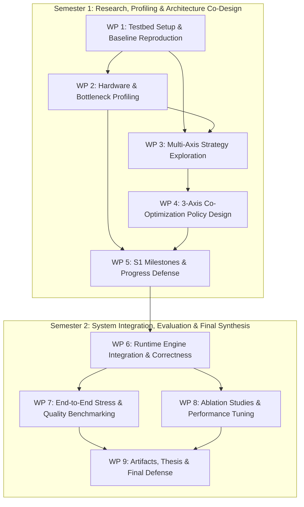

# WP-KV-BENCH: Co-optimization of KV-Cache Management for LLM Inference on Consumer GPUs

## Project Goal
> Jointly co-optimize KV-cache management across structural (compression/quantization), spatial (CPU offloading), and temporal (transfer scheduling/pipelining) dimensions to enable long-context (up to 32K) LLM inference on 8–16 GB consumer GPUs during the decode phase without offsetting transfer or compute overhead.

---

## Work Package Overview

| WP | Name | Semester / Phase | Status |
|---|---|---|---|
| 1 | Testbed Setup & Baseline Reproduction | Sem 1 / Phase 1: Environment & Baselines 🛠️ | 🔴 Not started |
| 2 | Hardware & System Bottleneck Profiling | Sem 1 / Phase 1: Environment & Baselines 🛠️ | 🔴 Not started |
| 3 | Multi-Axis Strategy Exploration & Candidate Benchmarking | Sem 1 / Phase 2: Exploration & Co-Design 🔬 | 🔴 Not started |
| 4 | 3-Axis Co-Optimization Policy Design & Prototype Architecture | Sem 1 / Phase 2: Exploration & Co-Design 🔬 | 🔴 Not started |
| 5 | Semester 1 Milestones, Sanity Checks & Progress Defense | Sem 1 / Phase 3: S1 Milestones & Defense 📋 | 🔴 Not started |
| 6 | Runtime Engine Integration & Output Correctness Verification | Sem 2 / Phase 4: Runtime Integration ⚙️ | 🔴 Not started |
| 7 | End-to-End Stress & Long-Context Quality Benchmarking | Sem 2 / Phase 5: Comprehensive Evaluation 📊 | 🔴 Not started |
| 8 | Ablation Studies & Performance Bottleneck Tuning | Sem 2 / Phase 5: Comprehensive Evaluation 📊 | 🔴 Not started |
| 9 | Reproducibility Artifacts, Thesis Documentation & Final Defense | Sem 2 / Phase 6: Synthesis & Thesis 🎓 | 🔴 Not started |

---

## Semester 1: Research, Profiling & Prototype Co-Design

### Phase 1: Environment & Baselines 🛠️

#### WP-1: Testbed Setup & Baseline Reproduction
Establish stable consumer hardware environments and reproduce baseline inference behavior to set empirical reference targets.
- Local testbed configuration (RTX 4060 8GB, 16GB RAM, standard PCIe).
- Cluster testbed configuration (Slurm HPC with 16GB VRAM allocation caps).
- Reproduction of uncompressed baseline (standard vLLM FP16/BF16).
- Reproduction of spatial offload baseline (FlexGen uniform offload).
- Reproduction of structural eviction baseline (StreamingLLM attention sink / sliding window).
- Reproduction validation checks via perplexity delta on PG-19 / WikiText-2.

#### WP-2: Hardware & System Bottleneck Profiling
Profile memory, compute, and PCIe transfer bottlenecks on consumer hardware to identify exact saturation points.
- VRAM Out-Of-Memory (OOM) ceiling mapping across context lengths (512 to 32K).
- Time-to-First-Token (TTFT) and Time-Per-Output-Token (TPOT) profiling.
- Host-to-device PCIe bandwidth and saturation measurements during decode phase.
- Baseline empirical profiling report and target benchmark curves.

---

### Phase 2: Exploration & Co-Design 🔬

#### WP-3: Multi-Axis Strategy Exploration & Candidate Benchmarking
Survey and micro-benchmark candidate algorithms from published literature across the three optimization axes to assess consumer-grade viability.
- Temporal/Structural: Evaluate candidate priority scoring and retention mechanisms (e.g., attention sinks, heavy-hitters, low-rank, clustering).
- Structural: Evaluate candidate compression codecs (e.g., FP8, INT4, HeadQ-style residuals) and profile CPU dequantization latency.
- Spatial: Evaluate offloading granularity and data movement models (e.g., value-only transfer vs. page-level offloading).
- Comparative trade-off matrix synthesizing candidates against PCIe and compute constraints.

#### WP-4: 3-Axis Co-Optimization Policy Design & Prototype Architecture
Design and implement the unified policy coordination layer that manages cache entries across multiple memory and representation tiers.
- State-machine design for KV-cache tier transitions (GPU Active $\rightarrow$ GPU Compressed $\rightarrow$ Host RAM Offload).
- Asynchronous transfer scheduling pipeline overlapping host-to-device PCIe copy with GPU decode execution.
- Prototype KV-cache manager integration and initial functional smoke tests.

---

### Phase 3: S1 Milestones & Defense 📋

#### WP-5: Semester 1 Milestones, Sanity Checks & Progress Defense
Consolidate Semester 1 experimental findings, complete institutional milestones, and present progress.
- Completion of CITI Program Ethics Exam and formal project proposal documentation.
- Onsite Senior Project Proposal Defense.
- Prototype sanity validation on the hardware testbed.
- Semester 1 Progress Report and oral presentation.

---

## Semester 2: System Integration, Evaluation & Final Synthesis

### Phase 4: Runtime Integration ⚙️

#### WP-6: Runtime Engine Integration & Output Correctness Verification
Integrate the co-optimized policy layer into a production-grade inference engine and verify output fidelity.
- Deep integration with open-source runtime engine (e.g., vLLM PagedAttention architecture).
- Numerical output correctness verification: Mean and P99 KL-divergence against uncompressed FP16.
- Top-1 token agreement and perplexity delta verification under varying context lengths.
- Memory defragmentation and multi-session allocation checks.

---

### Phase 5: Comprehensive Evaluation 📊

#### WP-7: End-to-End Stress & Long-Context Quality Benchmarking
Perform full-spectrum system and model-quality evaluation under scaled and realistic operational workloads.
- Long-context scaling benchmarks up to 32K context window.
- Multi-user concurrency simulation: 10–15 concurrent SME users with bursty conversation histories.
- Tail latency evaluation (P95/P99 TTFT and TPOT).
- Task quality evaluation using LongMemEval across 5 core conversational capabilities.
- Diagnostic positional retrieval evaluation using RULER suite for anomaly analysis.

#### WP-8: Ablation Studies & Performance Bottleneck Tuning
Isolate contributions of individual axes and optimize critical path kernels.
- Isolation of performance gains: priority scoring vs. offloading vs. compression.
- Trade-off analysis: CPU delegation overhead vs. PCIe transfer savings.
- Kernel-level optimizations and stream pipelining refinements based on profiling data.

---

### Phase 6: Synthesis & Thesis 🎓

#### WP-9: Reproducibility Artifacts, Thesis Documentation & Final Defense
Produce final scientific deliverables, open-source reproducibility artifacts, and academic documentation.
- Publication-quality visualization charts and Pareto frontier comparison curves.
- Consolidated reproducibility repository: automated benchmarking scripts, configuration manifests, and datasets.
- Final Senior Project Thesis document.
- Final slide deck, rehearsal, and Senior Project Defense presentation.

---

## Dependency Graph

