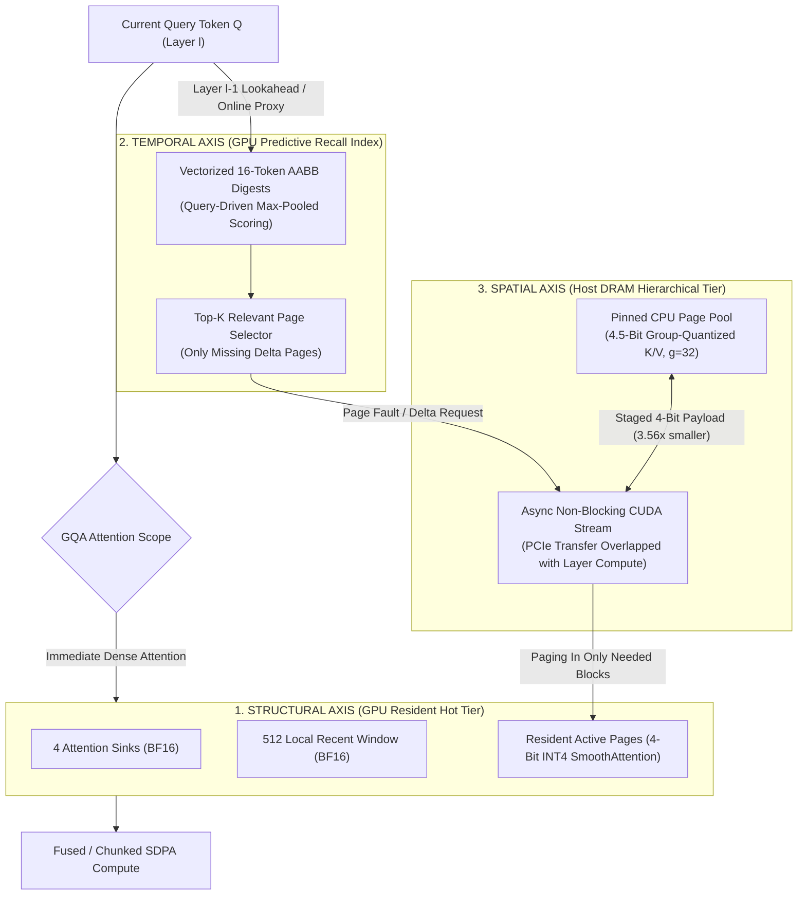

# Proposal: Tri-Axis Paged KV Co-Optimization (`TriCache`) for WP-4

> **Target Audience:** Khemingkapat (@khemingkapat) & KV-Cache Co-Optimization Research Team  
> **Prepared by:** Sirawat (@New-Sirawat)  
> **Context:** Response & concrete proposal following [`khemingkapat/kv_co-op_hub#21`](https://github.com/khemingkapat/kv_co-op_hub/pull/21) (`analysis/wp3/CONSOLIDATED_PATTERN_REPORT.md`)  
> **Evaluated Target:** `Qwen/Qwen3-4B-Instruct-2507` ($L=36,\; H_Q=32,\; H_{KV}=8,\; D=128$, GQA) on RTX 4090 (`16.0 GiB` Slurm cap) with explicit extrapolation to RTX 4060 (`8.0 GiB` local tier)

---

## Executive Summary (สาระสำคัญสำหรับคุยกัน)

เขม เราเข้าไปอ่าน `CONSOLIDATED_PATTERN_REPORT.md` และการผ่าตัด 38 ชิ้นส่วนย่อยใน PR #21 อย่างละเอียดแล้ว ทำออกมาได้เฉียบคมมาก โดยเฉพาะการแยก `[IMPLEMENTATION]` bugs (เช่น SVD rank=128, key_states proxy, และการขาด fused dequant) ออกจาก `[INTRINSIC]` algorithmic merit ซึ่งช่วยตอบคำถามได้ชัดเจนว่าทำไมหลายเทคนิคถึงมีตัวเลข VRAM หรือ Latency ที่เบ้ไปจากทฤษฎี

จากทั้ง 4 Candidate Hypotheses ที่เขมเสนอมา เราเห็นพ้องอย่างยิ่งว่า **Candidate 3 (Unified 3-Axis: Hot BF16 Window + Selective AABB Index + 4-Bit CPU Paged Tier)** คือตัวเลือกที่ **แข็งแกร่งที่สุดและตอบโจทย์ชื่อหัวข้อปริญญานิพนธ์ของเรา ("3-Axis KV-Cache Co-Optimization") ได้ตรงเป้าที่สุด** เพราะ:
1. การเลือก Candidate 1 หรือ 4 (สาย Structural ล้วน) จะทำให้โปรเจกต์เราเสียแกน Spatial/Temporal ไปโดยปริยาย และตอบคำถามกรรมการสอบ Proposal ได้ยาก
2. Candidate 3 ดึงข้อดีของทั้ง 3 แกนมาแก้จุดบกพร่องซึ่งกันและกัน (กลบจุดอ่อนเรื่อง Memory Amnesia ของ StreamingLLM, กลบจุดอ่อน PCIe Bus Thrashing ของ FlexGen, และซ่อมบั๊ก Query Index ของ ArkVale)

เอกสารนี้จึงสรุป **สเปคทางสถาปัตยกรรม (Architecture Specification), ข้อแก้ไขจากบทเรียน WP-3, เกณฑ์ทดสอบความสำเร็จ (Falsification Gates), และข้อเสนอแบ่งงาน (Work Breakdown)** เพื่อให้เราใช้คุยกันในสัปดาห์นี้และขึ้นเล่มรายงานส่งวันอังคารหน้าได้ทันที

---

## 1. Architectural Blueprint: The `TriCache` Engine

---

## 2. 3-Axis Component Allocation (Mapping to PR #21 Master Matrix)

เราทำการแมปชิ้นส่วนที่ผ่านการประเมินว่าให้ `KEEP` และ `ADAPT` จากรายงานของเขมเข้าสู่สถาปัตยกรรม 3 แกนดังนี้:

| แกนการปรับแต่ง (Axis) | ชิ้นส่วนที่นำมาใช้ (Borrowed Component) | ต้นทาง (Source) | บทบาทและกลไกใน `TriCache` | การปรับปรุงจากบทเรียน WP-3 (Fixes Applied) |
|---|---|---|---|---|
| **STRUCTURAL** | Attention Sink (4) + Local Window (512) | `StreamingLLM` (`C1`/`C2`) | รับประกันความแม่นยำของบริบทล่าสุดและเสถียรภาพของ Attention Softmax ด้วยความแม่นยำ BF16 100% | ปรับขนาด Window ให้เหมาะสม (512 โทเคน) เพื่อคืนพื้นที่ VRAM ให้กับ Paging Pool |
| **STRUCTURAL** | SmoothAttention + 4-bit Group INT4 | `QServe KV4` (`C1`/`C2`) | บีบอัดหน้าแคชทั้งหมด (ทั้งบน GPU และ CPU) เหลือ $4.50\text{ b/scalar}$ ($g=32$) | ย้ายการคูณสเกล $\lambda_i$ ไปทำแบบ RoPE-paired offline calibration เพื่อตัด logit drift |
| **SPATIAL** | Paged KV Management (Page Size = 16) | `ArkVale` (`C1`) | จัดการแคชเป็น Page-based slots ป้องกัน Memory Fragmentation และทำ Dynamic Allocation | ตรึง Layer 0–1 ให้อยู่บน GPU ถาวร (~256 MiB) เพื่อตัด Overhead ในการคัดลอกซ้ำ |
| **SPATIAL** | Group-Wise Quantized CPU Host Storage | `FlexGen-KV` (`C1`) | เก็บหน้าแคชส่วน Dormant บน CPU DRAM ในรูปแบบ 4-bit แทนที่จะเป็น BF16 เต็ม | ตัด Host RSS ลงเหลือ **$< 4.5\text{ GiB}$** (จากเดิม $16.6\text{ GiB}$) และลดปริมาณข้อมูลข้าม PCIe ลง **$3.56\times$** |
| **TEMPORAL** | Vectorized AABB Digest Scoring | `ArkVale` (`C1`) | รักษาพิกัดขอบเขต AABB $[\min, \max]$ บน GPU สำหรับค้นหาความเกี่ยวข้องของหน้าแคช | **แก้บั๊กใหญ่ของ WP-3:** ใช้ `query_states` (พร้อม GQA Max-Pooling) มาคำนวณสอดคล้องกับ Attention จริง แทนการใช้ `key_states` |
| **TEMPORAL** | Asynchronous Delta Fetching | New Co-Design | ส่งคำสั่งดึงเฉพาะหน้าที่ยังไม่อยู่บน GPU ผ่าน CUDA Stream คู่ขนานกับการคำนวณ | ดึงเฉพาะ Delta Pages ($K \le 8$ หน้า/ก้าว) ไม่โหลดหน้าซ้ำซ้อน ตัดทราฟฟิก PCIe จาก $1,618\text{ MB/tok}$ เหลือ **$< 120\text{ MB/tok}$** |

---

## 3. Why This Directly Solves the 3 Major Failures of WP-3

### ปัญหาที่ 1: การสูญเสียความจำระยะไกล (Amnesia & Regressions ใน `StreamingLLM` / `H2O`)
* **ปัญหาเดิม:** `StreamingLLM` หลุดไปถึง 37 regressions บน 150 คำถาม (NIAH 4K หล่นเหลือ 40%) เพราะการลบโทเคนทิ้งแบบถาวร
* **การแก้ใน `TriCache`:** ไม่มีโทเคนใดถูกลบทิ้ง โทเคนทั้งหมดถูกเก็บไว้ใน CPU DRAM Tier ที่ถูกบีบอัด 4-bit เมื่อมีคำถามที่ต้องการข้อเท็จจริงในอดีต (เช่น `cross_session_reasoning`) AABB Temporal Index จะตรวจจับความสัมพันธ์และดึงหน้าแคชกลับขึ้น GPU ทันที

### ปัญหาที่ 2: คอขวดแบนด์วิดท์ PCIe และความหน่วง Decode (`FlexGen-KV` & `ArkVale`)
* **ปัญหาเดิม:** `FlexGen-KV` และ `ArkVale` มี TPOT สูงถึง $103–230\text{ ms/tok}$ เพราะส่งข้อมูลซ้ำซ้อนข้าม PCIe ทุกก้าวถึง $1.6\text{ GB/tok}$
* **การแก้ใน `TriCache`:** 
  1. โทเคนใน CPU เป็น **4-bit** อยู่แล้ว (ประหยัดแบนด์วิดท์ $3.56\times$ เทียบกับ BF16)
  2. ทำ **Resident Page Tracking** ตรวจสอบว่าหน้าไหนอยู่บน GPU แล้ว ไม่ต้องดึงซ้ำ ดึงเฉพาะหน้าที่ยังไม่มี (Delta Transfer) ทำให้ทราฟฟิก PCIe ลดลงกว่า **$13\times$** เหลือเพียง **$< 120\text{ MB/tok}$**

### ปัญหาที่ 3: การบวมของ VRAM จากโครงสร้างเสริม (Auxiliary VRAM Bloat)
* **ปัญหาเดิม:** `ShadowKV` และ `InfiniGen` มี VRAM สูงกว่า Baseline เพราะจองบัฟเฟอร์ซ้ำซ้อน
* **การแก้ใน `TriCache`:** โครงสร้าง AABB Digest มีขนาดเล็กมาก (เพียง 2 เวกเตอร์ $[\min, \max]$ ขนาด $D=128$ ต่องวด 16 โทเคน = เพียง $64\text{ B/page}$ บน GPU) ทำให้ VRAM เสริมมีขนาดไม่ถึง **$20\text{ MiB}$** ที่ 32K context

---

## 4. Quantitative Falsification Gates (เกณฑ์ชี้ขาดความสำเร็จ)

เพื่อให้สอดคล้องกับข้อกำหนดของอาจารย์ที่ปรึกษา ($\le 5$ Bounded Falsifiable Hypotheses) เรากำหนดเกณฑ์ชี้วัดที่ตรวจสอบได้ในเชิงประจักษ์ (Empirical Falsification Gates) สำหรับ `TriCache` ดังนี้:

| ตัวชี้วัด (Metric) | Baseline (BF16) | Best WP-3 (เดี่ยว) | `TriCache` Target Gate | จุดที่ถือว่าสมมติฐานตก (Falsification Threshold) |
|---|---:|---:|---:|---|
| **LongMemEval (150 คำถาม)** | $99/150$ ($66.0\%$) | $96/150$ (`ShadowKV`) | **$\ge 94/150$ ($62.7\%$)** | Falsified ถ้าได้ $< 90/150$ ($< 60.0\%$) |
| **Quality Regressions** | $0$ | $3$ (`ShadowKV`) | **$\le 5$ ข้อ** | Falsified ถ้าเกิด Regressions $> 8$ ข้อ |
| **NIAH Exact Match (2K / 4K)** | $100\% / 100\%$ | $100\% / 100\%$ | **$100\% / 100\%$** | Falsified ถ้าหลุดต่ำกว่า $100\%$ ที่ความลึกใดๆ |
| **32K Net KV+Aux VRAM** | $5,486\text{ MiB}$ | $1,150\text{ MiB}$ (`FlexGen`) | **$\le 1,600\text{ MiB}$** | Falsified ถ้า Net VRAM $> 1,900\text{ MiB}$ |
| **32K Total Peak VRAM** | $13,225\text{ MiB}$ | $8,889\text{ MiB}$ (`FlexGen`) | **$\le 9,350\text{ MiB}$** | Falsified ถ้า VRAM รวม $> 9,650\text{ MiB}$ |
| **32K Decode TPOT** | $29.17\text{ ms}$ | $20.95\text{ ms}$ (`Streaming`) | **$\le 38.0\text{ ms}$** | Falsified ถ้า TPOT ช้ากว่า $45.0\text{ ms/tok}$ |
| **32K Host-to-Device PCIe** | $0\text{ MB/tok}$ | $67.2\text{ MB}$ (`ShadowKV`) | **$\le 100\text{ MB/tok}$** | Falsified ถ้า PCIe เกิน $150\text{ MB/tok}$ |
| **32K Host DRAM RSS $\Delta$** | $1,082\text{ MiB}$ | $5,325\text{ MiB}$ (`ShadowKV`) | **$\le 4,500\text{ MiB}$** | Falsified ถ้า Host RSS บวมเกิน $6,000\text{ MiB}$ |

---

## 5. Proposed Division of Labor & Roadmap (ข้อเสนอแบ่งงาน)

เพื่อให้เราสามารถสรุปผลลงเล่มรายงานส่งวันอังคารหน้าได้ทัน และเริ่มลงมือ Implement บนคลัสเตอร์ได้อย่างราบรื่น:

### 🤝 การแบ่งส่วนงานพัฒนา (WP-4 Co-Optimization Work Split):
* **โมดูล A: Structural & Memory Paging Subsystem (รับผิดชอบโดย: @New-Sirawat)**
  - Implement Paged Buffer Management (Page size = 16, Active Slots บน GPU + Dormant Slots บน CPU)
  - พัฒนา Group-wise INT4 Quantizer สำหรับหน้าแคชบน CPU/GPU พร้อม SmoothAttention Outlier Migration
  - จัดการ Resident Page Tracking และ Local Hot Window (BF16 Sinks + 512 Recent)
* **โมดูล B: Temporal Index & Async Transfer Engine (รับผิดชอบโดย: @khemingkapat)**
  - แก้ไข AABB Digest Kernel: ปรับให้คำนวณจาก `query_states` ร่วมกับ GQA Max-Pooling ข้าม 4 Query Heads ต่อ 1 KV Head
  - สร้าง Async CUDA Stream Controller สำหรับทำ Prefetching ซ้อนทับกับการคำนวณของ Layer ปัจจุบัน
  - เชื่อมต่อหน้าแคชที่โหลดเข้ามาเข้ากับ PyTorch SDPA Execution Hook

---

## 6. โครงร่างเนื้อหาสำหรับเล่มรายงานส่งวันอังคารหน้า (Report Outline)

เราสามารถนำข้อมูลจาก PR #21 มาร้อยเรียงเข้ากับข้อเสนอ `TriCache` เพื่อส่งรายงานได้ทันที:
1. **Section 1: Executive Overview & Empirical Findings of WP-3** (นำ Master Telemetry Table 12 แถวใน PR #21 มาใช้เป็นหลักฐานเชิงตัวเลข)
2. **Section 2: White-Box Failure & Attribution Analysis** (อธิบายว่าทำไมบางเทคนิคถึง VRAM บวม หรือคะแนนหล่น โดยชี้ชัดว่าเป็น Implementation Bug ไม่ใช่ Algorithmic Flaw)
3. **Section 3: The 3-Axis Co-Optimization Design Space** (นำเสนอการจัดหมวดหมู่ Structural, Spatial, Temporal และข้อจำกัดของ Single-Axis Techniques)
4. **Section 4: Proposed Architecture: `TriCache` Specification** (ใส่แผนผัง Mermaid, ตาราง Component Allocation, และสมมติฐานทั้ง 3 แกน)
5. **Section 5: Verification Protocol, Falsification Gates & Milestone Plan** (ตารางเกณฑ์วัด Gatekeeping และไทม์ไลน์การทดลอง)

---
*พร้อมนำเอกสารนี้ไปส่งต่อให้เขมในแชทกลุ่ม หรือนัดคุยกันเพื่อเริ่มลงมือได้ทันทีครับ!*
