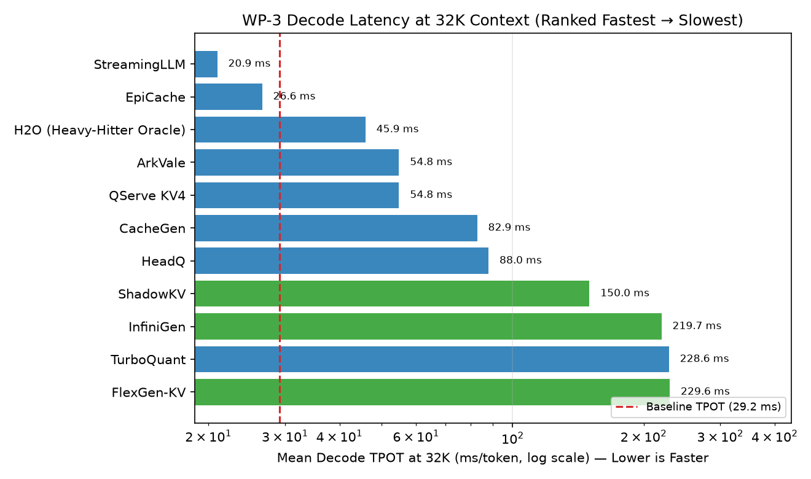
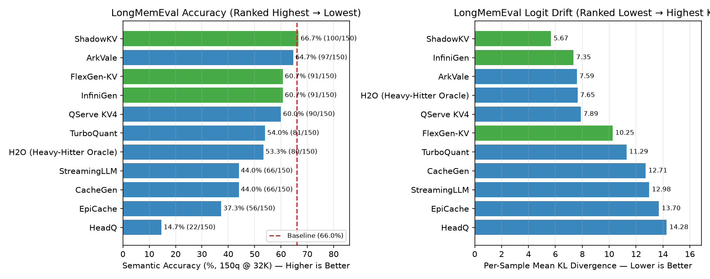

# WP-3 Consolidated Pattern Report: White-Box Component Synthesis & Falsifiable Candidate Directions

> **Source Benchmark Commits:** `khemingkapat/kv_bench@5fc1cea4ba64ac86a2da49edd8210a46753834fe` *(PR #59 / Slurm Job `30715`: `shadowkv`, `arkvale`, `qserve_kv4`, `turboquant`, `epicache`, `headq`)* & `2a9338a2f750741f7765d79c1270f5579a9ffed0` *(baseline, `streamingllm`, `h2o`, `flexgen_kv`, `infinigen`, `cachegen`)*  
> **Evaluated Model:** `Qwen/Qwen3-4B-Instruct-2507` ($L=36,\; H_Q=32,\; H_{KV}=8,\; D=128$, BF16 unmodified weights; theoretical uncompressed KV = `144 KiB/tok`, `4.50 GiB` @ 32K)  
> **Hardware Cap & Engine:** RTX 4090 capped at `16.0 GiB` (`gpu4090`), PyTorch Native SDPA  
> **Canonical Dataset:** 150 quantile-sampled LongMemEval questions (30 per capability, `ctx=32768`, offline semantic judge `semantic-grade-v2` in `results/grades/*_judged.json`) + `512–32,768` PG-19 hardware sweep + `2K/4K` NIAH diagnostic  
> **Scope Boundary:** This report synthesizes empirical patterns from WP-3 after resolving the 6 major wrapper bugs in `kv_bench` PR #59, and defines **4 falsifiable candidate hypotheses** ($\le 5$ advisor bound) for WP-4 co-design.

---

## 1. Executive Summary, Provenance & Overview Visuals

### 1.1 Post-PR #59 Re-Interpretation: Resolved `[IMPLEMENTATION]` Bugs vs. True `[INTRINSIC]` Limits
Fixing the 6 PyTorch wrapper bugs in `kv_bench` PR #59 (`5fc1cea`, Slurm Job `30715`) cleanly separated implementation artifacts from genuine algorithmic limits:
- **Resolved VRAM & Quality Inversions (Confirming Selective Offload Dominance):**
  - **`ShadowKV`** fixed its per-head `r=128` SVD no-op (to cross-head `r=160` + dynamic `rope_theta`) and unbounded sparse cache (to bounded LRU), slashing 32K Peak Alloc by **`-4,688 MiB`** (`14,233 -> 9,544.9 MiB`, `1,806 MiB` net KV+aux) while hitting **`100/150 (66.67%)`** LongMemEval (`+0.67 pp` over baseline, only `3` regressions!). Its remaining costs (`11.17 GiB` Host RSS, `150.0 ms` TPOT, `15.22 s` TTFT) isolate the **uncompressed BF16 CPU Value** and **online exact SVD** bottlenecks.
  - **`ArkVale`** fixed its `key_states` proxy (to SDPA-hooked GQA `query_states`), vectorized AABB digests, pinned exempt layers `0–1` on GPU, and enabled delta recall—nearly **halving 32K TPOT** (`102.9 -> 54.80 ms`, fastest CPU-offload method!) and lifting LongMemEval to **`97/150 (64.67%)`** (`14 -> 7` regressions, `+10 pp` on `cross_session_reasoning`). Its remaining `19.45 GiB` Host RSS isolates the **uncompressed BF16 CPU page pool**.
- **Resolved Quantizer Capacity & Speed Bugs (Confirming the 4-Bit Floor):**
  - **`QServe KV4`** replaced power-of-2 doubling above 16K with linear capacity growth (`10,762.7 -> 10,041.0 MiB`, `-722 MiB` VRAM; `2,083 MiB` RSS; `54.81 ms` TPOT) and leads all structural quantizers at **`90/150 (60.00%)`** (`12` regressions).
  - **`TurboQuant`** replaced its 7-stage Python `fwht` loop with a cached `(128, 128)` Hadamard matmul + pre-allocated buffers, slashing 32K TPOT **`3.78x`** (`864.1 -> 228.57 ms`) and RSS `2.74x` (`7,529 -> 2,744 MiB`), while confirming its **`[INTRINSIC]`** `54.00%` (`81/150`) accuracy ceiling vs. `QServe KV4`.
  - **`HeadQ`** fixed its broken `k_residual` PCA fit (to per-KV-head post-RoPE Query PCA via SDPA hook) and uncentered 2-bit grid (to channel standardization), reviving NIAH from **`0%/0% -> 90%/90%`** and LongMemEval from `0/150 -> 22/150 (14.67%)`—definitively proving that **2-bit Keys (`3.25 b/scalar`) hit an `[INTRINSIC]` routing limit** on multi-session 32K reasoning under 4:1 GQA.
- **Resolved Eviction Collapse (Isolating Single-Window Middle Amnesia):**
  - **`EpiCache`** pinned `4` sinks + `512` recent tokens (`1,024` total), replaced `.tolist()` sync with GPU `int32` positions (`442 KB/tok -> 8.3 KB/tok` harness floor; `30.6 -> 26.57 ms` TPOT, faster than baseline!), and corrected telemetry (`episodic_routing_active: false`). LongMemEval jumped `5.33% -> 37.33%` (`56/150`), cleanly isolating **1,024-token single-window middle amnesia** when multi-episode clustering/routing is absent.

### 1.2 Master 12-Entry Telemetry & Net KV+Aux VRAM Table (32K Hardware Sweep + 150q LongMemEval)

Fixed static `Qwen3-4B` BF16 weights + PyTorch CUDA runtime occupy **7,738.8 MiB** (**~7.56 GiB**) at 128 tokens ([`verify_baseline_pytorch_16gb.json`](../../results/baselines/verify_baseline_pytorch_16gb.json)). Subtracting this unified `7,738.8 MiB` static floor isolates **Net KV + Aux VRAM** (baseline 32K net KV+aux = `5,486.1 MiB`).

| Technique | Authoritative Axis (`METRICS_AND_AXES.md`) | Physical Scalar Bits | Effective Token Retention | 32K Peak Alloc (MiB) | Est. Net KV+Aux (MiB) | 32K Host RSS Δ (MiB) | 32K TTFT (s) | 32K TPOT (ms) | 32K Memcpy (MB/tok) | LongMem KL / Top-1 | NIAH (2K / 4K) | LongMemEval Semantic | Regressions | Detailed Report |
|---|---|---:|---:|---:|---:|---:|---:|---:|---:|---:|:---:|---:|---:|---|
| **ShadowKV** *(PR #59)* | `SPATIAL` (+ `STRUCTURAL`, `TEMPORAL`) | `16.0` (BF16) | `1.00` *(CPU V)* | **`9,544.9`** | **`1,806`** | `11,171.9` | `15.220` | `150.03` | `1,427.77` | `5.67 / 0.607` | `100% / 100%` | **100/150 (66.67%)** | `3` *(+4 UG)* | [`shadowkv.md`](techniques/shadowkv.md) |
| **PyTorch SDPA Baseline** | — | `16.0` (BF16) | `1.00` | `13,224.9` | `5,486` | `1,082.4` | `6.978` | `29.17` | `0.000` | — | — | **99/150 (66.00%)** | `0` | [`run_manifest_baseline_pytorch_16gb.json`](../../results/manifests/run_manifest_baseline_pytorch_16gb.json) |
| **ArkVale** *(PR #59)* | `SPATIAL` *(reconciled from `STRUCTURAL`)* | `16.0` (BF16) | `1.00` *(CPU)* | **`9,281.2`** | **`1,542`** | `19,450.1` | `14.802` | **`54.80`** | `1,192.88` | `7.59 / 0.478` | `100% / 100%` | **97/150 (64.67%)** | `7` *(+5 UG)* | [`arkvale.md`](techniques/arkvale.md) |
| **FlexGen-KV** | `SPATIAL` (+ `STRUCTURAL` 4-bit) | `4.5` (4b+scale) | `1.00` *(CPU)* | `8,888.9` | `1,150` | `6,564.6` | `10.205` | `229.57` | `1,646.96` | `10.25 / 0.300` | `100% / 100%` | **91/150 (60.67%)** | `14` | [`flexgen_kv.md`](techniques/flexgen_kv.md) |
| **InfiniGen** | `SPATIAL` (+ `TEMPORAL`) | `16.0` (BF16) | `1.00` *(CPU)* | `13,910.0` | `6,171` | `20,490.6` | `15.372` | `219.68` | `1,829.89` | `7.35 / 0.493` | `100% / 100%` | **91/150 (60.67%)** | `13` | [`infinigen.md`](techniques/infinigen.md) |
| **QServe KV4** *(PR #59)* | `STRUCTURAL` | `4.5` (4b+scale) | `1.00` | **`10,041.0`** | **`2,302`** | `2,083.1` | `7.160` | **`54.81`** | `0.008*` | `7.89 / 0.455` | `100% / 100%` | **90/150 (60.00%)** | `12` *(+3 UG)* | [`qserve_kv4.md`](techniques/qserve_kv4.md) |
| **TurboQuant** *(PR #59)* | `STRUCTURAL` | `4.375` (`K:4.25, V:4.5`) | `1.00` | `10,247.3` | `2,508` | `2,744.0` | `10.664` | `228.57` | `0.013*` | `11.29 / 0.229` | `100% / 100%` | **81/150 (54.00%)** | `20` *(+2 UG)* | [`turboquant.md`](techniques/turboquant.md) |
| **H2O** | `STRUCTURAL` | `16.0` (BF16) | `0.0625` *(2048/32K)* | `9,724.7` | `1,986` | `6,873.7` | `9.110` | `45.88` | `2.01` | `7.65 / 0.475` | `100% / 20%` | **80/150 (53.33%)** | `22` | [`h2o.md`](techniques/h2o.md) |
| **StreamingLLM** | `STRUCTURAL` | `16.0` (BF16) | `0.0626` *(2052/32K)* | `8,711.7` | `973` | `1,326.5` | `2.905` | `20.95` | `0.008*` | `12.98 / 0.132` | `100% / 40%` | **66/150 (44.00%)** | `37` | [`streamingllm.md`](techniques/streamingllm.md) |
| **CacheGen** | `STRUCTURAL` *(manifest: `SPATIAL`)* | `6.392` (8/4/2+anc) | `1.00` | `10,600.2` | `2,861` | `4,535.8` | `12.555` | `82.87` | `935.02` | `12.71 / 0.117` | `40% / 80%` | **66/150 (44.00%)** | `36` | [`cachegen.md`](techniques/cachegen.md) |
| **EpiCache** *(PR #59)* | `STRUCTURAL` *(single-window)* | `16.0` (BF16) | `~0.031` *(1024/32K)* | **`8,567.4`** | **`829`** | `1,827.5` | **`2.683`** | **`26.57`** | `0.008*` | `13.70 / 0.084` | `20% / 10%` | **56/150 (37.33%)** | `43` | [`epicache.md`](techniques/epicache.md) |
| **HeadQ** *(PR #59)* | `STRUCTURAL` | `3.25` (`K:2.375, V:4.125`) | `1.00` | **`9,681.3`** | **`1,943`** | `2,745.8` | `8.362` | `88.01` | `0.008*` | `14.28 / 0.030` | **`90% / 90%`** | **22/150 (14.67%)** | `81` *(+4 UG)* | [`headq.md`](techniques/headq.md) |

*\*Note: `~8,258–8,447 B/tok` (`~0.008 MB/tok`) in hardware sweeps is a baseline PyTorch instrumentation floor (`73.8 + 0.25 * ctx` B/tok), not technique offloading.*

### 1.3 Staged Overview Figures

---

## 2. Master Atomic Component Matrix (Post-PR #59)

| Mechanism Class | Source Technique | Component | Axis | Causal Tag(s) | Empirical Effect (Post-PR #59) | Verdict |
|---|---|---|---|---|---|---|
| **Token Retention / Eviction** | `streamingllm` | `C1`/`C2`: 4-token attention sink + 2048-token sliding window | `STRUCTURAL` | `[INTRINSIC]` | `20.95 ms` TPOT, `973 MiB` net KV, `37` regressions (`40%` 4K NIAH) | `KEEP` *(hot tier)* |
| **Token Retention / Eviction** | `h2o` | `C3`: Cumulative Heavy-Hitter + recent window (`1024+1024`) | `STRUCTURAL` | `[INTRINSIC]` | `+9.33 pp` LongMemEval over StreamingLLM (`53.33%`), still `22` regressions | `ADAPT` |
| **Token Retention / Eviction** | `h2o` | `C1`/`C2`/`C4`: Duplicate `fp32` $QK^\top$ + `.tolist()` sync | `STRUCTURAL` | `[IMPLEMENTATION]` | `+1.01 GiB` VRAM, `2.01 MB/tok` memcpy, `45.88 ms` TPOT | `DROP` |
| **Token Retention / Eviction** | `epicache` *(PR #59)* | `C2`/`C3`: 4 sinks + 512 recent + GPU `int32` positions | `STRUCTURAL` | `[INTRINSIC]` | `2.68 s` TTFT, `26.57 ms` TPOT, `829 MiB` net KV, `0.008 MB/tok`; `37.3%` isolates single-window amnesia | `KEEP` *(hot tier)* |
| **Token Retention / Eviction** | `epicache` | `C1`/`C4`: Per-layer sensitivity + multi-episode routing | `STRUCTURAL` / `SPATIAL` | `[IMPLEMENTATION]` | Unimplemented in WP-3 control (`episodic_routing_active=False`) | `ADAPT` *(WP-4)* |
| **Outlier Smoothing / Rotation** | `qserve_kv4` *(PR #59)* | `C1`/`C3`: `smooth_k` + linear-above-16K buffer growth | `STRUCTURAL` | `[INTRINSIC]` / `[IMPLEMENTATION]` | `100%` NIAH, `60.0%` LongMemEval, `-722 MiB` VRAM (`2,302 MiB` net) | `KEEP` / `ADAPT` |
| **Outlier Smoothing / Rotation** | `turboquant` *(PR #59)* | `C1`: Cached `(128, 128)` `H_d` Hadamard matmul + pre-alloc | `STRUCTURAL` | `[INTRINSIC]` / `[IMPLEMENTATION]` | `3.78x` faster TPOT (`228.6 ms`), `2.74x` less RSS; still needs fused kernel | `ADAPT` |
| **Outlier Smoothing / Rotation** | `headq` *(PR #59)* | `C1`/`C2`: Per-KV-head Query PCA hook + channel standardization | `STRUCTURAL` | `[INTRINSIC]` / `[HARDWARE/GQA]` | Revived NIAH `0% -> 90%/90%`, but 2-bit K still hits `14.7%` LongMemEval limit | `DROP` *(2-bit K)* |
| **Quantization / Residual Coding** | `qserve_kv4` *(PR #59)* | `C2`: Group-wise (`g=32`) symmetric INT4 K/V (`4.50 b/scalar`) | `STRUCTURAL` | `[INTRINSIC]` | Proven WP-3 quantization floor (`90/150 = 60.0%`, `12` regressions) | `KEEP` |
| **Quantization / Residual Coding** | `turboquant` *(PR #59)* | `C2`/`C3`: 4-bit Beta Lloyd-Max K + 3-bit/QJL V (`4.375 b/scalar`) | `STRUCTURAL` | `[INTRINSIC]` | `100%` NIAH, `54.0%` LongMemEval (`20` regressions, `-6 pp` vs. QServe) | `ADAPT` |
| **Quantization / Residual Coding** | `cachegen` | `C1`/`C2`/`C3`: Post-RoPE delta + 8/4/2-bit + CPU realloc | `STRUCTURAL` | `[INTRINSIC]` / `[IMPLEMENTATION]` | `44.0%` LongMemEval (`-43.3 pp` `fact_recall`), `935 MB/tok` memcpy | `DROP` |
| **Quantization / Residual Coding** | `flexgen_kv` | `C1`: Group-wise (`g=64`) 4-bit quantization on CPU K/V | `STRUCTURAL` | `[INTRINSIC]` | Bounds 32K Host RSS to `6.56 GiB` with `60.67%` accuracy | `KEEP` *(cold tier)* |
| **Quantization / Residual Coding** | `qserve_kv4` / `turboquant` / `headq` | Full-sequence BF16 dequantization before HF SDPA | `STRUCTURAL` | `[IMPLEMENTATION]` | `1.88x–7.84x` TPOT penalty + transient BF16 materialization | `DROP` *(fuse in WP-6)* |
| **CPU Tiering & Indexing** | `shadowkv` *(PR #59)* | `C1`: Cross-head pre-RoPE SVD (`[B, S, 1024]`, `r=160`, dynamic `rope_theta`) | `STRUCTURAL` | `[INTRINSIC]` | True `6.4x` Key compression; cuts 32K VRAM by `4.69 GiB` at **`66.67%` acc!** | `KEEP` / `ADAPT` *(fast SVD)* |
| **CPU Tiering & Indexing** | `shadowkv` *(PR #59)* | `C2`/`C3`: Landmarks + outliers + bounded LRU + BF16 CPU V | `SPATIAL` / `TEMPORAL` | `[INTRINSIC]` | Best recall (`100/150`, `3` QR), `1,806 MiB` net VRAM; BF16 CPU V drives `11.17 GiB` RSS & `150 ms` TPOT | `ADAPT` *(4-bit CPU V)* |
| **CPU Tiering & Indexing** | `arkvale` *(PR #59)* | `C1`/`C3`: Vectorized AABB digests + Query SDPA hook + delta recall | `SPATIAL` / `TEMPORAL` | `[INTRINSIC]` | **`97/150 (64.67%)`** (`7` QR), **`54.80 ms` TPOT**, `1,542 MiB` net VRAM | `KEEP` |
| **CPU Tiering & Indexing** | `arkvale` *(PR #59)* | `C2`: GPU-pinned layers `0–1` + uncompressed BF16 CPU page bank | `SPATIAL` | `[INTRINSIC]` | Fast decode, but BF16 CPU pool inflates 32K Host RSS to `19.45 GiB` | `ADAPT` *(4-bit CPU pool)* |
| **CPU Tiering & Indexing** | `flexgen_kv` / `infinigen` | Bulk CPU gather (`FlexGen`) & `key_states` proxy + double CPU pool (`InfiniGen`) | `SPATIAL` | `[IMPLEMENTATION]` | `220–230 ms` TPOT, `1.65–1.83 GB/tok` PCIe; strictly dominated by fixed `ArkVale`/`ShadowKV` | `DROP` *(gather)* |

---

## 3. Cross-Technique Pattern Synthesis (Answering Q1–Q5, Post-PR #59)

### Q1 (Retention vs. Amnesia): Which GPU-resident token selection mechanisms reduce decode latency/VRAM, and where does non-local retrieval break?
- **Only permanent eviction cuts decode compute and VRAM simultaneously:** `StreamingLLM` (`2,052` GPU tokens: `20.95 ms` TPOT, `973 MiB` net KV) and fixed `EpiCache` (`1,024` GPU tokens: `2.68 s` TTFT, `26.57 ms` TPOT, `829 MiB` net KV, `0.008 MB/tok` memcpy) both beat baseline latency (`29.17 ms`).
- **Any permanent single-window eviction breaks non-local retrieval:** Fixed `EpiCache` (`512` recent window) drops to `20%/10%` NIAH and `37.33%` LongMemEval (`43` regressions, `3.3%` `cross_session_reasoning`, `0.0%` `relative_timeframe`). `StreamingLLM` (`44.0%`, `37` regressions) and `H2O` (`53.33%`, `22` regressions) show the exact same pattern.
- **Takeaway:** Sink + recent window (`StreamingLLM` / fixed `EpiCache`) is the cleanest **hot GPU tier**, but middle tokens **must be demoted (quantized and/or offloaded)**—never permanently deleted.

### Q2 (Compression Floor vs. Implementation Collapses): What structural compression actually holds fidelity on `Qwen3-4B`, once implementation bugs are fixed?
- **4-bit group quantization with channel smoothing is now *conclusively* proven as the compression floor:**
  - **`QServe KV4` (`4.50 b/scalar`):** `100%` 2K/4K NIAH, **`90/150 (60.00%)`** LongMemEval (`12` regressions), `2,302 MiB` net KV+aux VRAM, `54.81 ms` TPOT.
  - **`TurboQuant` (`4.375 b/scalar`):** `100%` 2K/4K NIAH, **`81/150 (54.00%)`** LongMemEval (`20` regressions), `228.57 ms` TPOT (`3.78x` faster after `H_d` matmul fix)—confirming static unit-sphere rotation trails channel-smoothed INT4 by `6 pp`.
  - **`HeadQ` (`3.25 b/scalar`, 2-bit K + rank-4 Query PCA):** Fixing the Query PCA hook + channel standardization revived NIAH from `0% -> 90%/90%`, yet LongMemEval remained at **`22/150 (14.67%)`** (`81` regressions)—empirically confirming that **2-bit Keys cannot preserve multi-session reasoning** under 4:1 GQA (`H_Q=32, H_KV=8`).
- **Shared bottleneck across all quantizers:** Full-sequence BF16 dequantization before HF SDPA (`1.88x–7.84x` TPOT overhead). Fused Triton/CUDA dequantization (or vLLM FP8/INT4 paged kernels) is mandatory in WP-6.

### Q3 (Selective Recall vs. Bulk Offloading): How do GPU-side relevance proxies compare to bulk CPU swapping?
- **Bulk swapping (`FlexGen-KV`) hits the PCIe wall:** `1.65 GB/tok` PCIe, `229.57 ms` TPOT (`60.67%` accuracy).
- **Both fixed selective-recall engines now dominate the Pareto frontier:**
  - **`ShadowKV` (Cross-head SVD Keys + 8-tok Landmarks + CPU V):** Achieves **`100/150 (66.67%)`** (exceeding baseline `99/150`, only `3` regressions!) at **`9,544.9 MiB`** (`1,806 MiB` net KV+aux), proving `6.4x` low-rank Key compression is virtually lossless on `Qwen3-4B`. Its remaining `150.0 ms` TPOT and `11.17 GiB` RSS stem from uncompressed BF16 CPU Values + eager PyTorch LRU misses.
  - **`ArkVale` (Query-Driven GQA AABB Digests + Delta Page Recall):** Achieves **`97/150 (64.67%)`** (only `7` regressions, even with a tiny `256`-token active budget!) at **`9,281.2 MiB`** (`1,542 MiB` net KV+aux) and **`54.80 ms` TPOT** (fastest CPU-offload method at 32K!). Its remaining `19.45 GiB` Host RSS stems from uncompressed BF16 CPU pages.

### Q4 (VRAM Inflation & Aux-Buffer Accounting): What net KV+aux budget is achievable on 16 GB and 8 GB GPUs?
- **All WP-3 VRAM inversions are now resolved (except unfixed `InfiniGen`):**
  - Fixed **`ShadowKV`** dropped `-4,688 MiB` (`14,233 -> 9,544.9 MiB`, `1,806 MiB` net KV+aux).
  - Fixed **`ArkVale`** sits at `9,281.2 MiB` (`1,542 MiB` net KV+aux, including GPU-pinned exempt layers `0–1`).
  - Fixed **`QServe KV4`** dropped `-722 MiB` (`10,762.7 -> 10,041.0 MiB`, `2,302 MiB` net KV+aux; `1.27 GiB` persistent).
- **8 GB RTX 4060 & 16 GB Host RAM Extrapolation:** Both `ShadowKV` (`11.17 GiB` RSS) and `ArkVale` (`19.45 GiB` RSS) still store **uncompressed BF16** tensors in Host RAM—which overflows 16 GB system RAM under single-user (`ArkVale`) or multi-user (`ShadowKV`) loads. Combining selective recall with **4-bit (`g=32`) CPU tiering** (`3.56x` reduction) is essential to fit both `16 GB` Host RAM and `8–16 GB` VRAM caps.

### Q5 (5-Capability & Per-Question Failure Signatures Across 150 Questions, Post-PR #59)

| Method | `fact_recall` (30) | `information_update` (30) | `relative_timeframe` (30) | `cross_session_reasoning` (30) | `unanswerable_refusal` (30) | Total Regressions (vs. 99 Base Pass) |
|---|---:|---:|---:|---:|---:|---:|
| **ShadowKV** *(PR #59)* | **`93.3%`** (`0` reg) | `63.3%` (`1` reg) | **`33.3%`** (`0` reg) | **`43.3%`** (`2` reg) | **`100.0%`** (`0` reg) | **`3`** *(+4 UG)* |
| **Baseline (BF16)** | `90.0%` | `66.7%` | `30.0%` | `43.3%` | `100.0%` | `0` |
| **ArkVale** *(PR #59)* | **`93.3%`** (`0` reg) | `66.7%` (`2` reg) | `30.0%` (`1` reg) | `36.7%` (`3` reg) | `96.7%` (`1` reg) | **`7`** *(+5 UG)* |
| **FlexGen-KV** | `90.0%` (`1` reg) | `66.7%` (`3` reg) | `26.7%` (`1` reg) | `30.0%` (`6` reg) | `90.0%` (`3` reg) | `14` |
| **InfiniGen** | `83.3%` (`2` reg) | `60.0%` (`3` reg) | `30.0%` (`1` reg) | `40.0%` (`4` reg) | `90.0%` (`3` reg) | `13` |
| **QServe KV4** *(PR #59)* | `86.7%` (`1` reg) | `66.7%` (`1` reg) | `26.7%` (`2` reg) | `23.3%` (`7` reg) | `96.7%` (`1` reg) | `12` *(+3 UG)* |
| **TurboQuant** *(PR #59)* | `73.3%` (`5` reg) | `63.3%` (`1` reg) | `20.0%` (`4` reg) | `20.0%` (`8` reg) | `93.3%` (`2` reg) | `20` *(+2 UG)* |
| **H2O** | `86.7%` (`1` reg) | `46.7%` (`6` reg) | `26.7%` (`2` reg) | `16.7%` (`10` reg) | `90.0%` (`3` reg) | `22` |
| **StreamingLLM** | `70.0%` (`6` reg) | `60.0%` (`4` reg) | `10.0%` (`8` reg) | `3.3%` (`12` reg) | `76.7%` (`7` reg) | `37` |
| **CacheGen** | `46.7%` (`13` reg) | `50.0%` (`5` reg) | `16.7%` (`5` reg) | `20.0%` (`9` reg) | `86.7%` (`4` reg) | `36` |
| **EpiCache** *(PR #59)* | `66.7%` (`7` reg) | `30.0%` (`11` reg) | `0.0%` (`9` reg) | `3.3%` (`12` reg) | `86.7%` (`4` reg) | `43` |
| **HeadQ** *(PR #59)* | `26.7%` (`19` reg) | `26.7%` (`12` reg) | `10.0%` (`9` reg) | `3.3%` (`13` reg) | `6.7%` (`28` reg) | `81` *(+4 UG)* |

- **Cross-Session Reasoning remains the universal stress test:** `cross_session_reasoning` accounts for **67% (`2/3`)** of `ShadowKV`'s regressions, **43% (`3/7`)** of `ArkVale`'s, and **58% (`7/12`)** of `QServe KV4`'s.
- **Eviction vs. Preservation split:** Of the `16` baseline-passing questions where *both* `StreamingLLM` and `H2O` fail, **`ShadowKV` passes `14/16` (`87.5%`), `ArkVale` passes `11/16` (`68.8%`), and `QServe KV4` passes `9/16` (`56.2%`)**—confirming those failures are caused by middle-token deletion rather than intrinsic model limits.
- **Shared hard cluster (`8` questions):** Only `8` baseline-passing questions fail across $\ge 3$ of the top-5 methods (`00ca467f`, `2e6d26dc`, `6071bd76`, `a08a253f`, `bb7c3b45`, `f0e564bc`, `gpt4_213fd887`, `gpt4_372c3eed_abs`), concentrated in `cross_session_reasoning` (`5/8`).

---

## 4. Bounded Shortlist of Falsifiable Candidate Hypotheses (4 Candidates, Updated Post-PR #59)

PR #59 empirically validated the core prerequisites of Candidates 2 and 3 (fixed `ShadowKV`: `9.54 GiB` & `66.67%`; fixed `ArkVale`: `54.8 ms` & `64.67%`). The 4 bounded WP-4 candidate hypotheses below advance directly from those verified results:

### Candidate 1: `Hot-Sink/Window + 4-Bit SmoothQuantized GPU Tier` (`STRUCTURAL` Baseline)
- **Borrowed Components & Axes:** `StreamingLLM` / fixed `EpiCache` sink+window (`4 + 512` BF16 hot tokens) + `QServe KV4` RoPE-paired `smooth_k` & group-wise INT4 (`g=32`, linear capacity growth).
- **WP-4/WP-6 Prerequisites:** Replace full-BF16 dequantization before SDPA with a fused Triton/CUDA INT4 attention kernel (or vLLM native paged quant kernel) and offline RoPE-paired $\lambda_i = \lambda_{i+D/2}$ calibration.
- **Core Hypothesis:** Keeping recent/sink tokens in BF16 while storing older in-VRAM tokens in 4-bit SmoothINT4 recovers `QServe KV4`'s `cross_session_reasoning` (`-20 pp`) drift (`60.0% -> >= 63%`) while holding 32K Net KV+aux VRAM `<= 1,800 MiB` with zero PCIe traffic.
- **Quantitative Falsification Gate:** Falsified if 32K LongMemEval `< 94/150` (`62.7%`), Net KV+aux VRAM `> 1,800 MiB`, or 32K TPOT `> 35 ms/tok` (vs. `29.17 ms` baseline).

### Candidate 2: `ShadowKV-Q4 (Cross-Head SVD Keys + 4-Bit CPU Value Bank + vLLM 16-Tok Blocks)` (`SPATIAL` + `STRUCTURAL` + `TEMPORAL`)
- **PR #59 Validation Status:** Base hypothesis **CONFIRMED** (`9,544.9 MiB` Peak Alloc, `1,806 MiB` net KV+aux, **`100/150 = 66.67%`**, `3` regressions).
- **Remaining WP-4 Targets:** Eliminate the remaining BF16 CPU-Value Host RSS (`11.17 GiB`), PCIe volume (`1,428 MB/tok`), exact SVD TTFT (`15.22 s`), and eager gather TPOT (`150.0 ms`).
- **Core Hypothesis:** Quantizing `ShadowKV`'s pinned CPU Value bank to `g=32` INT4 (`3.56x` smaller RSS & PCIe), replacing exact `torch.linalg.svd` with fast `svd_lowrank`/calibrated basis, expanding the BF16 local anchor (`32 -> 256`), and aligning to vLLM 16-token blocks preserves `>= 95/150 (63.3%)` accuracy while slashing 32K Host RSS `<= 3,500 MiB`, PCIe `<= 40 MB/tok` decode, and TPOT `<= 55 ms/tok`.
- **Quantitative Falsification Gate:** Falsified if 32K LongMemEval `< 94/150` (`62.7%`), 32K Net KV+aux VRAM `> 2,000 MiB`, 32K Host RSS `> 4,500 MiB`, or 32K TPOT `> 60 ms/tok`.

### Candidate 3: `TriCache (Hot BF16 Window + Query-Driven AABB Index + 4-Bit CPU Page Bank)` (`STRUCTURAL` + `SPATIAL` + `TEMPORAL`)
- **PR #59 Validation Status:** Query-driven AABB + GPU exempt layers + delta recall **CONFIRMED** by fixed `ArkVale` jumping to **`97/150 (64.67%)`** (`7` regressions) and **`54.80 ms` TPOT** at `1,542 MiB` net VRAM!
- **Remaining WP-4 Targets:** Eliminate `ArkVale`'s `19.45 GiB` BF16 Host RSS and `1,193 MB/tok` BF16 PCIe traffic by quantizing the CPU page bank to `g=32` INT4 (`3.56x` reduction) + adding a BF16 sink/window hot tier + async CUDA stream overlap on vLLM 16-token blocks.
- **Core Hypothesis:** Pairing fixed `ArkVale`'s Query AABB recall with `QServe/FlexGen` 4-bit CPU pages and a BF16 hot window cuts 32K Host RSS from `19.45 GiB -> <= 4,500 MiB`, cuts decode PCIe `<= 150 MB/tok`, and maintains `>= 94/150 (62.7%)` LongMemEval at `<= 1,600 MiB` net KV+aux VRAM and `<= 40 ms` TPOT.
- **Quantitative Falsification Gate:** Falsified if 32K LongMemEval `< 90/150` (`60.0%`), 32K Host RSS `> 6,000 MiB`, decode PCIe `> 150 MB/tok`, or 32K Net KV+aux VRAM `> 1,900 MiB`.

### Candidate 4: `EpiCache-3Axis (Turn-Level Composable Top-k Episodes + 4-Bit CPU Episode Bank)` (`STRUCTURAL` + `SPATIAL` + `TEMPORAL`)
- **PR #59 Validation Status:** Hot-tier speed **CONFIRMED** (`2.68 s` TTFT, `26.57 ms` TPOT, `829 MiB` net KV, `0.008 MB/tok`), while `37.33%` LongMemEval cleanly isolated the absence of multi-episode clustering/routing.
- **Core Hypothesis:** Adding single-pass in-model centroid clustering, a **4-bit (`g=32`) pinned CPU episode bank**, prefill-overlapped async HtoD episode loading, and **composable Top-$k$ (`k=2`) vLLM 16-token episode blocks** alongside the BF16 sink+recent hot tier achieves **`0 MB/tok` decode PCIe** (near-native vLLM TPOT) while recovering LongMemEval from `37.3% -> >= 60.0%` (`>= 90/150`) at `<= 1,300 MiB` net KV+aux VRAM.
- **Quantitative Falsification Gate:** Falsified if 32K LongMemEval `< 87/150` (`58.0%`), 32K Net KV+aux VRAM `> 1,600 MiB`, decode PCIe `> 10 MB/tok`, or 32K Host RSS `> 3,500 MiB`.
