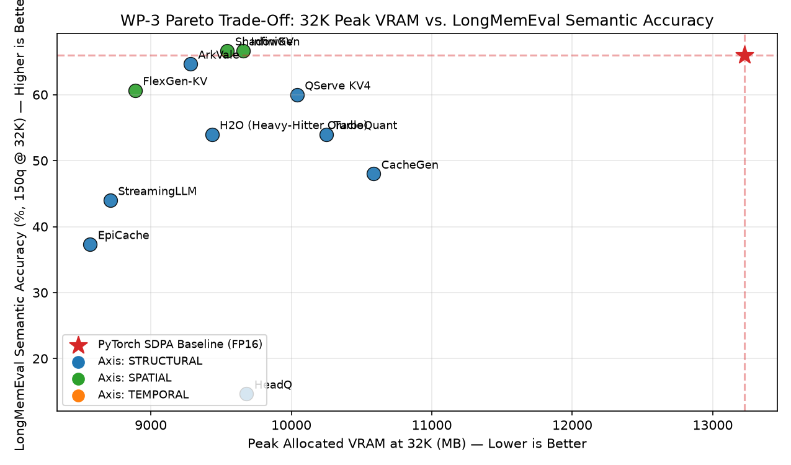
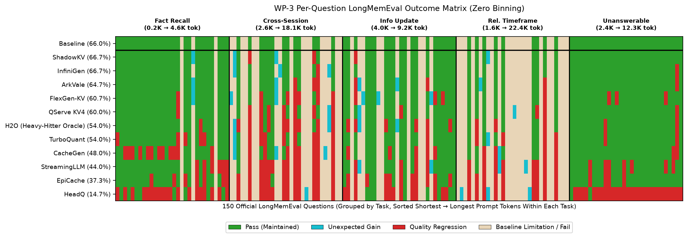

# WP-3 Consolidated Pattern Report: White-Box Component Synthesis & Falsifiable Candidate Directions

> **Source Benchmark Commits:** `khemingkapat/kv_bench@78ce018e589c554fccd7d4e31173fe04fcba8a0c` *(PR #60 / Slurm Job `30848`: `infinigen`, `cachegen`, `h2o`)*, `5fc1cea4ba64ac86a2da49edd8210a46753834fe` *(PR #59 / Slurm Job `30715`: `shadowkv`, `arkvale`, `qserve_kv4`, `turboquant`, `epicache`, `headq`)*, & `2a9338a2f750741f7765d79c1270f5579a9ffed0` *(baseline, `streamingllm`, `flexgen_kv`)*  
> **Evaluated Model:** `Qwen/Qwen3-4B-Instruct-2507` ($L=36,\; H_Q=32,\; H_{KV}=8,\; D=128$, BF16 unmodified weights; theoretical uncompressed KV = `144 KiB/tok`, `4.50 GiB` @ 32K)  
> **Hardware Cap & Engine:** RTX 4090 capped at `16.0 GiB` (`gpu4090`), PyTorch Native SDPA  
> **Canonical Dataset:** 150 quantile-sampled LongMemEval questions (30 per capability, `ctx=32768`, offline semantic judge `semantic-grade-v2` in `results/grades/*_judged.json`) + `512–32,768` PG-19 hardware sweep + `2K/4K` NIAH diagnostic  
> **Scope Boundary:** All 9 flagged implementation bugs across the 11 WP-3 techniques are now resolved across PR #59 and PR #60 (`StreamingLLM` & `FlexGen-KV` had zero correctness bugs). This report synthesizes clean, bug-free WP-3 patterns and defines **4 falsifiable candidate hypotheses** ($\le 5$ advisor bound) for WP-4 co-design.

---

## 1. Executive Summary, Provenance & Overview Visuals

### 1.1 Clean Post-PR #59/#60 Synthesis: Zero Remaining Implementation Bugs
With PR #59 (6 fixes, Job `30715`) and PR #60 (final 3 fixes, Job `30848`) merged, **every single WP-3 technique sits below baseline VRAM (`13,225 MiB`)**, all fake PCIe sync/reallocation spikes are eliminated, and all remaining performance gaps reflect genuine **`[INTRINSIC]`** algorithmic trade-offs or PyTorch-eager kernel limits:
- **Selective CPU Offloading Dominates Quality (All 3 Selective-Recall Methods Beat or Match Baseline):**
  - **`InfiniGen`** *(PR #60)* fixed its `key_states` proxy + prefill VRAM bloat, dropping 32K Peak Alloc **`-4,254 MiB`** (`13,910 -> 9,656.5 MiB`), cutting TPOT `219.7 -> 131.51 ms`, and reaching **`100/150 (66.67%)`** with the **lowest regression count in WP-3 (`2` QR, `50.0%` `cross_session_reasoning`)**.
  - **`ShadowKV`** *(PR #59)* fixed its cross-head `r=160` SVD + bounded LRU cache, dropping 32K Peak Alloc **`-4,688 MiB`** (`14,233 -> 9,544.9 MiB`) while tying for #1 at **`100/150 (66.67%)`** (`3` QR).
  - **`ArkVale`** *(PR #59)* fixed its GQA Query AABB hook + GPU exempt layers + delta recall, halving TPOT (`102.9 -> 54.80 ms`, fastest CPU-offload method!) and reaching **`97/150 (64.67%)`** (`7` QR) at `9,281.2 MiB` VRAM.
  - **Shared Consumer-Hardware Bottleneck Across All 3:** Uncompressed BF16 CPU backing stores inflate 32K Host RSS (`11.17–20.20 GiB`, overflowing 16 GB consumer RAM) and PCIe traffic (`1.19–1.88 GB/tok`).
- **4-Bit Compression Floor Conclusively Proven Across All 4 Quantizers:**
  - **`QServe KV4`** *(PR #59)* leads all quantizers at **`90/150 (60.00%)`** (`12` QR, `100%` NIAH, `10,041.0 MiB`, `54.81 ms` TPOT).
  - **`TurboQuant`** *(PR #59)* cut TPOT `3.78x` (`864.1 -> 228.57 ms`) via cached `H_d` matmul, confirming its `81/150 (54.00%)` ceiling.
  - **`CacheGen`** *(PR #60)* eliminated its fake `935 MB/tok` `.cpu()` realloc thrashing (`-> 8.4 KB/tok` floor, TTFT `12.56 -> 7.82 s`), isolating its `72/150 (48.00%)` deep 2-bit post-RoPE delta loss.
  - **`HeadQ`** *(PR #59)* revived NIAH `0%/0% -> 90%/90%` via per-KV-head Query PCA + channel standardization, yet remained at **`22/150 (14.67%)`** LongMemEval—definitively proving 2-bit Keys cannot sustain 32K multi-session reasoning under 4:1 GQA.
- **Pure Eviction Delivers Best Speed/VRAM, But Intrinsically Causes Middle Amnesia:**
  - **`H2O`** *(PR #60)* eliminated `.tolist()` sync (`2.01 MB/tok -> 8.3 KB/tok`, RSS `6,874 -> 1,548 MiB`, TPOT `45.88 -> 29.27 ms`!), **`StreamingLLM`** (`20.95 ms`), and **`EpiCache`** *(PR #59: `26.57 ms`, `2.68 s` TTFT, `0.008 MB/tok`)* prove fast GPU-resident hot tiers, yet permanent deletion caps them at `54.0%`, `44.0%`, and `37.3%` respectively.

### 1.2 Master 12-Entry Telemetry & Net KV+Aux VRAM Table (32K Hardware Sweep + 150q LongMemEval)

Fixed static `Qwen3-4B` BF16 weights + PyTorch CUDA runtime occupy **7,738.8 MiB** (**~7.56 GiB**) at 128 tokens ([`verify_baseline_pytorch_16gb.json`](../../results/baselines/verify_baseline_pytorch_16gb.json)). Subtracting this unified `7,738.8 MiB` static floor isolates **Net KV + Aux VRAM** (baseline 32K net KV+aux = `5,486.1 MiB`).

| Technique | Authoritative Axis (`METRICS_AND_AXES.md`) | Physical Scalar Bits | Effective Token Retention | 32K Peak Alloc (MiB) | Est. Net KV+Aux (MiB) | 32K Host RSS Δ (MiB) | 32K TTFT (s) | 32K TPOT (ms) | 32K Memcpy (MB/tok) | LongMem KL / Top-1 | NIAH (2K / 4K) | LongMemEval Semantic | Regressions | Detailed Report |
|---|---|---:|---:|---:|---:|---:|---:|---:|---:|---:|:---:|---:|---:|---|
| **InfiniGen** *(PR #60)* | `SPATIAL` (+ `TEMPORAL`) | `16.0` (BF16) | `1.00` *(CPU)* | **`9,656.5`** | **`1,918`** | `20,196.9` | `13.658` | `131.51` | `1,875.47` | `7.05 / 0.515` | `100% / 100%` | **100/150 (66.67%)** | **`2`** *(+3 UG)* | [`infinigen.md`](techniques/infinigen.md) |
| **ShadowKV** *(PR #59)* | `SPATIAL` (+ `STRUCTURAL`, `TEMPORAL`) | `16.0` (BF16) | `1.00` *(CPU V)* | **`9,544.9`** | **`1,806`** | `11,171.9` | `15.220` | `150.03` | `1,427.77` | `5.67 / 0.607` | `100% / 100%` | **100/150 (66.67%)** | **`3`** *(+4 UG)* | [`shadowkv.md`](techniques/shadowkv.md) |
| **PyTorch SDPA Baseline** | — | `16.0` (BF16) | `1.00` | `13,224.9` | `5,486` | `1,082.4` | `6.978` | `29.17` | `0.000` | — | — | **99/150 (66.00%)** | `0` | [`run_manifest_baseline_pytorch_16gb.json`](../../results/manifests/run_manifest_baseline_pytorch_16gb.json) |
| **ArkVale** *(PR #59)* | `SPATIAL` *(reconciled from `STRUCTURAL`)* | `16.0` (BF16) | `1.00` *(CPU)* | **`9,281.2`** | **`1,542`** | `19,450.1` | `14.802` | **`54.80`** | `1,192.88` | `7.59 / 0.478` | `100% / 100%` | **97/150 (64.67%)** | **`7`** *(+5 UG)* | [`arkvale.md`](techniques/arkvale.md) |
| **FlexGen-KV** | `SPATIAL` (+ `STRUCTURAL` 4-bit) | `4.5` (4b+scale) | `1.00` *(CPU)* | `8,888.9` | `1,150` | `6,564.6` | `10.205` | `229.57` | `1,646.96` | `10.25 / 0.300` | `100% / 100%` | **91/150 (60.67%)** | `14` | [`flexgen_kv.md`](techniques/flexgen_kv.md) |
| **QServe KV4** *(PR #59)* | `STRUCTURAL` | `4.5` (4b+scale) | `1.00` | **`10,041.0`** | **`2,302`** | `2,083.1` | `7.160` | **`54.81`** | `0.008*` | `7.89 / 0.455` | `100% / 100%` | **90/150 (60.00%)** | `12` *(+3 UG)* | [`qserve_kv4.md`](techniques/qserve_kv4.md) |
| **H2O** *(PR #60)* | `STRUCTURAL` | `16.0` (BF16) | `0.0625` *(2048/32K)* | **`9,434.7`** | **`1,696`** | **`1,548.3`** | `7.205` | **`29.27`** | `0.008*` | `7.80 / 0.465` | `100% / 20%` | **81/150 (54.00%)** | `22` *(+4 UG)* | [`h2o.md`](techniques/h2o.md) |
| **TurboQuant** *(PR #59)* | `STRUCTURAL` | `4.375` (`K:4.25, V:4.5`) | `1.00` | `10,247.3` | `2,508` | `2,744.0` | `10.664` | `228.57` | `0.013*` | `11.29 / 0.229` | `100% / 100%` | **81/150 (54.00%)** | `20` *(+2 UG)* | [`turboquant.md`](techniques/turboquant.md) |
| **CacheGen** *(PR #60)* | `STRUCTURAL` | `6.392` (8/4/2+anc) | `1.00` | `10,585.7` | `2,847` | **`2,382.3`** | **`7.820`** | `83.80` | **`0.008*`** | `12.71 / 0.117` | `40% / 80%` | **72/150 (48.00%)** | `31` *(+4 UG)* | [`cachegen.md`](techniques/cachegen.md) |
| **StreamingLLM** | `STRUCTURAL` | `16.0` (BF16) | `0.0626` *(2052/32K)* | `8,711.7` | `973` | `1,326.5` | `2.905` | **`20.95`** | `0.008*` | `12.98 / 0.132` | `100% / 40%` | **66/150 (44.00%)** | `37` | [`streamingllm.md`](techniques/streamingllm.md) |
| **EpiCache** *(PR #59)* | `STRUCTURAL` *(single-window)* | `16.0` (BF16) | `~0.031` *(1024/32K)* | **`8,567.4`** | **`829`** | `1,827.5` | **`2.683`** | **`26.57`** | `0.008*` | `13.70 / 0.084` | `20% / 10%` | **56/150 (37.33%)** | `43` | [`epicache.md`](techniques/epicache.md) |
| **HeadQ** *(PR #59)* | `STRUCTURAL` | `3.25` (`K:2.375, V:4.125`) | `1.00` | **`9,681.3`** | **`1,943`** | `2,745.8` | `8.362` | `88.01` | `0.008*` | `14.28 / 0.030` | **`90% / 90%`** | **22/150 (14.67%)** | `81` *(+4 UG)* | [`headq.md`](techniques/headq.md) |

*\*Note: `~8,258–8,447 B/tok` (`~0.008 MB/tok`) in hardware sweeps is a baseline PyTorch instrumentation floor (`73.8 + 0.25 * ctx` B/tok), not technique offloading.*

### 1.3 Staged Overview Figures

---

## 2. Master Atomic Component Matrix (Bug-Free Post-PR #59/#60)

| Mechanism Class | Source Technique | Component | Axis | Causal Tag(s) | Empirical Effect | Verdict |
|---|---|---|---|---|---|---|
| **Token Retention / Eviction** | `streamingllm` | `C1`/`C2`: 4-token sink + 2048-token sliding window | `STRUCTURAL` | `[INTRINSIC]` | `20.95 ms` TPOT, `973 MiB` net KV, `37` QR (`40%` 4K NIAH) | `KEEP` *(hot tier)* |
| **Token Retention / Eviction** | `h2o` *(PR #60)* | `C3`/`C4`: Pure-GPU `torch.topk` Heavy-Hitter + recent (`1024+1024`) | `STRUCTURAL` | `[INTRINSIC]` | **`29.27 ms` TPOT**, `1,548 MiB` RSS, `0.008 MB/tok`, `+10 pp` over StreamingLLM (`54.0%`), still `22` QR | `KEEP` *(hot tier)* |
| **Token Retention / Eviction** | `epicache` *(PR #59)* | `C2`/`C3`: 4 sinks + 512 recent + GPU `int32` positions | `STRUCTURAL` | `[INTRINSIC]` | `2.68 s` TTFT, `26.57 ms` TPOT, `829 MiB` net KV; `37.3%` isolates single-window amnesia | `KEEP` *(hot tier)* |
| **Token Retention / Eviction** | `epicache` | `C1`/`C4`: Multi-episode clustering/routing + layer sensitivity | `STRUCTURAL` / `SPATIAL` | `[IMPLEMENTATION]` | Unimplemented in WP-3 control (`episodic_routing_active=False`) | `ADAPT` *(WP-4)* |
| **Outlier Smoothing / Rotation** | `qserve_kv4` *(PR #59)* | `C1`/`C3`: `smooth_k` + linear-above-16K buffer growth | `STRUCTURAL` | `[INTRINSIC]` | `100%` NIAH, `60.0%` LongMemEval, `2,302 MiB` net KV, `54.81 ms` TPOT | `KEEP` / `ADAPT` |
| **Outlier Smoothing / Rotation** | `turboquant` *(PR #59)* | `C1`: Cached `(128, 128)` `H_d` Hadamard matmul + pre-alloc | `STRUCTURAL` | `[INTRINSIC]` | `3.78x` faster TPOT (`228.6 ms`), `54.0%` LongMemEval | `ADAPT` |
| **Outlier Smoothing / Rotation** | `headq` *(PR #59)* | `C1`/`C2`: Per-KV-head Query PCA + channel-standardized 2-bit K | `STRUCTURAL` | `[INTRINSIC]` / `[HARDWARE/GQA]` | `90%/90%` NIAH, but 2-bit K hits `14.7%` LongMemEval floor | `DROP` *(2-bit K)* |
| **Quantization / Residual Coding** | `qserve_kv4` *(PR #59)* | `C2`: Group-wise (`g=32`) symmetric INT4 K/V (`4.50 b/scalar`) | `STRUCTURAL` | `[INTRINSIC]` | Proven WP-3 compression floor (`90/150 = 60.0%`, `12` QR) | `KEEP` |
| **Quantization / Residual Coding** | `cachegen` *(PR #60)* | `C1`–`C3`: Pure-GPU realloc + post-RoPE 8/4/2-bit deltas | `STRUCTURAL` | `[INTRINSIC]` | `0.008 MB/tok`, `7.82 s` TTFT, `48.0%` (`-40 pp` `fact_recall` from deep 2-bit) | `DROP` *(deep 2-bit)* |
| **Quantization / Residual Coding** | `flexgen_kv` | `C1`: Group-wise (`g=64`) 4-bit CPU K/V | `STRUCTURAL` | `[INTRINSIC]` | Bounds 32K Host RSS to `6.56 GiB` at `60.67%` accuracy | `KEEP` *(cold tier)* |
| **Quantization / Residual Coding** | `qserve_kv4` / `turboquant` / `headq` / `cachegen` | Full-sequence BF16 dequantization before HF SDPA | `STRUCTURAL` | `[IMPLEMENTATION]` | `1.88x–7.84x` TPOT penalty (PyTorch eager limit) | `DROP` *(fuse in WP-6)* |
| **CPU Tiering & Indexing** | `infinigen` *(PR #60)* | `C1`/`C3`: 30% GPU Key proxy + Query SDPA hook + $\tau = \max - \alpha$ | `SPATIAL` / `TEMPORAL` | `[INTRINSIC]` | **`100/150 (66.67%)`**, **`2` QR** (`50%` cross-session!), `1,918 MiB` net VRAM; BF16 CPU pool gives `20.2 GiB` RSS & `131.5 ms` TPOT | `ADAPT` *(4-bit CPU)* |
| **CPU Tiering & Indexing** | `shadowkv` *(PR #59)* | `C1`–`C3`: Cross-head SVD (`r=160`) + landmarks + bounded LRU + BF16 CPU V | `SPATIAL` / `STRUCTURAL` / `TEMPORAL` | `[INTRINSIC]` | **`100/150 (66.67%)`**, **`3` QR**, `1,806 MiB` net VRAM; BF16 CPU V drives `11.17 GiB` RSS & `150 ms` TPOT | `ADAPT` *(4-bit CPU V)* |
| **CPU Tiering & Indexing** | `arkvale` *(PR #59)* | `C1`–`C3`: Vectorized AABB + Query SDPA hook + GPU layers `0–1` + delta recall | `SPATIAL` / `TEMPORAL` | `[INTRINSIC]` | **`97/150 (64.67%)`**, `7` QR, **`54.80 ms` TPOT**, `1,542 MiB` net VRAM; BF16 CPU pool gives `19.45 GiB` RSS | `KEEP` / `ADAPT` *(4-bit CPU)* |

---

## 3. Cross-Technique Pattern Synthesis (Answering Q1–Q5, Bug-Free Final WP-3)

### Q1 (Retention vs. Amnesia): Which GPU-resident token selection mechanisms reduce decode latency/VRAM, and where does non-local retrieval break?
- **Only permanent eviction matches or beats baseline latency with minimal VRAM:** `StreamingLLM` (`20.95 ms`, `973 MiB` net), `EpiCache` (`26.57 ms`, `829 MiB` net, `2.68 s` TTFT), and fixed `H2O` (`29.27 ms`, `1,696 MiB` net, `1,548 MiB` RSS) all run with **zero PCIe overhead (`0.008 MB/tok`)**.
- **Any permanent eviction breaks non-local retrieval:** Even bug-free `H2O` (`54.0%`, `22` QR, `20%` 4K NIAH), `StreamingLLM` (`44.0%`, `37` QR), and single-window `EpiCache` (`37.3%`, `43` QR) fail on `cross_session_reasoning` (`3.3%–16.7%`). Middle tokens **must be demoted (quantized/offloaded)**, never deleted.

### Q2 (Compression Floor): What structural compression actually holds fidelity on `Qwen3-4B`?
- **4-bit group quantization with channel smoothing (`QServe KV4`: `60.0%`, `12` QR, `100%` NIAH) is conclusively the empirical compression floor:** `TurboQuant` (`4.375 b`, `54.0%`), `CacheGen` (`8/4/2 b` post-RoPE deltas, `48.0%`), and fixed `HeadQ` (`3.25 b` 2-bit K + per-KV-head Query PCA, `90%/90%` NIAH, `14.7%` LongMemEval) prove sub-4-bit Keys degrade sharply on multi-session 32K reasoning under 4:1 GQA.

### Q3 (Selective Recall vs. Bulk Offloading): How do GPU-side relevance proxies compare to bulk CPU swapping?
- **All three bug-free selective-recall engines decisively beat bulk swapping (`FlexGen-KV`: `60.67%`, `229.6 ms`) on quality AND latency:**
  - **`InfiniGen`:** **`100/150 (66.67%)`**, only **`2` QR** (`50.0%` `cross_session_reasoning`), `131.51 ms` TPOT, `1,918 MiB` net VRAM.
  - **`ShadowKV`:** **`100/150 (66.67%)`**, **`3` QR**, `150.03 ms` TPOT, `1,806 MiB` net VRAM, lowest Host RSS (`11.17 GiB`, Values-only offload).
  - **`ArkVale`:** **`97/150 (64.67%)`**, **`7` QR**, **`54.80 ms` TPOT** (fastest offload method!), `1,542 MiB` net VRAM.

### Q4 (VRAM & Host RAM Accounting): What budget is achievable on 16 GB and 8 GB consumer systems?
- **Every WP-3 technique now fits comfortably under 16 GB VRAM** (`8.57–10.59 GiB` total Peak Alloc; `829–2,847 MiB` net KV+aux vs. `5,486 MiB` baseline).
- **The remaining consumer-hardware wall is Host RAM (`16 GB` cap):** Uncompressed BF16 CPU pools push `InfiniGen` (`20.20 GiB`) and `ArkVale` (`19.45 GiB`) past 16 GB system RAM, and `ShadowKV` (`11.17 GiB`) leaves little headroom for multi-user concurrency. **Combining selective recall with 4-bit (`g=32`) CPU tiering (`3.56x` reduction)** is the exact 3-axis key to fit both `8–16 GB` VRAM and `16 GB` Host RAM.

### Q5 (5-Capability & Per-Question Failure Signatures Across 150 Questions)

| Method | `fact_recall` (30) | `information_update` (30) | `relative_timeframe` (30) | `cross_session_reasoning` (30) | `unanswerable_refusal` (30) | Total Regressions (vs. 99 Base Pass) |
|---|---:|---:|---:|---:|---:|---:|
| **InfiniGen** *(PR #60)* | `90.0%` (`0` reg) | `66.7%` (`0` reg) | `30.0%` (`0` reg) | **`50.0%`** (`1` reg) | `96.7%` (`1` reg) | **`2`** *(+3 UG)* |
| **ShadowKV** *(PR #59)* | **`93.3%`** (`0` reg) | `63.3%` (`1` reg) | **`33.3%`** (`0` reg) | `43.3%` (`2` reg) | **`100.0%`** (`0` reg) | **`3`** *(+4 UG)* |
| **Baseline (BF16)** | `90.0%` | `66.7%` | `30.0%` | `43.3%` | `100.0%` | `0` |
| **ArkVale** *(PR #59)* | **`93.3%`** (`0` reg) | `66.7%` (`2` reg) | `30.0%` (`1` reg) | `36.7%` (`3` reg) | `96.7%` (`1` reg) | **`7`** *(+5 UG)* |
| **FlexGen-KV** | `90.0%` (`1` reg) | `66.7%` (`3` reg) | `26.7%` (`1` reg) | `30.0%` (`6` reg) | `90.0%` (`3` reg) | `14` |
| **QServe KV4** *(PR #59)* | `86.7%` (`1` reg) | `66.7%` (`1` reg) | `26.7%` (`2` reg) | `23.3%` (`7` reg) | `96.7%` (`1` reg) | `12` *(+3 UG)* |
| **H2O** *(PR #60)* | `86.7%` (`1` reg) | `53.3%` (`6` reg) | `20.0%` (`3` reg) | `16.7%` (`10` reg) | `93.3%` (`2` reg) | `22` *(+4 UG)* |
| **TurboQuant** *(PR #59)* | `73.3%` (`5` reg) | `63.3%` (`1` reg) | `20.0%` (`4` reg) | `20.0%` (`8` reg) | `93.3%` (`2` reg) | `20` *(+2 UG)* |
| **CacheGen** *(PR #60)* | `50.0%` (`12` reg) | `50.0%` (`5` reg) | `20.0%` (`4` reg) | `26.7%` (`8` reg) | `93.3%` (`2` reg) | `31` *(+4 UG)* |
| **StreamingLLM** | `70.0%` (`6` reg) | `60.0%` (`4` reg) | `10.0%` (`8` reg) | `3.3%` (`12` reg) | `76.7%` (`7` reg) | `37` |
| **EpiCache** *(PR #59)* | `66.7%` (`7` reg) | `30.0%` (`11` reg) | `0.0%` (`9` reg) | `3.3%` (`12` reg) | `86.7%` (`4` reg) | `43` |
| **HeadQ** *(PR #59)* | `26.7%` (`19` reg) | `26.7%` (`12` reg) | `10.0%` (`9` reg) | `3.3%` (`13` reg) | `6.7%` (`28` reg) | `81` *(+4 UG)* |

- **Eviction vs. Preservation split:** Of the `15` baseline-passing questions where *both* `StreamingLLM` and fixed `H2O` fail, **`InfiniGen` passes `14/15` (`93.3%`), `ShadowKV` passes `13/15` (`86.7%`), and `ArkVale` passes `10/15` (`66.7%`)**—confirming those failures are caused by permanent deletion.
- **Shared hard cluster (`6` questions):** Only `6` baseline-passing questions fail across $\ge 3$ of the top-5 methods (`00ca467f`, `2e6d26dc`, `6071bd76`, `f0e564bc`, `gpt4_213fd887`, `gpt4_372c3eed_abs`), half in `cross_session_reasoning` (`3/6`).

---

## 4. Bounded Shortlist of Falsifiable Candidate Hypotheses (4 Candidates, Final WP-3)

### Candidate 1: `Hot-Sink/Window + 4-Bit SmoothQuantized GPU Tier` (`STRUCTURAL` Baseline)
- **Borrowed Components & Axes:** `StreamingLLM` / `H2O` BF16 hot tier (`4 + 512`) + `QServe KV4` RoPE-paired `smooth_k` & group-wise INT4 (`g=32`).
- **Core Hypothesis:** Keeping recent/sink tokens in BF16 while storing older in-VRAM tokens in 4-bit SmoothINT4 recovers `QServe KV4`'s `cross_session_reasoning` (`-20 pp`) drift (`60.0% -> >= 63%`) at `<= 1,800 MiB` net KV VRAM with zero PCIe traffic (fused kernel in WP-6).
- **Falsification Gate:** Falsified if 32K LongMemEval `< 94/150` (`62.7%`), Net KV+aux VRAM `> 1,800 MiB`, or 32K TPOT `> 35 ms/tok`.

### Candidate 2: `ShadowKV-Q4 (Cross-Head SVD Keys + 4-Bit CPU Value Bank + vLLM 16-Tok Blocks)` (`SPATIAL` + `STRUCTURAL` + `TEMPORAL`)
- **WP-3 Validation:** Base hypothesis **CONFIRMED** (`9,544.9 MiB` Peak Alloc, `1,806 MiB` net VRAM, **`100/150 = 66.67%`**, `3` QR).
- **Core Hypothesis:** Quantizing `ShadowKV`'s pinned CPU Value bank to `g=32` INT4 (`3.56x` smaller RSS & PCIe), replacing exact `torch.linalg.svd` with fast `svd_lowrank`/calibrated basis, expanding the BF16 local anchor (`32 -> 256`), and aligning to vLLM 16-token blocks preserves `>= 95/150 (63.3%)` accuracy while slashing 32K Host RSS `<= 3,500 MiB`, decode PCIe `<= 40 MB/tok`, and TPOT `<= 55 ms/tok`.
- **Falsification Gate:** Falsified if 32K LongMemEval `< 94/150` (`62.7%`), Net KV+aux VRAM `> 2,000 MiB`, Host RSS `> 4,500 MiB`, or 32K TPOT `> 60 ms/tok`.

### Candidate 3: `TriCache (Hot BF16 Window + Query-Driven AABB Index + 4-Bit CPU Page Bank)` (`STRUCTURAL` + `SPATIAL` + `TEMPORAL`)
- **WP-3 Validation:** Query-driven AABB + GPU exempt layers + delta recall **CONFIRMED** (`ArkVale`: **`97/150 = 64.67%`**, **`54.80 ms` TPOT**, `1,542 MiB` net VRAM).
- **Core Hypothesis:** Pairing fixed `ArkVale`'s Query AABB recall with `QServe/FlexGen` 4-bit CPU pages and a BF16 hot window cuts 32K Host RSS from `19.45 GiB -> <= 4,500 MiB`, cuts decode PCIe `<= 150 MB/tok`, and maintains `>= 94/150 (62.7%)` LongMemEval at `<= 1,600 MiB` net VRAM and `<= 40 ms` TPOT.
- **Falsification Gate:** Falsified if 32K LongMemEval `< 90/150` (`60.0%`), Host RSS `> 6,000 MiB`, decode PCIe `> 150 MB/tok`, or Net KV+aux VRAM `> 1,900 MiB`.

### Candidate 4: `EpiCache-3Axis (Turn-Level Composable Top-k Episodes + 4-Bit CPU Episode Bank)` (`STRUCTURAL` + `SPATIAL` + `TEMPORAL`)
- **WP-3 Validation:** Hot-tier speed **CONFIRMED** (`2.68 s` TTFT, `26.57 ms` TPOT, `829 MiB` net KV, `0.008 MB/tok`); `37.33%` cleanly isolated the absence of multi-episode routing.
- **Core Hypothesis:** Adding single-pass in-model centroid clustering, a **4-bit (`g=32`) pinned CPU episode bank**, prefill-overlapped async HtoD episode loading, and **composable Top-$k$ (`k=2`) vLLM 16-token episode blocks** alongside the BF16 sink+recent hot tier achieves **`0 MB/tok` decode PCIe** (near-native vLLM TPOT) while recovering LongMemEval to `>= 60.0%` (`>= 90/150`) at `<= 1,300 MiB` net VRAM.
- **Falsification Gate:** Falsified if 32K LongMemEval `< 87/150` (`58.0%`), Net KV+aux VRAM `> 1,600 MiB`, decode PCIe `> 10 MB/tok`, or Host RSS `> 3,500 MiB`.
