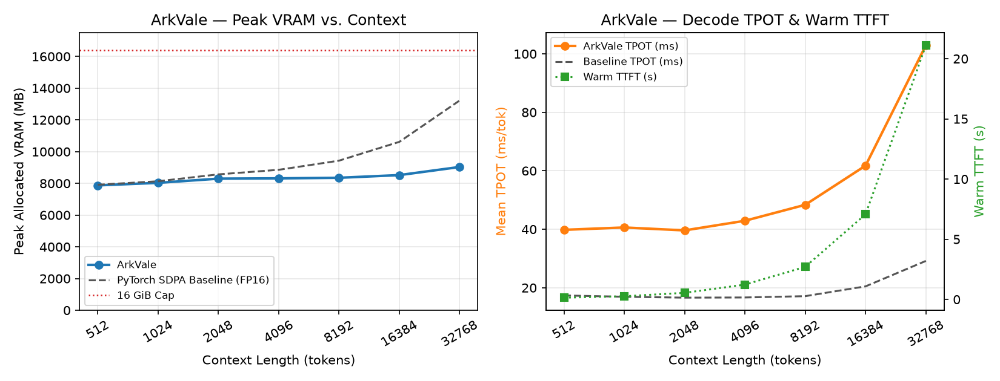
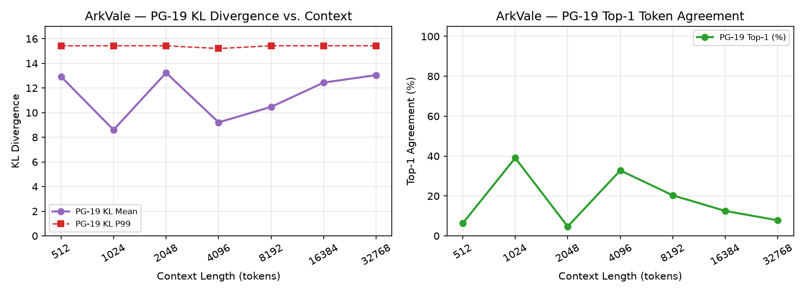
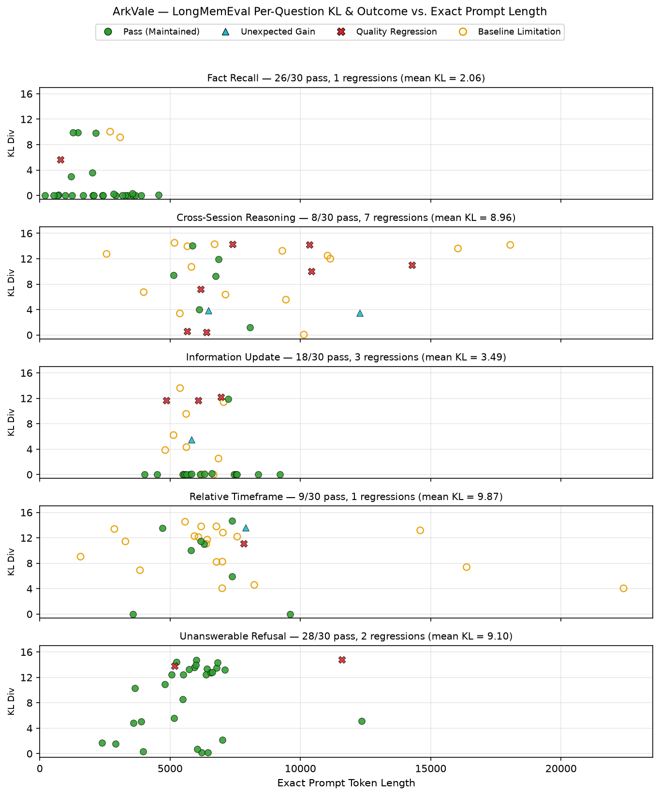

# WP-3 Technique Analysis: ArkVale (`arkvale`)

## 1. Verified Configuration & Empirical Snapshot

- **Authoritative Axis ([`docs/METRICS_AND_AXES.md`](../../../docs/METRICS_AND_AXES.md)):** **`SPATIAL`** (Host CPU DRAM full-page backup with GPU AABB page digests and on-demand page recall), with secondary `STRUCTURAL` page-selection mechanics.
  - *Axis Reconciliation Note:* `kv_bench` (`ArkValeTechnique.axes`) and the manifest label ArkVale as `["STRUCTURAL", "SPATIAL"]` (following the NeurIPS '24 paper's eviction framing). Under our Hub taxonomy (`docs/METRICS_AND_AXES.md`), because ArkVale preserves 100% of pages in host CPU DRAM and manages GPU-vs-CPU residency, its **primary production axis is `SPATIAL`**.
- **`kv_bench` Commit SHA:** `2a9338a2f750741f7765d79c1270f5579a9ffed0`
- **Model & Hardware:** `Qwen/Qwen3-4B-Instruct-2507` (`cdbee75f17c01a7cc42f958dc650907174af0554`, Pure Dense GQA, BF16, $L=36, H_Q=32, H_{KV}=8, D=128$) on NVIDIA GeForce RTX 4090 (23.52 GiB physical, `16.0 GiB` process allocator cap).
- **Manifest `technique_config` ([`run_manifest_wp3_arkvale.json`](../../../results/manifests/run_manifest_wp3_arkvale.json)):**
  - `cache_class`: `ArkValeCache`, `page_size`: `16`, `active_pages_budget`: `16` (`256` active tokens), `exempt_early_layers`: `2`, `block_size`: `16`.
- **Golden Artifact SHA-256s (`run_manifest_wp3_arkvale.json`):**
  - `arkvale_hardware_pytorch_16gb.json`: `ba4c2ed121e11a4f87cd37795501ddbfd362f190fabcb7096fc1bc5773ed1c9a`
  - `arkvale_longmem_pytorch_16gb.json`: `68fd866b3dee73909f72dd60658e82db0b8cd13cd2d03a5bb563225c413e914f`
  - `arkvale_niah_pytorch_16gb.json`: `cc37c564cb5b7ccb8395c83f1ec7a7a7b525bfd206f928ab2811fbc29e79829e`
  - `verify_arkvale_pytorch_16gb.json`: `6094d85b6a0e8a10650b2c3cf105d4f6218215f7152184ef1063cacb4b33a3`
  - `arkvale_judged.json`: `06e53fc123d80a877aabd1dda265c0b812ee6906d54aeb50beabcf1624edce4d`

### Hardware Sweep (`512 -> 32,768`, `SyntheticFiller` / PG-19)

Static `Qwen3-4B` BF16 weights + runtime overhead consume **~7,839.7 MiB (~7.66 GiB)**.

| Context | Status | Peak Alloc (MiB) | Net KV+Aux (MiB) | Base Alloc (MiB) | Host RSS $\Delta$ (MiB) | TTFT (s) | TPOT (ms) | Base TPOT (ms) | Tok/s | PCIe B/tok | Physical Scalar Bits | Eff. Token Retention | PG-19 Top-1 | PG-19 KL Mean | PG-19 KL P99 |
|---:|---|---:|---:|---:|---:|---:|---:|---:|---:|---:|---|---|---:|---:|---:|
| 512 | `SUCCESS` | 7,872.8 | 33.1 | 7,911.7 | 2,605.0 | 0.147 | 39.80 | 17.36 | 25.13 | 39,299,182.25 | 16-bit BF16 | 100% CPU; 256 GPU (L2..35) | 0.0625 | 12.92890 | 15.4197 |
| 1,024 | `SUCCESS` | 8,032.3 | 192.6 | 8,133.0 | 2,916.5 | 0.261 | 40.61 | 16.91 | 24.62 | 45,818,094.25 | 16-bit BF16 | 100% CPU; 256 GPU (L2..35) | 0.3906 | 8.60096 | 15.4243 |
| 2,048 | `SUCCESS` | 8,296.9 | 457.2 | 8,566.9 | 3,394.5 | 0.547 | 39.61 | 16.61 | 25.25 | 61,155,822.25 | 16-bit BF16 | 100% CPU; 256 GPU (L2..35) | 0.0469 | 13.23580 | 15.4249 |
| 4,096 | `SUCCESS` | 8,314.9 | 475.2 | 8,854.9 | 4,703.7 | 1.228 | 42.90 | 16.67 | 23.31 | 98,979,822.25 | 16-bit BF16 | 100% CPU; 256 GPU (L2..35) | 0.3281 | 9.21338 | 15.2016 |
| 8,192 | `SUCCESS` | 8,351.0 | 511.3 | 9,431.0 | 6,475.5 | 2.708 | 48.36 | 17.12 | 20.68 | 202,785,774.25 | 16-bit BF16 | 100% CPU; 256 GPU (L2..35) | 0.2031 | 10.46510 | 15.4249 |
| 16,384 | `SUCCESS` | 8,520.8 | 681.1 | 10,616.8 | 9,810.8 | 7.074 | 61.76 | 20.47 | 16.19 | 523,649,006.25 | 16-bit BF16 | 100% CPU; 256 GPU (L2..35) | 0.1250 | 12.43989 | 15.4249 |
| 32,768 | `SUCCESS` | **9,032.9** | **1,193.2** | 13,224.9 | **16,613.6** | **21.116** | 102.92 | 29.17 | 9.72 | **1,618,383,854.25** | 16-bit BF16 | 100% CPU; 256 GPU (L2..35) | 0.0781 | 13.04487 | 15.4249 |

### Quality Summary (Verify, NIAH, LongMemEval)

- **Verify (`ctx=128`):** `top1_agreement = 1.0000`, `kl_div_mean = 0.0`, `kl_div_p99 = 0.0` (`128 <= 16 * 16 = 256` active budget, so zero eviction occurs at `128`).
- **NIAH (`2K` & `4K`, 10 depths `0.0..0.9`):** **10/10 (100%)** at `2048` and **10/10 (100%)** at `4096`.
- **LongMemEval (`150` samples, prompt length `192..22,400`, mean `5,967.9` tokens):**
  - `peak_alloc_mb = 8,787.8`, `host_rss_delta_mb = 6,800.9`, `ttft_sec = 1.875`, `tpot_mean_ms = 39.59`, `throughput_tok_per_sec = 919.70`.
  - **LongMem KL:** `top1_agreement = 0.3836`, `kl_div_mean = 8.98795`, `kl_div_p99 = 15.4249`.
  - **Overall Accuracy:** **89/150 (59.33%)** vs. Baseline **99/150 (66.00%)** (`-6.67 pp`, lowest among Wave C techniques).
  - **Verdict Breakdown:** `PASS_FIDELITY_MAINTAINED: 85`, `BASELINE_LIMITATION: 47`, **`QUALITY_REGRESSION: 14`**, `UNEXPECTED_GAIN: 4`.

| LongMemEval Capability | Baseline Acc | ArkVale Acc | Delta (pp) | `QUALITY_REGRESSION` Count |
|---|---:|---:|---:|---:|
| `fact_recall` | 90.00% | 86.67% | -3.33 | 1 |
| `information_update` | 66.67% | 60.00% | -6.67 | 3 |
| `relative_timeframe` | 30.00% | 30.00% | 0.00 | 1 |
| `cross_session_reasoning` | 43.33% | 26.67% | **-16.67** | 7 |
| `unanswerable_refusal` | 100.00% | 93.33% | -6.67 | 2 |

---

## 2. White-Box Component Decomposition

| ID | Component | Source Location | Tensor Shapes & Dtypes (`Qwen3-4B`: $L=36, H_{KV}=8, D=128$) | Cadence |
|---|---|---|---|---|
| **C1** | **Incremental AABB Page Digest Builder** | [`arkvale_cache.py#L162-L183`](file:///home/khemi/workspace/kv_bench/src/techniques/arkvale_cache.py#L162-L183) (`_update_incremental_digests`) | Computes `c = 0.5*(amin+amax)`, `r_mean = mean(|k - c|)` per 16-token page; stores `gpu_b_min, gpu_b_max` `[B, 8, max_pages, 128]` BF16 on GPU. | Every `update()` for touched pages only. |
| **C2** | **Pinned CPU Backup Pool & Early-Layer Exemption** | [`arkvale_cache.py#L121-L160`](file:///home/khemi/workspace/kv_bench/src/techniques/arkvale_cache.py#L121-L160), [`#L209-L220`](file:///home/khemi/workspace/kv_bench/src/techniques/arkvale_cache.py#L209-L220), [`#L258-L265`](file:///home/khemi/workspace/kv_bench/src/techniques/arkvale_cache.py#L258-L265) | `cpu_k_buf, cpu_v_buf` `[B, 8, cap, 128]` BF16 pinned; layers `0, 1` (`exempt_early_layers=2`) bypass pruning and stream full `cpu_{k,v}_buf` to GPU. | Capacity doubles on growth; exempt layers copy full history every decode step. |
| **C3** | **AABB Digest Scoring & Full-Budget Page Recall** | [`arkvale_cache.py#L223-L256`](file:///home/khemi/workspace/kv_bench/src/techniques/arkvale_cache.py#L223-L256) (`ArkValeLayer.update`) | Scores `gpu_b_{min,max}` using **`key_states` as `q_proxy`** (`[B, 8, 1, 128]`); selects `16` pages (`256` tokens) and HtoD-copies **all 16 pages** (`gpu_active_{k,v}`) every step. | Every decode step for layers `2..35` (`total_pages > 16`). |

---

## 3. 3-Way Causal Attribution

- **VRAM Savings (`[INTRINSIC]`):** Capping layers `2..35` to `active_pages_budget=16` (`256` tokens) holds `peak_alloc_mb` at `8,296.9..8,520.8 MiB` from `2K` to `16K`, reaching only **`9,032.9 MiB`** (`1,193.2 MiB` net KV+aux) at `32K` — saving **`4.19 GiB`** vs. baseline (`13,224.9 MiB`).
- **Host RSS (`[INTRINSIC]` + `[IMPLEMENTATION]`):** `host_rss_delta_mb` reaches **`16,613.6 MiB`** (~16.2 GiB) at `32K`, exceeding a 16 GB host RAM cap due to uncompressed BF16 `cpu_{k,v}_buf` (`~4.5 GiB` payload) plus power-of-2 pinned allocator doubling (`cap=32,768 -> 65,536` when `32,768 + gen > 32,768`).
- **PCIe Volume, TTFT & TPOT (`[IMPLEMENTATION]`):** At `32K`, `memcpy_bytes_per_token` is **`1,618,383,854.25 B/tok`** (~1.62 GB/tok), TTFT is **`21.116 s`** (`3.03x` slower than baseline `6.978 s`), and TPOT is **`102.92 ms`** (`3.53x` slower than baseline). Three implementation bugs drive this:
  1. `C2` copies `cpu_{k,v}_buf[:, :, :new_total]` to GPU on **every decode step** for exempt layers `0, 1` (`arkvale_cache.py:263-264`), plus full prefill round-trip for all 36 layers.
  2. `C3` re-fetches **all 16 selected pages** (`256` tokens) from `cpu_{k,v}_buf` on every decode step (`arkvale_cache.py:254-255`) instead of caching resident pages on GPU and recalling only `recalled` delta pages.
  3. `C1` iterates over pages in Python during prefill (`for p in range(p_start, p_end + 1)` over `2,048` pages $\times 36$ layers), inflating 32K TTFT to `21.12 s`.
- **KL & LongMemEval Regressions (`[IMPLEMENTATION]` + `[INTRINSIC]`):**
  - `arkvale_cache.py:228` uses **`key_states` as `q_proxy`** (`q_proxy = key_states.unsqueeze(-2)`) instead of `query_states`, and averages scores across `H_KV=8` instead of max-pooling across `H_Q=32` GQA heads (`score_page_digests_gqa` in `arkvale.py:62-104` is never called by `ArkValeLayer`!).
  - Additionally, `active_pages_budget=16` (`256` tokens = `0.78%` of 32K) is `8x–16x` smaller than the paper's `2,048–4,096` token budget. Together, these cause `verify` at `512` to immediately drop to `top1_agreement = 0.0625` (`kl_div_mean = 12.93`, `kl_div_p99 = 15.4249` clamp) and LongMemEval to drop to `89/150 (59.33%)` (`14 QUALITY_REGRESSION`s, `-16.67 pp` on `cross_session_reasoning`).

---

## 4. Paper vs. Replication Fidelity

| Dimension | ArkVale Paper ([`arkvale.md`](../../../docs/literature_survey/techniques/arkvale.md)) | `kv_bench` Replication (`arkvale.py` / `arkvale_cache.py`) | Fidelity Verdict |
|---|---|---|---|
| **AABB Digest (`c ± r_mean`)** | `c = 0.5*(min+max)`, `r_mean = mean(|k - c|)`. | Exact formula in `_update_incremental_digests`, though looped in Python. | **Faithful (slow prefill loop).** |
| **Page Scoring Query** | Uses **decode `query` $q$** with GQA max-pool across query heads. | Uses **`key_states` as `q_proxy`** (`arkvale_cache.py:228`) with KV-head mean! | **Critical Divergence (`[IMPLEMENTATION]` Bug).** |
| **Zero-Copy Eviction & Delta Recall** | Resident GPU page pool; only recalls `<10` delta pages/step. | Re-fetches **all 16 active pages** every step; exempt layers re-fetch **all 32K tokens** every step! | **Critical Divergence (`[IMPLEMENTATION]` Bug):** `1.62 GB/tok` PCIe traffic. |
| **Active Token Budget** | `2,048–4,096` tokens (`128–256` pages at `p=16`). | `active_pages_budget=16` (`256` tokens). | **Under-budgeted (`8x–16x` tighter).** |

---

## 5. Component Verdicts (`KEEP` / `ADAPT` / `DROP`)

| Component | Verdict | Contribution | Failure Mode | Required Fix (if `ADAPT`) |
|---|---|---|---|---|
| **C1: Incremental AABB Page Digests** | **`ADAPT`** | Compact `2*D` per-page summary aligned with 16-token PagedAttention blocks. | Python `for p in range(...)` loop inflates 32K TTFT to `21.12 s`. | Vectorize prefill digest computation with `.view(..., num_pages, 16, D)`. |
| **C2: Pinned CPU Backup & Exempt Layers** | **`ADAPT`** | Keeps VRAM at `9.03 GiB` at 32K; preserves layers `0, 1` accuracy. | Exempt layers re-copy full 32K CPU buffer every decode step; `16.2 GiB` host RSS. | Pin exempt layers `0, 1` **on GPU** (`~256 MiB` at 32K) and quantize CPU backup to 4-bit (WP-4). |
| **C3: Digest Scoring & Page Recall** | **`ADAPT`** | Enables bounded-VRAM recallable eviction. | Uses `key_states` as `q_proxy` and re-fetches all 16 pages every step. | Hook SDPA to pass true **`query_states`** into `score_page_digests_gqa`, maintain resident GPU page slots, and recall **only delta pages**. |
