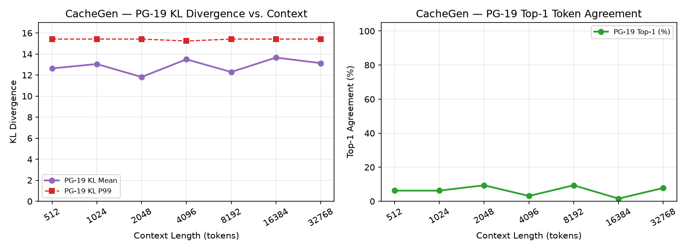
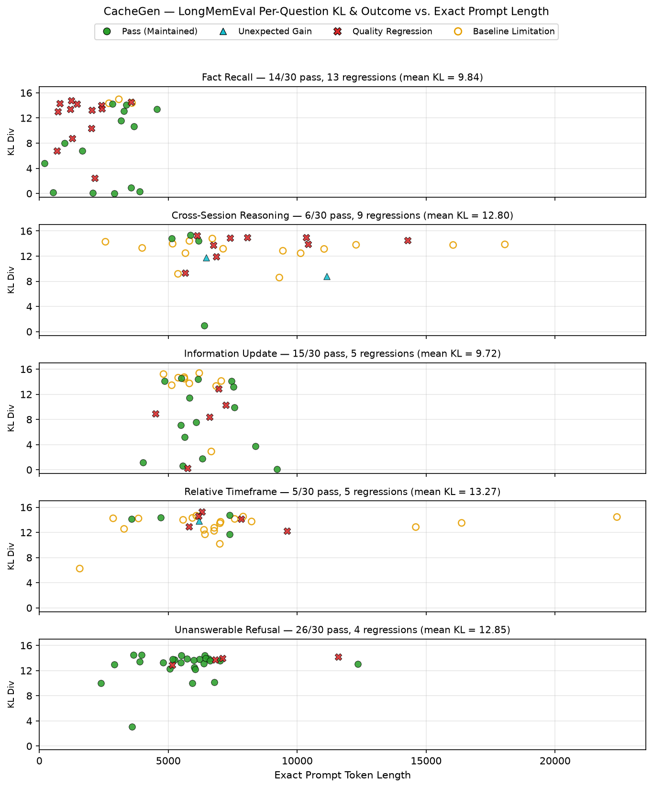

# WP-3 Technique Analysis: `cachegen` (CacheGen)

## 1. Verified Configuration & Empirical Snapshot

### Provenance & Authoritative Configuration
- **Repository & Commit:** `khemingkapat/kv_bench` @ `2a9338a2f750741f7765d79c1270f5579a9ffed0` (`main`, clean working tree)
- **Primary Model:** `Qwen/Qwen3-4B-Instruct-2507` (`cdbee75f17c01a7cc42f958dc650907174af0554`, Pure Dense GQA, `bfloat16`, $L=36, H_Q=32, H_{KV}=8, D=128$)
- **Hardware & Harness:** `gpu06.slurm.cpe.kmutt.ac.th`, NVIDIA GeForce RTX 4090 (23.52 GiB physical, **16.0 GiB** process allocator cap), Slurm Job `25765` (hardware/verify/NIAH) & `30137` (LongMemEval)
- **Authoritative Axis ([`docs/METRICS_AND_AXES.md`](../../../docs/METRICS_AND_AXES.md)):** `STRUCTURAL` *(Note: `cachegen.py` and manifest declare `["STRUCTURAL", "SPATIAL"]`, but `CacheGenCache` performs no host/network offloading; all state resides in GPU VRAM under `STRUCTURAL` compression.)*
- **Manifest `technique_config`:**
  ```json
  {
    "cache_class": "CacheGenCache",
    "anchor_group_size": 10,
    "shallow_bits": 8,
    "mid_bits": 4,
    "deep_bits": 2,
    "block_size": 16
  }
  ```
- **`VERIFIED` Hub Artifact SHA-256s ([`run_manifest_wp3_cachegen.json`](../../../results/manifests/run_manifest_wp3_cachegen.json)):**
  - `cachegen_hardware_pytorch_16gb.json`: `acc433feceacefd6e24f735e0dd5bee34b4fbf257389848f8fec5b48342b32f3`
  - `cachegen_longmem_pytorch_16gb.json`: `d6420e6a6e3f1e168452591baec6acf3c165f8c425d2d97471daf95b1b1606f3`
  - `cachegen_niah_pytorch_16gb.json`: `67b12f9ee081f2f3813290f475cc426d6a3862a98a41c3fc8c874169b8adda7a`
  - `verify_cachegen_pytorch_16gb.json`: `3e7c6c3e0ed2448d586a74c45404508ab995fc228eae5c4accdd86d7f486c9c9`
  - `cachegen_grades.json`: `647237521ab83fbeca89e5eb3e16f8d875e98486fecd8ef0e1fcff03b1f91803`
  - `cachegen_judged.json`: `94da6e62c9977f2ca0c3c52046fdc60dbe84629c71249d3dccddff0a831e14d1`

### Precision & Retention Separation
| Metric | Value | Notes |
|---|---:|---|
| **Physical Scalar Bits** | **6.392 bits/scalar** (K & V) | 1/10 tokens stored as BF16 anchors (`1.6 bits/scalar`) + all tokens stored in layer-tiered delta buffers (layers `0..11`: 8-bit, `12..23`: 4-bit, `24..35`: 2-bit; mean `4.667 bits/scalar`) + per-token BF16 delta scale (`0.125 bits/scalar`) = `6.392 bits/scalar` (`CacheGenCache.effective_bits_per_scalar`; hardware JSON reports `compression_ratio_vs_bf16 = 3.43`) |
| **Effective Token Retention** | **100.0%** | All prompt and generated tokens are retained in `CacheGenLayer` (`total_tokens_seen`) |

### Hardware Context Scaling Sweep (`512 -> 32,768`, `SyntheticFiller`)
Static `Qwen3-4B` BF16 weights + PyTorch runtime occupy **7,738.78 MiB (~7.56 GiB)** (`verify_baseline_pytorch_16gb.json` at `ctx=128`); net KV+aux VRAM below is `Peak Alloc - 7,738.78 MiB`.

| Ctx | Peak Alloc (MiB) | Base Alloc (MiB) | Net KV+Aux (MiB) | Base Net KV (MiB) | TTFT (s) | TPOT (ms) | Base TPOT (ms) | Tok/s | Host RSS Δ (MiB) | Memcpy (B/tok) | Top-1 Agr. | KL Mean | KL P99 |
|---:|---:|---:|---:|---:|---:|---:|---:|---:|---:|---:|---:|---:|---:|
| 512 | 7,891.78 | 7,911.66 | 153.00 | 172.88 | 0.0644 | 40.66 | 17.36 | 24.59 | 3,127.71 | 253.50 | 0.0625 | 12.6342 | 15.4199 |
| 1,024 | 8,101.63 | 8,133.04 | 362.85 | 394.26 | 0.0949 | 40.99 | 16.91 | 24.40 | 3,136.83 | 1,888,125.50 | 0.0625 | 13.0502 | 15.4249 |
| 2,048 | 8,393.99 | 8,566.92 | 655.21 | 828.14 | 0.2226 | 40.88 | 16.61 | 24.46 | 3,198.47 | 5,659,266.56 | 0.0938 | 11.8169 | 15.4248 |
| 4,096 | 8,523.53 | 8,854.93 | 784.75 | 1,116.15 | 0.5243 | 40.07 | 16.67 | 24.96 | 3,255.27 | 11,318,405.94 | 0.0312 | 13.4983 | 15.2393 |
| 8,192 | 8,753.57 | 9,430.96 | 1,014.79 | 1,692.18 | 1.3384 | 39.97 | 17.12 | 25.02 | 3,438.21 | 52,794,513.19 | 0.0938 | 12.2941 | 15.4249 |
| 16,384 | 9,311.56 | 10,616.78 | 1,572.78 | 2,878.00 | 3.8025 | 43.09 | 20.47 | 23.21 | 3,826.65 | 226,229,415.69 | 0.0156 | 13.6631 | 15.4249 |
| 32,768 | 10,600.17 | 13,224.90 | 2,861.39 | 5,486.12 | 12.5550 | 82.87 | 29.17 | 12.07 | 4,535.78 | 935,016,150.94 | 0.0781 | 13.1353 | 15.4249 |

*Verify (`ctx=128`, 16 gen tokens):* `top1_agreement = 0.0`, `kl_div_mean = 12.35715`, `kl_div_p99 = 15.3301`.

### Quality Diagnostics: NIAH (2K/4K) & LongMemEval (150 Questions, Judged)
- **NIAH Exact Retrieval:**
  - `2,048` ctx: **4/10 (40.0%)** (passed only at depths `0.2, 0.4, 0.5, 0.9`)
  - `4,096` ctx: **8/10 (80.0%)** (failed at depths `0.2, 0.9`)
- **LongMemEval Logit Fidelity (native lengths `192..22,400`, mean `5,967.9` tokens):** `top1_agreement = 0.1174`, `kl_div_mean = 12.7129`, `kl_div_p99 = 15.4249`.
- **LongMemEval 5-Capability Judged Accuracy ([`cachegen_judged.json`](../../../results/grades/cachegen_judged.json) vs. [`baseline_judged.json`](../../../results/grades/baseline_judged.json)):**

| Capability | Baseline | CacheGen | Δ vs. Baseline | `QUALITY_REGRESSION` Count |
|---|---:|---:|---:|---:|
| **Overall (150)** | **66.0% (99/150)** | **44.0% (66/150)** | **-22.00 pp** | **36** *(+3 `UNEXPECTED_GAIN`)* |
| `fact_recall` (30) | 90.00% | 46.67% | -43.33 pp | 13 |
| `information_update` (30) | 66.67% | 50.00% | -16.67 pp | 5 |
| `cross_session_reasoning` (30) | 43.33% | 20.00% | -23.33 pp | 9 |
| `relative_timeframe` (30) | 30.00% | 16.67% | -13.33 pp | 5 |
| `unanswerable_refusal` (30) | 100.00% | 86.67% | -13.33 pp | 4 |





---

## 2. White-Box Component Decomposition

| ID | Component | Source Location | Tensor Shapes & Dtypes (`Qwen3-4B`: $L=36, H_Q=32, H_{KV}=8, D=128$) | Cadence |
|---|---|---|---|---|
| **C1** | **Anchor-Relative Delta Encoder** | `cachegen_cache.py`: `CacheGenLayer.update` (L279–308) | Stores BF16 anchors every $G=10$ tokens in `k_anchors_buf`, `v_anchors_buf` `(1, 8, ceil(cap/10), 128)` `bf16`; computes `key_states - active_k_anchors` | Every prefill chunk & decode step |
| **C2** | **Layer-Tiered Delta Quantizer & Bit-Packer** | `cachegen_cache.py`: `_resolve_tier_bits` (L79–86), `_pack_quantized` (L97–113) | Layers `0..11`: 8-bit `int8`; `12..23`: 4-bit `uint8` (`D/2=64`); `24..35`: 2-bit `uint8` (`D/4=32`); plus per-token `k_delta_s_buf`, `v_delta_s_buf` `(1, 8, cap, 1)` `bf16` | Every prefill chunk & decode step |
| **C3** | **CPU-Staged Capacity Grower** | `cachegen_cache.py`: `CacheGenLayer._ensure_capacity` (L189–251) | On capacity growth (`1024 -> 2048 -> 2048+256 -> ...`), copies all 6 GPU buffers **`.cpu()`** (L217–222), frees GPU buffers, reallocates larger GPU buffers, and copies back **HtoD** (L243–248) | Every capacity expansion past 1,024 tokens |
| **C4** | **Full-Sequence Delta Reconstruction for SDPA** | `cachegen_cache.py`: `_reconstruct_from_deltas` (L133–158), `keys`/`values` (L161–174) | Unpacks entire `[0..T]` deltas, multiplies by `ds`, and adds `anchors` into `(1, 8, T, 128)` `bf16` for HF `sdpa` | Every prefill chunk & every decode step |

---

## 3. 3-Way Causal Attribution

- **VRAM Savings (`10,600.17 MiB` vs. `13,224.90 MiB` at 32K, `-2,624.73 MiB`):**
  - **`[IMPLEMENTATION]`** Persistent single-pass `CacheGenLayer` state at 32K (`32,832` tokens) occupies **`1,934,062,464 B` (`1.80 GiB`)**, including `1/10` BF16 anchors + tiered deltas + BF16 scales (note: `compressed_bitstream_bytes = 3,868,124,928 B` = `3.60 GiB` in the hardware JSON accumulates `2×` across `--profile` + timed runs in `harness.py`). Meanwhile, **C4** reconstructs transient `(1, 8, T, 128)` BF16 tensors for HF `sdpa`, leaving net KV+aux at `2,861.39 MiB` (vs. `5,486.12 MiB` baseline net).
- **Extreme PCIe Memcpy (`935.0 MB/tok` at 32K) & TTFT/TPOT Overhead (`12.56 s` TTFT, `82.87 ms` TPOT at 32K):**
  - **`[IMPLEMENTATION]`** **C3 (`_ensure_capacity`, L210–248)** explicitly stages all 6 cache buffers through **CPU RAM** (`.cpu()` DtoH followed by `.copy_()` HtoD) on every capacity growth step! Past `2,048` tokens, `new_capacity = required_capacity + 256` (L205) triggers **~120 CPU round-trips** during a 32K sweep (`1024 -> 2048 -> 2304 -> ... -> 32768`), inflating `memcpy_bytes_per_token` to **`935,016,150.94 B/tok`** (far above the `8,266 B/tok` harness floor) and driving TTFT (`12.56 s` vs. `6.98 s` baseline) and Host RSS (`4,535.78 MiB`). Meanwhile, **C4**'s per-step full-sequence delta unpacking drives decode TPOT to `82.87 ms` (`2.84x` baseline).
- **KL Divergence (`11.8–13.7` mean), NIAH (`40%` at 2K, `80%` at 4K), & LongMemEval (`44.0%`, `36` QR):**
  - **`[INTRINSIC]`** + **`[IMPLEMENTATION]`** **C1 + C2** cause **36 `QUALITY_REGRESSION`s** (`fact_recall` collapses `-43.33 pp` with 13 QR; `cross_session_reasoning` drops `-23.33 pp` with 9 QR, e.g., `2e6d26dc`, `f0e564bc`, `a11281a2`). Two mechanisms compound:
    1. Post-RoPE Keys rotate with position, so `K_i - K_anchor` across $G=10$ tokens has *high* variance (unlike pre-RoPE or unrotated states), forcing **2-bit per-token symmetric delta quantization** in the deep third of layers (`24..35`) to clip/corrupt attention routing—even failing `2,048` NIAH at `6/10` depths.
    2. **C2** uses uniform `round(deltas / scale)` *without* CacheGen's offline channel-layer arithmetic coding (`P_{l,c}`) or adaptive chunk-rate fallback, paying full lossy 2-bit error in deep layers without entropy-coding compression gains.
  - **`[HARDWARE/GQA]`** `kl_div_p99 = 15.4249` is the runner's top-5 logprob clamp on `N=1` `SyntheticFiller`.

---

## 4. Paper vs. Replication Fidelity

| Dimension | CacheGen Paper ([`docs/literature_survey/techniques/cachegen.md`](../../../docs/literature_survey/techniques/cachegen.md)) | `kv_bench` Replication (`cachegen.py` / `cachegen_cache.py`) | Impact of Divergence |
|---|---|---|---|
| **Arithmetic Coding (AC)** | Offline-profiled channel-layer distributions $P_{\ell,c}$ + GPU arithmetic coder (`3.5x–4.3x` bitstream reduction) | **Omitted.** Raw `int8`/`uint8` bit-packed tensors (`cachegen_cache.py` L97–113) | Lower true compression (`6.392 bits/scalar` physical) |
| **Layer-Tiered Quantization** | 3 tiers with bin widths $w_g \in \{0.5, 1.0, 1.5\}$ + 8-bit anchors | 3 tiers with fixed bitwidths `8 / 4 / 2` bits + **16-bit BF16 anchors** | Deep-layer 2-bit deltas cause `-43.33 pp` `fact_recall` & `40%` 2K NIAH |
| **Anchor Storage** | Anchor token stored at 8-bit; non-anchors as deltas | Anchors stored in `bf16` (`1/10`), *and* anchor slots still allocated in `k_delta_q_buf` | Wastes ~10% delta buffer space |
| **Execution & Offload Axis** | Network streaming (`1–10 Gbps`) with chunked GPU AC decode before prefill/decode | **No offloading (`SPATIAL` unimplemented)**; accidental `.cpu()` staging in `_ensure_capacity` (`L217–248`) | Generates **`935 MB/tok` PCIe thrashing** during growth |

---

## 5. Component Verdicts (`KEEP` / `ADAPT` / `DROP`)

| Component | Verdict | Contribution | Failure Mode | Fix Prerequisite (if `ADAPT`) |
|---|---|---|---|---|
| **C1: Anchor-Relative Delta Encoder** | **`ADAPT`** | Parallelizable $G=10$ delta structure | Post-RoPE key rotation increases delta variance across $G=10$ tokens | Compute deltas **pre-RoPE** (or per-channel centered) so rotary phase does not inflate delta dynamic range |
| **C2: Layer-Tiered Quantizer (8/4/2)** | **`ADAPT`** | Protects shallow layers (`0..11`) at 8-bit | Deep-layer `2-bit` deltas destroy `fact_recall` (-43.33 pp) & 2K NIAH (40%); lacks AC | Raise deep tier floor to `>=3–4` bits (or add residual/outlier protection) and add GPU entropy/LZ4 coding for `SPATIAL` PCIe offload |
| **C3: CPU-Staged `_ensure_capacity`** | **`DROP`** | Avoids 2× GPU peak during realloc | Triggers ~120 DtoH+HtoD round-trips (`935 MB/tok` memcpy, `12.56 s` TTFT) | Replace with doubling/chunked paged blocks or pure-GPU realloc |
| **C4: Full-Seq Delta Reconstruction** | **`DROP`** | Reference HF `sdpa` compatibility | `2.84x` TPOT slowdown at 32K | Decompress chunks once into paged BF16/INT4 KV blocks (for `LMCache` spatial restore), not per-decode-step |
