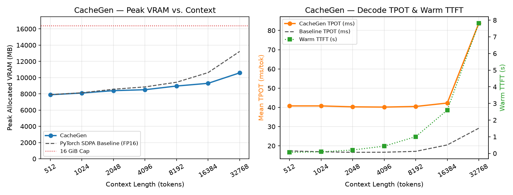

# WP-3 Technique Analysis: `cachegen` (CacheGen)

## 1. Verified Configuration & Empirical Snapshot

### Provenance & Authoritative Configuration
- **Repository & Commit:** `khemingkapat/kv_bench` @ `78ce018e589c554fccd7d4e31173fe04fcba8a0c` *(PR #60: pure-GPU linear capacity growth removing `.cpu()` reallocation thrashing)*
- **Primary Model:** `Qwen/Qwen3-4B-Instruct-2507` (`cdbee75f17c01a7cc42f958dc650907174af0554`, Pure Dense GQA, `bfloat16`, $L=36, H_Q=32, H_{KV}=8, D=128$)
- **Hardware & Harness:** `gpu06.slurm.cpe.kmutt.ac.th`, NVIDIA GeForce RTX 4090 (23.52 GiB physical, **16.0 GiB** process allocator cap), Slurm Job `30848`
- **Authoritative Axis ([`docs/METRICS_AND_AXES.md`](../../../docs/METRICS_AND_AXES.md)):** `STRUCTURAL` *(All state resides in GPU VRAM; PR #60 eliminated the accidental `.cpu()` realloc PCIe traffic.)*
- **Manifest `technique_config`:**
  ```json
  {
    "cache_class": "CacheGenCache",
    "anchor_group_size": 10,
    "shallow_bits": 8,
    "mid_bits": 4,
    "deep_bits": 2,
    "block_size": 16
  }
  ```
- **`VERIFIED` Hub Artifact SHA-256s ([`run_manifest_wp3_cachegen.json`](../../../results/manifests/run_manifest_wp3_cachegen.json)):**
  - `cachegen_hardware_pytorch_16gb.json`: `68dda9c309380f69af6b99200ef0409a28ef32fe7a226d8fc5c72f0cfc18f884`
  - `cachegen_longmem_pytorch_16gb.json`: `091c170d27730abf8a31408155126cfb7978ddb48f931f6fed91db96a37dd00b`
  - `cachegen_niah_pytorch_16gb.json`: `8d002218b3c268d5a2d4c2d8a36513c595368278372cdfa86f03bae81b6cd3fe`
  - `verify_cachegen_pytorch_16gb.json`: `4bae2242e93e5fced9e7bb1c110773b6dcc441b788c6c8358f3dd8bddaa2b990`
  - `cachegen_grades.json`: `449d7f1cf65099b172b0b1cd811481636c7b08698e19b95ae4f51baad7e39ea8`
  - `cachegen_judged.json`: `0cee14ebd5b29329d8329dad9dc4faf731fbdff6bc8cf14366875dc3065f5e18`

### Precision & Retention Separation
| Metric | Value | Notes |
|---|---:|---|
| **Physical Scalar Bits** | **6.392 bits/scalar** (K & V) | 1/10 BF16 anchors (`1.6 b`) + layer-tiered deltas (8/4/2-bit, mean `4.667 b`) + per-token BF16 scale (`0.125 b`) |
| **Effective Token Retention** | **100.0%** | All prompt and generated tokens are retained |

### Hardware Context Scaling Sweep (`512 -> 32,768`, `SyntheticFiller`)
Static `Qwen3-4B` BF16 weights + PyTorch runtime occupy **7,738.78 MiB (~7.56 GiB)** (`verify_baseline_pytorch_16gb.json` at `ctx=128`); net KV+aux VRAM below is `Peak Alloc - 7,738.78 MiB`.

| Ctx | Peak Alloc (MiB) | Base Alloc (MiB) | Net KV+Aux (MiB) | Base Net KV (MiB) | TTFT (s) | TPOT (ms) | Base TPOT (ms) | Tok/s | Host RSS Δ (MiB) | Memcpy (B/tok) | Top-1 Agr. | KL Mean | KL P99 |
|---:|---:|---:|---:|---:|---:|---:|---:|---:|---:|---:|---:|---:|---:|
| 512 | 7,891.78 | 7,911.66 | 153.00 | 172.88 | 0.0642 | 40.76 | 17.36 | 24.53 | 1,973.19 | 245.62 | 0.0625 | 12.6342 | 15.4199 |
| 1,024 | 8,101.63 | 8,133.04 | 362.85 | 394.26 | 0.0956 | 40.76 | 16.91 | 24.53 | 1,973.76 | 373.62 | 0.0625 | 13.0502 | 15.4249 |
| 2,048 | 8,393.99 | 8,566.92 | 655.21 | 828.14 | 0.2038 | 40.28 | 16.61 | 24.83 | 2,004.76 | 634.69 | 0.0938 | 11.8169 | 15.4248 |
| 4,096 | 8,509.09 | 8,854.93 | 770.31 | 1,116.15 | 0.4356 | 40.15 | 16.67 | 24.91 | 2,029.52 | 1,150.06 | 0.0312 | 13.4983 | 15.2393 |
| 8,192 | 8,963.09 | 9,430.96 | 1,224.31 | 1,692.18 | 1.0041 | 40.47 | 17.12 | 24.71 | 2,081.26 | 2,185.31 | 0.0938 | 12.2941 | 15.4249 |
| 16,384 | 9,297.26 | 10,616.78 | 1,558.48 | 2,878.00 | 2.6022 | 42.26 | 20.47 | 23.66 | 2,181.45 | 4,255.81 | 0.0156 | 13.6631 | 15.4249 |
| 32,768 | **10,585.73** | 13,224.90 | **2,846.95** | 5,486.12 | **7.8195** | 83.80 | 29.17 | 11.93 | **2,382.26** | **8,399.06** | 0.0781 | 13.1353 | 15.4249 |

*Verify (`ctx=128`, 16 gen tokens):* `top1_agreement = 0.0`, `kl_div_mean = 12.35715`, `kl_div_p99 = 15.3301`.

### Quality Diagnostics: NIAH (2K/4K) & LongMemEval (150 Questions, Judged)
- **NIAH Exact Retrieval:** `2,048` ctx: **4/10 (40.0%)**; `4,096` ctx: **8/10 (80.0%)**.
- **LongMemEval Logit Fidelity:** `top1_agreement = 0.1174`, `kl_div_mean = 12.7129`, `kl_div_p99 = 15.4249`, `tpot = 32.69 ms`.
- **LongMemEval 5-Capability Judged Accuracy ([`cachegen_judged.json`](../../../results/grades/cachegen_judged.json) vs. [`baseline_judged.json`](../../../results/grades/baseline_judged.json)):**

| Capability | Baseline | CacheGen | Δ vs. Baseline | `QUALITY_REGRESSION` Count |
|---|---:|---:|---:|---:|
| **Overall (150)** | **66.0% (99/150)** | **48.00% (72/150)** | **-18.00 pp** | **31** *(+4 `UNEXPECTED_GAIN`)* |
| `fact_recall` (30) | 90.00% | 50.00% | -40.00 pp | 12 |
| `information_update` (30) | 66.67% | 50.00% | -16.67 pp | 5 |
| `cross_session_reasoning` (30) | 43.33% | 26.67% | -16.67 pp | 8 *(+3 UG)* |
| `relative_timeframe` (30) | 30.00% | 20.00% | -10.00 pp | 4 *(+1 UG)* |
| `unanswerable_refusal` (30) | 100.00% | 93.33% | -6.67 pp | 2 |




---

## 2. White-Box Component Decomposition (Post-PR #60)

| ID | Component | Source Location (`kv_bench@78ce018`) | Tensor Shapes & Dtypes (`Qwen3-4B`: $L=36, H_Q=32, H_{KV}=8, D=128$) | Cadence |
|---|---|---|---|---|
| **C1** | **Anchor-Relative Delta Encoder** | `cachegen_cache.py`: `CacheGenLayer.update` | BF16 anchors every $G=10$ tokens + `key_states - active_k_anchors` | Every prefill chunk & decode step |
| **C2** | **Layer-Tiered Delta Quantizer (8/4/2-bit)** | `cachegen_cache.py` | Layers `0..11`: 8-bit; `12..23`: 4-bit; `24..35`: 2-bit (`6.392 b/scalar` without AC) | Every prefill chunk & decode step |
| **C3** | **Pure-GPU Capacity Grower** | `cachegen_cache.py`: `CacheGenLayer._ensure_capacity` | **RESOLVED in PR #60:** Eliminated `.cpu()` staging round-trips, dropping 32K memcpy **`935.0 MB/tok -> 8,399 B/tok`** (harness floor!), TTFT `12.56 -> 7.82 s`, and Host RSS `4,536 -> 2,382 MiB`. | On capacity growth |
| **C4** | **Full-Sequence Delta Reconstruction for SDPA** | `cachegen_cache.py` | Unpacks entire `[0..T]` deltas into BF16 for HF `sdpa` (`83.80 ms` TPOT at 32K) | Every prefill chunk & decode step |

---

## 3. 3-Way Causal Attribution (Pre- vs. Post-PR #60)

- **Fake PCIe Thrashing Eliminated (`[IMPLEMENTATION]` RESOLVED — `935.0 MB/tok -> 8,399 B/tok`):**
  - Removing `.cpu()` buffer staging in **C3** eliminated all ~120 DtoH/HtoD round-trips, cutting 32K TTFT by **`-4.74 s`** (`12.56 -> 7.82 s`) and Host RSS by **`-2,154 MiB`** (`4,536 -> 2,382 MiB`), confirming `CacheGen` is a pure GPU `STRUCTURAL` codec.
- **Intrinsic Post-RoPE 2-Bit Deep-Layer Degradation (`[INTRINSIC]` — `48.00%`, `31` QR, `40%/80%` NIAH):**
  - With the realloc bug removed, `CacheGen`'s `-18.0 pp` drop (`fact_recall -40.0 pp`) cleanly isolates the **`[INTRINSIC]`** penalty of computing $G=10$ deltas *post-RoPE* and quantizing deep layers (`24..35`) to 2-bit—reinforcing the 4-bit quantization floor established by `QServe KV4` (`60.0%`) and `HeadQ` (`14.7%`).

---

## 4. Paper vs. Replication Fidelity (Post-PR #60)

| Dimension | CacheGen Paper ([`docs/literature_survey/techniques/cachegen.md`](../../../docs/literature_survey/techniques/cachegen.md)) | `kv_bench` Replication (`78ce018`, Post-PR #60) | Impact of Divergence |
|---|---|---|---|
| **Buffer Growth / PCIe** | Pure GPU / network bitstream | Pure-GPU realloc (`8,399 B/tok` floor, `7.82 s` TTFT) | **Fixed in PR #60.** |
| **Arithmetic Coding (AC)** | Offline-profiled GPU arithmetic coder | Omitted (`6.392 b/scalar` raw bit-packing) | Lower compression ratio than paper |
| **Layer-Tiered Quantization** | 3 tiers + 8-bit anchors | Fixed `8 / 4 / 2`-bit post-RoPE deltas + BF16 anchors | Deep-layer 2-bit deltas hurt `fact_recall` (`50.0%`) |

---

## 5. Component Verdicts (`KEEP` / `ADAPT` / `DROP`)

| Component | Verdict | Contribution | Failure Mode | Fix Prerequisite (if `ADAPT`) |
|---|---|---|---|---|
| **C1: Post-RoPE Delta Encoder** | **`DROP`** *(for in-VRAM)* | Parallelizable $G=10$ structure | Post-RoPE phase inflates delta variance | Compute deltas pre-RoPE if used for cold streaming |
| **C2: 8/4/2-Bit Layer Tiers** | **`ADAPT`** | Protects shallow layers at 8-bit | Deep 2-bit tier causes `-40 pp` `fact_recall` | Raise deep floor to `>= 4-bit` |
| **C3: Pure-GPU Capacity Grower** | **`KEEP`** | Zero PCIe overhead (`8.4 KB/tok` floor) | None | — |
| **C4: Full-Seq Delta Recon** | **`DROP`** | Reference HF `sdpa` path | `83.8 ms` TPOT at 32K | Decompress once on spatial restore, not per step |
