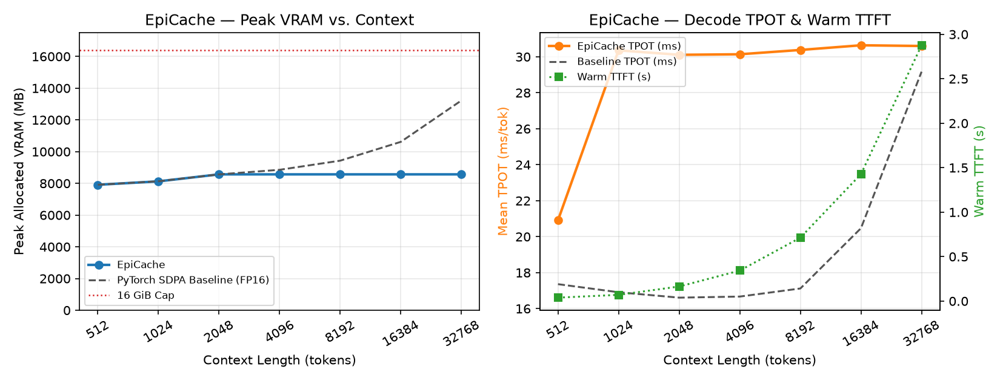
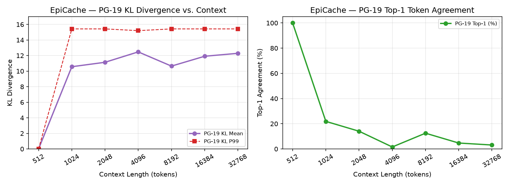

# WP-3 Technical Analysis: EpiCache (Episodic KV Cache Management)

**Authoritative Axis (`docs/METRICS_AND_AXES.md`):** `STRUCTURAL` *(Manifest/code declares `["STRUCTURAL", "SPATIAL"]`, but the PyTorch `EpiCacheCache` implementation performs zero host-RAM episode tiering or routing; only `STRUCTURAL` token eviction executes.)*  
**`kv_bench` Pinned Commit:** `2a9338a2f750741f7765d79c1270f5579a9ffed0`  
**Target Model:** `Qwen/Qwen3-4B-Instruct-2507` (`Pure Dense GQA`, $L=36$, $H_Q=32$, $H_{KV}=8$, $D=128$, `bfloat16`)  
**Hardware Cap:** 16.0 GiB process allocator cap on NVIDIA RTX 4090 (23.52 GiB physical VRAM, `effective_gpu_utilization = 0.5783`)

---

## 1. Verified Configuration & Empirical Snapshot

### 1.1 Manifest Provenance & `technique_config`
From [`results/manifests/run_manifest_wp3_epicache.json`](../../../results/manifests/run_manifest_wp3_epicache.json):
- **Manifest `technique_config`:**
  - `cache_class`: `EpiCacheCache`
  - `num_episodes`: `4`
  - `episode_budget_tokens`: `1024`
  - `layer_sensitivity_alpha`: `2.0`
  - `block_size`: `16`
- **VERIFIED Hub Artifact SHA-256 Checksums:**
  - `results/runs/wp3/epicache_hardware_pytorch_16gb.json`: `f2e7550025d372b4e5e97288995e54dfb8888b069c68a8caf7a5953cc1b9d411`
  - `results/runs/wp3/epicache_longmem_pytorch_16gb.json`: `b3b319b85f68dbe821fb4f40210d7262e18858e2a1ad3bc037f04e54776636a0`
  - `results/runs/wp3/epicache_niah_pytorch_16gb.json`: `fc945c375ed71f7e73e5579477204c3c1f582cd25c97b609215a8f512bc46c73`
  - `results/runs/wp3/verify_epicache_pytorch_16gb.json`: `1133f9f72a8064be77c563dce293bb2c93a4c8c9d305e210f683af546f382c8d`
  - `results/grades/epicache_grades.json`: `c4d7a3e4a28d2721e85fbd1fd6ac41afb94ec263f4b1ffbe401804564c239a82`
  - `results/grades/epicache_judged.json`: `cb50d765a62333ce3215551314e163c573113b6dc17e15c64792de5a43e67f68`

### 1.2 Hardware Scaling Sweep (`512 -> 32,768` Tokens, `SyntheticFiller`)
Static `Qwen3-4B` BF16 weights + runtime at `ctx=128` (`verify_epicache_pytorch_16gb.json`) is **`7,738.78 MB` (~7.56 GiB)**. At `ctx=32,768`, EpiCache caps `Peak Alloc` at **`8,567.15 MB`** (net KV+aux **`~828.4 MB`**) vs. Baseline's `13,224.90 MB` (`~5,486.1 MB` KV+aux), saving `4,657.8 MB` by capping retained KV to `1,024` tokens per layer.

| `ctx` | Peak Alloc (MB) | Peak Reserved (MB) | Warm TTFT (s) | TPOT Mean / P95 (ms) | Throughput (tok/s) | Host RSS Δ (MB) | Memcpy (B/tok) | Physical Scalar Bits | Effective Token Retention |
|---:|---:|---:|---:|---:|---:|---:|---:|---:|---:|
| **512** | 7,911.66 | 7,998.0 | 0.0386 | 20.91 / 20.91 | 47.81 | 1,985.12 | 201.75 | 16-bit BF16 | 100.0% (575 / 575) |
| **1,024** | 8,126.16 | 8,164.0 | 0.0701 | 30.36 / 30.36 | 32.94 | 2,327.99 | 291,200.75 | 16-bit BF16 | 94.12% (1,024 / 1,088) |
| **2,048** | 8,566.92 | 8,624.0 | 0.1639 | 30.11 / 30.11 | 33.21 | 2,381.06 | 296,073.75 | 16-bit BF16 | 48.48% (1,024 / 2,112) |
| **4,096** | 8,566.93 | 8,924.0 | 0.3428 | 30.14 / 30.14 | 33.18 | 2,419.22 | 305,819.75 | 16-bit BF16 | 24.62% (1,024 / 4,160) |
| **8,192** | 8,566.96 | 8,924.0 | 0.7131 | 30.38 / 30.38 | 32.91 | 2,501.44 | 325,311.75 | 16-bit BF16 | 12.40% (1,024 / 8,256) |
| **16,384** | 8,567.03 | 8,924.0 | 1.4277 | 30.64 / 30.64 | 32.64 | 2,665.99 | 364,295.75 | 16-bit BF16 | 6.23% (1,024 / 16,448) |
| **32,768** | 8,567.15 | 8,924.0 | 2.8768 | 30.60 / 30.60 | 32.68 | 2,845.69 | 442,263.75 | 16-bit BF16 | 3.12% (1,024 / 32,832) |

### 1.3 Micro Fidelity (Verify, PG-19 / Hardware Sweep KL) & Macro Retrieval (NIAH, LongMemEval)
- **Verify (`ctx=128`, 16 decode tokens):** `top1_agreement = 1.0`, `kl_div_mean = 0.0`, `kl_div_p99 = 0.0`.
- **Hardware Sweep KL (`SyntheticFiller`, $N=1$ per length, 64 decode tokens):**
  - `512`: `top1 = 1.0`, `kl_mean = 0.0`, `kl_p99 = 0.0` (below `1024` budget).
  - `1,024` to `32,768`: **Catastrophic divergence immediately at `1,024`** (`top1 = 0.2188`, `kl_mean = 10.56592`), worsening to `top1 = 0.0156–0.1406` and `kl_mean = 10.65–12.47` (`kl_p99 = 15.4249` clamp) across `2K–32K` (`32K`: `top1 = 0.0312`, `kl_mean = 12.2879`).
- **NIAH (`2K` & `4K` depth grid, passcode `"849204"`):**
  - **`2,048` ctx:** **`0.0%` (`0.0`)** across all 10 depths — outputs degenerate gibberish (e.g., `"3 for the the project is a the project."`, `"****12342300000000"`).
  - **`4,096` ctx:** **`0.0%` (`0.0`)** across all 10 depths — outputs degenerate gibberish (e.g., `"not for, for for for to for of the"`).
- **LongMemEval (`150` native-length samples, `192–22,400` prompt tokens, median `5,859`, `epicache_judged.json`):**
  - **Overall Accuracy:** **`8 / 150 = 5.33%`** vs. Baseline **`99 / 150 = 66.0%`** ($\Delta = -60.67\text{ pp}$).
  - **Causal Verdicts:** `PASS_FIDELITY_MAINTAINED = 8`, `BASELINE_LIMITATION = 51`, **`QUALITY_REGRESSION = 91`**, `UNEXPECTED_GAIN = 0`.
  - **LongMemEval KL & Retention:** `top1_agreement = 0.0624`, `kl_div_mean = 13.51353`, `kl_div_p99 = 15.4249`, `Physical Scalar Bits = 16-bit BF16`, `Effective Token Retention = 24.29%` (`4.11×` compression).
  - **Length-Tier Accuracy:** `short = 50.0%`, `medium = 4.63%`, `long = 0.0%`.

| LongMemEval Capability | Baseline (`N=30` each) | EpiCache (`N=30` each) | $\Delta$ (pp) | `QUALITY_REGRESSION` Count |
|---|---:|---:|---:|---:|
| **Fact Recall** | 90.0% (27/30) | 26.7% (8/30) | -63.3 | 19 |
| **Information Update** | 66.7% (20/30) | 0.0% (0/30) | -66.7 | 20 |
| **Relative Timeframe** | 30.0% (9/30) | 0.0% (0/30) | -30.0 | 9 |
| **Cross-Session Reasoning** | 43.3% (13/30) | 0.0% (0/30) | -43.3 | 13 |
| **Unanswerable Refusal** | 100.0% (30/30) | 0.0% (0/30) | -100.0 | 30 |

---

## 2. White-Box Component Decomposition

| ID | Component | Source File, Class/Method & Lines | Tensor Shapes & Dtypes (`Qwen3-4B`, BF16) | Execution Cadence |
|---|---|---|---|---|
| **C1** | **Discarded Layer-Sensitivity Budgeter (`compute_layer_sensitivity_budgets`)** | `src/techniques/epicache.py` (L18–45); `src/techniques/epicache_cache.py`: `EpiCacheLayer.__init__` (L56–66) | Computes `self.sensitivity_budget` from synthetic parabola, then **overwrites** `self.layer_budget = self.episode_budget_tokens` (`1024`) to avoid HF 4D causal mask mismatch. | Once per layer at cache init (`36×`). |
| **C2** | **L2 Key-Norm Eviction Without Recent Window (`evict_block_prefill`)** | `src/techniques/epicache.py`: `evict_block_prefill` (L70–102); `epicache_cache.py`: `EpiCacheLayer.prune` (L96–113) | `k_block.float().norm(p=2, dim=-1).mean(dim=(0,1))` $\to$ `(seq_len,)` `float32`. Keeps **only token `0`** + top-`1023` by Key L2 norm. **Zero recent-window protection.** | Every chunk end (`prune_after_chunk`) AND every decode step (`new_tokens == 1` when `seq_len > 1024`, `epicache_cache.py` L91–92). |
| **C3** | **Decode-Step `.tolist()` Sync (`EpiCacheLayer.prune`)** | `src/techniques/epicache_cache.py`: L106–112 | `idx_list = retained_idx.tolist()` triggers a GPU-to-CPU sync on all 36 layers during every decode step (`2,304` syncs per 64-tok sample). | Every decode step for `ctx >= 1024`. |
| **C4** | **Dead Episodic Routing & Hardcoded Telemetry** | `src/techniques/epicache.py`: `route_query_to_episode` (L48–67), `extra_metrics` (L236–237) | `route_query_to_episode` is never called. `extra_metrics` hardcodes `"block_wise_prefill_active": True, "episodic_routing_active": True` despite zero clustering or CPU cache bank. | `extra_metrics` only. |

---

## 3. 3-Way Causal Attribution

- **VRAM (`8,567.15 MB` flat from `2K` to `32K`):** **`[IMPLEMENTATION]`** — `C2` caps all 36 layers at `1,024` tokens (`~147 MB` KV), saving `4.66 GB` vs. baseline at 32K, though `C1` discards per-layer sensitivity allocation.
- **Host RSS (`1,985 -> 2,846 MB`) & PCIe Memcpy (`291–442 KB/tok` at `1K–32K`):** **`[IMPLEMENTATION]`** — Discounting the `8,266 B/tok` harness floor, the `291–442 KB/tok` D2H memcpy spike starting at `ctx=1024` comes from `C3` (`retained_idx.tolist()`) executing on all 36 layers at every decode step once `seq_len > 1024`. (Zero episodic CPU offloading occurs.)
- **TTFT (`2.88 s` at `32K`) & TPOT (`30.11–30.64 ms` at `1K–32K`):** **`[IMPLEMENTATION]`** — Prefill TTFT matches StreamingLLM (`2.88 s` vs. `2.90 s`) because `C2` prunes after each 1,024-token chunk without duplicate attention matmuls. However, decode TPOT jumps `+9.5 ms` (`20.91 ms` at `512` $\to$ `30.36 ms` at `1024`) due to `C2`+`C3` computing Key L2 norms, `topk`, `sort`, and `.tolist()` on all 36 layers every decode step.
- **Catastrophic Quality Collapse (`5.33%` LongMemEval, `91` `QUALITY_REGRESSION`s, `0%` NIAH, `kl_mean = 13.51`):** **`[IMPLEMENTATION]`** — This collapse is **not** intrinsic to the EpiCache paper; it is caused by three compounding bugs in `C2`:
  1. **No Recent Window Protection:** `evict_block_prefill` ranks *all* tokens `[1..seq_len)` solely by Key L2 norm. Recent prompt/question tokens and newly generated decode tokens are immediately evicted if their Key L2 norms are smaller than earlier sink/filler tokens, destroying local syntactic coherence and producing `"for for for"` gibberish (e.g., `bb7c3b45`: *"Gibberish word repetition, no answer"*).
  2. **Single Sink Token (`[0]`):** Only 1 token is pinned instead of 4+, destabilizing softmax denominators.
  3. **Key L2 Norm Proxy Without Episode Clustering (`C4`):** Without medoid cross-attention scoring or topic routing, `C2` cannot retrieve task-relevant facts, causing `0.0%` accuracy on `information_update`, `relative_timeframe`, `cross_session_reasoning`, and `unanswerable_refusal` (all `30/30` refusal prompts failed).

---

## 4. Paper vs. Replication Fidelity

| Dimension | Paper (`Kim et al., ICML 2026`, `docs/literature_survey/techniques/epicache.md`) | `kv_bench` PyTorch Implementation (`epicache.py`, `epicache_cache.py`) | Fidelity Verdict |
|---|---|---|---|
| **Episodic Clustering & Medoid Routing** | Offline 4-utterance chunking + K-Means ($E=4$ episodes) + query-time cosine routing + CPU-VRAM episode bank. | `route_query_to_episode` is dead code; no clustering, no CPU bank, no routing. `extra_metrics` hardcodes `episodic_routing_active=True`. | **Not Implemented (Misreported)** |
| **Token Importance Scoring** | Patched cross-attention scoring from episode medoid $s_i^{\max} = \max \text{Attn}(x_t \to x_i)$ + recent window. | Key L2 norm (`norm(p=2)`) with **only token `0`** pinned and **zero recent window**; evicts user question & decode tokens. | **Broken Proxy** |
| **Layer-Sensitivity Budgeting** | Allocates $M_\ell \propto s_\ell^\alpha$ using offline Key-similarity sensitivity $s_\ell = 1 - \sigma_\ell$. | Synthetic parabola computed in `self.sensitivity_budget` and **explicitly discarded** (`self.layer_budget = self.episode_budget_tokens`). | **Bypassed** |

---

## 5. Component Verdicts (`KEEP` / `ADAPT` / `DROP`)

| Component | Verdict | Contribution | Failure Mode | Exact Fix Prerequisite (if `ADAPT`) |
|---|---|---|---|---|
| **C1: `compute_layer_sensitivity_budgets`** | **`ADAPT`** | Theoretical basis for non-uniform per-layer KV allocation. | Computed then discarded due to HF 4D shared `causal_mask` constraint. | Replace synthetic parabola with 1-sample cosine calibration ($s_\ell = 1 - \sigma_\ell$) and pass per-layer 4D masks or use vLLM/FlexAttention per-layer lengths. |
| **C2: `evict_block_prefill`** | **`DROP` (rewrite)** | Caps peak VRAM to `8.57 GB` via chunk-wise pruning. | Destroys coherence (`5.33%` LongMemEval, `0%` NIAH) by evicting recent/decode tokens via Key L2 norm. | Pin first 4 sink tokens + mandatory recent window (e.g., `512` tokens) and score middle tokens via query-guided attention rather than Key L2 norm. |
| **C3: `.tolist()` Decode Sync** | **`DROP`** | Tracks `original_positions` for diagnostics. | Causes `291–442 KB/tok` D2H memcpy and `+9.5 ms` TPOT penalty. | Maintain `original_positions` on GPU as a `torch.int32` tensor and copy to CPU once at end-of-sample. |
| **C4: `route_query_to_episode` & Telemetry** | **`ADAPT`** | Placeholder for multi-episode CPU-GPU routing. | Dead code; telemetry falsely reports `episodic_routing_active=True`. | Implement actual K-Means episode clustering, CPU cache bank, and query routing; gate telemetry flags on actual execution. |
