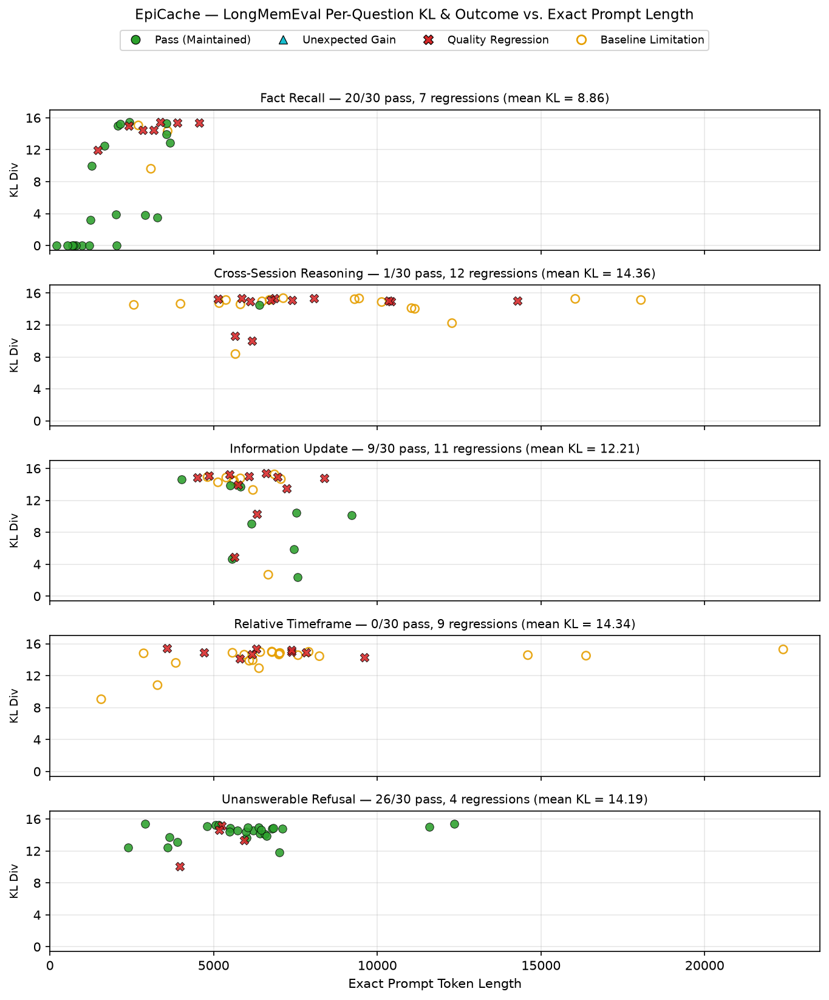

# WP-3 Technical Analysis: EpiCache (Episodic KV Cache Management)

**Authoritative Axis (`docs/METRICS_AND_AXES.md`):** `STRUCTURAL` *(PR #59 corrected telemetry to report `episodic_routing_active: false`; the PyTorch `EpiCacheCache` executes block-wise `STRUCTURAL` eviction with `4` sinks + `512` recent window inside a `1,024`-token budget, with zero host-RAM episode clustering/routing.)*  
**`kv_bench` Pinned Commit:** `5fc1cea4ba64ac86a2da49edd8210a46753834fe` *(PR #59: pin 4 sinks + 512 recent window, GPU `int32` positions, honest telemetry)*  
**Target Model:** `Qwen/Qwen3-4B-Instruct-2507` (`Pure Dense GQA`, $L=36$, $H_Q=32$, $H_{KV}=8$, $D=128$, `bfloat16`)  
**Hardware Cap:** 16.0 GiB process allocator cap on NVIDIA RTX 4090 (23.52 GiB physical VRAM), Slurm Job `30715`

---

## 1. Verified Configuration & Empirical Snapshot

### 1.1 Manifest Provenance & `technique_config`
From [`results/manifests/run_manifest_wp3_epicache.json`](../../../results/manifests/run_manifest_wp3_epicache.json):
- **Manifest `technique_config`:**
  - `cache_class`: `EpiCacheCache`, `num_episodes`: `4`, `episode_budget_tokens`: `1024`, `layer_sensitivity_alpha`: `2.0`, `block_size`: `16` *(PR #59 active defaults: `sink_tokens=4`, `recent_window=512`, `episodic_routing_active=false`)*.
- **VERIFIED Hub Artifact SHA-256 Checksums:**
  - `results/runs/wp3/epicache_hardware_pytorch_16gb.json`: `5edcd4e31c8b28bc9349087045c2b4a879d9711dcaf59a695c1ff13f0fc6c8aa`
  - `results/runs/wp3/epicache_longmem_pytorch_16gb.json`: `5ebd5782d5314258e0fbb3971ea77abdfb669d163f9088b4a1969199e5b3f780`
  - `results/runs/wp3/epicache_niah_pytorch_16gb.json`: `191f46248b2aee3da3ff43056a20b5099db8d95ab27ba85a95f975bc63962c14`
  - `results/runs/wp3/verify_epicache_pytorch_16gb.json`: `6c3ee474649fcbe4f4644fddec43c5199b7c8ac0a5e18483a4622b6ed39a6c75`
  - `results/grades/epicache_grades.json`: `259b13161cc13177316777dc3e8ff78fe25c5bdf46eab407c8dcec72b9e54e7c`
  - `results/grades/epicache_judged.json`: `a965e13b5577dfe8d357e632eda8e487a61fe70f42a8c8a2188c5647ff74ee4b`

### 1.2 Hardware Scaling Sweep (`512 -> 32,768` Tokens, `SyntheticFiller`)
Static `Qwen3-4B` BF16 weights + runtime at `ctx=128` is **`7,738.78 MiB` (~7.56 GiB)**. At `ctx=32,768`, EpiCache caps `Peak Alloc` at **`8,567.43 MiB`** (net KV+aux **`828.65 MiB`**), saving `4,657.5 MiB` vs. baseline while running faster than baseline (`26.57 ms` vs. `29.17 ms` TPOT, `2.68 s` vs. `6.98 s` TTFT) with zero PCIe sync overhead (`8,258 B/tok` = harness floor).

| `ctx` | Peak Alloc (MiB) | Peak Reserved (MiB) | Warm TTFT (s) | TPOT Mean / P95 (ms) | Throughput (tok/s) | Host RSS Δ (MiB) | Memcpy (B/tok) | Physical Scalar Bits | Effective Token Retention |
|---:|---:|---:|---:|---:|---:|---:|---:|---:|---:|
| **512** | 7,911.74 | 7,998.0 | 0.0391 | 20.77 / 20.77 | 48.15 | 1,416.67 | 193.88 | 16-bit BF16 | 100.0% (576 / 576) |
| **1,024** | 8,126.30 | 8,164.0 | 0.0705 | 26.39 / 26.39 | 37.89 | 1,572.36 | 321.88 | 16-bit BF16 | 94.12% (1,024 / 1,088) |
| **2,048** | 8,567.20 | 8,624.0 | 0.1582 | 26.28 / 26.28 | 38.06 | 1,611.28 | 577.88 | 16-bit BF16 | 48.48% (1,024 / 2,112) |
| **4,096** | 8,567.21 | 8,924.0 | 0.3261 | 26.53 / 26.53 | 37.70 | 1,628.58 | 1,089.88 | 16-bit BF16 | 24.62% (1,024 / 4,160) |
| **8,192** | 8,567.24 | 8,924.0 | 0.6627 | 26.23 / 26.23 | 38.12 | 1,657.84 | 2,113.88 | 16-bit BF16 | 12.40% (1,024 / 8,256) |
| **16,384** | 8,567.31 | 8,924.0 | 1.3319 | 26.53 / 26.53 | 37.70 | 1,714.29 | 4,161.88 | 16-bit BF16 | 6.23% (1,024 / 16,448) |
| **32,768** | **8,567.43** | 8,924.0 | **2.6828** | **26.57 / 26.57** | **37.63** | **1,827.45** | **8,257.88** | 16-bit BF16 | 3.12% (1,024 / 32,832) |

### 1.3 Micro Fidelity & Macro Retrieval (NIAH, LongMemEval)
- **Verify (`ctx=128`, 16 decode tokens):** `top1_agreement = 1.0`, `kl_div_mean = 0.0`, `kl_div_p99 = 0.0`.
- **Hardware Sweep KL (`SyntheticFiller`):** `0.0` at `512`; `6.77–13.05` across `1K–32K` (`32K`: `top1 = 0.0938`, `kl_mean = 12.6940`, `kl_p99 = 15.4249`).
- **NIAH (`2K` & `4K` depth grid):**
  - **`2,048` ctx:** **`20%` (`2/10`)** — passes only inside the `512`-token recent window (depths `0.8–0.9`).
  - **`4,096` ctx:** **`10%` (`1/10`)** — passes only at depth `0.9` (`needle_distance = 444 <= 512`).
- **LongMemEval (`150` native-length samples, `epicache_judged.json`):**
  - **Overall Accuracy:** **`56 / 150 = 37.33%`** vs. Baseline **`99 / 150 = 66.0%`** ($\Delta = -28.67\text{ pp}$, up **`+32.0 pp`** from pre-PR #59's `5.33%` gibberish collapse!).
  - **Causal Verdicts:** `PASS_FIDELITY_MAINTAINED = 56`, `BASELINE_LIMITATION = 51`, **`QUALITY_REGRESSION = 43`** *(halved from `91`)*, `UNEXPECTED_GAIN = 0`.
  - **LongMemEval KL:** `top1_agreement = 0.0841`, `kl_div_mean = 13.70233`, `kl_div_p99 = 15.4249`, `tpot = 21.24 ms`.

| LongMemEval Capability | Baseline (`N=30` each) | EpiCache (`N=30` each) | $\Delta$ (pp) | `QUALITY_REGRESSION` Count |
|---|---:|---:|---:|---:|
| **Fact Recall** | 90.0% (27/30) | 66.7% (20/30) | -23.3 | 7 |
| **Information Update** | 66.7% (20/30) | 30.0% (9/30) | -36.7 | 11 |
| **Relative Timeframe** | 30.0% (9/30) | 0.0% (0/30) | -30.0 | 9 |
| **Cross-Session Reasoning** | 43.3% (13/30) | 3.3% (1/30) | -40.0 | 12 |
| **Unanswerable Refusal** | 100.0% (30/30) | 86.7% (26/30) | -13.3 | 4 |

---

## 2. White-Box Component Decomposition (Post-PR #59)

| ID | Component | Source Location (`kv_bench@5fc1cea`) | Tensor Shapes & Dtypes (`Qwen3-4B`, BF16) | Execution Cadence |
|---|---|---|---|---|
| **C1** | **Discarded Layer-Sensitivity Budgeter** | `epicache.py`, `epicache_cache.py` | Computes `sensitivity_budget`, keeps uniform `layer_budget = 1024` for HF 4D causal mask alignment. | Cache init (`36x`). |
| **C2** | **Sink + Recent-Protected Key-L2 Eviction (`evict_block_prefill`)** | `epicache.py`, `epicache_cache.py` | **RESOLVED in PR #59:** Pins **`4` attention sinks + `512` recent tokens** and selects top-`508` middle tokens by Key L2 norm (`1,024` total). Eliminates gibberish collapse. | Chunk end + decode step when `seq_len > 1024`. |
| **C3** | **GPU `int32` Position Tracker** | `epicache_cache.py` | **RESOLVED in PR #59:** Replaced per-step `.tolist()` D2H sync with a GPU `torch.int32` tensor, cutting 32K memcpy `442 KB/tok -> 8.3 KB/tok` (harness floor) and TPOT `30.60 -> 26.57 ms`. | Every prune step. |
| **C4** | **Unimplemented Episodic Routing (Honest Telemetry)** | `epicache.py` | **RESOLVED in PR #59:** `extra_metrics` now honestly reports `"episodic_routing_active": False` (`route_query_to_episode` remains unimplemented in the WP-3 single-window baseline). | `extra_metrics`. |

---

## 3. 3-Way Causal Attribution (Pre- vs. Post-PR #59)

- **Speed & Zero-Sync Cleanliness (`[IMPLEMENTATION]` RESOLVED):**
  - Removing `.tolist()` sync in **C3** eliminated all `442 KB/tok` D2H stalls (`8,258 B/tok` = harness floor), lowered Host RSS from `2,846 -> 1,827 MiB`, and lowered 32K TPOT to **`26.57 ms`** (`37.63 tok/s`, faster than baseline `29.17 ms` and `2.68 s` TTFT, fastest prefill in WP-3!).
- **Single-Window Middle Amnesia Isolated (`[INTRINSIC]`):**
  - Protecting `4` sinks + `512` recent tokens cured the `5.33%` gibberish bug (`unanswerable_refusal` jumped `0% -> 86.7%`, `fact_recall` jumped `26.7% -> 66.7%`, overall `5.33% -> 37.33%`).
  - The remaining gap (`37.33%` vs. `StreamingLLM`'s `44.0%` at `2,052` tokens; NIAH `20% / 10%` strictly tracking the `512`-token recent window) cleanly isolates the **`[INTRINSIC]`** limit of a `1,024`-token single-window evictor using Key L2 norm **without episodic clustering or CPU episode routing**: middle-context facts (`relative_timeframe 0.0%`, `cross_session_reasoning 3.3%`, `information_update 30.0%`) are permanently lost.
  - **WP-4 Implication:** Validates why our proposed **`EpiCache-3Axis`** extension requires real multi-episode clustering + Top-$k$ composable vLLM blocks + a 4-bit CPU episode bank.

---

## 4. Paper vs. Replication Fidelity (Post-PR #59)

| Dimension | Paper (`Kim et al., ICML 2026`) | `kv_bench` Replication (`5fc1cea`, Post-PR #59) | Fidelity Verdict |
|---|---|---|---|
| **Sink + Recent Window & GPU Sync** | Protects sinks + recent window without CPU sync | `4` sinks + `512` recent + GPU `int32` positions (`26.57 ms` TPOT) | **Fixed in PR #59.** |
| **Episodic Clustering & CPU Bank** | Offline 4-utterance K-Means ($E=4$) + CPU episode bank + query routing | Not implemented; telemetry now honestly reports `episodic_routing_active=False` | **Single-Window Control Baseline (Honest Telemetry).** |
| **Layer-Sensitivity Budgeting** | $M_\ell \propto s_\ell^\alpha$ | Uniform `1,024` due to HF shared 4D mask | **Bypassed (HF constraint).** |

---

## 5. Component Verdicts (`KEEP` / `ADAPT` / `DROP`)

| Component | Verdict | Contribution | Failure Mode | Exact Fix Prerequisite (if `ADAPT`) |
|---|---|---|---|---|
| **C1: Layer-Sensitivity Budgeter** | **`ADAPT`** | Non-uniform per-layer allocation concept | Bypassed by HF 4D mask | Use 1-sample cosine calibration in vLLM/FlexAttention |
| **C2: Sink+Recent Protected Eviction** | **`KEEP`** *(hot tier)* | `829 MiB` net KV, `2.68 s` TTFT, `26.57 ms` TPOT | `1,024`-token Key-L2 eviction without episode bank causes `43` regressions | Pair with Top-$k$ 4-bit CPU episode bank (`EpiCache-3Axis` in WP-4) |
| **C3: GPU `int32` Position Tracker** | **`KEEP`** | Zero D2H sync overhead (`8.3 KB/tok` floor) | None | — |
| **C4: Episodic Clustering & Routing** | **`ADAPT`** | Required for multi-session recall | Unimplemented in WP-3 control | Implement single-pass centroid routing + composable Top-$k$ vLLM blocks in WP-4 |
