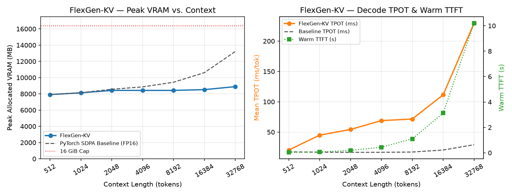
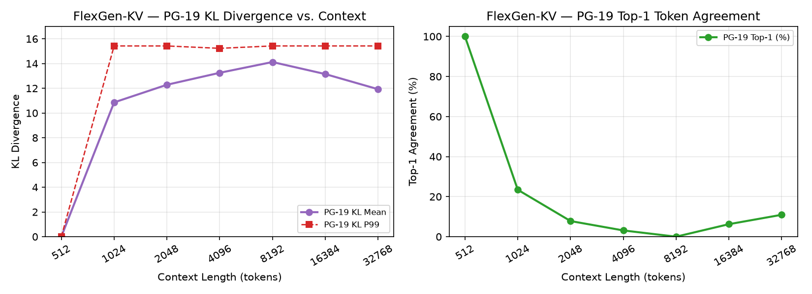
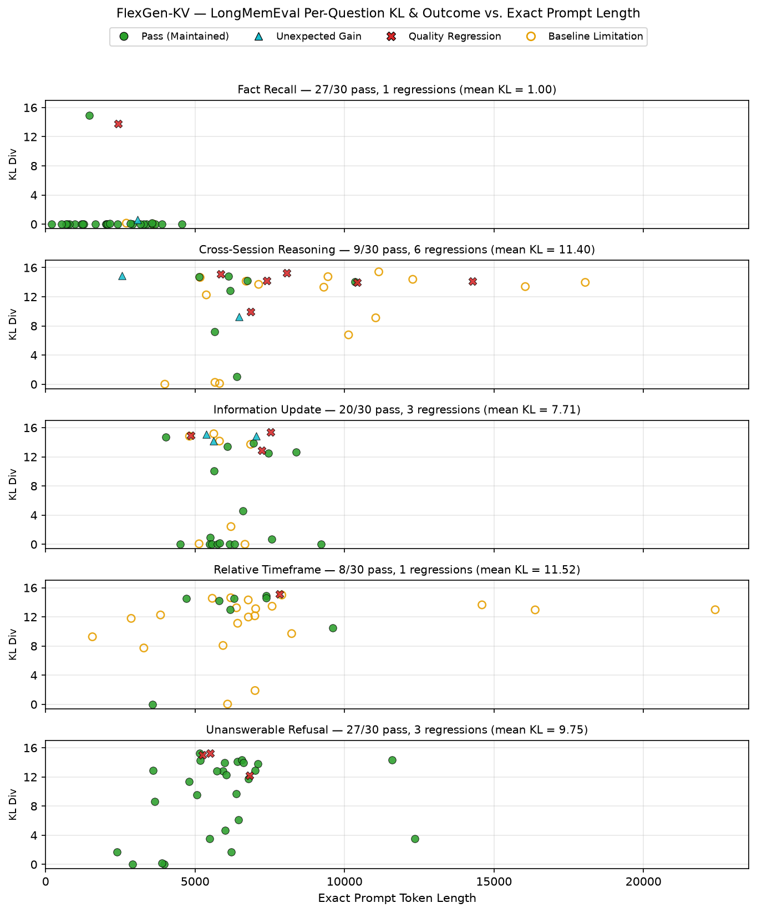

# WP-3 Technique Analysis: FlexGen-KV (`flexgen_kv`)

## 1. Verified Configuration & Empirical Snapshot

- **Authoritative Axis ([`docs/METRICS_AND_AXES.md`](../../../docs/METRICS_AND_AXES.md)):** `SPATIAL` (Host CPU DRAM offloading) with secondary `STRUCTURAL` compression (4-bit asymmetric group-wise quantization, `group_size=64`).
- **`kv_bench` Commit SHA:** `2a9338a2f750741f7765d79c1270f5579a9ffed0`
- **Model & Hardware:** `Qwen/Qwen3-4B-Instruct-2507` (`cdbee75f17c01a7cc42f958dc650907174af0554`, Pure Dense GQA, BF16, $L=36, H_Q=32, H_{KV}=8, D=128$) on NVIDIA GeForce RTX 4090 (23.52 GiB physical, `16.0 GiB` process allocator cap).
- **Manifest `technique_config` ([`run_manifest_wp3_flexgen_kv.json`](../../../results/manifests/run_manifest_wp3_flexgen_kv.json)):**
  - `cache_class`: `FlexGenKVCache`, `gpu_cache_tokens`: `1024`, `cpu_cache_tokens`: `32768`, `block_size`: `16`, `quantize_kv`: `true`, `group_size`: `64`, `cpu_delegation`: `false`, `swap_space_gb`: `4`.
- **Golden Artifact SHA-256s (`run_manifest_wp3_flexgen_kv.json`):**
  - `flexgen_kv_hardware_pytorch_16gb.json`: `bd79f1dd9965a48064da778921df20967d26d1de1ca99c420714fe435c4fc7d9`
  - `flexgen_kv_longmem_pytorch_16gb.json`: `513a8a4e922c665e27a71acd3f4fe1d2e87f5696c82b688d6c9b84157e713653`
  - `flexgen_kv_niah_pytorch_16gb.json`: `6ff0ae38d44b386b15b6a439812d2d4842f09a9748cca2265a10e7540e5f1d45`
  - `verify_flexgen_kv_pytorch_16gb.json`: `8850c517fcaf52a6bd2622a66ff01198e9bb2960d68b231981bacdd402fb17af`
  - `flexgen_kv_grades.json`: `a60778daab23f5a34e101889ab952aff2d9db76741b2eb7581ce2523f98f8865`
  - `flexgen_kv_judged.json`: `2a8118336d39730e66380de88c3bfbb07e7f1e35ca0104b0475481994aff7440`

### Hardware Sweep (`512 -> 32,768`, `SyntheticFiller` / PG-19)

Static `Qwen3-4B` BF16 weights + PyTorch runtime occupy **7,738.8 MiB (~7.56 GiB)** (`verify_baseline_pytorch_16gb.json` at `ctx=128`); net KV+aux VRAM below is `Peak Alloc - 7,738.8 MiB`.

| Context | Status | Peak Alloc (MiB) | Net KV+Aux (MiB) | Base Alloc (MiB) | Host RSS $\Delta$ (MiB) | TTFT (s) | TPOT (ms) | Base TPOT (ms) | Tok/s | PCIe B/tok | Physical Scalar Bits (GPU / CPU) | Eff. Token Retention | PG-19 Top-1 | PG-19 KL Mean | PG-19 KL P99 |
|---:|---|---:|---:|---:|---:|---:|---:|---:|---:|---:|---|---|---:|---:|---:|
| 512 | `SUCCESS` | 7,911.7 | 172.9 | 7,911.7 | 1,981.8 | 0.039 | 20.33 | 17.36 | 49.18 | 201.75* | 16-bit BF16 / — | 100% (512 GPU / 0 CPU) | 1.0000 | 0.00000 | 0.0000 |
| 1,024 | `SUCCESS` | 8,126.5 | 387.7 | 8,133.0 | 3,447.6 | 0.070 | 44.94 | 16.91 | 22.25 | 1,347,521.75 | 16-bit BF16 / 4-bit (g=64) | 100% (1,024 GPU / 0+gen CPU) | 0.2344 | 10.85959 | 15.4247 |
| 2,048 | `SUCCESS` | 8,422.9 | 684.1 | 8,566.9 | 3,500.6 | 0.188 | 54.37 | 16.61 | 18.39 | 44,478,657.75 | 16-bit BF16 / 4-bit (g=64) | 100% (1,024 GPU / 1,024+gen CPU) | 0.0781 | 12.28487 | 15.4235 |
| 4,096 | `SUCCESS` | 8,422.9 | 684.2 | 8,854.9 | 3,709.9 | 0.440 | 68.92 | 16.67 | 14.51 | 132,731,585.75 | 16-bit BF16 / 4-bit (g=64) | 100% (1,024 GPU / 3,072+gen CPU) | 0.0312 | 13.25233 | 15.2318 |
| 8,192 | `SUCCESS` | 8,423.0 | 684.2 | 9,431.0 | 4,123.0 | 1.099 | 71.55 | 17.12 | 13.98 | 317,200,065.75 | 16-bit BF16 / 4-bit (g=64) | 100% (1,024 GPU / 7,168+gen CPU) | 0.0000 | 14.12391 | 15.4249 |
| 16,384 | `SUCCESS` | 8,520.8 | 782.0 | 10,616.8 | 4,925.4 | 3.126 | 111.51 | 20.47 | 8.97 | 717,987,521.75 | 16-bit BF16 / 4-bit (g=64) | 100% (1,024 GPU / 15,360+gen CPU) | 0.0625 | 13.15064 | 15.4249 |
| 32,768 | `SUCCESS` | 8,888.9 | 1,150.1 | 13,224.9 | 6,564.6 | 10.205 | 229.57 | 29.17 | 4.36 | 1,646,964,417.75 | 16-bit BF16 / 4-bit (g=64) | 100% (1,024 GPU / 31,744+gen CPU) | 0.1094 | 11.92694 | 15.4249 |

*\*`ctx=512` `201.75 B/tok` (`htod=4,600`, `dtoh=8,312`) is harness profiler overhead with zero KV offload (`pcie_transfer_bytes=0`).*

### Quality Summary (Verify, NIAH, LongMemEval)

- **Verify (`ctx=128`):** `top1_agreement = 1.0000`, `kl_div_mean = 0.0`, `kl_div_p99 = 0.0` (entire prompt fits within `gpu_cache_tokens=1024`, zero quantization/offload triggered).
- **NIAH (`2K` & `4K`, 10 depths `0.0..0.9`):** **10/10 (100%)** at `2048` and **10/10 (100%)** at `4096`.
- **LongMemEval (`150` samples, prompt length `192..22,400`, mean `5,967.9` tokens):**
  - `peak_alloc_mb = 8,643.8`, `host_rss_delta_mb = 2,839.1`, `ttft_sec = 0.804`, `tpot_mean_ms = 57.83`, `throughput_tok_per_sec = 574.93`.
  - **LongMem KL:** `top1_agreement = 0.2999`, `kl_div_mean = 10.25039`, `kl_div_p99 = 15.4249`.
  - **Overall Accuracy:** **91/150 (60.67%)** vs. Baseline **99/150 (66.00%)** (`-5.33 pp`).
  - **Verdict Breakdown:** `PASS_FIDELITY_MAINTAINED: 85`, `BASELINE_LIMITATION: 45`, **`QUALITY_REGRESSION: 14`**, `UNEXPECTED_GAIN: 6`.

| LongMemEval Capability | Baseline Acc | FlexGen-KV Acc | Delta (pp) | `QUALITY_REGRESSION` Count |
|---|---:|---:|---:|---:|
| `fact_recall` | 90.00% | 90.00% | 0.00 | 1 |
| `information_update` | 66.67% | 66.67% | 0.00 | 3 |
| `relative_timeframe` | 30.00% | 26.67% | -3.33 | 1 |
| `cross_session_reasoning` | 43.33% | 30.00% | -13.33 | 6 |
| `unanswerable_refusal` | 100.00% | 90.00% | -10.00 | 3 |

---

## 2. White-Box Component Decomposition

| ID | Component | Source Location | Tensor Shapes & Dtypes (`Qwen3-4B`: $L=36, H_{KV}=8, D=128$) | Cadence |
|---|---|---|---|---|
| **C1** | **4-Bit Asymmetric Group Quantizer / Dequantizer** | [`flexgen_cache.py#L17-L95`](https://github.com/khemingkapat/kv_bench/blob/2a9338a2f750741f7765d79c1270f5579a9ffed0/src/techniques/flexgen_cache.py#L17-L95) (`quantize_4bit_group`, `dequantize_4bit_group`) | Input `[B, 8, N, 128]` BF16 $\rightarrow$ `packed` `[B, 8, N, 2, 32]` `uint8` + `scales, mins` `[B, 8, N, 2, 1]` BF16 (`group_size=64`, `3.56x` ratio). | On offload (prefill/decode overflow) & on every decode step during reconstruction. |
| **C2** | **GPU Active Window & Pinned CPU Tiering** | [`flexgen_cache.py#L246-L315`](https://github.com/khemingkapat/kv_bench/blob/2a9338a2f750741f7765d79c1270f5579a9ffed0/src/techniques/flexgen_cache.py#L246-L315), [`#L349-L409`](https://github.com/khemingkapat/kv_bench/blob/2a9338a2f750741f7765d79c1270f5579a9ffed0/src/techniques/flexgen_cache.py#L349-L409) (`FlexGenKVLayer._ensure_cpu_capacity`, `_offload_excess_to_cpu`) | GPU active window `[B, 8, <=1024, 128]` BF16; pinned CPU buffers `cpu_{k,v}_packed` `[B, 8, cap, 2, 32]` `uint8` + `scales, mins`. | Whenever `gpu_keys.shape[-2] > 1024` (prefill & every decode step). |
| **C3** | **Full-Sequence CPU-to-GPU Reconstruction** | [`flexgen_cache.py#L317-L348`](https://github.com/khemingkapat/kv_bench/blob/2a9338a2f750741f7765d79c1270f5579a9ffed0/src/techniques/flexgen_cache.py#L317-L348), [`#L411-L464`](https://github.com/khemingkapat/kv_bench/blob/2a9338a2f750741f7765d79c1270f5579a9ffed0/src/techniques/flexgen_cache.py#L411-L464) (`_reconstruct_full_tensor`, `update`) | Reconstructs `[B, 8, S, 128]` BF16 across all 36 layers by HtoD copying all `num_cpu_tokens` and dequantizing on GPU. | **Every single decode step** across all 36 layers (`cpu_delegation=False`). |

---

## 3. 3-Way Causal Attribution

- **VRAM Savings (`[INTRINSIC]` + `[HARDWARE/GQA]`):** Capping the GPU-resident window at `1,024` tokens (`C2`) flattens `peak_alloc_mb` at `8,422.9 MiB` (`684.1 MiB` net KV+aux) from `2K` to `8K`, rising only to `8,888.9 MiB` (`1,150.1 MiB` net) at `32K` (a **4.34 GiB VRAM saving** vs. baseline `13,224.9 MiB`). The `466 MiB` bump from `8K` to `32K` is transient GPU dequantization workspace in `C1`/`C3`.
- **Host RSS (`[INTRINSIC]`):** `C1` + `C2` keep 32K host RSS delta at `6,564.6 MiB` (well within a 16 GB host RAM cap), because `31,744` tokens $\times 36$ layers are stored in 4-bit packed format (`~1.26 GiB` raw KV payload + pinned allocator overhead).
- **PCIe Volume & TPOT Collapse (`[IMPLEMENTATION]`):** At `32K`, `memcpy_bytes_per_token` reaches **`1,646,964,417.75 B/tok`** (~1.65 GB/tok; `pcie_transfer_bytes = 210.81 GB` total), driving TPOT from `29.17 ms` (baseline) to **`229.57 ms`** (`7.87x` slowdown) and throughput to `4.36 tok/s`. This is **not** intrinsic to FlexGen: because `cpu_delegation=False` and `C3` calls `self.keys`/`self.values` (`_reconstruct_full_tensor`) on **every decode token for all 36 layers**, it streams the entire 31,744-token CPU cache back over PCIe on every step instead of delegating attention to CPU or streaming once per block. (Note: the `~8,266 B/tok` baseline harness floor is negligible relative to `1.65 GB/tok`.)
- **KL & LongMemEval Regressions (`[INTRINSIC]` + `[IMPLEMENTATION]`):**
  - On `SyntheticFiller` (PG-19, $N=1$), `kl_div_mean` jumps to `10.86..14.12` (`kl_div_p99` hits the `15.4249` top-5 `eps=1e-7` clamp) as soon as `ctx >= 1024` triggers `C1` quantization. Note $N=1$ PG-19 KL exhibits high per-sample variance, and 2K/4K NIAH (`10/10`) does not extrapolate to 32K multi-session reasoning.
  - On LongMemEval (max prompt `22,400` tokens, distinct from 32K `SyntheticFiller`), `C1` 4-bit asymmetric min-max quantization of **both Keys and Values** (`group_size=64`) causes `14 QUALITY_REGRESSION`s, concentrated in `cross_session_reasoning` (`-13.33 pp`, 6 regressions) and `unanswerable_refusal` (`-10.00 pp`, 3 regressions), where subtle logit shifts flip multi-hop synthesis or refusal calibration.

---

## 4. Paper vs. Replication Fidelity

| Dimension | FlexGen Paper ([`flexgen.md`](../../../docs/literature_survey/techniques/flexgen.md)) | `kv_bench` Replication (`flexgen_kv.py` / `flexgen_cache.py`) | Fidelity Verdict |
|---|---|---|---|
| **Scope (Weights vs. KV)** | Offloads & 4-bit quantizes weights, activations, and KV cache for 30B–175B models. | Keeps `Qwen3-4B` BF16 weights pinned on GPU; offloads/quantizes **KV cache only**. | **Intentional Project Adaptation** (matches `docs/MODELS.md`). |
| **4-Bit Group Quantization** | Asymmetric min-max, `group_size=64` along hidden dim. | Exact match (`quantize_4bit_group`, `group_size=64`). | **Faithful.** |
| **CPU Attention Delegation** | Computes attention on CPU for CPU-resident KV to avoid $s\times$ PCIe transfer. | `cpu_delegation=False` by default; `C3` streams **100% of CPU KV back to GPU every step**. | **Critical Divergence (`[IMPLEMENTATION]`):** causes `1.65 GB/tok` PCIe thrashing. |
| **Scheduling & LP Placement** | Zig-zag block scheduling + LP solver + async CUDA streams. | Single-sequence FIFO `1024`-token GPU window; synchronous `to(device)` + `torch.cat`. | **Simplified Stub.** |

---

## 5. Component Verdicts (`KEEP` / `ADAPT` / `DROP`)

| Component | Verdict | Contribution | Failure Mode | Required Fix (if `ADAPT`) |
|---|---|---|---|---|
| **C1: 4-Bit Group Quantizer** | **`ADAPT`** | `3.56x` host/transfer compression with bounded host RSS (`6.56 GiB` at 32K). | Quantizing both K & V uniformly causes `14` LongMemEval regressions (`-5.33 pp`). | Keep `group_size=64` packing for **Keys or cold tiers**, or pair with higher-precision V / outlier protection (WP-4). |
| **C2: GPU Window + Pinned CPU Tier** | **`KEEP`** | Caps net KV+aux VRAM at `~0.67–1.12 GiB` (`684–1,150 MiB`) up to 32K; clean `DynamicLayer` pinned pool. | None in tiering itself (FIFO eviction is lossless up to `33,792` tokens). | — |
| **C3: Full-Sequence Decode Reconstruction** | **`DROP`** | Functional correctness for SDPA fallback. | Streams `1.65 GB/tok` over PCIe on every decode step (`229.57 ms` TPOT). | Replace with **selective page/block recall** (ArkVale/ShadowKV style) or **CPU attention delegation** (`cpu_delegation=True`). |
