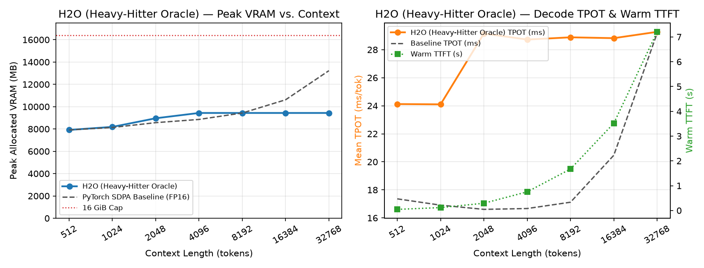
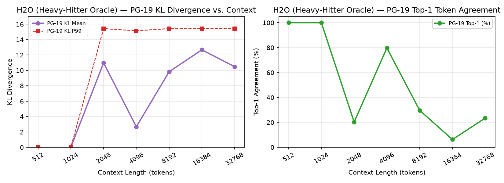
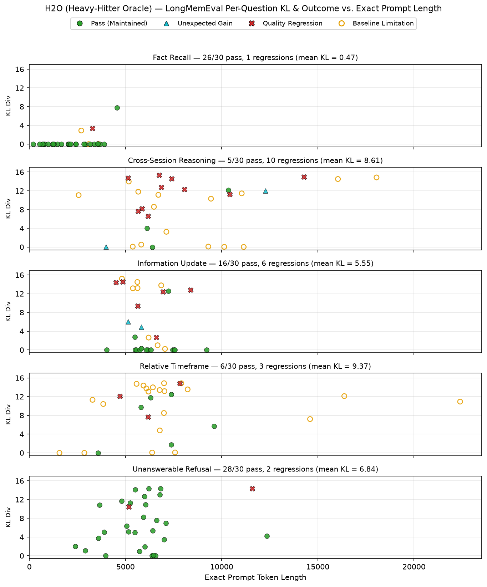

# WP-3 Technical Analysis: H2O (Heavy-Hitter Oracle)

**Authoritative Axis (`docs/METRICS_AND_AXES.md`):** `STRUCTURAL`  
**`kv_bench` Pinned Commit:** `78ce018e589c554fccd7d4e31173fe04fcba8a0c` *(PR #60: pure-GPU `torch.topk` removing `.tolist()` D2H sync + `bfloat16` score matmul)*  
**Target Model:** `Qwen/Qwen3-4B-Instruct-2507` (`Pure Dense GQA`, $L=36$, $H_Q=32$, $H_{KV}=8$, $D=128$, `bfloat16`)  
**Hardware Cap:** 16.0 GiB process allocator cap on NVIDIA RTX 4090 (23.52 GiB physical VRAM), Slurm Job `30848`

---

## 1. Verified Configuration & Empirical Snapshot

### 1.1 Manifest Provenance & `technique_config`
From [`results/manifests/run_manifest_wp3_h2o_pytorch.json`](../../../results/manifests/run_manifest_wp3_h2o_pytorch.json):
- **Manifest `technique_config`:** `cache_class`: `H2OCache`, `heavy_hitter_tokens`: `1024`, `recent_window_tokens`: `1024`, `effective_cache_tokens`: `2048`, `block_size`: `16`.
- **VERIFIED Hub Artifact SHA-256 Checksums:**
  - `results/runs/wp3/h2o_hardware_pytorch_16gb.json`: `5f68bae50d66ba0e0ce64c78cd25632b575476fdb632a857cf493e92eded50a0`
  - `results/runs/wp3/h2o_longmem_pytorch_16gb.json`: `b4b0348ec14616f53fbc6b130ab595a41a86b3adcafaef98d891cad610e0935b`
  - `results/runs/wp3/h2o_niah_pytorch_16gb.json`: `d1eb472c3852ae56ee2c8dfb939d6b97d4e0748d69b74f868d3ca1f4b35edcb4`
  - `results/runs/wp3/verify_h2o_pytorch_16gb.json`: `59b885d5fe565951d181cc5925b70489f1fd8ddfa0c7051a730c607ca7f85ee1`
  - `results/grades/h2o_grades.json`: `ab664c214aae6976e07e371a4f4f584f5e4bb0ee12b80f82ec2ae262e66331c5`
  - `results/grades/h2o_judged.json`: `22c41f7658cad401a60e54683d804e3d0e5176bc231c70b8c94b77103f9e2ed8`

### 1.2 Hardware Scaling Sweep (`512 -> 32,768` Tokens, `SyntheticFiller`)
Static `Qwen3-4B` BF16 weights + runtime at `ctx=128` is **`7,738.78 MiB` (~7.56 GiB)**. Post-PR #60, H2O caps 32K `Peak Alloc` at **`9,434.73 MiB`** (`1,695.95 MiB` net KV+aux, saving `3,790.2 MiB` vs. baseline), slashes 32K TPOT **`45.88 -> 29.27 ms`** (matching baseline `29.17 ms`!), drops Host RSS **`6,874 -> 1,548 MiB`**, and eliminates all D2H sync traffic (`8,258 B/tok` = harness floor!).

| `ctx` | Peak Alloc (MiB) | Peak Reserved (MiB) | Warm TTFT (s) | TPOT Mean / P95 (ms) | Throughput (tok/s) | Host RSS Δ (MiB) | Memcpy (B/tok) | Physical Scalar Bits | Effective Token Retention |
|---:|---:|---:|---:|---:|---:|---:|---:|---:|---:|
| **512** | 7,915.79 | 7,998.0 | 0.0449 | 24.12 / 24.12 | 41.46 | 1,194.47 | 193.88 | 16-bit BF16 | 100.0% (576 / 576) |
| **1,024** | 8,186.19 | 8,226.0 | 0.1164 | 24.10 / 24.10 | 41.50 | 1,194.65 | 321.88 | 16-bit BF16 | 100.0% (1,088 / 1,088) |
| **2,048** | 8,959.22 | 9,026.0 | 0.2918 | 29.15 / 29.15 | 34.30 | 1,297.94 | 577.88 | 16-bit BF16 | 96.97% (2,048 / 2,112) |
| **4,096** | 9,434.51 | 9,688.0 | 0.7521 | 28.72 / 28.72 | 34.82 | 1,314.96 | 1,089.88 | 16-bit BF16 | 49.23% (2,048 / 4,160) |
| **8,192** | 9,434.54 | 9,688.0 | 1.6724 | 28.88 / 28.88 | 34.62 | 1,347.13 | 2,113.88 | 16-bit BF16 | 24.81% (2,048 / 8,256) |
| **16,384** | 9,434.60 | 9,868.0 | 3.5180 | 28.82 / 28.82 | 34.70 | 1,311.09 | 4,161.88 | 16-bit BF16 | 12.45% (2,048 / 16,448) |
| **32,768** | **9,434.73** | 9,868.0 | **7.2046** | **29.27 / 29.27** | **34.16** | **1,548.30** | **8,257.88** | 16-bit BF16 | 6.24% (2,048 / 32,832) |

### 1.3 Micro Fidelity & Macro Retrieval (NIAH, LongMemEval)
- **Verify (`ctx=128`):** `top1_agreement = 1.0`, `kl_div_mean = 0.0`, `kl_div_p99 = 0.0`.
- **NIAH (`2K` & `4K`):** `2,048` ctx: **100% (`10/10`)**; `4,096` ctx: **20% (`2/10`)** (depths `0.8–0.9` inside `1,024` recent window).
- **LongMemEval (`150` native-length samples, `h2o_judged.json`):**
  - **Overall Accuracy:** **`81 / 150 = 54.00%`** vs. Baseline **`99 / 150 = 66.0%`** ($\Delta = -12.00\text{ pp}$, **`+10.0 pp` over StreamingLLM**).
  - **Causal Verdicts:** `PASS_FIDELITY_MAINTAINED = 77`, `BASELINE_LIMITATION = 47`, **`QUALITY_REGRESSION = 22`**, `UNEXPECTED_GAIN = 4`.
  - **LongMemEval KL:** `top1_agreement = 0.4647`, `kl_div_mean = 7.79577`, `kl_div_p99 = 15.4249`, `tpot = 23.08 ms`.

| LongMemEval Capability | Baseline (`N=30` each) | H2O (`N=30` each) | $\Delta$ (pp) | `QUALITY_REGRESSION` Count |
|---|---:|---:|---:|---:|
| **Fact Recall** | 90.0% (27/30) | 86.7% (26/30) | -3.3 | 1 |
| **Information Update** | 66.7% (20/30) | 53.3% (16/30) | -13.3 | 6 *(+2 UG)* |
| **Relative Timeframe** | 30.0% (9/30) | 20.0% (6/30) | -10.0 | 3 |
| **Cross-Session Reasoning** | 43.3% (13/30) | 16.7% (5/30) | -26.7 | 10 *(+2 UG)* |
| **Unanswerable Refusal** | 100.0% (30/30) | 93.3% (28/30) | -6.7 | 2 |

---

## 2. White-Box Component Decomposition (Post-PR #60)

| ID | Component | Source Location (`kv_bench@78ce018`) | Tensor Shapes & Dtypes (`Qwen3-4B`, BF16) | Execution Cadence |
|---|---|---|---|---|
| **C1/C2** | **SDPA Hook + `bfloat16` Score Accumulation** | `h2o.py`, `h2o_cache.py` | **IMPROVED in PR #60:** Computes chunk score matmul in `bfloat16` instead of `float32`, saving `290 MiB` VRAM (`9,724.7 -> 9,434.7 MiB`) and `1.91 s` TTFT (`9.11 -> 7.20 s`). | Every layer ($36\times$). |
| **C3** | **Cumulative Score & KV Buffer (`H2OLayer`)** | `h2o_cache.py` | `keys`/`values`: `(1, 8, 2048, 128)` `bf16`; `cumulative_scores`: `(1, 8, S)` | Every step. |
| **C4** | **Pure-GPU `torch.topk` Eviction (`compute_h2o_boundaries`)** | `h2o.py`, `h2o_cache.py` | **RESOLVED in PR #60:** Eliminated `.tolist()` + Python `sorted()` D2H/H2D syncs, cutting 32K memcpy **`2.01 MB/tok -> 8,258 B/tok`** (harness floor!), Host RSS **`6,874 -> 1,548 MiB`**, and TPOT **`45.88 -> 29.27 ms`**. | Chunk end + decode step (`seq_len > 2048`). |

---

## 3. 3-Way Causal Attribution (Pre- vs. Post-PR #60)

- **Sync, RSS & Latency Penalties Eliminated (`[IMPLEMENTATION]` RESOLVED):**
  - Replacing `.tolist()` + Python `sorted()` with pure-GPU `torch.topk` and moving score accumulation to `bfloat16` cut 32K memcpy **`2.01 MB/tok -> 8,258 B/tok`** (harness floor), Host RSS **`-5,325 MiB`** (`6,874 -> 1,548 MiB`), 32K TPOT **`45.88 -> 29.27 ms`** (`23.08 ms` on LongMemEval!), and TTFT **`9.11 -> 7.20 s`**.
- **Intrinsic Eviction Amnesia Confirmed (`[INTRINSIC]` — `54.00%`, `22` QR, `20%` 4K NIAH):**
  - Even with all implementation penalties removed, permanent Heavy-Hitter eviction (`1024 + 1024`) still incurs **`22` regressions** (`cross_session_reasoning 16.7%`, `information_update 53.3%`, `4K NIAH 20%`), proving middle-token deletion is intrinsically lossy and evicted tokens must be demoted to a cold tier rather than discarded.

---

## 4. Paper vs. Replication Fidelity (Post-PR #60)

| Dimension | Paper (`Zhang et al., NeurIPS 2023`) | `kv_bench` Replication (`78ce018`, Post-PR #60) | Fidelity Verdict |
|---|---|---|---|
| **Dual-Pool Budget** | $K$ heavy hitters + $K$ recent (`50%/50%`) | `1024 + 1024` (`2048` total) | **Exact Match** |
| **Pure-GPU Eviction** | In-place GPU top-$k$ | Pure-GPU `torch.topk` (`29.27 ms` TPOT, `8.3 KB/tok` floor) | **Faithful (Fixed in PR #60)** |
| **Score Extraction** | Fused inside attention | Post-hoc `bfloat16` hook (`7.20 s` TTFT, `~0.72 GiB` overhead vs StreamingLLM) | **PyTorch SDPA Limitation** |

---

## 5. Component Verdicts (`KEEP` / `ADAPT` / `DROP`)

| Component | Verdict | Contribution | Failure Mode | Exact Fix Prerequisite (if `ADAPT`) |
|---|---|---|---|---|
| **C1/C2: `bfloat16` Score Hook** | **`ADAPT`** | Accurate cumulative GQA scoring (`7.20 s` TTFT) | Still duplicates attention matmul under HF SDPA | Fuse into Triton/vLLM attention or use lightweight last-query proxy |
| **C3/C4: Pure-GPU Heavy-Hitter Pool** | **`KEEP`** *(hot tier)* | `29.27 ms` TPOT, `1,548 MiB` RSS, `+10 pp` over StreamingLLM | Permanent eviction still causes `22` regressions | Demote evicted tokens to 4-bit cold tier in WP-4 instead of deleting |
