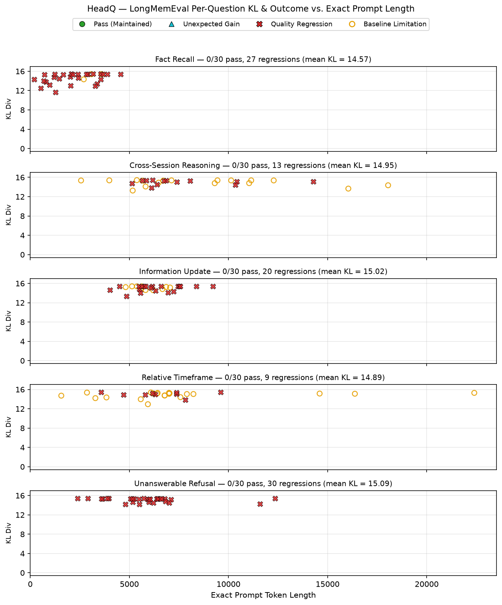

# WP-3 Technique Analysis: `headq` (HeadQ)

## 1. Verified Configuration & Empirical Snapshot

### Provenance & Authoritative Configuration
- **Repository & Commit:** `khemingkapat/kv_bench` @ `2a9338a2f750741f7765d79c1270f5579a9ffed0` (`main`, clean working tree)
- **Primary Model:** `Qwen/Qwen3-4B-Instruct-2507` (`cdbee75f17c01a7cc42f958dc650907174af0554`, Pure Dense GQA, `bfloat16`, $L=36, H_Q=32, H_{KV}=8, D=128$)
- **Hardware & Harness:** `gpu06.slurm.cpe.kmutt.ac.th`, NVIDIA GeForce RTX 4090 (23.52 GiB physical, **16.0 GiB** process allocator cap), Slurm Job `25749` (hardware/verify/NIAH) & `30137` (LongMemEval)
- **Authoritative Axis ([`docs/METRICS_AND_AXES.md`](../../../docs/METRICS_AND_AXES.md)):** `STRUCTURAL`
- **Manifest `technique_config`:**
  ```json
  {
    "cache_class": "HeadQCache",
    "key_bits": 2,
    "val_bits": 4,
    "pca_rank": 4,
    "sidecode_bits": 4,
    "block_size": 16
  }
  ```
- **`VERIFIED` Hub Artifact SHA-256s ([`run_manifest_wp3_headq.json`](../../../results/manifests/run_manifest_wp3_headq.json)):**
  - `headq_hardware_pytorch_16gb.json`: `8dc8e382da4d3df971d9fd6454cff788ee1ce3091e0985a5085e930f867a1a09`
  - `headq_longmem_pytorch_16gb.json`: `fff4d8c40b6656f5dfe82270bfbbe041a236d4e13dbeafe014f31d0d85c52fa8`
  - `headq_niah_pytorch_16gb.json`: `33c8f7aead5722be613bc61791ce7c7fe21cdf0750d5cc72ab2bc5b50f2add41`
  - `verify_headq_pytorch_16gb.json`: `84956190916e7e0cddcba31c3f46ff3145fa9535afbd5bad04d695e8c429a452`
  - `headq_grades.json`: `28f9a526ff3325e0f46ac4a9928280ab224b4889179cd2f9198e9eaa0f9fb197`
  - `headq_judged.json`: `7f327c3607b80c76727031b10e68df54e5f5512a7384579fe4e1c5723953fb1a`

### Precision & Retention Separation
| Metric | Value | Notes |
|---|---:|---|
| **Physical Scalar Bits** | **3.25 bits/scalar** (combined); **K: 2.375**, **V: 4.125** | K: 2-bit base (`32 B/tok/head`) + BF16 K scale (`2 B`) + 4-bit rank-4 sidecode (`2 B`) + BF16 sidecode scale (`2 B`) = `38 B` (+ 1 KiB/layer `U` basis); V: 4-bit (`64 B`) + BF16 V scale (`2 B`) = `66 B`; Total `104 B / 256 scalars` (`4.92x` theoretical; `5.22x` reported) |
| **Effective Token Retention** | **100.0%** | All prompt and generated tokens are retained in `HeadQLayer` (`total_tokens_seen`) |

### Hardware Context Scaling Sweep (`512 -> 32,768`, `SyntheticFiller`)
Static `Qwen3-4B` BF16 weights + PyTorch runtime occupy **7,738.78 MiB (~7.56 GiB)** (`verify_baseline_pytorch_16gb.json` at `ctx=128`); net KV+aux VRAM below is `Peak Alloc - 7,738.78 MiB`.

| Ctx | Peak Alloc (MiB) | Base Alloc (MiB) | Net KV+Aux (MiB) | Base Net KV (MiB) | TTFT (s) | TPOT (ms) | Base TPOT (ms) | Tok/s | Host RSS Δ (MiB) | Memcpy (B/tok) | Top-1 Agr. | KL Mean | KL P99 |
|---:|---:|---:|---:|---:|---:|---:|---:|---:|---:|---:|---:|---:|---:|
| 512 | 7,863.50 | 7,911.66 | 124.72 | 172.88 | 0.1631 | 51.73 | 17.36 | 19.33 | 3,630.97 | 225.31 | 0.0000 | 14.1805 | 15.3975 |
| 1,024 | 8,045.16 | 8,133.04 | 306.38 | 394.26 | 0.2045 | 49.41 | 16.91 | 20.24 | 3,627.07 | 353.31 | 0.0000 | 14.3242 | 15.4249 |
| 2,048 | 8,337.45 | 8,566.92 | 598.67 | 828.14 | 0.2969 | 49.93 | 16.61 | 20.03 | 3,677.53 | 609.31 | 0.0156 | 12.4934 | 15.4249 |
| 4,096 | 8,395.97 | 8,854.93 | 657.19 | 1,116.15 | 0.5012 | 49.94 | 16.67 | 20.02 | 3,755.42 | 1,121.31 | 0.0312 | 13.4899 | 15.2318 |
| 8,192 | 8,513.00 | 9,430.96 | 774.22 | 1,692.18 | 1.0360 | 49.81 | 17.12 | 20.08 | 3,905.30 | 2,145.31 | 0.0938 | 11.7722 | 15.4249 |
| 16,384 | 9,043.72 | 10,616.78 | 1,304.94 | 2,878.00 | 2.5913 | 50.06 | 20.47 | 19.98 | 4,235.73 | 4,193.31 | 0.0000 | 14.0484 | 15.4248 |
| 32,768 | 10,108.84 | 13,224.90 | 2,370.06 | 5,486.12 | 7.7166 | 80.89 | 29.17 | 12.36 | 4,655.65 | 8,289.31 | 0.0000 | 14.3445 | 15.4249 |

*Verify (`ctx=128`, 16 gen tokens):* `top1_agreement = 0.0`, `kl_div_mean = 14.28884`, `kl_div_p99 = 15.3301`.

### Quality Diagnostics: NIAH (2K/4K) & LongMemEval (150 Questions, Judged)
- **NIAH Exact Retrieval:**
  - `2,048` ctx: **0/10 (0.0%)** across depths `[0.0 .. 0.9]` (total collapse)
  - `4,096` ctx: **0/10 (0.0%)** across depths `[0.0 .. 0.9]` (total collapse)
- **LongMemEval Logit Fidelity (native lengths `192..22,400`, mean `5,967.9` tokens):** `top1_agreement = 0.0136`, `kl_div_mean = 14.75551`, `kl_div_p99 = 15.4249`.
- **LongMemEval 5-Capability Judged Accuracy ([`headq_judged.json`](../../../results/grades/headq_judged.json) vs. [`baseline_judged.json`](../../../results/grades/baseline_judged.json)):**

| Capability | Baseline | HeadQ | Δ vs. Baseline | `QUALITY_REGRESSION` Count |
|---|---:|---:|---:|---:|
| **Overall (150)** | **66.0% (99/150)** | **0.0% (0/150)** *(raw 1/150)* | **-66.00 pp** | **99** *(100% of baseline-correct samples regressed)* |
| `fact_recall` (30) | 90.00% | 0.00% | -90.00 pp | 27 |
| `information_update` (30) | 66.67% | 0.00% | -66.67 pp | 20 |
| `cross_session_reasoning` (30) | 43.33% | 0.00% | -43.33 pp | 13 |
| `relative_timeframe` (30) | 30.00% | 0.00% | -30.00 pp | 9 |
| `unanswerable_refusal` (30) | 100.00% | 0.00% | -100.00 pp | 30 |




---

## 2. White-Box Component Decomposition

| ID | Component | Source Location | Tensor Shapes & Dtypes (`Qwen3-4B`: $L=36, H_Q=32, H_{KV}=8, D=128$) | Cadence |
|---|---|---|---|---|
| **C1** | **2-bit Per-Token Symmetric Key Quantizer** | `headq.py`: `quantize_key_2bit` (L57–91), `dequantize_key_2bit` (L94–117) | `k_packed`: `(1, 8, T_new, 32)` `uint8` (4 levels `[-2, 1]`, `scale = amax / 1.5`); `k_scales`: `(1, 8, T_new, 1)` `bf16` | Every prefill chunk & decode step |
| **C2** | **First-Chunk Key-Residual PCA Basis Fit** | `headq_cache.py`: `HeadQLayer.update` (L193–194); `headq.py`: `compute_query_pca_basis` (L20–54) | `basis`: `(128, 4)` `bf16`; fits SVD on **first-chunk `k_residual`** (`key_states - k_dequant`) across all heads pooled, *not* offline calibration queries | Once per layer on first prefill chunk (`self.basis is None`) |
| **C3** | **4-bit Rank-4 Residual Side-Code & 4-bit Value Quantizer** | `headq.py`: `compute_key_sidecode` (L120–150), `quantize_value_4bit` (L175–188) | `z_packed`: `(1, 8, T_new, 2)` `uint8`, `z_scales`: `(1, 8, T_new, 1)` `bf16`; `v_packed`: `(1, 8, T_new, 64)` `uint8`, `v_scales`: `(1, 8, T_new, 1)` `bf16` | Every prefill chunk & decode step |
| **C4** | **Pre-Allocated Buffers & Full-BF16 Key/Value Reconstruction** | `headq_cache.py`: `HeadQLayer._ensure_capacity` (L133–169), `keys` (L78–102), `values` (L109–119) | Reconstructs `k_base + z_recon @ basis.T` and `v_dequant` over entire `[0..T]` into `(1, 8, T, 128)` `bf16` for HF `sdpa` | Every prefill chunk & every decode step |

---

## 3. 3-Way Causal Attribution

- **VRAM Savings (`10,108.84 MiB` vs. `13,224.90 MiB` at 32K, `-3,116.06 MiB`):**
  - **`[IMPLEMENTATION]`** Persistent single-pass `HeadQLayer` buffers at 32K (`32,832` tokens) occupy **`983,390,976 B` (`0.916 GiB`)**, giving the lowest peak VRAM among all four quantizers (note: `quantized_cache_bytes = 1,966,781,952 B` in the hardware JSON accumulates `2×` across `--profile` + timed runs in `harness.py`). **C4** still materializes transient `(1, 8, T, 128)` `bf16` K/V tensors for HF `sdpa`, leaving net KV+aux at `2,370.06 MiB` (vs. `5,486.12 MiB` baseline net).
- **TPOT & Throughput (`49.4–51.7 ms` at 512–16K, `80.89 ms` at 32K vs. `16.6–29.2 ms` baseline, `~2.8–3.0x` slowdown):**
  - **`[IMPLEMENTATION]`** **C4** unpacks 2-bit keys, unpacks 4-bit sidecodes, executes `z_recon @ basis.T`, adds `k_base + k_corr`, and unpacks 4-bit values across all `[0..T]` tokens in Python/PyTorch eager ops on every decode step across 36 layers.
- **Host RSS (`3,631 -> 4,656 MiB`) & PCIe Memcpy (`8,289.31 B/tok` at 32K):**
  - **`[IMPLEMENTATION]`** Matches the **`8,266 B/tok`** 32K hardware-sweep instrumentation floor (`+23 B/tok` overhead); zero spatial offloading.
- **Total Quality Collapse (`0.0%` NIAH, `0.0%` Judged LongMemEval, `99/99` `QUALITY_REGRESSION`, `kl_div_mean = 14.18–14.76`):**
  - **`[IMPLEMENTATION]`** **Catastrophic Bug in C1 + C2:**
    1. **C2 (`headq_cache.py` L193–194):** `self.basis = compute_query_pca_basis(k_residual, rank=self.rank)` fits PCA on the **first-chunk Key quantization residual** (`k_residual`) instead of **offline post-RoPE calibration Queries** (`U_h`). Because `k_residual` is uncorrelated with the active query subspace, the rank-4 sidecode corrects random/null directions rather than the model-visible score space!
    2. **C1 (`headq.py` L74–78):** `quantize_key_2bit` uses a **per-token** symmetric quantizer (`scale = k.abs().amax(dim=-1) / 1.5`) without **channel-mean centering** (`k - mu`) or outlier smoothing, and uses 4 asymmetric integer levels `[-2, -1, 0, 1]` divided by `1.5` (so `-2` maps to `-1.33 * amax`). Combined with broken C2, 2-bit Key quantization destroys attention routing, producing gibberish token/zero repetition across all 99 `QUALITY_REGRESSION` samples (`bb7c3b45`, `2e6d26dc`, `f0e564bc`) and `0/10` on both 2K and 4K NIAH.
  - **`[HARDWARE/GQA]`** Even with a valid query-PCA basis, GQA (`H_Q=32, H_KV=8`) shares one key head across 4 query heads, meaning `basis` would need group-pooled query PCA (`U_k`), and `kl_div_p99 = 15.4249` reflects the runner's top-5 clamp.

---

## 4. Paper vs. Replication Fidelity

| Dimension | HeadQ Paper ([`docs/literature_survey/techniques/headq.md`](../../../docs/literature_survey/techniques/headq.md)) | `kv_bench` Replication (`headq.py` / `headq_cache.py`) | Impact of Divergence |
|---|---|---|---|
| **PCA Basis (`U_h`) Source** | Offline calibration on **post-RoPE Queries** per head ($r=4$ captures ~87% query variance) | Online SVD on **first-chunk `k_residual`** pooled across all heads (`headq_cache.py` L194) | **Root cause of 0% LongMemEval & 0% NIAH** (corrects wrong subspace) |
| **Base Key Quantizer** | Centered / channel-aware 2-bit quantizer (exploiting Proposition 1 softmax-null translation) | Uncentered per-token `amax / 1.5` with `[-2, -1, 0, 1]` (`headq.py` L74–77) | Severe dynamic-range waste on outlier/offset channels |
| **Value Quantization** | $A^2$-weighted readout precision allocation | Uniform per-token 4-bit symmetric (`quantize_value_4bit`) | Ignores attention-weighted value policy |
| **Logit Correction Path** | Associative $(q^\top U_h)\tilde{z}_j / \sqrt{d}$ added directly to coarse logits | Reconstructs full-dim `k_base + z_recon @ basis.T` in BF16 for HF `sdpa` (`headq_cache.py` L101–102) | Loses associative FLOPs advantage; `~2.9x` TPOT slowdown |

---

## 5. Component Verdicts (`KEEP` / `ADAPT` / `DROP`)

| Component | Verdict | Contribution | Failure Mode | Fix Prerequisite (if `ADAPT`) |
|---|---|---|---|---|
| **C1: 2-bit Key Quantizer** | **`ADAPT`** | Aggressive 2-bit key footprint (32 B/tok/head) | Uncentered per-token `amax/1.5` with `[-2..1]` causes catastrophic routing collapse | Add per-channel centering/smoothing (Proposition 1) + proper uniform 2-bit grid before quantization |
| **C2: Key-Residual PCA Fit** | **`DROP`** (replace with offline Query PCA) | None (broken proxy) | Fits SVD on `k_residual` instead of calibration Queries; directly causes 99/99 regressions | Pre-compute per-KV-head group-pooled **Query** PCA basis $U_k \in \mathbb{R}^{128 \times 4}$ offline on calibration prompts |
| **C3: Rank-4 Sidecode & 4-bit V** | **`ADAPT`** | Compact 16-bit/head/tok residual code | Ineffective without valid Query PCA $U_k$; V lacks $A^2$ weighting | Pair with offline Query PCA $U_k$ and test $A^2$-aware V allocation |
| **C4: Full-BF16 Reconstruction** | **`DROP`** | Reference HF `sdpa` compatibility | `~2.9x` TPOT slowdown; forfeits associative $(q^\top U_k)\tilde{z}_j$ speedup | Fuse coarse 2-bit score + 4-element sidecode dot product in Triton/CUDA attention kernel |
