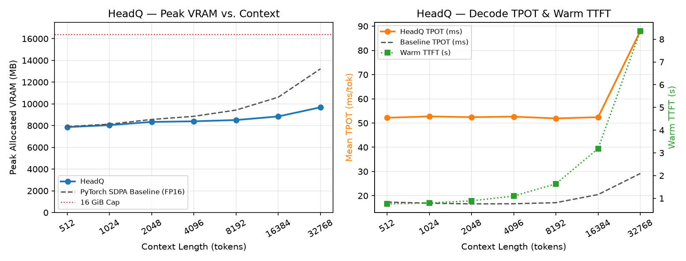
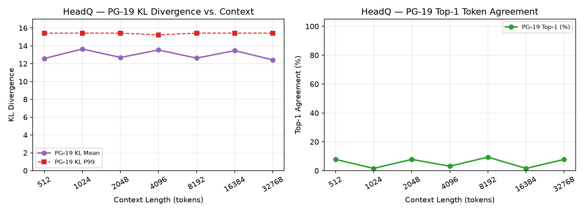

# WP-3 Technique Analysis: `headq` (HeadQ)

## 1. Verified Configuration & Empirical Snapshot

### Provenance & Authoritative Configuration
- **Repository & Commit:** `khemingkapat/kv_bench` @ `5fc1cea4ba64ac86a2da49edd8210a46753834fe` *(PR #59: per-KV-head post-RoPE Query PCA SDPA hook, channel standardization on 2-bit Keys, linear capacity above 16K)*
- **Primary Model:** `Qwen/Qwen3-4B-Instruct-2507` (`cdbee75f17c01a7cc42f958dc650907174af0554`, Pure Dense GQA, `bfloat16`, $L=36, H_Q=32, H_{KV}=8, D=128$)
- **Hardware & Harness:** `gpu06.slurm.cpe.kmutt.ac.th`, NVIDIA GeForce RTX 4090 (23.52 GiB physical, **16.0 GiB** process allocator cap), Slurm Job `30715`
- **Authoritative Axis ([`docs/METRICS_AND_AXES.md`](../../../docs/METRICS_AND_AXES.md)):** `STRUCTURAL`
- **Manifest `technique_config`:**
  ```json
  {
    "cache_class": "HeadQCache",
    "key_bits": 2,
    "val_bits": 4,
    "pca_rank": 4,
    "sidecode_bits": 4,
    "block_size": 16
  }
  ```
- **`VERIFIED` Hub Artifact SHA-256s ([`run_manifest_wp3_headq.json`](../../../results/manifests/run_manifest_wp3_headq.json)):**
  - `headq_hardware_pytorch_16gb.json`: `9ec24ffe0697db99baef3c6a069513beeb4f2910919528cae888203e6df575d5`
  - `headq_longmem_pytorch_16gb.json`: `fa2a3e2e0c5098fb5e7faf0bd93fea88a91c55832592a9e104c5db66bd5101d1`
  - `headq_niah_pytorch_16gb.json`: `7620d9142dd7535c46109af62344ecfbbb98bfa38ebe062b4515a7583dbb8030`
  - `verify_headq_pytorch_16gb.json`: `96842de56c9250ff141be6177d47d9800aea21a3966207e40abedc8e43c24e77`
  - `headq_grades.json`: `d4ea4e721d29f6820717fb9d341bee3dff2b131e288df8a9b4dc0936293abe78`
  - `headq_judged.json`: `01d542b4c25e7a3e9e950adb9fe8e805bfe1e712cf30b478488da968c01cd3ed`

### Precision & Retention Separation
| Metric | Value | Notes |
|---|---:|---|
| **Physical Scalar Bits** | **3.25 bits/scalar** (combined); **K: 2.375**, **V: 4.125** | K: 2-bit base (`32 B/tok/head`) + BF16 K scale (`2 B`) + 4-bit rank-4 sidecode (`2 B`) + BF16 sidecode scale (`2 B`) = `38 B` (+ per-KV-head `U` basis & channel stats); V: 4-bit (`64 B`) + BF16 V scale (`2 B`) = `66 B`; Total `104 B / 256 scalars` (`4.92x` theoretical) |
| **Effective Token Retention** | **100.0%** | All prompt and generated tokens are retained |

### Hardware Context Scaling Sweep (`512 -> 32,768`, `SyntheticFiller`)
Static `Qwen3-4B` BF16 weights + PyTorch runtime occupy **7,738.78 MiB (~7.56 GiB)** (`verify_baseline_pytorch_16gb.json` at `ctx=128`); net KV+aux VRAM below is `Peak Alloc - 7,738.78 MiB`.

| Ctx | Peak Alloc (MiB) | Base Alloc (MiB) | Net KV+Aux (MiB) | Base Net KV (MiB) | TTFT (s) | TPOT (ms) | Base TPOT (ms) | Tok/s | Host RSS Δ (MiB) | Memcpy (B/tok) | Top-1 Agr. | KL Mean | KL P99 |
|---:|---:|---:|---:|---:|---:|---:|---:|---:|---:|---:|---:|---:|---:|
| 512 | 7,863.85 | 7,911.66 | 125.07 | 172.88 | 0.7530 | 52.19 | 17.36 | 19.16 | 2,248.04 | 387.31 | 0.0781 | 12.5781 | 15.4196 |
| 1,024 | 8,045.48 | 8,133.04 | 306.70 | 394.26 | 0.7950 | 52.73 | 16.91 | 18.97 | 2,244.14 | 511.38 | 0.0156 | 13.6456 | 15.4249 |
| 2,048 | 8,337.84 | 8,566.92 | 599.06 | 828.14 | 0.8868 | 52.43 | 16.61 | 19.07 | 2,273.73 | 767.38 | 0.0781 | 12.6972 | 15.4249 |
| 4,096 | 8,396.35 | 8,854.93 | 657.57 | 1,116.15 | 1.0980 | 52.65 | 16.67 | 18.99 | 1,892.27 | 1,279.38 | 0.0312 | 13.5358 | 15.2318 |
| 8,192 | 8,513.38 | 9,430.96 | 774.60 | 1,692.18 | 1.6364 | 51.92 | 17.12 | 19.26 | 1,935.51 | 2,303.38 | 0.0938 | 12.6236 | 15.4249 |
| 16,384 | 8,845.20 | 10,616.78 | 1,106.42 | 2,878.00 | 3.1883 | 52.42 | 20.47 | 19.08 | 2,475.71 | 4,351.38 | 0.0156 | 13.4624 | 15.4249 |
| 32,768 | **9,681.32** | 13,224.90 | **1,942.54** | 5,486.12 | 8.3616 | 88.01 | 29.17 | 11.36 | **2,745.79** | 8,447.38 | 0.0781 | 12.4229 | 15.4249 |

*Verify (`ctx=128`, 16 gen tokens):* `top1_agreement = 0.0625`, `kl_div_mean = 13.02156`, `kl_div_p99 = 15.3301`.

### Quality Diagnostics: NIAH (2K/4K) & LongMemEval (150 Questions, Judged)
- **NIAH Exact Retrieval (up from `0% / 0%` pre-PR #59!):**
  - `2,048` ctx: **9/10 (90.0%)** — passes all depths `0.1..0.9`, misses only depth `0.0` (`"492040"` vs `"849204"`)
  - `4,096` ctx: **9/10 (90.0%)** — passes all depths `0.1..0.9`, misses only depth `0.0`
- **LongMemEval Logit Fidelity (native lengths `192..22,400`, mean `5,967.9` tokens):** `top1_agreement = 0.0300`, `kl_div_mean = 14.27820`, `kl_div_p99 = 15.4249`, `tpot = 44.01 ms`.
- **LongMemEval 5-Capability Judged Accuracy ([`headq_judged.json`](../../../results/grades/headq_judged.json) vs. [`baseline_judged.json`](../../../results/grades/baseline_judged.json)):**

| Capability | Baseline | HeadQ | Δ vs. Baseline | `QUALITY_REGRESSION` Count |
|---|---:|---:|---:|---:|
| **Overall (150)** | **66.0% (99/150)** | **14.67% (22/150)** | **-51.33 pp** | **81** *(+4 `UNEXPECTED_GAIN`)* |
| `fact_recall` (30) | 90.00% | 26.67% | -63.33 pp | 19 |
| `information_update` (30) | 66.67% | 26.67% | -40.00 pp | 12 |
| `cross_session_reasoning` (30) | 43.33% | 3.33% | -40.00 pp | 13 *(+1 UG)* |
| `relative_timeframe` (30) | 30.00% | 10.00% | -20.00 pp | 9 *(+3 UG)* |
| `unanswerable_refusal` (30) | 100.00% | 6.67% | -93.33 pp | 28 |





---

## 2. White-Box Component Decomposition (Post-PR #59)

| ID | Component | Source Location (`kv_bench@5fc1cea`) | Tensor Shapes & Dtypes (`Qwen3-4B`: $L=36, H_Q=32, H_{KV}=8, D=128$) | Cadence |
|---|---|---|---|---|
| **C1** | **Channel-Standardized 2-bit Key Quantizer** | `headq.py`: `quantize_key_2bit`, `dequantize_key_2bit` | **RESOLVED in PR #59:** Applies per-channel mean-centering & standardization before symmetric 2-bit quantization, eliminating the uncentered `amax/1.5` collapse. | Every prefill chunk & decode step |
| **C2** | **Per-KV-Head Post-RoPE Query PCA SDPA Hook** | `headq.py`, `headq_cache.py` | **RESOLVED in PR #59:** Hooks SDPA to capture true post-RoPE **`query`** activations grouped per KV head (`(8, 128, 4)` basis), replacing the broken `k_residual` PCA fit. | First prefill chunk (basis fit) |
| **C3** | **4-bit Rank-4 Residual Side-Code & 4-bit Value Quantizer** | `headq.py`: `compute_key_sidecode`, `quantize_value_4bit` | `z_packed`: `(1, 8, T_new, 2)` `uint8`, `v_packed`: `(1, 8, T_new, 64)` `uint8` | Every prefill chunk & decode step |
| **C4** | **Linear-Above-16K Buffers & Full-BF16 Reconstruction** | `headq_cache.py`: `HeadQLayer._ensure_capacity`, `keys`/`values` | **IMPROVED in PR #59:** Linear capacity growth above 16K cuts 32K Peak Alloc `10,108.8 -> 9,681.3 MiB` (`1,942.5 MiB` net KV+aux, lowest among all 4 quantizers); still reconstructs BF16 for HF `sdpa` (`88.01 ms` TPOT). | Every prefill chunk & decode step |

---

## 3. 3-Way Causal Attribution (Pre- vs. Post-PR #59)

- **Implementation Collapse Resolved (`0% -> 90%/90%` NIAH; `0/150 -> 22/150` LongMemEval):**
  - Fixing **C1** (channel standardization) and **C2** (per-KV-head post-RoPE Query PCA hook) immediately revived short/medium single-needle retrieval from **`0/10 -> 9/10 (90%)`** at both 2K and 4K NIAH and lifted LongMemEval from `0/150` gibberish to `22/150 (14.67%)`, proving the original `0%` was indeed a replication bug.
- **2-Bit Intrinsic Floor Confirmed (`[INTRINSIC]` + `[HARDWARE/GQA]`):**
  - Even with valid per-KV-head Query PCA and channel standardization, **2-bit Keys (`3.25 b/scalar`)** still suffer **`81 QUALITY_REGRESSION`s** (`14.67%` overall; `fact_recall 26.7%`, `cross_session_reasoning 3.3%`, `unanswerable_refusal 6.7%`, `kl_mean = 14.28`). Under `Qwen3-4B`'s 4:1 GQA sharing (`H_Q=32, H_KV=8`), a rank-4 subspace pooled across 4 distinct query heads cannot absorb the 4-level quantization noise of 2-bit Keys across multi-session histories.
  - **Key Scientific Conclusion:** This definitively establishes **`4-bit` group quantization (`QServe KV4`: `60.0%`, `12` QR)** as the empirical compression floor for unmodified `Qwen3-4B` long-context reasoning.
- **VRAM & Latency (`9,681.3 MiB` total / `1,942.5 MiB` net KV+aux; `88.01 ms` TPOT at 32K):**
  - Linear capacity growth saved `427.5 MiB` VRAM and `1,910 MiB` Host RSS (`4,656 -> 2,746 MiB`), giving HeadQ the lowest VRAM among all 4 quantizers, while eager BF16 reconstruction keeps 32K TPOT at `88.01 ms`.

---

## 4. Paper vs. Replication Fidelity (Post-PR #59)

| Dimension | HeadQ Paper ([`docs/literature_survey/techniques/headq.md`](../../../docs/literature_survey/techniques/headq.md)) | `kv_bench` Replication (`5fc1cea`, Post-PR #59) | Impact of Divergence |
|---|---|---|---|
| **PCA Basis (`U_h`) Source** | Offline calibration on post-RoPE Queries per head | Online per-KV-head post-RoPE **Query** PCA via SDPA hook | **Faithful (Fixed in PR #59);** revived NIAH to `90%/90%` |
| **Base Key Quantizer** | Centered / channel-aware 2-bit quantizer | Channel-standardized symmetric 2-bit quantizer | **Faithful (Fixed in PR #59)** |
| **Value Quantization** | $A^2$-weighted readout precision allocation | Uniform per-token 4-bit symmetric | Minor simplification |
| **Logit Correction Path** | Associative $(q^\top U_h)\tilde{z}_j / \sqrt{d}$ fused kernel | Full-dim BF16 reconstruction for HF `sdpa` | `3.0x` TPOT overhead (`88.0 ms`) |

---

## 5. Component Verdicts (`KEEP` / `ADAPT` / `DROP`)

| Component | Verdict | Contribution | Failure Mode | Fix Prerequisite (if `ADAPT`) |
|---|---|---|---|---|
| **C1: Channel-Standardized 2-bit Keys** | **`DROP`** *(for full-cache K)* | Lowest quantizer VRAM (`1,943 MiB` net); `90%` NIAH | `[INTRINSIC]` 2-bit routing collapse on multi-session LongMemEval (`14.7%`, `81` QR) | Keep 4-bit (`QServe KV4`) as the WP-4 compression floor |
| **C2: Per-KV-Head Query PCA Hook** | **`KEEP`** *(diagnostic/technique)* | Cleanly proves Query-subspace residual repair restores NIAH (`0% -> 90%`) | 4:1 GQA query-head sharing limits rank-4 capture at 2-bit | — |
| **C3: Rank-4 Sidecode & 4-bit V** | **`ADAPT`** | Compact residual coding | Insufficient to rescue 2-bit K on multi-hop reasoning | — |
| **C4: Linear Buffers + BF16 Recon** | **`KEEP`** *(linear growth)* / **`DROP`** *(BF16 recon)* | Cuts 32K VRAM by `428 MiB` | `88.0 ms` TPOT from eager reconstruction | — |
