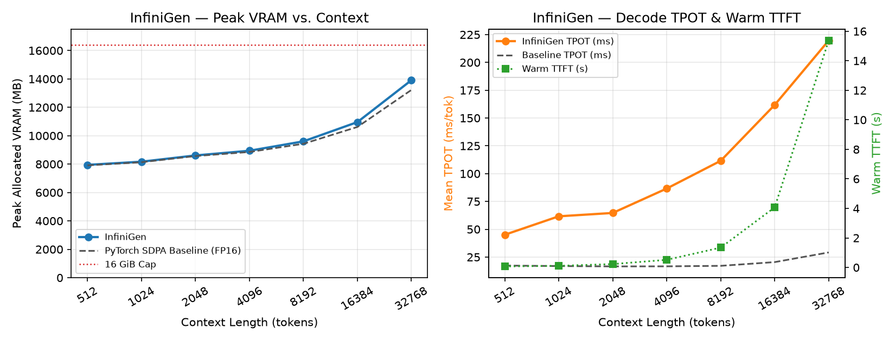
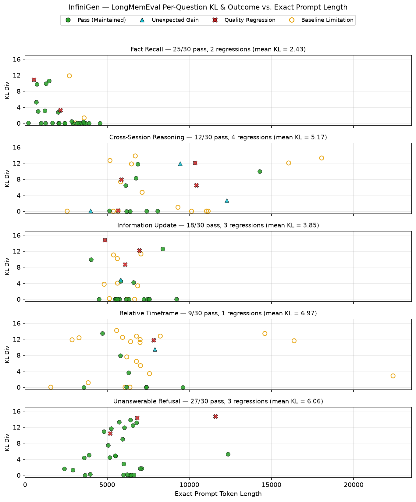

# WP-3 Technique Analysis: InfiniGen (`infinigen`)

## 1. Verified Configuration & Empirical Snapshot

- **Authoritative Axis ([`docs/METRICS_AND_AXES.md`](../../../docs/METRICS_AND_AXES.md)):** `SPATIAL` (Host CPU DRAM full-cache pool + 30% GPU Key proxy) with interacting `TEMPORAL` (one-layer-ahead speculative prefetching) and `STRUCTURAL` (dynamic $\tau = \max - \alpha$ thresholding) axes.
- **`kv_bench` Commit SHA:** `2a9338a2f750741f7765d79c1270f5579a9ffed0`
- **Model & Hardware:** `Qwen/Qwen3-4B-Instruct-2507` (`cdbee75f17c01a7cc42f958dc650907174af0554`, Pure Dense GQA, BF16, $L=36, H_Q=32, H_{KV}=8, D=128$) on NVIDIA GeForce RTX 4090 (23.52 GiB physical, `16.0 GiB` process allocator cap).
- **Manifest `technique_config` ([`run_manifest_wp3_infinigen.json`](../../../results/manifests/run_manifest_wp3_infinigen.json)):**
  - `cache_class`: `InfiniGenCache`, `k_proxy_ratio`: `0.3`, `alpha_threshold`: `4.0`, `block_size`: `16`, `max_budget_ratio`: `0.35`, `swap_space_gb`: `4`.
- **Golden Artifact SHA-256s (`run_manifest_wp3_infinigen.json`):**
  - `infinigen_hardware_pytorch_16gb.json`: `85ad425a18e7cda2596016939b35585892cd7c2510572bff9b7819e32dc6e161`
  - `infinigen_longmem_pytorch_16gb.json`: `0bae320374584510548877bba3a6f0d746d16ea14664f22255a045570cf20c5f`
  - `infinigen_niah_pytorch_16gb.json`: `3edd0b98a4cca0bdb458adb1bffe75ce2c766d61dc7fce6d859b26f5a7cd671d`
  - `verify_infinigen_pytorch_16gb.json`: `0d869719111f4122ff2d5e65364267c3bc8a287bfb1c6b3ef128b51744d0cd93`
  - `infinigen_judged.json`: `cdbc469441c3731302ec3ce12291dd50f2f730b85aef2cd27182ef781a4d4e8a`

### Hardware Sweep (`512 -> 32,768`, `SyntheticFiller` / PG-19)

Static `Qwen3-4B` BF16 weights + runtime overhead consume **~7,839.7 MiB (~7.66 GiB)**.

| Context | Status | Peak Alloc (MiB) | Net KV+Aux (MiB) | Base Alloc (MiB) | Host RSS $\Delta$ (MiB) | TTFT (s) | TPOT (ms) | Base TPOT (ms) | Tok/s | PCIe B/tok | Physical Scalar Bits | Eff. Token Retention | PG-19 Top-1 | PG-19 KL Mean | PG-19 KL P99 |
|---:|---|---:|---:|---:|---:|---:|---:|---:|---:|---:|---|---|---:|---:|---:|
| 512 | `SUCCESS` | 7,947.1 | 107.4 | 7,911.7 | 2,122.6 | 0.071 | 45.05 | 17.36 | 22.20 | 29,696,601.25 | 16-bit BF16 | 100% CPU; <=35% active | 0.0938 | 12.74616 | 15.4200 |
| 1,024 | `SUCCESS` | 8,170.0 | 330.3 | 8,133.0 | 2,202.1 | 0.109 | 61.64 | 16.91 | 16.22 | 55,804,006.88 | 16-bit BF16 | 100% CPU; <=35% active | 0.3750 | 8.54286 | 15.4243 |
| 2,048 | `SUCCESS` | 8,610.8 | 771.1 | 8,566.9 | 2,786.2 | 0.228 | 64.66 | 16.61 | 15.47 | 107,520,416.00 | 16-bit BF16 | 100% CPU; <=35% active | 0.0312 | 13.31564 | 15.4249 |
| 4,096 | `SUCCESS` | 8,941.6 | 1,101.9 | 8,854.9 | 3,953.7 | 0.516 | 86.60 | 16.67 | 11.55 | 187,541,319.25 | 16-bit BF16 | 100% CPU; <=35% active | 0.0781 | 12.50690 | 15.2393 |
| 8,192 | `SUCCESS` | 9,603.1 | 1,763.4 | 9,431.0 | 6,309.9 | 1.344 | 111.55 | 17.12 | 8.96 | 324,091,471.38 | 16-bit BF16 | 100% CPU; <=35% active | 0.2500 | 9.86657 | 15.4249 |
| 16,384 | `SUCCESS` | 10,959.9 | 3,120.2 | 10,616.8 | 11,049.3 | 4.070 | 161.79 | 20.47 | 6.18 | 710,706,859.12 | 16-bit BF16 | 100% CPU; <=35% active | 0.1875 | 10.96492 | 15.4249 |
| 32,768 | `SUCCESS` | **13,910.0** | **6,070.3** | 13,224.9 | **20,490.6** | **15.372** | **219.68** | 29.17 | 4.55 | **1,829,885,205.25** | 16-bit BF16 | 100% CPU; <=35% active | 0.0469 | 13.51975 | 15.4249 |

### Quality Summary (Verify, NIAH, LongMemEval)

- **Verify (`ctx=128`):** `top1_agreement = 0.3750`, `kl_div_mean = 8.53176`, `kl_div_p99 = 15.3301` (already severely diverged at `128` tokens!).
- **NIAH (`2K` & `4K`, 10 depths `0.0..0.9`):** **10/10 (100%)** at `2048` and **10/10 (100%)** at `4096`.
- **LongMemEval (`150` samples, prompt length `192..22,400`, mean `5,967.9` tokens):**
  - `peak_alloc_mb = 12,247.4`, `host_rss_delta_mb = 10,556.5`, `ttft_sec = 1.091`, `tpot_mean_ms = 99.28`, `throughput_tok_per_sec = 253.15`.
  - **LongMem KL:** `top1_agreement = 0.4932`, `kl_div_mean = 7.34983`, `kl_div_p99 = 15.4249`.
  - **Overall Accuracy:** **91/150 (60.67%)** vs. Baseline **99/150 (66.00%)** (`-5.33 pp`).
  - **Verdict Breakdown:** `PASS_FIDELITY_MAINTAINED: 86`, `BASELINE_LIMITATION: 46`, **`QUALITY_REGRESSION: 13`**, `UNEXPECTED_GAIN: 5`.

| LongMemEval Capability | Baseline Acc | InfiniGen Acc | Delta (pp) | `QUALITY_REGRESSION` Count |
|---|---:|---:|---:|---:|
| `fact_recall` | 90.00% | 83.33% | -6.67 | 2 |
| `information_update` | 66.67% | 60.00% | -6.67 | 3 |
| `relative_timeframe` | 30.00% | 30.00% | 0.00 | 1 |
| `cross_session_reasoning` | 43.33% | 40.00% | -3.33 | 4 |
| `unanswerable_refusal` | 100.00% | 90.00% | -10.00 | 3 |

---

## 2. White-Box Component Decomposition

| ID | Component | Source Location | Tensor Shapes & Dtypes (`Qwen3-4B`: $L=36, H_{KV}=8, D=128$) | Cadence |
|---|---|---|---|---|
| **C1** | **Orthogonal Rotation & 30% GPU Key Proxy** | [`infinigen_cache.py#L38-L46`](file:///home/khemi/workspace/kv_bench/src/techniques/infinigen_cache.py#L38-L46), [`#L235-L248`](file:///home/khemi/workspace/kv_bench/src/techniques/infinigen_cache.py#L235-L248), [`#L333-L339`](file:///home/khemi/workspace/kv_bench/src/techniques/infinigen_cache.py#L333-L339) | `rotation_matrix` `[128, 128]` BF16 (random QR); `d_proxy = 38` (`int(128 * 0.30)`); `proxy_k_buf` `[B, 8, cap, 38]` BF16 on GPU. | Every `update()` (prefill + decode). |
| **C2** | **Double Pinned Host CPU Buffer Pool** | [`infinigen_cache.py#L250-L308`](file:///home/khemi/workspace/kv_bench/src/techniques/infinigen_cache.py#L250-L308) (`_ensure_capacity`) | `cpu_k_buf, cpu_v_buf` `[B, 8, cap, 128]` BF16 pinned + `staging_cpu_k, staging_cpu_v` `[B, 8, ceil(cap*0.35)+32, 128]` BF16 pinned. | Allocated/doubled on growth (`min=2048`). |
| **C3** | **Speculative Block Scoring & Synchronous CPU Gather** | [`infinigen_cache.py#L49-L119`](file:///home/khemi/workspace/kv_bench/src/techniques/infinigen_cache.py#L49-L119), [`#L352-L423`](file:///home/khemi/workspace/kv_bench/src/techniques/infinigen_cache.py#L352-L423) (`compute_speculative_block_mask`, `update`) | Computes `q_proxy` from **`key_states`** (`[B, 8, 1, 38]`); gathers up to `35%` blocks (`block_size=16`) into `staging_cpu_{k,v}` and copies HtoD. | Every decode step (`new_tokens == 1, total > 16`); prefill copies full CPU buffer back to GPU! |

---

## 3. 3-Way Causal Attribution

- **Host RSS Explosion (`[IMPLEMENTATION]`):** At `32K`, `host_rss_delta_mb` reaches **`20,490.6 MiB` (~20.0 GiB)** — **exceeding** the 16 GB consumer host RAM cap. This is caused by `C2` pre-allocating **two** sets of pinned BF16 host buffers per layer (`cpu_{k,v}_buf` capacity doubled to `>=32,768` + `staging_cpu_{k,v}` at `35%` capacity), plus `2x` growth-copy spikes.
- **VRAM Bloat & Prefill TTFT (`[IMPLEMENTATION]`):** At `32K`, `peak_alloc_mb` is **`13,910.0 MiB`** (`+685 MiB` *above* baseline) and TTFT is **`15.372 s`** (`2.20x` slower than baseline `6.978 s`). Why? During prefill (`infinigen_cache.py:421-422`), `C3` copies `key_states`/`value_states` to `cpu_{k,v}_buf` and **immediately copies the entire `cpu_{k,v}_buf[:, :, :total_tokens_seen]` back to GPU**, accomplishing zero prefill VRAM savings while paying a full round-trip PCIe copy!
- **PCIe Volume & TPOT Collapse (`[IMPLEMENTATION]`):** At `32K`, `memcpy_bytes_per_token` hits **`1,829,885,205.25 B/tok`** (~1.83 GB/tok) and TPOT hits **`219.68 ms`** (`7.53x` slower than baseline). Because `C3` runs synchronously inside `Cache.update()` (no layer-ahead CUDA stream overlap) and copies scattered blocks into `staging_cpu_{k,v}` on CPU before HtoD transfer, the GPU stalls on every layer.
- **KL & LongMemEval Degradation (`[IMPLEMENTATION]`):**
  - `infinigen_cache.py:355` passes **`key_states` as `q_proxy`** (`q_rot = torch.matmul(key_states, rot_matrix)`) instead of the previous layer's query/hidden state! Consequently, block selection scores key-to-key similarity rather than query-to-key attention.
  - This single bug explains why `verify` at `ctx=128` already drops to `top1_agreement = 0.375` (`kl_div_mean = 8.53`), PG-19 KL stays at `8.54..13.52` across `512..32K` (`kl_div_p99 = 15.4249` clamp), and LongMemEval drops to `91/150 (60.67%)` with `13 QUALITY_REGRESSION`s spread across all 5 capabilities (`fact_recall -6.67 pp`, `information_update -6.67 pp`, `unanswerable_refusal -10.00 pp`). (2K/4K NIAH `10/10` passes only because `max_budget_ratio=0.35` + sink/recent blocks happen to retain enough context at short lengths.)

---

## 4. Paper vs. Replication Fidelity

| Dimension | InfiniGen Paper ([`infinigen.md`](../../../docs/literature_survey/techniques/infinigen.md)) | `kv_bench` Replication (`infinigen.py` / `infinigen_cache.py`) | Fidelity Verdict |
|---|---|---|---|
| **Speculative Query Source** | Uses layer $i-1$ normalized hidden state $X_a^{(i-1)} W_{Q,i}^{\text{partial}}$. | Uses **`key_states`** of the current token (`infinigen_cache.py:355`)! | **Critical Divergence (`[IMPLEMENTATION]` Bug):** destroys block selection accuracy. |
| **Rotation Matrix $A_\ell$** | Offline SVD of calibration $Q$ activations to concentrate outlier energy. | Random QR orthogonal matrix (`generate_orthogonal_matrix`, `seed=42`). | **Divergence:** random rotation spreads energy instead of concentrating it. |
| **Async Layer-Ahead Pipelining** | Overlaps layer $i+1$ DMA behind layer $i$ FFN on separate CUDA stream. | **Synchronous** CPU loop copy into `staging_cpu_{k,v}` + HtoD inside `update()`. | **Critical Divergence (`[IMPLEMENTATION]` Bug):** `219.68 ms` TPOT. |
| **Host Cache Eviction** | Counter-based aging eviction at 80% host RAM cap. | No eviction; doubles pinned `cpu_{k,v}_buf` + `staging_cpu_{k,v}` (`20.0 GiB` RSS). | **Incomplete Stub.** |

---

## 5. Component Verdicts (`KEEP` / `ADAPT` / `DROP`)

| Component | Verdict | Contribution | Failure Mode | Required Fix (if `ADAPT`) |
|---|---|---|---|---|
| **C1: Orthogonal Rotation & 30% Key Proxy** | **`ADAPT`** | Lightweight `30%` GPU key proxy concept. | Random QR rotation does not concentrate outlier channels. | Use **SVD of calibration/prefill $Q$** (or top-$k$ variance channels) instead of random QR. |
| **C2: Double Pinned Host CPU Pool** | **`DROP`** | Provides pinned backing store. | `20.0 GiB` host RSS at 32K from un-evicted `cpu` + `staging` buffers. | Replace with single-pool paged host store + 4-bit compression (WP-4). |
| **C3: Speculative Block Scoring & Gather** | **`ADAPT`** | Block-aligned (`block_size=16`) $\tau = \max - \alpha$ thresholding fits PagedAttention. | Uses `key_states` as `q_proxy`, synchronous gather, and full prefill round-trip. | Hook SDPA/decoder layer to pass true **$Q$ (or $X_a^{(i-1)}$)**, overlap DMA on async CUDA stream, and skip prefill HtoD round-trip. |
