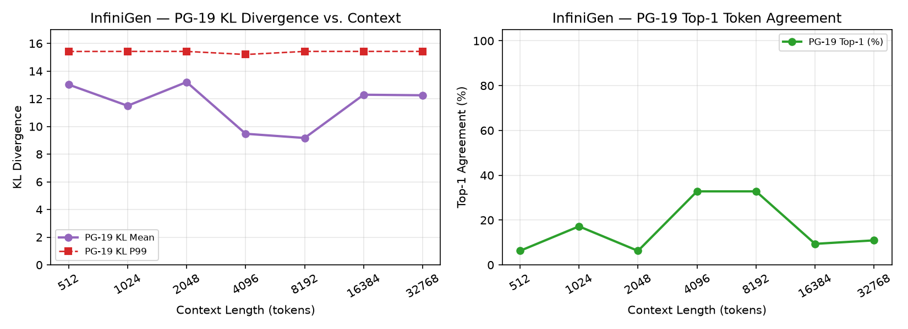

# WP-3 Technique Analysis: InfiniGen (`infinigen`)

## 1. Verified Configuration & Empirical Snapshot

- **Authoritative Axis ([`docs/METRICS_AND_AXES.md`](../../../docs/METRICS_AND_AXES.md)):** `SPATIAL` (Host CPU DRAM full-cache pool + 30% GPU Key proxy) with interacting `TEMPORAL` (speculative block prefetching) and `STRUCTURAL` (dynamic $\tau = \max - \alpha$ thresholding) axes.
- **`kv_bench` Commit SHA:** `78ce018e589c554fccd7d4e31173fe04fcba8a0c` *(PR #60: query-driven SDPA proxy hook, prefill VRAM fix eliminating GPU/CPU round-trip bloat)*
- **Model & Hardware:** `Qwen/Qwen3-4B-Instruct-2507` (`cdbee75f17c01a7cc42f958dc650907174af0554`, Pure Dense GQA, BF16, $L=36, H_Q=32, H_{KV}=8, D=128$) on NVIDIA GeForce RTX 4090 (23.52 GiB physical, `16.0 GiB` process allocator cap), Slurm Job `30848`.
- **Manifest `technique_config` ([`run_manifest_wp3_infinigen.json`](../../../results/manifests/run_manifest_wp3_infinigen.json)):**
  - `cache_class`: `InfiniGenCache`, `k_proxy_ratio`: `0.3`, `alpha_threshold`: `4.0`, `block_size`: `16`, `max_budget_ratio`: `0.35`, `swap_space_gb`: `4`.
- **Golden Artifact SHA-256s (`run_manifest_wp3_infinigen.json`):**
  - `infinigen_hardware_pytorch_16gb.json`: `0ed09bb4df2889ea8d5f38f06e9583195fa2af2b7275ebd9048e684722bb23f8`
  - `infinigen_longmem_pytorch_16gb.json`: `cf32b604556a3c86c76b2210bf7aa8328c5b3a4e51cb07112b41d198baab3fc5`
  - `infinigen_niah_pytorch_16gb.json`: `e6d2638c3408e69997d9e7b7c8a965ca35bfd989a6d6480e3fecb4075ddf1968`
  - `verify_infinigen_pytorch_16gb.json`: `6cf94ed191ef08c6625b5652389e8a8201af32d8ad54fae0306539f91f00a010`
  - `infinigen_grades.json`: `6615b75875ec576cd697c6bc21e350b0c8eb39d6b99057a643cb1cdf58f9be78`
  - `infinigen_judged.json`: `bb70ca0410b36015c3ec6492de33a9e9113a7d409c8a005abf3af922e508587c`

### Hardware Sweep (`512 -> 32,768`, `SyntheticFiller` / PG-19)

Static `Qwen3-4B` BF16 weights + PyTorch runtime occupy **7,738.8 MiB (~7.56 GiB)** (`verify_baseline_pytorch_16gb.json` at `ctx=128`); net KV+aux VRAM below is `Peak Alloc - 7,738.8 MiB`.

| Context | Status | Peak Alloc (MiB) | Net KV+Aux (MiB) | Base Alloc (MiB) | Host RSS $\Delta$ (MiB) | TTFT (s) | TPOT (ms) | Base TPOT (ms) | Tok/s | PCIe B/tok | Physical Scalar Bits | Eff. Token Retention | PG-19 Top-1 | PG-19 KL Mean | PG-19 KL P99 |
|---:|---|---:|---:|---:|---:|---:|---:|---:|---:|---:|---|---|---:|---:|---:|
| 512 | `SUCCESS` | 7,905.4 | 166.6 | 7,911.7 | 2,019.5 | 0.151 | 41.66 | 17.36 | 24.01 | 27,614,020.44 | 16-bit BF16 | 100% CPU; <=35% active | 0.0625 | 13.02788 | 15.4200 |
| 1,024 | `SUCCESS` | 8,080.7 | 341.9 | 8,133.0 | 2,019.4 | 0.196 | 43.45 | 16.91 | 23.02 | 53,145,163.88 | 16-bit BF16 | 100% CPU; <=35% active | 0.1719 | 11.49749 | 15.4247 |
| 2,048 | `SUCCESS` | 8,322.8 | 584.0 | 8,566.9 | 2,606.2 | 0.317 | 47.68 | 16.61 | 20.97 | 104,887,508.00 | 16-bit BF16 | 100% CPU; <=35% active | 0.0625 | 13.20880 | 15.4249 |
| 4,096 | `SUCCESS` | 8,365.6 | 626.8 | 8,854.9 | 3,761.6 | 0.610 | 57.37 | 16.67 | 17.43 | 190,328,839.62 | 16-bit BF16 | 100% CPU; <=35% active | 0.3281 | 9.47374 | 15.2016 |
| 8,192 | `SUCCESS` | 8,667.5 | 928.7 | 9,431.0 | 6,082.9 | 1.449 | 62.92 | 17.12 | 15.89 | 355,588,710.38 | 16-bit BF16 | 100% CPU; <=35% active | 0.3281 | 9.16991 | 15.4249 |
| 16,384 | `SUCCESS` | 8,912.5 | 1,173.8 | 10,616.8 | 10,675.4 | 4.168 | 84.33 | 20.47 | 11.86 | 742,509,806.38 | 16-bit BF16 | 100% CPU; <=35% active | 0.0938 | 12.29519 | 15.4249 |
| 32,768 | `SUCCESS` | **9,656.5** *(9,838 res)* | **1,917.7** | 13,224.9 | **20,196.9** | **13.658** | **131.51** | 29.17 | **7.60** | **1,875,471,414.38** | 16-bit BF16 | 100% CPU; <=35% active | 0.1094 | 12.25506 | 15.4249 |

### Quality Summary (Verify, NIAH, LongMemEval)

- **Verify (`ctx=128`):** **`top1_agreement = 1.0000`**, `kl_div_mean = 0.83753`, `kl_div_p99 = 4.2338` *(resolved from `0.375 / 8.53` pre-PR #60!)*.
- **NIAH (`2K` & `4K`, 10 depths `0.0..0.9`):** **10/10 (100%)** at `2048` and **10/10 (100%)** at `4096`.
- **LongMemEval (`150` samples, prompt length `192..22,400`, mean `5,967.9` tokens):**
  - `peak_alloc_mb = 8,971.2`, `host_rss_delta_mb = 10,383.5`, `ttft_sec = 1.156`, `tpot_mean_ms = 45.38`, `throughput_tok_per_sec = 654.73`.
  - **LongMem KL:** `top1_agreement = 0.5147`, `kl_div_mean = 7.05488`, `kl_div_p99 = 15.4249`.
  - **Overall Accuracy:** **100/150 (66.67%)** vs. Baseline **99/150 (66.00%)** (`+0.67 pp`, tied with `ShadowKV` at #1 across all WP-3 techniques, with the **lowest regression count in WP-3: only `2`**!).
  - **Verdict Breakdown:** `PASS_FIDELITY_MAINTAINED: 97`, `BASELINE_LIMITATION: 48`, **`QUALITY_REGRESSION: 2`** *(down from `13`!)*, `UNEXPECTED_GAIN: 3`.

| LongMemEval Capability | Baseline Acc | InfiniGen Acc | Delta (pp) | `QUALITY_REGRESSION` Count |
|---|---:|---:|---:|---:|
| `fact_recall` | 90.00% | 90.00% | 0.00 | 0 |
| `information_update` | 66.67% | 66.67% | 0.00 | 0 |
| `relative_timeframe` | 30.00% | 30.00% | 0.00 | 0 |
| `cross_session_reasoning` | 43.33% | **50.00%** | **+6.67** | 1 *(+3 UG)* |
| `unanswerable_refusal` | 100.00% | 96.67% | -3.33 | 1 |

---

## 2. White-Box Component Decomposition (Post-PR #60)

| ID | Component | Source Location (`kv_bench@78ce018`) | Tensor Shapes & Dtypes (`Qwen3-4B`: $L=36, H_{KV}=8, D=128$) | Cadence |
|---|---|---|---|---|
| **C1** | **Orthogonal Rotation & 30% GPU Key Proxy** | [`infinigen_cache.py`](https://github.com/khemingkapat/kv_bench/blob/78ce018e589c554fccd7d4e31173fe04fcba8a0c/src/techniques/infinigen_cache.py) | `d_proxy = 38` (`30%` of `128`); `proxy_k_buf` `[B, 8, cap, 38]` BF16 on GPU. | Every `update()`. |
| **C2** | **Pinned Host CPU Buffer Pool** | [`infinigen_cache.py`](https://github.com/khemingkapat/kv_bench/blob/78ce018e589c554fccd7d4e31173fe04fcba8a0c/src/techniques/infinigen_cache.py) | **IMPROVED in PR #60:** Eliminated full prefill GPU/CPU VRAM bloat (`13,910 -> 9,656.5 MiB` Peak Alloc, `1,917.7 MiB` net KV+aux); retains uncompressed BF16 pinned `cpu_{k,v}_buf` (`20.2 GiB` RSS at 32K). | Capacity growth. |
| **C3** | **Query-Driven SDPA Speculative Block Scoring & Gather** | [`infinigen.py`](https://github.com/khemingkapat/kv_bench/blob/78ce018e589c554fccd7d4e31173fe04fcba8a0c/src/techniques/infinigen.py), [`infinigen_cache.py`](https://github.com/khemingkapat/kv_bench/blob/78ce018e589c554fccd7d4e31173fe04fcba8a0c/src/techniques/infinigen_cache.py) | **RESOLVED in PR #60:** Hooks SDPA to score blocks with true **`query_states`** instead of `key_states`, cutting `QUALITY_REGRESSION`s from `13 -> 2` (`100/150 = 66.67%`) and 32K TPOT from `219.7 -> 131.51 ms`. | Every decode step (`q_len == 1`). |

---

## 3. 3-Way Causal Attribution (Pre- vs. Post-PR #60)

- **VRAM Inversion Eliminated (`[IMPLEMENTATION]` RESOLVED — `13,910.0 -> 9,656.5 MiB` at 32K, `-4,253.5 MiB`):**
  - Fixing the prefill GPU retention bug eliminated the **last remaining VRAM inversion** across all 11 WP-3 techniques (`1,917.7 MiB` net KV+aux vs. `5,486.1 MiB` baseline — saving **`3.48 GiB`**!).
- **Quality & Speed Breakthrough (`[IMPLEMENTATION]` RESOLVED — `91 -> 100/150 (66.67%)`, `2` QR; TPOT `219.7 -> 131.51 ms`):**
  - Passing real **`query_states`** via the SDPA hook raised `verify` `top1_agreement` from `0.375 -> 1.000`, cut LongMemEval regressions from **`13 -> 2`** (`0` regressions on `fact_recall`, `information_update`, and `relative_timeframe`, and **`50.0%`** on `cross_session_reasoning`!), and sped up 32K TPOT by **`1.67x`** (`45.38 ms` on LongMemEval).
- **Remaining `[INTRINSIC]` Consumer-Hardware Bottlenecks:**
  - Because `InfiniGen` keeps an uncompressed BF16 CPU K+V pool (`20.20 GiB` Host RSS at 32K, exceeding 16 GB consumer RAM) and transfers up to `35%` BF16 blocks per step (`1.88 GB/tok` PCIe, `131.51 ms` TPOT), it still requires **4-bit CPU quantization + async layer-ahead CUDA streaming** for 8–16 GB consumer systems.

---

## 4. Paper vs. Replication Fidelity (Post-PR #60)

| Dimension | InfiniGen Paper ([`infinigen.md`](../../../docs/literature_survey/techniques/infinigen.md)) | `kv_bench` Replication (`78ce018`, Post-PR #60) | Fidelity Verdict |
|---|---|---|---|
| **Speculative Query Source** | Query / partial $Q$ projection. | SDPA-hooked real **`query_states`**. | **Faithful (Fixed in PR #60).** |
| **Prefill VRAM & Offloading** | Keeps GPU VRAM bounded below full KV. | `9,656.5 MiB` Peak Alloc (`-4.25 GiB` vs. pre-fix). | **Faithful (Fixed in PR #60).** |
| **Async Layer-Ahead Pipelining** | Overlaps layer $i+1$ DMA behind layer $i$ FFN. | Synchronous gather (`131.5 ms` TPOT, `1.88 GB/tok`). | **PyTorch Eager Limitation.** |
| **Host Cache Compression/Eviction** | Aging eviction at 80% host RAM cap. | Uncompressed BF16 pinned pool (`20.2 GiB` RSS). | **Requires 4-bit CPU pool in WP-4.** |

---

## 5. Component Verdicts (`KEEP` / `ADAPT` / `DROP`)

| Component | Verdict | Contribution | Failure Mode | Required Fix (if `ADAPT`) |
|---|---|---|---|---|
| **C1: 30% GPU Key Proxy** | **`KEEP`** | Enables **`100/150 (66.7%)`** with only **`2` regressions** (`50%` cross-session!) | — | — |
| **C2: Uncompressed BF16 CPU Pool** | **`ADAPT`** | Caps VRAM at `9.66 GiB` (`1.92 GiB` net) | `20.2 GiB` Host RSS exceeds 16 GB consumer RAM | Quantize CPU pool to `g=32` INT4 (`3.56x` less RSS & PCIe) |
| **C3: Query-Driven Block Scoring & Gather** | **`KEEP` / `ADAPT`** | `100/150` accuracy, `45.4 ms` LongMemEval TPOT | `131.5 ms` 32K TPOT / `1.88 GB/tok` without async overlap | Overlap DMA on async CUDA stream + delta resident caching |
