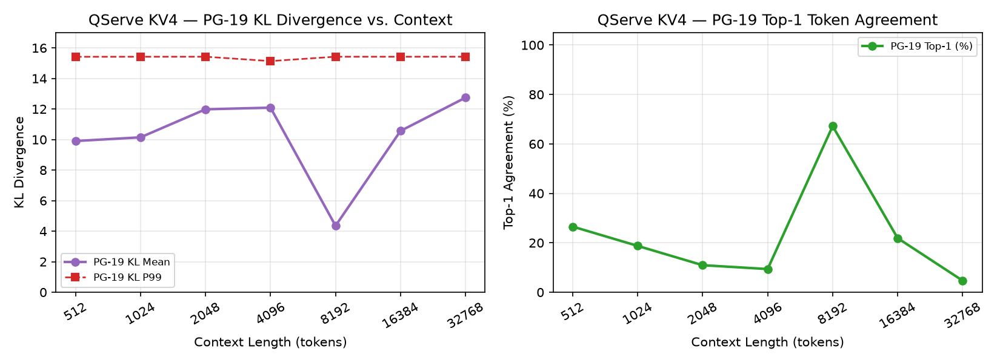
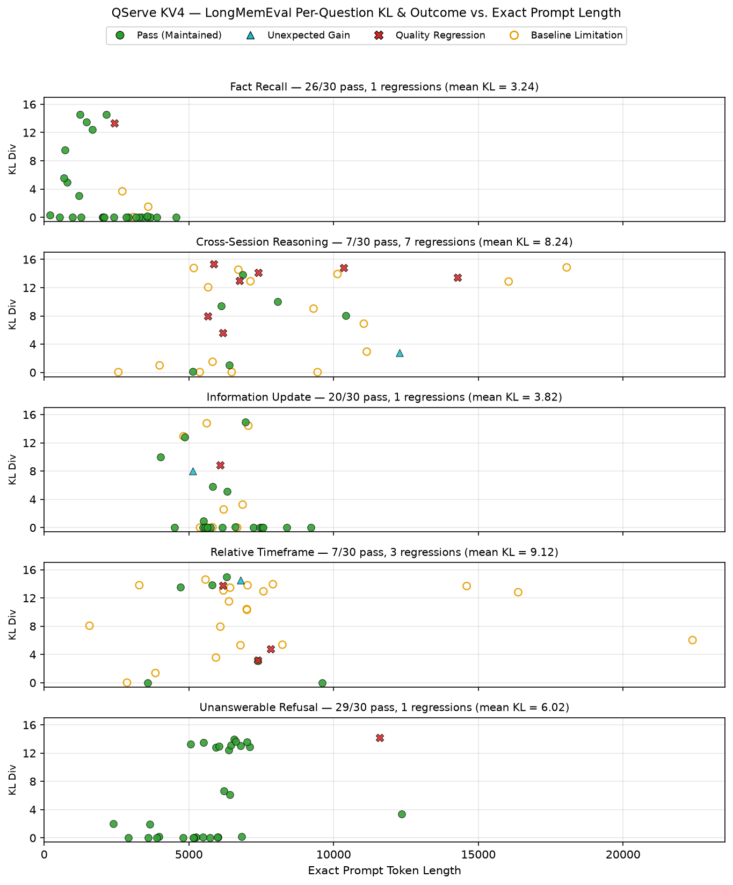

# WP-3 Technique Analysis: `qserve_kv4` (QServe KV4)

## 1. Verified Configuration & Empirical Snapshot

### Provenance & Authoritative Configuration
- **Repository & Commit:** `khemingkapat/kv_bench` @ `2a9338a2f750741f7765d79c1270f5579a9ffed0` (`main`, clean working tree)
- **Primary Model:** `Qwen/Qwen3-4B-Instruct-2507` (`cdbee75f17c01a7cc42f958dc650907174af0554`, Pure Dense GQA, `bfloat16`, $L=36, H_Q=32, H_{KV}=8, D=128$)
- **Hardware & Harness:** `gpu06.slurm.cpe.kmutt.ac.th`, NVIDIA GeForce RTX 4090 (23.52 GiB physical, **16.0 GiB** process allocator cap), Slurm Job `25748` (hardware/verify/NIAH) & `30137` (LongMemEval)
- **Authoritative Axis ([`docs/METRICS_AND_AXES.md`](../../../docs/METRICS_AND_AXES.md)):** `STRUCTURAL`
- **Manifest `technique_config`:**
  ```json
  {
    "cache_class": "QServeKVCache",
    "kv_cache_bits": 4,
    "group_size": 32,
    "smooth_attention_alpha": 0.5,
    "block_size": 16
  }
  ```
- **`VERIFIED` Hub Artifact SHA-256s ([`run_manifest_wp3_qserve_kv4.json`](../../../results/manifests/run_manifest_wp3_qserve_kv4.json)):**
  - `qserve_kv4_hardware_pytorch_16gb.json`: `8f1d2a35aa6ea320ad43651f0342ecf4c7dc9cd3392d5856e4fc299762152c69`
  - `qserve_kv4_longmem_pytorch_16gb.json`: `6bad0eefc97a1efa95ac5f88080e9eb6a23dea429e2324df1b065fcfb4b18a8c`
  - `qserve_kv4_niah_pytorch_16gb.json`: `6400f386d866d1212c83a5ebf2dbb6a5f6bbfe269fe4ceaa43bb55e8c9bce1ee`
  - `verify_qserve_kv4_pytorch_16gb.json`: `1aca05409ecfc310499f0e1bacc897dfedd738be775ba99b9500674c4f800a2c`
  - `qserve_kv4_grades.json`: `0400cb7f7e572c3008613121af84c0a5acea979e38b84dbb5ae77b1f3ddd9828`
  - `qserve_kv4_judged.json`: `72530e64786d8ad1df6881c7791a1f01dff5b1a76d3fe964f624a535473bd537`

### Precision & Retention Separation
| Metric | Value | Notes |
|---|---:|---|
| **Physical Scalar Bits** | **4.50 bits/scalar** (K & V) | 4-bit packed INT4 payload (`0.5 B/scalar`) + 1 BF16 scale per `group_size=32` (`16 bits / 32 = 0.50 bits/scalar`); plus negligible one-time `smooth_k` `(1, 8, 1, 128)` BF16 (2 KiB/layer) |
| **Effective Token Retention** | **100.0%** | All prompt and generated tokens are retained in `QServeKVLayer` (`total_tokens_seen`) |

### Hardware Context Scaling Sweep (`512 -> 32,768`, `SyntheticFiller`)
Static `Qwen3-4B` BF16 weights + PyTorch runtime occupy **7,738.78 MiB (~7.56 GiB)** (`verify_baseline_pytorch_16gb.json` at `ctx=128`); net KV+aux VRAM below is `Peak Alloc - 7,738.78 MiB`.

| Ctx | Peak Alloc (MiB) | Base Alloc (MiB) | Net KV+Aux (MiB) | Base Net KV (MiB) | TTFT (s) | TPOT (ms) | Base TPOT (ms) | Tok/s | Host RSS Δ (MiB) | Memcpy (B/tok) | Top-1 Agr. | KL Mean | KL P99 |
|---:|---:|---:|---:|---:|---:|---:|---:|---:|---:|---:|---:|---:|---:|
| 512 | 7,873.62 | 7,911.66 | 134.84 | 172.88 | 0.0463 | 36.43 | 17.36 | 27.45 | 2,791.35 | 201.75 | 0.2656 | 9.9033 | 15.4200 |
| 1,024 | 8,065.50 | 8,133.04 | 326.72 | 394.26 | 0.0822 | 36.32 | 16.91 | 27.53 | 2,791.66 | 329.75 | 0.1875 | 10.1451 | 15.4246 |
| 2,048 | 8,359.99 | 8,566.92 | 621.21 | 828.14 | 0.1663 | 36.25 | 16.61 | 27.59 | 2,835.81 | 585.75 | 0.1094 | 11.9818 | 15.4249 |
| 4,096 | 8,441.00 | 8,854.93 | 702.22 | 1,116.15 | 0.3715 | 35.97 | 16.67 | 27.80 | 2,894.64 | 1,097.75 | 0.0938 | 12.0892 | 15.1387 |
| 8,192 | 8,674.56 | 9,430.96 | 935.78 | 1,692.18 | 0.8855 | 36.29 | 17.12 | 27.56 | 3,004.27 | 2,121.75 | 0.6719 | 4.3519 | 15.4249 |
| 16,384 | 9,370.62 | 10,616.78 | 1,631.84 | 2,878.00 | 2.3659 | 35.80 | 20.47 | 27.93 | 3,205.68 | 4,169.75 | 0.2188 | 10.5661 | 15.4249 |
| 32,768 | 10,762.74 | 13,224.90 | 3,023.96 | 5,486.12 | 7.2394 | 59.92 | 29.17 | 16.69 | 3,628.61 | 8,265.75 | 0.0469 | 12.7457 | 15.4249 |

*Verify (`ctx=128`, 16 gen tokens):* `top1_agreement = 0.0`, `kl_div_mean = 12.56021`, `kl_div_p99 = 15.3301`.

### Quality Diagnostics: NIAH (2K/4K) & LongMemEval (150 Questions, Judged)
- **NIAH Exact Retrieval:**
  - `2,048` ctx: **10/10 (100%)** across depths `[0.0 .. 0.9]`
  - `4,096` ctx: **10/10 (100%)** across depths `[0.0 .. 0.9]`
- **LongMemEval Logit Fidelity (native lengths `192..22,400`, mean `5,967.9` tokens):** `top1_agreement = 0.4554`, `kl_div_mean = 7.89133`, `kl_div_p99 = 15.4249`.
- **LongMemEval 5-Capability Judged Accuracy ([`qserve_kv4_judged.json`](../../../results/grades/qserve_kv4_judged.json) vs. [`baseline_judged.json`](../../../results/grades/baseline_judged.json)):**

| Capability | Baseline | QServe KV4 | Δ vs. Baseline | `QUALITY_REGRESSION` Count |
|---|---:|---:|---:|---:|
| **Overall (150)** | **66.0% (99/150)** | **59.33% (89/150)** | **-6.67 pp** | **13** *(+3 `UNEXPECTED_GAIN`)* |
| `fact_recall` (30) | 90.00% | 86.67% | -3.33 pp | 1 |
| `information_update` (30) | 66.67% | 66.67% | 0.00 pp | 1 |
| `cross_session_reasoning` (30) | 43.33% | 23.33% | -20.00 pp | 7 |
| `relative_timeframe` (30) | 30.00% | 23.33% | -6.67 pp | 3 |
| `unanswerable_refusal` (30) | 100.00% | 96.67% | -3.33 pp | 1 |





---

## 2. White-Box Component Decomposition

| ID | Component | Source Location | Tensor Shapes & Dtypes (`Qwen3-4B`: $L=36, H_Q=32, H_{KV}=8, D=128$) | Cadence |
|---|---|---|---|---|
| **C1** | **Dynamic SmoothAttention Key Scaling** | `qserve_cache.py`: `QServeKVLayer._ensure_smooth_k` (L159–179) & `update` (L200–202) | `smooth_k`: `(1, 8, 1, 128)` `bfloat16`; computed once on first prefill chunk (`k_abs_max` / `group_mean` per `group_size=32`, raised to `alpha=0.5`); `k_smooth = key_states / smooth_k` | First prefill chunk (scale fit) + every prefill/decode `update()` |
| **C2** | **Per-Group Symmetric INT4 Quantizer & Bit-Packer** | `qserve_kv4.py`: `quantize_kv_int4` (L138–185), `pack_int4` (L100–118) | Input `(1, 8, T_new, 128)` `bf16` → `packed`: `(1, 8, T_new, 64)` `uint8`, `scales`: `(1, 8, T_new, 4, 1)` `bf16` (`group_size=32`) | Every prefill chunk & decode step |
| **C3** | **Pre-Allocated Capacity Ring/Grow Buffers** | `qserve_cache.py`: `QServeKVLayer._ensure_capacity` (L118–157) | Pre-allocates `k_packed_buf`, `v_packed_buf` `(1, 8, cap, 64)` `uint8` & `k_scales_buf`, `v_scales_buf` `(1, 8, cap, 4, 1)` `bf16` (`cap = max(req, 2*cap, 1024)`) | On capacity growth (`1024 -> 2048 -> ... -> 32768`) |
| **C4** | **Full-Sequence BF16 Dequantization & Rescaling for SDPA** | `qserve_cache.py`: `QServeKVLayer.keys` (L78–89), `values` (L96–104); `qserve_kv4.py`: `dequantize_kv_int4` (L188–205), `unpack_int4` (L121–135) | Unpacks entire `[0..T]` cache back to `(1, 8, T, 128)` `bf16` and multiplies `recon * smooth_k` before returning to HF `sdpa` | Every prefill chunk & every decode step |

---

## 3. 3-Way Causal Attribution

- **VRAM Savings (`10,762.74 MiB` vs. `13,224.90 MiB` at 32K, `-2,462.16 MiB`):**
  - **`[IMPLEMENTATION]`** Persistent single-pass KV state in **C2/C3** (`QServeKVLayer`) at 32K (`32,832` tokens) occupies **`1,361,567,232 B` (`1.27 GiB`)** vs. `4.51 GiB` BF16 (note: `quantized_cache_bytes = 2,723,134,464 B` in the hardware JSON accumulates `2×` across `--profile` + timed runs in `harness.py`). However, **C4** materializes a transient full-sequence `(1, 8, T, 128)` BF16 K/V tensor pair (`~4.51 GiB` at 32K) during `update()` for HF SDPA, preventing QServe from reaching its full theoretical `3.56x`–`4x` peak-VRAM reduction (`3,023.96 MiB` net vs. `5,486.12 MiB` baseline net).
- **TPOT & Throughput (`35.8–36.4 ms` at 512–16K, `59.92 ms` at 32K vs. `16.6–29.2 ms` baseline, `~2.1x` slowdown):**
  - **`[IMPLEMENTATION]`** Driven by **C4**: every single decode step unpacks, casts `int8 -> bf16`, rescales by `scales` and `smooth_k` across all `T` historical tokens in Python/PyTorch eager ops across 36 layers, turning an $O(1)$-write/$O(T)$-read fused attention kernel into an $O(T)$ global-VRAM dequantization + allocation loop.
- **Host RSS (`2,791 -> 3,629 MiB`) & PCIe Memcpy (`8,265.75 B/tok` at 32K):**
  - **`[IMPLEMENTATION]`** Discounting the **`8,266 B/tok`** 32K hardware-sweep `memcpy` instrumentation floor (shared by PyTorch runner profiling/CUDA event syncs across structural techniques), QServe performs zero spatial offloading; Host RSS growth tracks Python/PyTorch tensor metadata.
- **KL Divergence (`4.35–12.75` mean; `15.4249` P99 top-5 clamp) vs. NIAH (`100%`) & LongMemEval (`59.33%`, `13` QR):**
  - **`[IMPLEMENTATION]`** **C1** (`_ensure_smooth_k`) divides `key_states` by `smooth_k` on write and **multiplies `recon * smooth_k` back on read** (`QServeKVLayer.keys` L88) *without* scaling `query` (`q_smooth`). While this preserves mathematical identity in the unquantized limit, it breaks QServe's RoPE-commutative offline weight-folding design and leaves `smooth_k` only as a per-group dynamic-range equalizer for **C2**. Because `smooth_k` is fit solely on the first prefill chunk (`new_tokens` of chunk 0), later chunks/tokens with different channel outliers suffer quantization clipping.
  - **`[INTRINSIC]`** **C2** symmetric INT4 (`[-8, 7]`) with `group_size=32` preserves exact needle retrieval (`10/10` at 2K/4K NIAH — never extrapolated to 32K) and `fact_recall` (`86.67%`, only 1 QR) / `information_update` (`66.67%`, 1 QR). However, **7 of 13 `QUALITY_REGRESSION`s** occur in `cross_session_reasoning` (`43.33% -> 23.33%`, e.g., `bb7c3b45` at 5,859 tok, `f0e564bc` at 7,402 tok, `d23cf73b` at 14,276 tok) and **3/13** in `relative_timeframe`, showing that INT4 key-score noise perturbs multi-hop attention aggregation even when single-fact retrieval survives.
  - **`[HARDWARE/GQA]`** Note that `kl_div_p99 = 15.4249` reflects the runner's top-5 logprob clamp (`-ln(2e-7) ≈ 15.4249`) on `N=1` `SyntheticFiller` prompts, and LongMemEval prompts (`192..22,400` tokens, mean `5,968`) are shorter than the 32K `SyntheticFiller` stress point.

---

## 4. Paper vs. Replication Fidelity

| Dimension | QServe Paper ([`docs/literature_survey/techniques/qserve.md`](../../../docs/literature_survey/techniques/qserve.md)) | `kv_bench` Replication (`qserve_kv4.py` / `qserve_cache.py`) | Impact of Divergence |
|---|---|---|---|
| **Scope (W4A8KV4 vs. KV4)** | Full W4A8KV4 co-design (INT4 weights, INT8 activations, INT4 KV) | **KV4-only** on unmodified BF16 weights (`Qwen3-4B`) | Intentional project-scope alignment (`docs/MODELS.md`) |
| **SmoothAttention** | Offline calibration of $\lambda_i = \lambda_{i+D/2} = \max(|K_i|, |K_{i+D/2}|)^\alpha$ folded into $W_Q, W_K$ (RoPE-commutative) | Online first-chunk `smooth_k = (k_abs_max / group_mean)^0.5` divided on K write & multiplied back on K read (`qserve_cache.py` L88, L174–178); `Q` untouched; RoPE pairing not enforced | Runtime multiply overhead; first-chunk calibration drift on long prompts |
| **KV4 Format & Scaling** | Unsigned `UINT4` with **per-head** dynamic FP16 scale + zero-point packed in paged blocks | Signed `INT4` (`[-8, 7]`) symmetric per-group (`group_size=32`) with BF16 scales | Slightly tighter group granularity (`32` vs `128`), symmetric zero-point |
| **Attention Kernel** | Custom CUDA/PTX fused KV4 attention (2-ALU Kim et al. bit-unpacking, FP16 accumulation, async scale prefetch) | Eager PyTorch `unpack_int4` → full BF16 dequantization → HF `sdpa` (`QServeKVLayer.keys`/`values`) | Causes **`~2.1x` TPOT slowdown** and transient BF16 VRAM spike |

---

## 5. Component Verdicts (`KEEP` / `ADAPT` / `DROP`)

| Component | Verdict | Contribution | Failure Mode | Fix Prerequisite (if `ADAPT`) |
|---|---|---|---|---|
| **C1: Dynamic SmoothAttention** | **`ADAPT`** | Mitigates Key channel outliers; enables 100% 2K/4K NIAH & 86.7% `fact_recall` | First-chunk-only fit drifts on long multi-session prompts; runtime K-rescaling without Q-folding | Calibrate RoPE-paired $\lambda_i = \lambda_{i+D/2}$ offline over representative prompts and fold into $W_Q, W_K$ (or apply per-token dynamic Q-K scaling) |
| **C2: Per-Group INT4 Quantizer** | **`KEEP`** | 4.50 bits/scalar storage; lowest `QUALITY_REGRESSION` count (13/150) among all WP-3 quantizers | Minor multi-hop reasoning degradation (`cross_session_reasoning` -20 pp) | — |
| **C3: Pre-Allocated Buffers** | **`KEEP`** | Eliminates decode-loop tensor `cat()` fragmentation; stable Host RSS | None | — |
| **C4: Full-BF16 Dequant for SDPA** | **`DROP`** (replace with fused kernel) | Functional PyTorch reference path | `~2.1x` TPOT penalty and transient 4.5 GiB BF16 materialization at 32K | Replace with fused Triton/CUDA INT4 PagedAttention kernel (in-register unpacking) |
