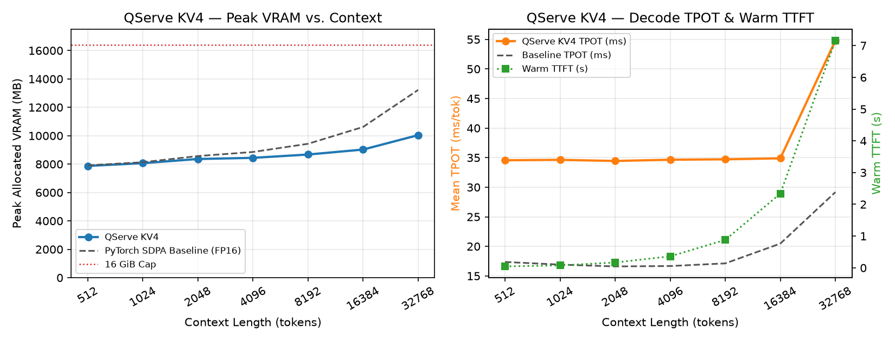

# WP-3 Technique Analysis: `qserve_kv4` (QServe KV4)

## 1. Verified Configuration & Empirical Snapshot

### Provenance & Authoritative Configuration
- **Repository & Commit:** `khemingkapat/kv_bench` @ `5fc1cea4ba64ac86a2da49edd8210a46753834fe` *(PR #59: linear capacity growth above 16K + streamlined dequant)*
- **Primary Model:** `Qwen/Qwen3-4B-Instruct-2507` (`cdbee75f17c01a7cc42f958dc650907174af0554`, Pure Dense GQA, `bfloat16`, $L=36, H_Q=32, H_{KV}=8, D=128$)
- **Hardware & Harness:** `gpu06.slurm.cpe.kmutt.ac.th`, NVIDIA GeForce RTX 4090 (23.52 GiB physical, **16.0 GiB** process allocator cap), Slurm Job `30715`
- **Authoritative Axis ([`docs/METRICS_AND_AXES.md`](../../../docs/METRICS_AND_AXES.md)):** `STRUCTURAL`
- **Manifest `technique_config`:**
  ```json
  {
    "cache_class": "QServeKVCache",
    "kv_cache_bits": 4,
    "group_size": 32,
    "smooth_attention_alpha": 0.5,
    "block_size": 16
  }
  ```
- **`VERIFIED` Hub Artifact SHA-256s ([`run_manifest_wp3_qserve_kv4.json`](../../../results/manifests/run_manifest_wp3_qserve_kv4.json)):**
  - `qserve_kv4_hardware_pytorch_16gb.json`: `2bc98aac89f2f51a6473dc29a36dd48a831cd34cf56722461770edc99be0b07d`
  - `qserve_kv4_longmem_pytorch_16gb.json`: `04d7745f4faa5f55679bfea9c2156f86e3402831daf8fbb94c9535d232f7a20a`
  - `qserve_kv4_niah_pytorch_16gb.json`: `045c20250ecb72449ae98d73f62b5d2b71869f63e8979d96dbdf417e7c1746d4`
  - `verify_qserve_kv4_pytorch_16gb.json`: `ad7b799b6cec10b1f9a1305bf61e010dfd87ba7eff0ea104fc3bc04242005ebb`
  - `qserve_kv4_grades.json`: `b8e866350a4d498d3457dcf026697e1518f04075a75a4438804789c313a5cec9`
  - `qserve_kv4_judged.json`: `1a657c37723795003025a4aeb1aef161c9cdc146e707ed20a29fa76dfb8d6446`

### Precision & Retention Separation
| Metric | Value | Notes |
|---|---:|---|
| **Physical Scalar Bits** | **4.50 bits/scalar** (K & V) | 4-bit packed INT4 payload (`0.5 B/scalar`) + 1 BF16 scale per `group_size=32` (`16 bits / 32 = 0.50 bits/scalar`); plus negligible one-time `smooth_k` `(1, 8, 1, 128)` BF16 (2 KiB/layer) |
| **Effective Token Retention** | **100.0%** | All prompt and generated tokens are retained in `QServeKVLayer` (`total_tokens_seen`) |

### Hardware Context Scaling Sweep (`512 -> 32,768`, `SyntheticFiller`)
Static `Qwen3-4B` BF16 weights + PyTorch runtime occupy **7,738.78 MiB (~7.56 GiB)** (`verify_baseline_pytorch_16gb.json` at `ctx=128`); net KV+aux VRAM below is `Peak Alloc - 7,738.78 MiB`.

| Ctx | Peak Alloc (MiB) | Base Alloc (MiB) | Net KV+Aux (MiB) | Base Net KV (MiB) | TTFT (s) | TPOT (ms) | Base TPOT (ms) | Tok/s | Host RSS Δ (MiB) | Memcpy (B/tok) | Top-1 Agr. | KL Mean | KL P99 |
|---:|---:|---:|---:|---:|---:|---:|---:|---:|---:|---:|---:|---:|---:|
| 512 | 7,873.62 | 7,911.66 | 134.84 | 172.88 | 0.0449 | 34.56 | 17.36 | 28.94 | 1,751.00 | 193.88 | 0.2656 | 9.9033 | 15.4200 |
| 1,024 | 8,065.50 | 8,133.04 | 326.72 | 394.26 | 0.0770 | 34.63 | 16.91 | 28.88 | 1,751.48 | 321.88 | 0.1875 | 10.1451 | 15.4246 |
| 2,048 | 8,359.99 | 8,566.92 | 621.21 | 828.14 | 0.1671 | 34.44 | 16.61 | 29.04 | 1,599.31 | 577.88 | 0.1094 | 11.9818 | 15.4249 |
| 4,096 | 8,441.00 | 8,854.93 | 702.22 | 1,116.15 | 0.3624 | 34.65 | 16.67 | 28.86 | 1,616.44 | 1,089.88 | 0.0938 | 12.0892 | 15.1387 |
| 8,192 | 8,674.56 | 9,430.96 | 935.78 | 1,692.18 | 0.8802 | 34.72 | 17.12 | 28.80 | 1,643.97 | 2,113.88 | 0.6719 | 4.3519 | 15.4249 |
| 16,384 | 9,024.85 | 10,616.78 | 1,286.07 | 2,878.00 | 2.3393 | 34.89 | 20.47 | 28.67 | 1,913.66 | 4,161.88 | 0.2188 | 10.5661 | 15.4249 |
| 32,768 | **10,040.97** | 13,224.90 | **2,302.19** | 5,486.12 | 7.1595 | **54.81** | 29.17 | **18.24** | **2,083.05** | 8,257.88 | 0.0469 | 12.7457 | 15.4249 |

*Verify (`ctx=128`, 16 gen tokens):* `top1_agreement = 0.0`, `kl_div_mean = 12.56021`, `kl_div_p99 = 15.3301`.

### Quality Diagnostics: NIAH (2K/4K) & LongMemEval (150 Questions, Judged)
- **NIAH Exact Retrieval:**
  - `2,048` ctx: **10/10 (100%)** across depths `[0.0 .. 0.9]`
  - `4,096` ctx: **10/10 (100%)** across depths `[0.0 .. 0.9]`
- **LongMemEval Logit Fidelity (native lengths `192..22,400`, mean `5,967.9` tokens):** `top1_agreement = 0.4554`, `kl_div_mean = 7.89133`, `kl_div_p99 = 15.4249`.
- **LongMemEval 5-Capability Judged Accuracy ([`qserve_kv4_judged.json`](../../../results/grades/qserve_kv4_judged.json) vs. [`baseline_judged.json`](../../../results/grades/baseline_judged.json)):**

| Capability | Baseline | QServe KV4 | Δ vs. Baseline | `QUALITY_REGRESSION` Count |
|---|---:|---:|---:|---:|
| **Overall (150)** | **66.0% (99/150)** | **60.00% (90/150)** | **-6.00 pp** | **12** *(+3 `UNEXPECTED_GAIN`)* |
| `fact_recall` (30) | 90.00% | 86.67% | -3.33 pp | 1 |
| `information_update` (30) | 66.67% | 66.67% | 0.00 pp | 1 *(+1 UG)* |
| `cross_session_reasoning` (30) | 43.33% | 23.33% | -20.00 pp | 7 *(+1 UG)* |
| `relative_timeframe` (30) | 30.00% | 26.67% | -3.33 pp | 2 *(+1 UG)* |
| `unanswerable_refusal` (30) | 100.00% | 96.67% | -3.33 pp | 1 |




---

## 2. White-Box Component Decomposition (Post-PR #59)

| ID | Component | Source Location (`kv_bench@5fc1cea`) | Tensor Shapes & Dtypes (`Qwen3-4B`: $L=36, H_Q=32, H_{KV}=8, D=128$) | Cadence |
|---|---|---|---|---|
| **C1** | **Dynamic SmoothAttention Key Scaling** | `qserve_cache.py`: `QServeKVLayer._ensure_smooth_k` & `update` | `smooth_k`: `(1, 8, 1, 128)` `bfloat16`; computed once on first prefill chunk (`k_abs_max / group_mean` per `group_size=32`, `alpha=0.5`); `k_smooth = key_states / smooth_k` | First prefill chunk + every prefill/decode `update()` |
| **C2** | **Per-Group Symmetric INT4 Quantizer & Bit-Packer** | `qserve_kv4.py`: `quantize_kv_int4`, `pack_int4` | Input `(1, 8, T_new, 128)` `bf16` → `packed`: `(1, 8, T_new, 64)` `uint8`, `scales`: `(1, 8, T_new, 4, 1)` `bf16` (`group_size=32`) | Every prefill chunk & decode step |
| **C3** | **Linear-Above-16K Pre-Allocated Buffers** | `qserve_cache.py`: `QServeKVLayer._ensure_capacity` | **RESOLVED in PR #59:** Uses linear capacity step above 16K instead of power-of-2 doubling (`32,768 -> 65,536`), cutting 32K Peak Alloc by `721.8 MiB` (`10,762.7 -> 10,041.0 MiB`) | On capacity growth |
| **C4** | **Streamlined Full-Sequence BF16 Dequantization for SDPA** | `qserve_cache.py`: `QServeKVLayer.keys`/`values`; `qserve_kv4.py`: `dequantize_kv_int4` | **IMPROVED in PR #59:** Streamlined unpack path cuts 32K TPOT from `59.92 -> 54.81 ms`, though still materializes full-sequence `(1, 8, T, 128)` `bf16` for HF `sdpa` | Every prefill chunk & decode step |

---

## 3. 3-Way Causal Attribution (Pre- vs. Post-PR #59)

- **VRAM Savings (`[IMPLEMENTATION]` IMPROVED — `10,762.7 -> 10,041.0 MiB` at 32K, `-3,183.9 MiB` vs. Baseline):**
  - Fixing power-of-2 capacity doubling above 16K in **C3** saved **`721.8 MiB`** at 32K (`Net KV+aux = 2,302.2 MiB`, down from `3,024.0 MiB`) and cut Host RSS nearly in half (`3,628.6 -> 2,083.1 MiB`). Persistent single-pass quantized state is `1.27 GiB`; the remaining `~1.03 GiB` above persistent state is transient **C4** BF16 materialization for HF SDPA.
- **TPOT & Throughput (`[IMPLEMENTATION]` IMPROVED — `59.92 -> 54.81 ms` at 32K, `18.24 tok/s`):**
  - Streamlined eager unpacking shaved `5.1 ms/tok` (`34.4–34.9 ms` across `512–16K`, `54.81 ms` at `32K`), but full-sequence BF16 dequantization before HF SDPA still imposes a **`1.88x`** slowdown vs. baseline (`29.17 ms`) until replaced by a fused Triton/CUDA INT4 attention kernel.
- **Zero Spatial Offloading (`8,258 B/tok` harness floor):**
  - Pure `STRUCTURAL` GPU compression with zero PCIe KV traffic.
- **Quality (`[INTRINSIC]` CONFIRMED — `90/150 = 60.00%`, `12` QR, `100%` 2K/4K NIAH):**
  - Remains the **highest-accuracy quantizer across all WP-3 structural codecs**, decisively outperforming `TurboQuant` (`54.0%`, 20 QR), `CacheGen` (`44.0%`, 36 QR), and fixed `HeadQ` (`14.7%`, 81 QR). `7/12` regressions remain concentrated in `cross_session_reasoning` (`23.33%`), confirming that pure 4-bit Key noise subtly perturbs multi-hop synthesis even when `fact_recall` (`86.67%`) and `information_update` (`66.67%`) hold.

---

## 4. Paper vs. Replication Fidelity

| Dimension | QServe Paper ([`docs/literature_survey/techniques/qserve.md`](../../../docs/literature_survey/techniques/qserve.md)) | `kv_bench` Replication (`5fc1cea`, Post-PR #59) | Impact of Divergence |
|---|---|---|---|
| **Scope (W4A8KV4 vs. KV4)** | Full W4A8KV4 co-design | **KV4-only** on unmodified BF16 weights (`Qwen3-4B`) | Intentional project-scope alignment (`docs/MODELS.md`) |
| **SmoothAttention** | Offline RoPE-paired $\lambda_i = \lambda_{i+D/2}$ folded into $W_Q, W_K$ | Online first-chunk `smooth_k` divided on K write & multiplied back on K read | Runtime multiply overhead; slight long-prompt calibration drift |
| **KV4 Format & Buffer Growth** | Paged UINT4 blocks with per-head FP16 scale + zero-point | Signed INT4 (`[-8, 7]`) per-group (`g=32`) + linear capacity growth above 16K | Tighter group granularity (`32`); eliminated 64K doubling spike (`-722 MiB`) |
| **Attention Kernel** | Custom CUDA/PTX fused KV4 attention | Streamlined eager PyTorch unpack → BF16 HF `sdpa` | **`1.88x` TPOT penalty** (`54.8 ms`) + transient BF16 materialization |

---

## 5. Component Verdicts (`KEEP` / `ADAPT` / `DROP`)

| Component | Verdict | Contribution | Failure Mode | Fix Prerequisite (if `ADAPT`) |
|---|---|---|---|---|
| **C1: Dynamic SmoothAttention** | **`ADAPT`** | Mitigates Key channel outliers; enables 100% NIAH & `60.0%` LongMemEval | First-chunk online fit drifts slightly on long prompts | Offline RoPE-paired $\lambda_i = \lambda_{i+D/2}$ calibration |
| **C2: Per-Group INT4 Quantizer (`g=32`)** | **`KEEP`** | `4.50 b/scalar`; best structural quantizer (`90/150 = 60.0%`, `12` QR) | Multi-hop `cross_session_reasoning` (`-20 pp`) when applied to all tokens | Pair with BF16 hot sink/window or use for cold CPU Value/Page tiers |
| **C3: Linear-Above-16K Buffers** | **`KEEP`** | Eliminates 64K over-allocation (`-722 MiB` VRAM, `2.08 GiB` RSS) | None | — |
| **C4: Full-BF16 Dequant for SDPA** | **`DROP`** | Functional PyTorch reference path | `1.88x` TPOT slowdown & `~1.0 GiB` transient BF16 overhead | Replace with fused Triton/CUDA INT4 PagedAttention kernel in WP-6 |
