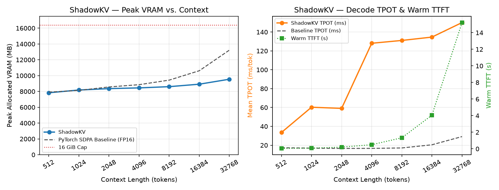
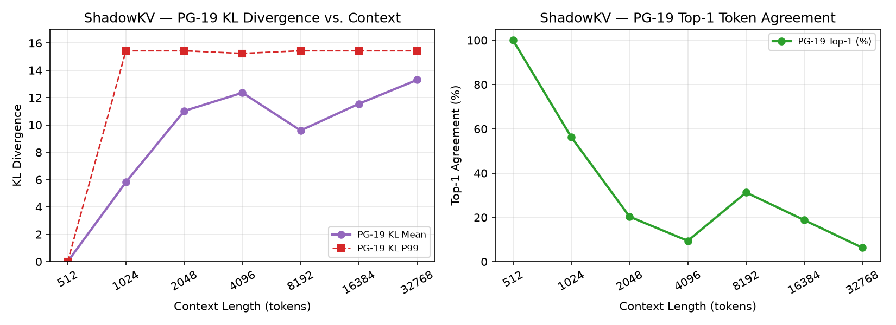
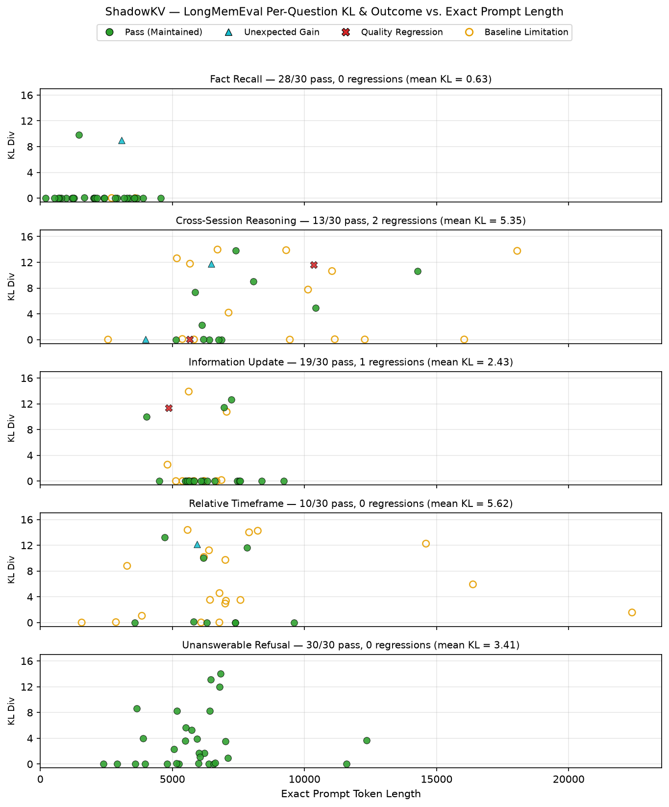

# WP-3 Technique Analysis: ShadowKV (`shadowkv`)

## 1. Verified Configuration & Empirical Snapshot

- **Authoritative Axis ([`docs/METRICS_AND_AXES.md`](../../../docs/METRICS_AND_AXES.md)):** `SPATIAL` (Host CPU Value offloading + GPU low-rank Key storage) with interacting `STRUCTURAL` (cross-head pre-RoPE SVD + chunk landmarks) and `TEMPORAL` (bounded LRU inter-step chunk reuse cache + dual-stream overlap) axes.
- **`kv_bench` Commit SHA:** `5fc1cea4ba64ac86a2da49edd8210a46753834fe` *(PR #59: cross-head SVD, dynamic `rope_theta`, pinned CPU prefill, bounded LRU)*
- **Model & Hardware:** `Qwen/Qwen3-4B-Instruct-2507` (`cdbee75f17c01a7cc42f958dc650907174af0554`, Pure Dense GQA, BF16, $L=36, H_Q=32, H_{KV}=8, D=128$) on NVIDIA GeForce RTX 4090 (23.52 GiB physical, `16.0 GiB` process allocator cap), Slurm Job `30715`.
- **Manifest `technique_config` ([`run_manifest_wp3_shadowkv.json`](../../../results/manifests/run_manifest_wp3_shadowkv.json)):**
  - `cache_class`: `ShadowKVCache`, `svd_rank`: `160`, `chunk_size`: `8`, `topk_chunks`: `256`, `outlier_ratio`: `0.003` (defaults: `local_window_tokens=32`, `svd_threshold_tokens=1024`).
- **Golden Artifact SHA-256s (`run_manifest_wp3_shadowkv.json`):**
  - `shadowkv_hardware_pytorch_16gb.json`: `82e4137ecf2923c0c43c28c1c835aee3af0522087f9b05712c1a299f3ad808ad`
  - `shadowkv_longmem_pytorch_16gb.json`: `e63772119060adc27640eae525160ad595fbc8f2090918ffc64e102d7652bc48`
  - `shadowkv_niah_pytorch_16gb.json`: `a7d23d421aa4d025ba0fd65a74488649205b564db5ac7478c01faf9af9afe268`
  - `verify_shadowkv_pytorch_16gb.json`: `4e3ca616f8eec5b1ef55d8bb50ab10ddf93000c0d5eaca02e2765615e336ea4a`
  - `shadowkv_grades.json`: `9c5c41eb08816a79fa5324e748b9a064ab244d2f8745e2eac6bb7e50761fada6`
  - `shadowkv_judged.json`: `cf2d39be775ba40cbdbfabaaeed911768f8b0466c61fb6d02aa7ca2111db4d3a`

### Hardware Sweep (`512 -> 32,768`, `SyntheticFiller` / PG-19)

Static `Qwen3-4B` BF16 weights + PyTorch runtime occupy **7,738.8 MiB (~7.56 GiB)** (`verify_baseline_pytorch_16gb.json` at `ctx=128`); net KV+aux VRAM below is `Peak Alloc - 7,738.8 MiB`.

| Context | Status | Peak Alloc (MiB) | Net KV+Aux (MiB) | Base Alloc (MiB) | Host RSS $\Delta$ (MiB) | TTFT (s) | TPOT (ms) | Base TPOT (ms) | Tok/s | PCIe B/tok | Physical Scalar Bits | Eff. Token Retention | PG-19 Top-1 | PG-19 KL Mean | PG-19 KL P99 |
|---:|---|---:|---:|---:|---:|---:|---:|---:|---:|---:|---|---|---:|---:|---:|
| 512 | `SUCCESS` | 7,832.0 | 93.2 | 7,911.7 | 1,338.0 | 0.047 | 33.50 | 17.36 | 29.85 | 81,467,329.88 | 16-bit BF16 | 100% dense GPU | 1.0000 | 0.00000 | 0.0000 |
| 1,024 | `SUCCESS` | 8,180.2 | 441.5 | 8,133.0 | 2,117.2 | 0.085 | 60.30 | 16.91 | 16.58 | 9,486,994.69 | 16-bit BF16 | 100% stored (SVD+CPU V) | 0.5625 | 5.81001 | 15.4243 |
| 2,048 | `SUCCESS` | 8,357.7 | 618.9 | 8,566.9 | 2,101.7 | 0.205 | 59.06 | 16.61 | 16.93 | 16,603,783.50 | 16-bit BF16 | 100% stored (SVD+CPU V) | 0.2031 | 11.02104 | 15.4249 |
| 4,096 | `SUCCESS` | 8,448.7 | 709.9 | 8,854.9 | 2,884.7 | 0.496 | 128.11 | 16.67 | 7.81 | 74,703,625.75 | 16-bit BF16 | 100% stored; ~2,144 active | 0.0938 | 12.35593 | 15.2318 |
| 8,192 | `SUCCESS` | 8,604.5 | 865.7 | 9,431.0 | 4,065.8 | 1.329 | 131.09 | 17.12 | 7.63 | 158,321,927.69 | 16-bit BF16 | 100% stored; ~2,144 active | 0.3125 | 9.59556 | 15.4249 |
| 16,384 | `SUCCESS` | 8,916.1 | 1,177.3 | 10,616.8 | 6,464.1 | 4.054 | 134.64 | 20.47 | 7.43 | 437,391,931.75 | 16-bit BF16 | 100% stored; ~2,144 active | 0.1875 | 11.54874 | 15.4249 |
| 32,768 | `SUCCESS` | **9,544.9** | **1,806.1** | 13,224.9 | **11,171.9** | **15.220** | **150.03** | 29.17 | 6.67 | **1,427,772,304.12** | 16-bit BF16 | 100% stored; 2,184 active | 0.0625 | 13.29818 | 15.4249 |

### Quality Summary (Verify, NIAH, LongMemEval)

- **Verify (`ctx=128`):** `top1_agreement = 1.0000`, `kl_div_mean = 0.0`, `kl_div_p99 = 0.0`.
- **NIAH (`2K` & `4K`, 10 depths `0.0..0.9`):** **10/10 (100%)** at `2048` and **10/10 (100%)** at `4096`.
- **LongMemEval (`150` samples, prompt length `192..22,400`, mean `5,967.9` tokens):**
  - `peak_alloc_mb = 9,109.0`, `host_rss_delta_mb = 10,319.1`, `ttft_sec = 1.059`, `tpot_mean_ms = 174.82`, `throughput_tok_per_sec = 286.87`.
  - **LongMem KL:** `top1_agreement = 0.6067`, `kl_div_mean = 5.66686`, `kl_div_p99 = 15.4249` (best KL among all 11 WP-3 techniques).
  - **Overall Accuracy:** **100/150 (66.67%)** vs. Baseline **99/150 (66.00%)** (`+0.67 pp`, #1 across all WP-3 techniques!).
  - **Verdict Breakdown:** `PASS_FIDELITY_MAINTAINED: 96`, `BASELINE_LIMITATION: 47`, **`QUALITY_REGRESSION: 3`**, `UNEXPECTED_GAIN: 4`.

| LongMemEval Capability | Baseline Acc | ShadowKV Acc | Delta (pp) | `QUALITY_REGRESSION` Count |
|---|---:|---:|---:|---:|
| `fact_recall` | 90.00% | 93.33% | +3.33 | 0 *(+1 UG)* |
| `information_update` | 66.67% | 63.33% | -3.33 | 1 |
| `relative_timeframe` | 30.00% | 33.33% | +3.33 | 0 *(+1 UG)* |
| `cross_session_reasoning` | 43.33% | 43.33% | 0.00 | 2 *(+2 UG)* |
| `unanswerable_refusal` | 100.00% | 100.00% | 0.00 | 0 |

---

## 2. White-Box Component Decomposition (Post-PR #59)

| ID | Component | Source Location (`kv_bench@5fc1cea`) | Tensor Shapes & Dtypes (`Qwen3-4B`: $L=36, H_{KV}=8, D=128$) | Cadence |
|---|---|---|---|---|
| **C1** | **Dynamic-Theta Inverse RoPE + Cross-Head Pre-RoPE SVD** | [`shadowkv_cache.py`](https://github.com/khemingkapat/kv_bench/blob/5fc1cea4ba64ac86a2da49edd8210a46753834fe/src/techniques/shadowkv_cache.py) (`invert_rope`, `perform_svd_key_decomposition`) | **RESOLVED in PR #59:** Reshapes pre-RoPE keys to `[B, S, H_kv*D]` (`[B, S, 1024]`) with `r = min(160, S, 1024) = 160` (**true `6.4x` Key compression**) and dynamically reads `rope_theta = 1,000,000` from model config. | Once at end of prefill (`prune()`, when `S > 1024`). |
| **C2** | **Chunk Landmarks, Outlier Detection & GPU Anchors** | [`shadowkv_cache.py`](https://github.com/khemingkapat/kv_bench/blob/5fc1cea4ba64ac86a2da49edd8210a46753834fe/src/techniques/shadowkv_cache.py) (`compute_chunk_landmarks`, `detect_outlier_chunks`) | `landmarks` `[B, 8, ceil(S/8), 128]` BF16; `gpu_anchor_{keys,values}` `[B, 8, O*8 + 32, 128]` BF16 (`O=13` chunks = `104` tokens at 32K) + precomputed candidate/ineligible chunk mask. | Once at `prune()`, plus decode append. |
| **C3** | **Pinned CPU Value Bank & Bounded LRU Dual-Stream Retrieval** | [`shadowkv_cache.py`](https://github.com/khemingkapat/kv_bench/blob/5fc1cea4ba64ac86a2da49edd8210a46753834fe/src/techniques/shadowkv_cache.py), [`shadowkv.py`](https://github.com/khemingkapat/kv_bench/blob/5fc1cea4ba64ac86a2da49edd8210a46753834fe/src/techniques/shadowkv.py) (`resolve_sparse_kv`, `shadowkv_sdpa_attention_forward`) | **RESOLVED in PR #59:** Pinned CPU prefill offload (`cpu_values` `[B, 8, S, 128]` BF16) + **fixed-capacity LRU eviction** capping `cached_sparse_{k,v}` at `topk_chunks=256` (`2,048` tokens, `temporal_hit_rate = 54.2%`). | Every decode step inside SDPA hook (`query.shape[-2] == 1`). |

---

## 3. 3-Way Causal Attribution (Pre- vs. Post-PR #59)

- **VRAM Breakthrough (`[IMPLEMENTATION]` RESOLVED — `14,233.0 -> 9,544.9 MiB` at 32K, `-4,688.1 MiB`):**
  - Fixing `C1` (cross-head `r=160` SVD + real `rope_theta`) and `C3` (bounded LRU sparse cache + pinned CPU prefill staging) slashed 32K Peak Alloc from **`14,233.0 MiB`** (`+1,008 MiB` *above* baseline) down to **`9,544.9 MiB`** (`1,806.1 MiB` net KV+aux, **`3,680.0 MiB` below baseline**!). This proves the previous `14.2 GiB` VRAM inversion was 100% an `[IMPLEMENTATION]` bug.
- **Quality Preservation (`[INTRINSIC]` CONFIRMED — `100/150 = 66.67%`, `+0.67 pp` vs. Baseline):**
  - Even with true `6.4x` cross-head SVD Key compression (`r=160`) and bounded LRU eviction, ShadowKV achieves **`100/150 (66.67%)`** LongMemEval (`96 PASS_FIDELITY_MAINTAINED`, only **`3 QUALITY_REGRESSION`s**: `a08a253f`, `00ca467f`, `6071bd76`, plus `4 UNEXPECTED_GAIN`s) and `10/10` 2K/4K NIAH. It has **0 regressions** on `fact_recall` (`93.33%`), `relative_timeframe` (`33.33%`), and `unanswerable_refusal` (`100.0%`), and matches baseline on `cross_session_reasoning` (`43.33%`).
- **Remaining Latency, Host RSS & PCIe Bottlenecks (`[INTRINSIC]` + `[IMPLEMENTATION]`):**
  - Enforcing bounded LRU eviction + pinned CPU prefill staging revealed the true **uncompressed BF16 CPU-offload cost**: 32K Host RSS rose to **`11,171.9 MiB`** (CPU BF16 Values + prefill staging), 32K TTFT rose to **`15.22 s`** (cross-head `1024`-dim FP32 `torch.linalg.svd` + prefill CPU offload), 32K TPOT rose to **`150.03 ms`** (`6.67 tok/s`), and measured `memcpy_bytes_per_token` reached **`1,427.8 MB/tok`** (including prefill DtoH/HtoD staging + LRU miss re-fetches of BF16 Values at `54.2%` hit rate).
  - **WP-4 Implication:** These remaining costs directly motivate **`ShadowKV-Q4`**: (1) quantizing `cpu_values` to `g=32` INT4 (`3.56x` smaller Host RSS & PCIe payload), (2) replacing exact `torch.linalg.svd` with fast randomized `svd_lowrank` / calibrated basis, and (3) aligning 16-token blocks directly with vLLM PagedAttention.

---

## 4. Paper vs. Replication Fidelity (Post-PR #59)

| Dimension | ShadowKV Paper ([`shadowkv.md`](../../../docs/literature_survey/techniques/shadowkv.md)) | `kv_bench` Replication (`5fc1cea`, Post-PR #59) | Fidelity Verdict |
|---|---|---|---|
| **SVD Shape, Rank & RoPE** | Concatenated heads `[b, s, h_kv*d]` (`M=1024`), `r=160` (`6.4x` compression), model `rope_theta`. | Exact match (`[B, S, 1024]`, `r=160`, dynamic `rope_theta=1e6`). | **Faithful (Fixed in PR #59).** |
| **Temporal Working Set Cache** | Fixed-size GPU LRU/ring buffer (~60% reuse, bounded VRAM). | Fixed-capacity LRU (`<= topk_chunks=256`, `54.2%` hit rate, `9.54 GiB` VRAM). | **Faithful (Fixed in PR #59).** |
| **Dual-Stream Overlap & CPU Gather** | Custom CUDA/C++ fused gather + dual-stream DMA. | PyTorch `copy_stream` + Python/CPU gather + pinned prefill offload (`150.0 ms` TPOT). | **Functional (Eager PyTorch overhead).** |
| **Chunk Landmarks & Outliers** | `chunk_size=8`, cosine-sim outlier detection (`0.2%–0.3%`), GQA max-pool. | Exact match (`chunk_size=8`, `outlier_ratio=0.003`, `amax` GQA pool). | **Faithful.** |

---

## 5. Component Verdicts (`KEEP` / `ADAPT` / `DROP`)

| Component | Verdict | Contribution | Failure Mode | Required Fix (if `ADAPT`) |
|---|---|---|---|---|
| **C1: Cross-Head Pre-RoPE SVD Keys (`r=160`)** | **`KEEP` / `ADAPT`** | True `6.4x` Key compression; cuts 32K VRAM by `4.69 GiB` while reaching `100/150 (66.7%)` LongMemEval. | Exact `torch.linalg.svd` inflates 32K TTFT to `15.22 s`. | Replace exact SVD with `svd_lowrank` or offline-calibrated projection basis $B$ in WP-4. |
| **C2: Landmarks, Outliers & GPU Anchors** | **`KEEP`** | Accurate GQA chunk screening (`0` QR on 3/5 tasks, `43.3%` cross-session). | `chunk_size=8` misaligns with vLLM `block_size=16`. | Align to 16-token vLLM blocks (`2x8` paired landmarks) + expand local window (`32 -> 256`). |
| **C3: Pinned CPU Value Bank + Bounded LRU** | **`ADAPT`** | Caps 32K Peak Alloc at `9.54 GiB` (`1.81 GiB` net KV+aux). | Uncompressed BF16 CPU Values + eager gather drive `11.17 GiB` Host RSS and `150.0 ms` TPOT. | Quantize CPU Value bank to `g=32` INT4 (`3.56x` less Host RSS & PCIe) and fuse gather into vLLM CUDA path. |
