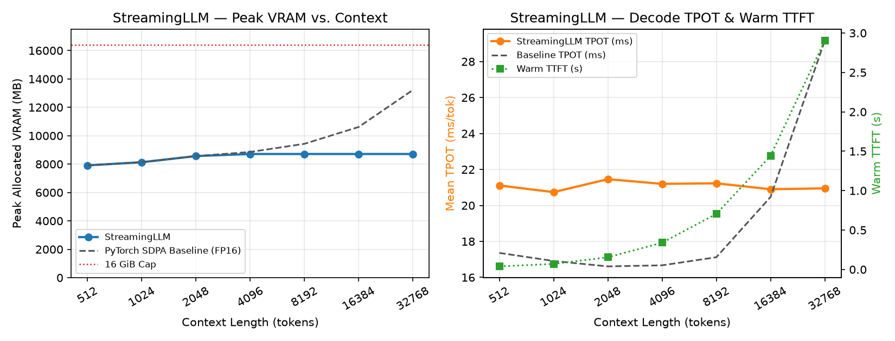
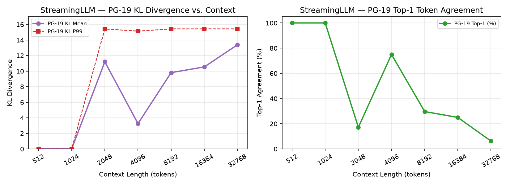
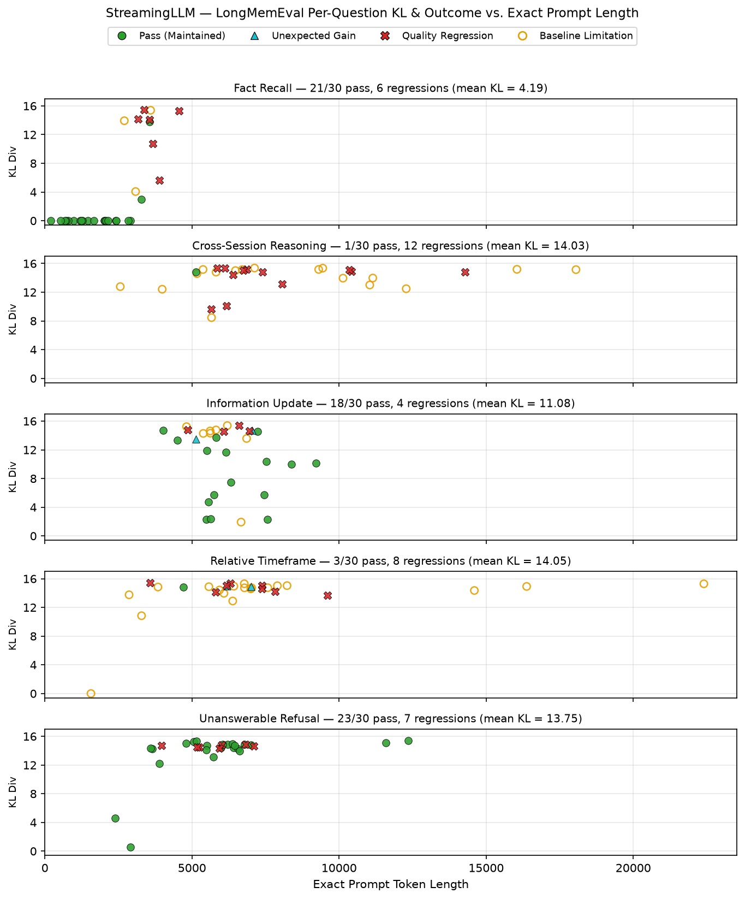

# WP-3 Technical Analysis: StreamingLLM (Attention Sink + Rolling Window)

**Authoritative Axis (`docs/METRICS_AND_AXES.md`):** `STRUCTURAL`  
**`kv_bench` Pinned Commit:** `2a9338a2f750741f7765d79c1270f5579a9ffed0`  
**Target Model:** `Qwen/Qwen3-4B-Instruct-2507` (`Pure Dense GQA`, $L=36$, $H_Q=32$, $H_{KV}=8$, $D=128$, `bfloat16`)  
**Hardware Cap:** 16.0 GiB process allocator cap on NVIDIA RTX 4090 (23.52 GiB physical VRAM, `effective_gpu_utilization = 0.5783`)

---

## 1. Verified Configuration & Empirical Snapshot

### 1.1 Manifest Provenance & `technique_config`
From [`results/manifests/run_manifest_wp3_streamingllm_pytorch.json`](../../../results/manifests/run_manifest_wp3_streamingllm_pytorch.json):
- **Manifest `technique_config`:**
  - `cache_class`: `StreamingCache`
  - `sink_tokens`: `4`
  - `window_size`: `2048`
  - `block_size`: `16`
  - `effective_cache_tokens`: `2052` ($4 + 2048$)
  - `effective_sliding_window`: `2064` ($\lceil 4/16 \rceil \times 16 + 2048$, used by vLLM config path)
- **VERIFIED Hub Artifact SHA-256 Checksums:**
  - `results/runs/wp3/streamingllm_hardware_pytorch_16gb.json`: `05bd5adb4d5010a215e9c1f8c46fe66b998cb7937411ddfdcc5f0f786cd6d1eb`
  - `results/runs/wp3/streamingllm_longmem_pytorch_16gb.json`: `de2705b9dc340dee86282708cb672db9acb102e74e92a01ef7d381e42f67c353`
  - `results/runs/wp3/streamingllm_niah_pytorch_16gb.json`: `5f01cee56d9e25470e067b02003e87307f88c3d3b47b5e8bbefe3ac11be45b91`
  - `results/runs/wp3/verify_streamingllm_pytorch_16gb.json`: `c36501447918cf95dfbbd0a7a731bda78278b90c1f174499d44022389a274375`
  - `results/grades/streamingllm_grades.json`: `d7f955f61d5f91519c17ff4a0054c04cad3dbc6fa92840a0ecd8a3c3f5b58f22`
  - `results/grades/streamingllm_judged.json`: `89a8fc339c8f33800c7e9f9ddf84026e08fea124d3de71751033cfcd95d483c2`

### 1.2 Hardware Scaling Sweep (`512 -> 32,768` Tokens, `SyntheticFiller`)
Static `Qwen3-4B` BF16 weights + PyTorch CUDA runtime baseline at `ctx=128` (`verify_baseline_pytorch_16gb.json` / `verify_streamingllm_pytorch_16gb.json`) is **`7,738.78 MiB` (~7.56 GiB)** (`7,748.0 MiB` reserved). Everything above `7,738.78 MiB` represents net KV-cache + prefill activation buffers. At `ctx=32,768` (+64 decode tokens = 32,832 total tokens), StreamingLLM caps `Peak Alloc` at **`8,711.71 MiB`** (net KV+aux **`~972.9 MiB`**) vs. Baseline's `13,224.90 MiB` (net KV+aux **`~5,486.1 MiB`**), a **`4,513.2 MiB`** VRAM savings.

| `ctx` | Peak Alloc (MiB) | Peak Reserved (MiB) | Warm TTFT (s) | TPOT Mean / P95 (ms) | Throughput (tok/s) | Host RSS Δ (MiB) | Memcpy (B/tok) | Physical Scalar Bits | Effective Token Retention |
|---:|---:|---:|---:|---:|---:|---:|---:|---:|---:|
| **512** | 7,911.66 | 7,998.0 | 0.0388 | 21.11 / 21.11 | 47.37 | 1,104.58 | 201.75 | 16-bit BF16 | 100.0% (576 / 576) |
| **1,024** | 8,133.04 | 8,164.0 | 0.0703 | 20.74 / 20.74 | 48.22 | 1,104.67 | 329.75 | 16-bit BF16 | 100.0% (1,088 / 1,088) |
| **2,048** | 8,566.92 | 8,624.0 | 0.1543 | 21.46 / 21.46 | 46.61 | 1,149.89 | 585.75 | 16-bit BF16 | 97.16% (2,052 / 2,112) |
| **4,096** | 8,711.49 | 8,924.0 | 0.3389 | 21.20 / 21.20 | 47.18 | 1,048.17 | 1,097.75 | 16-bit BF16 | 49.33% (2,052 / 4,160) |
| **8,192** | 8,711.53 | 9,104.0 | 0.7050 | 21.23 / 21.23 | 47.09 | 1,186.24 | 2,121.75 | 16-bit BF16 | 24.85% (2,052 / 8,256) |
| **16,384** | 8,711.59 | 9,104.0 | 1.4412 | 20.90 / 20.90 | 47.84 | 1,233.78 | 4,169.75 | 16-bit BF16 | 12.48% (2,052 / 16,448) |
| **32,768** | 8,711.71 | 9,124.0 | 2.9049 | 20.95 / 20.95 | 47.73 | 1,326.49 | 8,265.75 | 16-bit BF16 | 6.25% (2,052 / 32,832) |

*(Note: `Memcpy B/tok` scaling linearly from `201.75` to `8,265.75` is a harness instrumentation floor from `torch.profiler` H2D input/position tensor tracking per prompt token, not KV-cache PCIe offloading.)*

### 1.3 Micro Fidelity (Verify, PG-19 / Hardware Sweep KL) & Macro Retrieval (NIAH, LongMemEval)
- **Verify (`ctx=128`, 16 decode tokens):** `top1_agreement = 1.0`, `kl_div_mean = 0.0`, `kl_div_p99 = 0.0`.
- **Hardware Sweep KL (`SyntheticFiller`, $N=1$ per length, 64 decode tokens):**
  - `512` & `1,024`: `top1_agreement = 1.0`, `kl_div_mean = 0.0`, `kl_div_p99 = 0.0` (zero eviction).
  - `2,048` (60 middle tokens evicted): `top1 = 0.1719`, `kl_mean = 11.19983`, `kl_p99 = 15.4249` (top-5 clamp).
  - `4,096` (2,108 evicted): `top1 = 0.75`, `kl_mean = 3.2542`, `kl_p99 = 15.1387`.
  - `8,192`: `top1 = 0.2969`, `kl_mean = 9.8077`, `kl_p99 = 15.4249`.
  - `16,384`: `top1 = 0.25`, `kl_mean = 10.53793`, `kl_p99 = 15.4249`.
  - `32,768`: `top1 = 0.0625`, `kl_mean = 13.38436`, `kl_p99 = 15.4249`.
- **NIAH (`2K` & `4K` depth grid, passcode `"849204"`):**
  - **`2,048` ctx:** **`100%` (`1.0`)** across all 10 depths (`0.0` to `0.9`, needle distances `239–2,048` tokens; note `2048` prompt fits within `2052` capacity during prefill).
  - **`4,096` ctx:** **`40%` (`0.4`)** — `0.0` at depths `0.0–0.5` (`needle_distance` `2,067–4,096` > `2,048` window); **`1.0`** at depths `0.6–0.9` (`needle_distance` `444–1,661` $\le 2,048$ window).
- **LongMemEval (`150` native-length samples, `192–22,400` prompt tokens, median `5,859`, `streamingllm_judged.json`):**
  - **Overall Accuracy:** **`66 / 150 = 44.0%`** vs. Baseline **`99 / 150 = 66.0%`** ($\Delta = -22.0\text{ pp}$).
  - **Causal Verdicts:** `PASS_FIDELITY_MAINTAINED = 62`, `BASELINE_LIMITATION = 47`, **`QUALITY_REGRESSION = 37`**, `UNEXPECTED_GAIN = 4`.
  - **LongMemEval KL & Retention:** `top1_agreement = 0.1318`, `kl_div_mean = 12.97997`, `kl_div_p99 = 15.4249`, `Physical Scalar Bits = 16-bit BF16`, `Effective Token Retention = 42.52%` (`2.35×` compression).
  - **Length-Tier Accuracy:** `short = 75.0%`, `medium = 36.11%`, `long = 18.18%`.

| LongMemEval Capability | Baseline (`N=30` each) | StreamingLLM (`N=30` each) | $\Delta$ (pp) | `QUALITY_REGRESSION` Count |
|---|---:|---:|---:|---:|
| **Fact Recall** | 90.0% (27/30) | 70.0% (21/30) | -20.0 | 6 |
| **Information Update** | 66.7% (20/30) | 60.0% (18/30) | -6.7 | 4 |
| **Relative Timeframe** | 30.0% (9/30) | 10.0% (3/30) | -20.0 | 8 |
| **Cross-Session Reasoning** | 43.3% (13/30) | 3.3% (1/30) | -40.0 | 12 |
| **Unanswerable Refusal** | 100.0% (30/30) | 76.7% (23/30) | -23.3 | 7 |

---

## 2. White-Box Component Decomposition

| ID | Component | Source File, Class/Method & Lines | Tensor Shapes & Dtypes (`Qwen3-4B`, BF16) | Execution Cadence |
|---|---|---|---|---|
| **C1** | **Dual-Region Cache Buffer (`StreamingLayer`)** | `src/techniques/streaming_cache.py`: `StreamingLayer.__init__`, `update` (L15–65) | `self.keys`, `self.values`: `(1, 8, S_active, 128)`, `bfloat16`, where $S_{\text{active}} \le 2052$ after prune (up to `2052 + 1024 = 3076` mid-chunk). | Every prefill chunk (`q_len <= 1024`) and every decode step (`q_len == 1`). |
| **C2** | **Contiguous Slice-and-Cat Eviction (`evict_streaming_kv_cache`)** | `src/techniques/streamingllm.py`: `evict_streaming_kv_cache` (L171–206); called by `StreamingLayer.update` (L55–62) & `prune` (L66–75) | `narrow(-2, 0, 4)` + `narrow(-2, S-2048, 2048)` $\to$ `torch.cat` to `(1, 8, 2052, 128)`, `bfloat16`. | Once per 1,024-token prefill chunk via `prune_after_chunk()` (`pytorch_runner.py` L270–271) and every decode step (`q_len == 1`). |
| **C3** | **Absolute RoPE Injection (Runner Interaction)** | `src/core/pytorch_runner.py`: `chunk_pos` (L260), `pos_tensor` (L319) | `position_ids`: `(1, q_len)`, `int64` using absolute sequence indices `[c_start..c_end)` and `curr_pos`. Note: `compute_cache_boundaries().cache_positions` (`streamingllm.py` L102) is unused in `StreamingCache`. | Every prefill chunk and decode step. |
| **C4** | **Deterministic Position Tracker (`original_positions`)** | `src/techniques/streaming_cache.py`: `StreamingLayer.original_positions` (L31–39) | Python `list[int]` computed on-demand from `total_tokens_seen` for `diagnostic.py` (`L150`). Zero GPU memory. | Post-sample diagnostic inspection only. |

---

## 3. 3-Way Causal Attribution

- **VRAM (`8,711.71 MiB` flat from `4K` to `32K`):** **`[INTRINSIC]` + `[IMPLEMENTATION]`** — `C1`+`C2` bound `S_active` to `2,052` tokens (`2052 * 36 * 2 * 8 * 128 * 2 bytes = 281.8 MiB` / `295.5 MB` steady-state KV across all 36 layers), plus `chunk_size=1024` transient prefill activations (`~691 MiB`), keeping `Peak Alloc` flat at `8,711.5–8,711.7 MiB` from `4K` to `32K`.
- **Host RSS (`1,048–1,326 MiB`) & PCIe Memcpy (`201.75 -> 8,265.75 B/tok`):** **`[IMPLEMENTATION]`** — `C2` performs zero CPU offloading. The linear `Memcpy B/tok` growth is solely the `pytorch_runner.py` `torch.profiler` instrumentation floor (`8,265.75 B/tok` at `32K`) and must be discounted.
- **TTFT (`2.9049 s` at `32K` vs. Baseline `6.9783 s`) & TPOT (`20.95 ms` vs. Baseline `29.17 ms`):** **`[INTRINSIC]` + `[HARDWARE/GQA]`** — Because `C2` prunes after each `1,024`-token chunk, prefill attention scales as $O(N \cdot (2052 + 1024))$ rather than $O(N^2)$, cutting 32K TTFT by **`2.40×`**. Decode TPOT stays flat at `~20.9–21.5 ms` (`~47–48 tok/s`) across `512–32K` instead of degrading to `29.17 ms` at 32K. (At `512–4K`, TPOT is ~4 ms slower than baseline `16.6–17.4 ms` due to `C2` `narrow`+`cat` allocation overhead per decode step across 36 layers.)
- **KL Divergence (`kl_div_mean = 13.38` at `32K`, `12.98` on LongMemEval) & `15.4249` Clamp:** **`[INTRINSIC]` + `[IMPLEMENTATION]`** — Once `seq_len > 2052`, `C2` permanently drops middle tokens. On `SyntheticFiller` ($N=1$ per length), next-token prediction depends on earlier filler/structure, causing `top1_agreement` to drop to `0.0625` at `32K` and `kl_div_p99` to hit the top-5 tail clamp (`15.4249`). Note that `C3` (absolute RoPE) does *not* cause OOD collapse here because `Qwen3-4B-Instruct-2507` natively supports 32K+ RoPE positions.
- **NIAH (`100%` at `2K`, `40%` at `4K`):** **`[INTRINSIC]`** — Exact step-function boundary at `needle_distance = 2048`. At `4K`, depths `0.0–0.5` (`2,067–4,096` tokens back) are evicted by `C2` (`0%`), while depths `0.6–0.9` (`444–1,661` tokens back) remain inside `C1` (`100%`). Cannot be extrapolated to `32K` without noting that at `32K`, `2048 / 32768 = 6.25%` of context would remain in-window.
- **LongMemEval (`44.0%`, `37` `QUALITY_REGRESSION`s):** **`[INTRINSIC]`** — LongMemEval prompts span `192–22,400` tokens (median `5,859`). On `short` prompts ($\le 2K$), accuracy is `75.0%`. On `cross_session_reasoning` (which requires synthesizing facts across early and late sessions), `C2` evicts early sessions, collapsing accuracy from `43.3%` to **`3.3%`** (`12` `QUALITY_REGRESSION`s, e.g., `bb7c3b45` at `5,859` tokens: *"Falsely claims no information about heels purchase"*). Similarly, `relative_timeframe` drops `-20.0 pp` (`8` regressions) and `fact_recall` drops `-20.0 pp` (`6` regressions).

---

## 4. Paper vs. Replication Fidelity

| Dimension | Paper (`Xiao et al., ICLR 2024`, `docs/literature_survey/techniques/streamingllm.md`) | `kv_bench` PyTorch Implementation (`streamingllm.py`, `streaming_cache.py`) | Fidelity Verdict |
|---|---|---|---|
| **Sink + Rolling Window** | $x=4$ initial sink tokens + $y$ recent tokens (`4 + 2044` or `4 + 1020`). | `sink_tokens=4`, `window_size=2048` (`4 + 2048 = 2052`). | **Exact Match** |
| **RoPE Position Handling** | Stores **raw (un-rotated) Keys** and dynamically applies **cache-relative positions** $[0, x+y-1]$ so models can decode past training length (4M+ tokens). | `pytorch_runner.py` passes **absolute `position_ids`** (`c_start..c_end`, `curr_pos`); `StreamingCache` stores **already-rotated Keys**. `cache_positions` in `compute_cache_boundaries()` is unused. | **Divergent** (Safe up to Qwen3's 32K+ native RoPE, but would fail beyond `max_position_embeddings`). |
| **Buffer Management** | Pre-allocated circular ring buffer (or zero-copy in-place overwrite). | `torch.narrow` + `torch.cat` allocating new `(1, 8, 2052, 128)` tensors every decode step (`~4 ms` TPOT overhead). | **Simplified** |
| **GQA Support** | Paper tested MHA (Llama-2, Falcon, MPT, Pythia). | Works natively on `Qwen3-4B` GQA ($H_{KV}=8$) because sink+window selection is position-based, shared across all 32 Q heads. | **Faithful Extension** |

---

## 5. Component Verdicts (`KEEP` / `ADAPT` / `DROP`)

| Component | Verdict | Contribution | Failure Mode | Exact Fix Prerequisite (if `ADAPT`) |
|---|---|---|---|---|
| **C1: Dual-Region Buffer (`StreamingLayer`)** | **`KEEP`** | Bounds active VRAM to `8.51 GiB` (`8,711.7 MiB`; `~281.8 MiB` KV) and TTFT to `2.90 s` at 32K. | None for sink+window storage. | — |
| **C2: Eviction (`evict_streaming_kv_cache`)** | **`ADAPT`** | Enforces $O(1)$ cache size and preserves softmax attention sinks. | Permanent middle-token deletion causes `37` LongMemEval regressions (`3.3%` cross-session) and `~4 ms` TPOT overhead from `torch.cat`. | Replace `torch.cat` with pre-allocated ring buffer; route evicted middle blocks to `SPATIAL` CPU/quantized tier (WP-4/WP-6) instead of discarding. |
| **C3: Absolute RoPE Injection** | **`ADAPT`** | Simplifies `transformers` integration within 32K native RoPE. | Breaks extrapolation beyond model's `max_position_embeddings`. | Store pre-RoPE keys or apply inverse/re-rotated delta RoPE using `compute_cache_boundaries().cache_positions`. |
| **C4: `original_positions` Tracker** | **`KEEP`** | Zero-overhead deterministic tracking for `diagnostic.py`. | None. | — |
