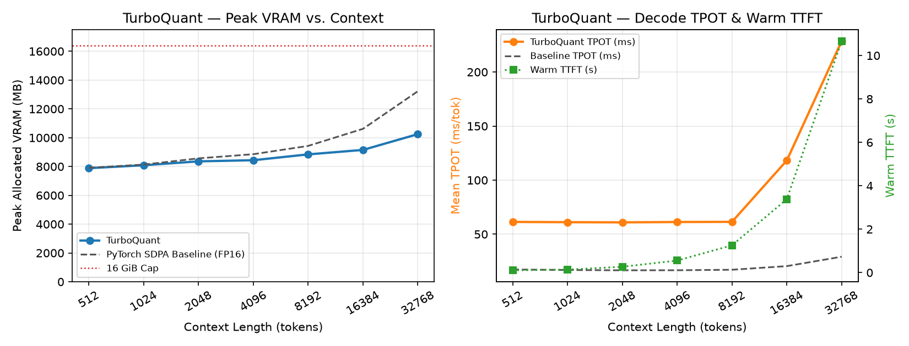
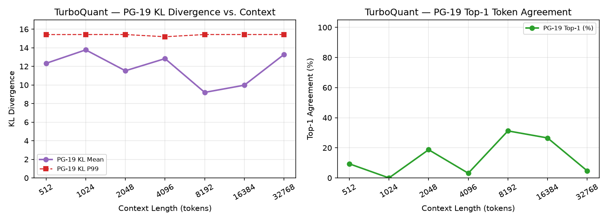
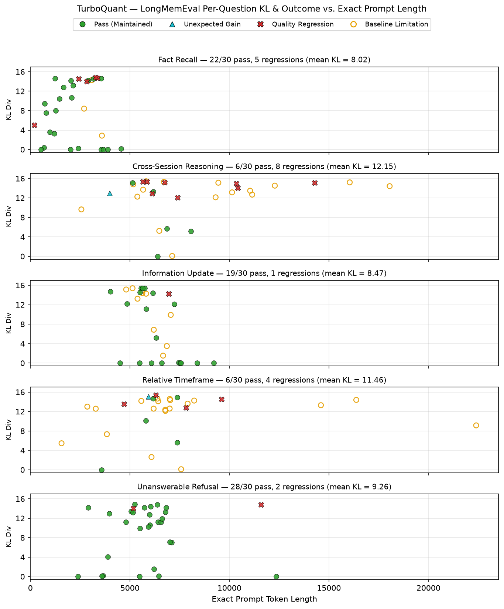

# WP-3 Technique Analysis: `turboquant` (TurboQuant)

## 1. Verified Configuration & Empirical Snapshot

### Provenance & Authoritative Configuration
- **Repository & Commit:** `khemingkapat/kv_bench` @ `5fc1cea4ba64ac86a2da49edd8210a46753834fe` *(PR #59: cached `H_d` Hadamard matmul replacing Python `fwht` loop + pre-allocated buffers)*
- **Primary Model:** `Qwen/Qwen3-4B-Instruct-2507` (`cdbee75f17c01a7cc42f958dc650907174af0554`, Pure Dense GQA, `bfloat16`, $L=36, H_Q=32, H_{KV}=8, D=128$)
- **Hardware & Harness:** `gpu06.slurm.cpe.kmutt.ac.th`, NVIDIA GeForce RTX 4090 (23.52 GiB physical, **16.0 GiB** process allocator cap), Slurm Job `30715`
- **Authoritative Axis ([`docs/METRICS_AND_AXES.md`](../../../docs/METRICS_AND_AXES.md)):** `STRUCTURAL`
- **Manifest `technique_config`:**
  ```json
  {
    "cache_class": "TurboQuantCache",
    "k_bits": 4,
    "v_bits": 3,
    "qjl_v": true,
    "qjl_k": false,
    "block_size": 16,
    "compression_ratio": 3.657,
    "theoretical_bytes_per_token_head": 140
  }
  ```
- **`VERIFIED` Hub Artifact SHA-256s ([`run_manifest_wp3_turboquant.json`](../../../results/manifests/run_manifest_wp3_turboquant.json)):**
  - `turboquant_hardware_pytorch_16gb.json`: `19bb72a4d580685332231f0fc20d5a0ff3d81938d916ae54e96b7148db0d107e`
  - `turboquant_longmem_pytorch_16gb.json`: `a430df93c6f612fdf96d057825e056ae415113c1584d14ae89e5f10f0ad8fe73`
  - `turboquant_niah_pytorch_16gb.json`: `f7a00eef53a380d506892fb446ee846bd7890067593809b745df456f229cdd6f`
  - `verify_turboquant_pytorch_16gb.json`: `15914c0ea3bd998c140f280956e98c90e3b5f59ed0e9d56567ab3cd331faa04c`
  - `turboquant_grades.json`: `481dee6c0c78c26250139d41d2bf3f52b1c51b9cf0abefaf5edb93a1f2b8c170`
  - `turboquant_judged.json`: `4a4e9582b4608bd4151ed12648bc1d4417def14caf80ed2523fcdf4cd7e03aa5`

### Precision & Retention Separation
| Metric | Value | Notes |
|---|---:|---|
| **Physical Scalar Bits** | **4.375 bits/scalar** (combined); **K: 4.25**, **V: 4.50** | K: 4-bit Lloyd-Max (`64 B/tok/head`) + FP32 norm (`4 B`) = `68 B`; V: 3-bit Lloyd-Max (`48 B`) + 1-bit QJL sign (`16 B`) + 2×FP32 norms (`8 B`) = `72 B`; Total `140 B / 256 scalars` vs. `512 B` BF16 (`3.657x`) |
| **Effective Token Retention** | **100.0%** | All prompt and generated tokens are retained |

### Hardware Context Scaling Sweep (`512 -> 32,768`, `SyntheticFiller`)
Static `Qwen3-4B` BF16 weights + PyTorch runtime occupy **7,738.78 MiB (~7.56 GiB)** (`verify_baseline_pytorch_16gb.json` at `ctx=128`); net KV+aux VRAM below is `Peak Alloc - 7,738.78 MiB`.

| Ctx | Peak Alloc (MiB) | Base Alloc (MiB) | Net KV+Aux (MiB) | Base Net KV (MiB) | TTFT (s) | TPOT (ms) | Base TPOT (ms) | Tok/s | Host RSS Δ (MiB) | Memcpy (B/tok) | Top-1 Agr. | KL Mean | KL P99 |
|---:|---:|---:|---:|---:|---:|---:|---:|---:|---:|---:|---:|---:|---:|
| 512 | 7,885.75 | 7,911.66 | 146.97 | 172.88 | 0.1055 | 61.35 | 17.36 | 16.30 | 2,117.82 | 4,914.38 | 0.0938 | 12.3267 | 15.4200 |
| 1,024 | 8,088.01 | 8,133.04 | 349.23 | 394.26 | 0.1363 | 61.12 | 16.91 | 16.36 | 2,123.39 | 5,042.38 | 0.0000 | 13.7744 | 15.4249 |
| 2,048 | 8,358.08 | 8,566.92 | 619.30 | 828.14 | 0.2690 | 60.96 | 16.61 | 16.40 | 2,146.24 | 5,307.38 | 0.1875 | 11.5273 | 15.4249 |
| 4,096 | 8,436.85 | 8,854.93 | 698.07 | 1,116.15 | 0.5542 | 61.27 | 16.67 | 16.32 | 2,190.55 | 5,837.38 | 0.0312 | 12.8339 | 15.1875 |
| 8,192 | 8,842.31 | 9,430.96 | 1,103.53 | 1,692.18 | 1.2576 | 61.41 | 17.12 | 16.28 | 2,262.28 | 6,897.38 | 0.3125 | 9.2001 | 15.4249 |
| 16,384 | 9,153.13 | 10,616.78 | 1,414.35 | 2,878.00 | 3.3817 | 118.18 | 20.47 | 8.46 | 2,429.20 | 9,017.38 | 0.2656 | 9.9759 | 15.4249 |
| 32,768 | **10,247.25** | 13,224.90 | **2,508.47** | 5,486.12 | **10.6638** | **228.57** | 29.17 | **4.37** | **2,743.99** | 13,257.38 | 0.0469 | 13.2783 | 15.4249 |

*Verify (`ctx=128`, 16 gen tokens):* `top1_agreement = 0.125`, `kl_div_mean = 11.28498`, `kl_div_p99 = 15.3301`.  
*Shannon-$\phi$ Geometric Distortion (32K):* `k_eps_snr = 0.008737`, `k_eps_dir = 0.004306`, `v_eps_snr = 0.018946`, `v_eps_dir = 0.009250`.

### Quality Diagnostics: NIAH (2K/4K) & LongMemEval (150 Questions, Judged)
- **NIAH Exact Retrieval:**
  - `2,048` ctx: **10/10 (100%)** across depths `[0.0 .. 0.9]`
  - `4,096` ctx: **10/10 (100%)** across depths `[0.0 .. 0.9]`
- **LongMemEval Logit Fidelity (native lengths `192..22,400`, mean `5,967.9` tokens):** `top1_agreement = 0.2289`, `kl_div_mean = 11.28866`, `kl_div_p99 = 15.4900`.
- **LongMemEval 5-Capability Judged Accuracy ([`turboquant_judged.json`](../../../results/grades/turboquant_judged.json) vs. [`baseline_judged.json`](../../../results/grades/baseline_judged.json)):**

| Capability | Baseline | TurboQuant | Δ vs. Baseline | `QUALITY_REGRESSION` Count |
|---|---:|---:|---:|---:|
| **Overall (150)** | **66.0% (99/150)** | **54.00% (81/150)** | **-12.00 pp** | **20** *(+2 `UNEXPECTED_GAIN`)* |
| `fact_recall` (30) | 90.00% | 73.33% | -16.67 pp | 5 |
| `information_update` (30) | 66.67% | 63.33% | -3.33 pp | 1 |
| `cross_session_reasoning` (30) | 43.33% | 20.00% | -23.33 pp | 8 *(+1 UG)* |
| `relative_timeframe` (30) | 30.00% | 20.00% | -10.00 pp | 4 *(+1 UG)* |
| `unanswerable_refusal` (30) | 100.00% | 93.33% | -6.67 pp | 2 |





---

## 2. White-Box Component Decomposition (Post-PR #59)

| ID | Component | Source Location (`kv_bench@5fc1cea`) | Tensor Shapes & Dtypes (`Qwen3-4B`: $L=36, H_Q=32, H_{KV}=8, D=128$) | Cadence |
|---|---|---|---|---|
| **C1** | **Cached `H_d` Hadamard Matmul + Rademacher Sign Flip** | `turboquant_ops.py`: `fwht`, `ifwht` | **RESOLVED in PR #59:** Replaced the 7-stage Python `while h < d` butterfly loop with a cached `(128, 128)` Hadamard matrix multiply (`x @ H_d`), cutting 32K TTFT `20.63 -> 10.66 s` and TPOT `864.1 -> 228.6 ms` (`3.78x` speedup). | Every encode + full-cache decode |
| **C2** | **Asymmetric Key Encoder (4-bit Beta Lloyd-Max)** | `turboquant_ops.py`: `turboquant_encode_key` | `key_packed`: `(1, 8, T, 64)` `uint8`, `key_norms`: `(1, 8, T, 1)` `fp32` | Every prefill chunk & decode step |
| **C3** | **Asymmetric Value Encoder (3-bit Lloyd-Max + 1-bit QJL)** | `turboquant_ops.py`: `turboquant_encode_value`, `qjl_sketch` | `value_packed`: `(1, 8, T, 64)` `uint8`, `value_norms` & `value_res_norms`: `(1, 8, T, 1)` `fp32` | Every prefill chunk & decode step |
| **C4** | **Pre-Allocated Buffers + Full-Sequence Decode for SDPA** | `turboquant_cache.py`: `TurboQuantLayer.update` | **PARTIALLY RESOLVED in PR #59:** Eliminated per-step `torch.cat` allocator churn (slashing Host RSS `7,529 -> 2,744 MiB`), though full-sequence `ifwht` + QJL decode before HF `sdpa` still runs every step (`228.57 ms` at 32K). | Every prefill chunk & decode step |

---

## 3. 3-Way Causal Attribution (Pre- vs. Post-PR #59)

- **Speed & Host RSS Breakthrough (`[IMPLEMENTATION]` IMPROVED):**
  - Replacing the Python-loop `fwht` with a cached `(128, 128)` Hadamard matmul and pre-allocating buffers delivered a **`3.78x` 32K TPOT speedup** (`864.12 -> 228.57 ms`, and `54.11 ms` on LongMemEval!), a **`1.93x` 32K TTFT speedup** (`20.63 -> 10.66 s`), and a **`2.74x` Host RSS drop** (`7,528.9 -> 2,744.0 MiB`).
  - **Remaining `[IMPLEMENTATION]` bottleneck:** `228.57 ms` at 32K is still `7.84x` slower than baseline (`29.17 ms`) because eager PyTorch still executes three full-sequence `[0..T]` `H_d` matmuls (`K`, `V`, `QJL`) per layer per decode step for HF SDPA; reaching `< 45 ms` requires a fused register-level Triton/CUDA kernel.
- **VRAM (`10,247.25 MiB` total / `2,508.47 MiB` net KV+aux at 32K, `-2,977.65 MiB` vs. Baseline):**
  - Persistent state is `1.23 GiB` (`3.657x` ratio); remaining `~1.28 GiB` above persistent state is transient full-sequence decode workspace for HF SDPA.
- **Quality (`[INTRINSIC]` CONFIRMED — `81/150 = 54.00%`, `20` QR, `100%` 2K/4K NIAH):**
  - Identical Shannon-$\phi$ distortion (`k_eps_dir = 0.0043`, `v_eps_dir = 0.0092`) and `54.0%` LongMemEval confirm that TurboQuant's `-6.0 pp` gap behind `QServe KV4` (`60.0%`, `12` QR) is **`[INTRINSIC]`**: static unit-sphere Beta Lloyd-Max quantization without outlier-channel smoothing loses fine-grained multi-fact discrimination in `fact_recall` (`73.3%`, 5 QR) and `cross_session_reasoning` (`20.0%`, 8 QR).

---

## 4. Paper vs. Replication Fidelity (Post-PR #59)

| Dimension | TurboQuant Paper ([`docs/literature_survey/techniques/turboquant.md`](../../../docs/literature_survey/techniques/turboquant.md)) | `kv_bench` Replication (`5fc1cea`, Post-PR #59) | Impact of Divergence |
|---|---|---|---|
| **Asymmetric KQV Codec** | K: WHT + 4-bit Beta Lloyd-Max; V: WHT + 3-bit + 1-bit QJL | Exact match (`140 B/tok/head`, `4.375 b/scalar`) | Faithful mathematical codec |
| **FWHT & Buffer Management** | Fused GPU kernel + static buffers | Cached `(128, 128)` `H_d` matmul + pre-allocated buffers | Cut TPOT **`3.78x`** (`864 -> 229 ms`) & RSS `2.74x`; still needs fused kernel for `< 45 ms` |
| **Decode Read Path** | In-attention inner-product dequantization | Full-sequence decode to BF16 before HF `sdpa` | Remaining `7.8x` TPOT gap at 32K |

---

## 5. Component Verdicts (`KEEP` / `ADAPT` / `DROP`)

| Component | Verdict | Contribution | Failure Mode | Fix Prerequisite (if `ADAPT`) |
|---|---|---|---|---|
| **C1: Cached `H_d` Hadamard Transform** | **`ADAPT`** | Calibration-free outlier dispersion (`3.78x` faster after PR #59) | Full-sequence matmul still `228.6 ms` at 32K | Fuse 128-pt FWHT + QJL into Triton/CUDA attention kernel |
| **C2: 4-bit Beta Lloyd-Max (K)** | **`ADAPT`** | `4.25 b/scalar`, `100%` 2K/4K NIAH | `-16.7 pp` `fact_recall`, `-23.3 pp` `cross_session_reasoning` (`[INTRINSIC]`) | Pair with BF16 sink/recent window or channel smoothing |
| **C3: 3-bit Lloyd-Max + 1-bit QJL (V)** | **`KEEP`** | `4.50 b/scalar` unbiased Value estimator | Needs fused kernel | — |
| **C4: Full-Seq Decode for SDPA** | **`DROP`** | Reference HF `sdpa` path | `7.8x` TPOT overhead at 32K | Fuse dequant into attention kernel |
