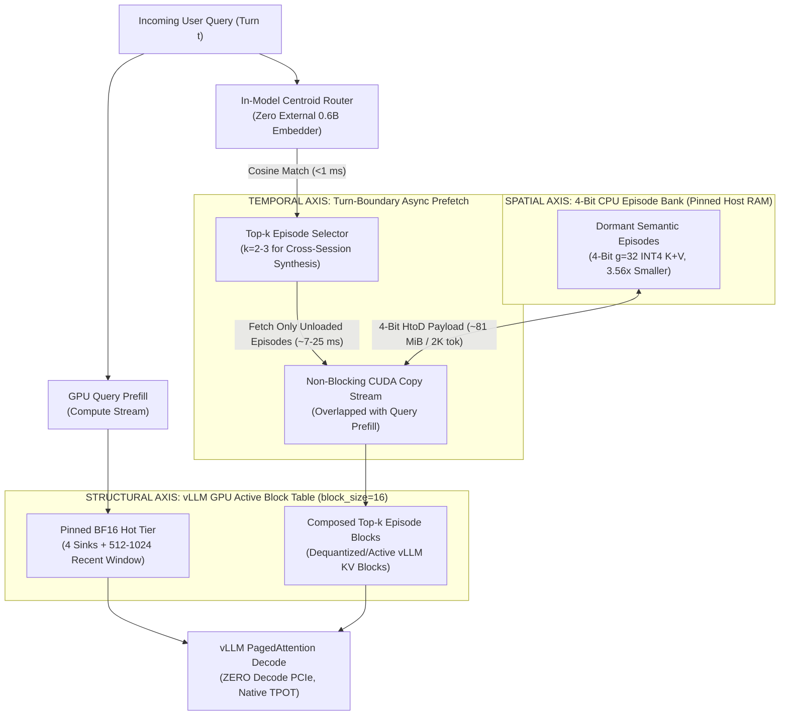
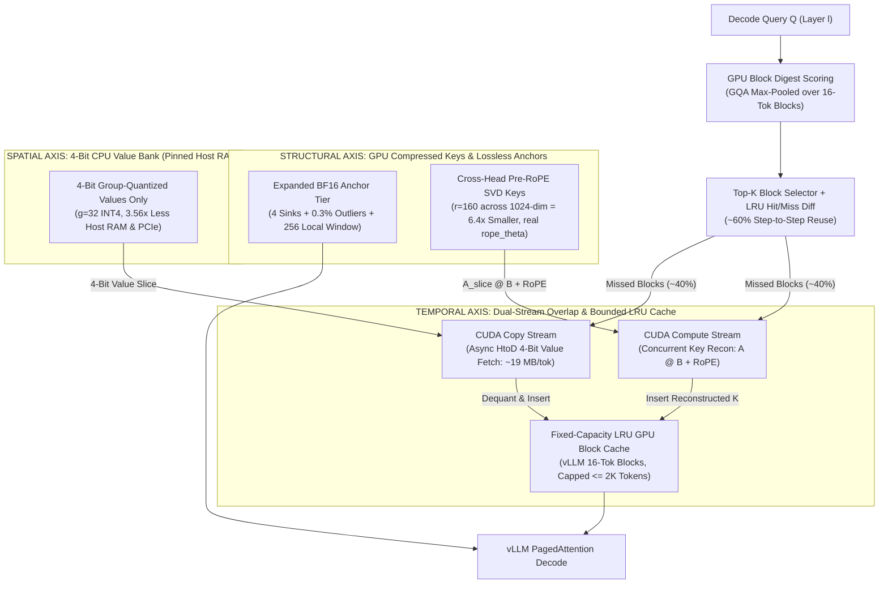

# Proposal: Two-Pole 3-Axis KV-Cache Co-Optimization (`EpiCache-3Axis` & `ShadowKV-Q4`) for WP-4

> **Prepared by:** Khemingkapat (`@khemingkapat`)  
> **Status:** Working Draft / Flexible Candidate Hypotheses *(pre-discussion with `@New-Sirawat`; knobs & assumptions intentionally kept open until WP-4 micro-benchmarking)*  
> **Empirical Anchor:** [`analysis/wp3/CONSOLIDATED_PATTERN_REPORT.md`](analysis/wp3/CONSOLIDATED_PATTERN_REPORT.md) (PR #21, `kv_bench@2a9338a`)  
> **Target Runtime & Model:** **vLLM** PagedAttention (`block_size = 16`, native vLLM baseline) on `Qwen/Qwen3-4B-Instruct-2507` ($L=36,\; H_Q=32,\; H_{KV}=8,\; D=128$, BF16 unmodified weights) under `16.0 GiB` RTX 4090 Slurm cap, with explicit scaling to `8.0 GiB` RTX 4060 / `16 GiB` Host RAM.  
> *(Note: PyTorch SDPA was used in WP-3 solely as a scientific control harness to replicate paper mechanisms not exposed in vLLM; WP-4/WP-6 implementation targets vLLM directly.)*

---

## Executive Summary: Why Two Opposite Poles?

Rather than committing early to a single untested architecture before running WP-4 micro-benchmarks, this proposal puts forward **two opposite-pole 3-axis co-optimization methods** spanning the consumer-GPU Pareto frontier:

1. **Method 1 — `EpiCache-3Axis` *(Latency-First Pole, Turn-Level Co-Design)*:**
   - **Core Bet:** Move all CPU↔GPU PCIe transfers to the **user-turn boundary** (once per query, overlapped with prompt prefill) by routing composable semantic episodes onto vLLM's 16-token blocks—achieving **`0 MB/tok` PCIe during autoregressive decode** and near-native vLLM TPOT.
2. **Method 2 — `ShadowKV-Q4` *(Quality-First Pole, Block-Level Co-Design)*:**
   - **Core Bet:** Keep **100% of 32K context searchable at every decode step** via cross-head pre-RoPE SVD Keys on GPU + a **4-bit quantized CPU Value bank** aligned to vLLM's 16-token blocks—preserving ShadowKV's near-BF16 LongMemEval accuracy (`~64%`) while fixing its `14.2 GiB` VRAM leak and slashing Host RAM & PCIe traffic by `3.56×`.

Both methods are **flexible hypotheses**: every precision level, budget split, and routing threshold is exposed as a tunable knob to be validated or falsified against explicit quantitative gates.

---

## Method 1 (Latency-First Pole): `EpiCache-3Axis`

### 1.1 Architectural Blueprint

### 1.2 What We Extend Beyond the Original EpiCache Paper (ICML '26)

In WP-3, our PyTorch `EpiCache` wrapper collapsed to `5.33%` (`8/150`) because `route_query_to_episode` was unimplemented and `evict_block_prefill` evicted the user's question and recent decode tokens. Beyond fixing those replication bugs, **`EpiCache-3Axis`** addresses **4 consumer-GPU blind spots of the original paper** ([`docs/literature_survey/techniques/epicache.md`](docs/literature_survey/techniques/epicache.md)):

| Original EpiCache Paper (ICML '26, A100) | Our 3-Axis Extension (`EpiCache-3Axis`) | Axis & Consumer-GPU Impact |
|---|---|---|
| **Uncompressed BF16/FP16 episodes** (`~0.30 s` swap stall on A100; `3.3+ GiB` RAM/user) | **4-Bit Group-Quantized (`g=32`) CPU Episode Bank** (`4.5 bits/scalar`) | **`STRUCTURAL` + `SPATIAL`:** Cuts Host RAM **3.56×** (essential for 10–15 concurrent users in WP-7) and slashes consumer PCIe swap time **3.56×** (`~81 MiB` for 2K tokens ≈ `7–10 ms`). |
| **Synchronous blocking swap** on topic shift | **Async CUDA Stream Prefetch** overlapped with query prefill | **`TEMPORAL`:** Hides the turn-boundary episode transfer behind query prompt processing. |
| **Monolithic Top-1 episode swap** (loads only 1 episode; struggles on cross-topic questions) | **Composable Top-$k$ (`k=2`) Episodes on vLLM 16-Token Blocks** + **Pinned BF16 Sink/Recent Window** | **`SPATIAL` + `STRUCTURAL`:** vLLM's block table composes blocks from multiple episodes seamlessly without copying monolithic caches—directly targeting `cross_session_reasoning`. |
| **Separate `0.6B` embedding model (`~1.2 GiB` VRAM)** + $E\times$ full offline prefill passes | **Single-Pass In-Model Centroid Routing** (mean-pooled mid-layer hidden states / Key centroids) | **`STRUCTURAL` + `TEMPORAL`:** Eliminates `~1.2 GiB` extra VRAM overhead and $E\times$ prefill cost on 8–16 GB GPUs. |

### 1.3 3-Axis Component Allocation (`EpiCache-3Axis`)

| Axis | Component | Role in `EpiCache-3Axis` | Source / Inspiration |
|---|---|---|---|
| **`STRUCTURAL`** | Pinned BF16 Hot Tier (`4` sinks + `512–1024` recent) | Guarantees syntactic stability & protects current user query/decode tokens (prevents WP-3 collapse) | `StreamingLLM` (`C1`) |
| **`STRUCTURAL`** | Group-Wise INT4 (`g=32`) + Optional Layer-Sensitivity Budget | Compresses dormant CPU episodes `3.56×`; optionally allocates more blocks to high-sensitivity layers | `QServe KV4` (`C2`) + `EpiCache` (`C1`) |
| **`SPATIAL`** | Pinned 4-Bit CPU Episode Bank + vLLM 16-Token Block Pool | Maps episodes directly onto vLLM physical KV blocks (`block_size=16`) with zero fragmentation | `FlexGen-KV` (`C1/C2`) + vLLM PagedAttention |
| **`TEMPORAL`** | Single-Pass Centroid Router + Prefill-Overlapped Async DMA | Routes once per turn (`<1 ms`), prefetches missing episode blocks asynchronously → **`0 MB/tok` decode PCIe** | New Co-Design (`EpiCache` + Async CUDA Stream) |

### 1.4 Flexible Knobs & Open Assumptions to Validate (`EpiCache-3Axis`)

- **Knob 1 — Episode Segmentation:** Natural conversation turn/session boundaries *vs.* fixed-size chunk K-Means (`E = 4, 8, 16`).
- **Knob 2 — Multi-Episode Composition ($k$):** `k = 1` *vs.* `k = 2` *vs.* cosine-similarity threshold (critical for `cross_session_reasoning`).
- **Knob 3 — Active GPU Budget:** Total active GPU tokens `M ∈ {2048, 3072, 4096}` (hot window + loaded episodes).
- **Knob 4 — Layer Sensitivity Allocation:** Uniform per-layer budget (vLLM-native) *vs.* offline cosine-calibrated sensitivity $s_\ell = 1 - \sigma_\ell$.
- **Primary Assumption to Test:** *Can Top-$k$ multi-episode routing + a BF16 recent window achieve $\ge 60\%$ on LongMemEval (`cross_session_reasoning` included) without per-token PCIe fetching?*

---

## Method 2 (Quality-First Pole): `ShadowKV-Q4`

### 2.1 Architectural Blueprint

### 2.2 What We Extend Beyond the Original ShadowKV Paper (A100 Server)

In WP-3, `ShadowKV` achieved the **highest LongMemEval accuracy (`96/150 = 64.0%`, only `3` regressions, `0` on 4/5 tasks)** and lowest offload PCIe (`67.2 MB/tok`), but suffered a fake `14.23 GiB` VRAM spike from two implementation bugs (`r=128` per-head SVD no-op + un-evicted `cached_sparse` cache). Beyond fixing those bugs, **`ShadowKV-Q4`** addresses **4 consumer-GPU & vLLM blind spots of the original paper** ([`docs/literature_survey/techniques/shadowkv.md`](docs/literature_survey/techniques/shadowkv.md)):

| Original ShadowKV Paper (A100 Server) | Our 3-Axis Extension (`ShadowKV-Q4`) | Axis & Consumer-GPU Impact |
|---|---|---|
| **Uncompressed BF16 CPU Values** (`5.3 GiB` Host RAM/user; assumes A100 PCIe Gen4 x16) | **4-Bit Group-Quantized (`g=32`) CPU Value Bank** *(with FP8/BF16 fallback knob)* | **`STRUCTURAL` + `SPATIAL`:** Cuts Host RAM **3.56×** (`~5.3 GiB → ~1.5 GiB` per 32K seq, vital for 16 GB RAM / multi-user) and cuts PCIe **3.56×** (`67 → ~19 MB/tok`), keeping dual-stream overlap balanced on slower consumer PCIe x8. |
| **`chunk_size = 8` custom non-paged buffers** (fragments vLLM `block_size = 16`) | **vLLM-Aligned 16-Token Block Mapping** *(16-tok block with 16-tok digest or paired `2×8` sub-landmarks)* | **`SPATIAL`:** Eliminates PagedAttention fragmentation so fetched blocks slot directly into vLLM's physical block table. |
| **Tiny `32`-token local window** + mean-only landmarks (`3/3` WP-3 regressions in `cross_session_reasoning`) | **Expanded BF16 Anchor Tier** (`4` sinks + `0.3%` outliers + **`256` local window**) + **Optional AABB/Landmark Hybrid** | **`STRUCTURAL`:** Protects multi-turn recent context in BF16 and prevents a single needle token inside a 16-token block from being washed out by mean-averaging. |
| **Exact online `torch.linalg.svd`** every prefill (adds TTFT on 4K–32K prompts) | **Fast Low-Rank Projection** *(randomized `svd_lowrank` or offline-calibrated shared basis $B$ for $O(1)$ projection)* | **`TEMPORAL`:** Reduces prefill SVD overhead while keeping `6.4×` cross-head (`r=160`) Key compression with Qwen3's real `rope_theta = 1,000,000`. |

### 2.3 3-Axis Component Allocation (`ShadowKV-Q4`)

| Axis | Component | Role in `ShadowKV-Q4` | Source / Inspiration |
|---|---|---|---|
| **`STRUCTURAL`** | Cross-Head Pre-RoPE SVD Keys (`r=160`, `1024 → 160`) + Expanded BF16 Anchors | Compresses all 32K Keys `6.4×` on GPU without quantization routing collapse; protects sinks, outliers & 256 local tokens | `ShadowKV` (`C1/C2`) |
| **`SPATIAL`** | 4-Bit Pinned CPU Value Bank + vLLM 16-Token Block Alignment | Keeps 100% of Values offloaded in `3.56×` smaller Host RAM (`~1.5 GiB` at 32K) and aligned to vLLM blocks | `ShadowKV` (`C3`) + `QServe/FlexGen` 4-bit packing |
| **`TEMPORAL`** | Bounded LRU GPU Block Cache + Dual-Stream Async Overlap + Fast SVD | Caps GPU working cache (`≤ 2,048` tokens, fixing `14.2 GiB` leak) and overlaps `~19 MB/tok` 4-bit `V` DMA with `A @ B + RoPE` | `ShadowKV` (`C3`) + New Co-Design |

### 2.4 Flexible Knobs & Open Assumptions to Validate (`ShadowKV-Q4`)

- **Knob 1 — CPU Value Precision:** `INT4 (g=32)` *vs.* `FP8` *vs.* `BF16` fallback (tests whether 4-bit Values preserve `ShadowKV`'s `≤ 3–4` regressions).
- **Knob 2 — Block Scoring Digest:** Paired `2×8` mean landmarks *vs.* 16-token AABB box digest (`c ± r_mean`).
- **Knob 3 — SVD Rank & Basis Mode:** `r ∈ {128, 160}` and exact `svd` *vs.* `svd_lowrank` *vs.* offline-calibrated shared $B$.
- **Knob 4 — Active LRU Budget & Local Anchor:** `topk_tokens ∈ {1024, 2048}` and `local_window ∈ {32, 256}`.
- **Primary Assumption to Test:** *Does 4-bit CPU Value quantization + `r=160` cross-head SVD keep LongMemEval $\ge 63\%$ (`≤ 4` regressions) while cutting 32K Net KV VRAM to $\le 1.8\text{ GiB}$ and PCIe to $\le 25\text{ MB/tok}$?*

---

## Side-by-Side Comparison & Quantitative Falsification Gates

| Metric / Dimension | PyTorch BF16 Baseline *(WP-3 Ref)* | Method 1: **`EpiCache-3Axis`** *(Latency-First Pole)* | Method 2: **`ShadowKV-Q4`** *(Quality-First Pole)* |
|---|---|---|---|
| **Primary Optimization Pole** | Reference (Uncompressed) | **Decode Latency (TPOT) & Multi-User Scale** | **Long-Context Recall & Fidelity** |
| **Granularity & Cadence** | Full dense attention | **Episode-level** (routed once per user turn) | **16-tok Block-level** (scored every decode step) |
| **LongMemEval Target (150q)** | `99/150` (`66.0%`) | **`≥ 90/150` (`≥ 60.0%`)** *(Falsified if `< 87/150`)* | **`≥ 94/150` (`≥ 62.7%`)** *(Falsified if `< 91/150`)* |
| **Quality Regressions** | `0` | **`≤ 10`** *(Falsified if `> 13`)* | **`≤ 4`** *(Falsified if `> 7`)* |
| **NIAH Exact Match (2K / 4K)** | `100% / 100%` | **`100% / 100%`** | **`100% / 100%`** |
| **32K Net KV+Aux VRAM** | `5,486 MiB` | **`≤ 1,300 MiB`** *(Falsified if `> 1,600 MiB`)* | **`≤ 1,800 MiB`** *(Falsified if `> 2,200 MiB`)* |
| **32K Decode TPOT** | `29.17 ms` *(PyTorch)* | **Near-native vLLM** *(≤ 1.15× native vLLM baseline)* | **≤ 1.5–1.8× native vLLM** *(~2× faster than WP-3 ShadowKV)* |
| **32K Decode PCIe Traffic** | `0 MB/tok` | **`0 MB/tok` during decode** *(turn-switch burst `≤ 100 MiB`)* | **`≤ 25 MB/tok`** *(Falsified if `> 40 MB/tok`)* |
| **32K Host DRAM RSS Δ** | `1,082 MiB` | **`≤ 2,500 MiB`** *(4-bit episodes)* | **`≤ 3,500 MiB`** *(4-bit Values only)* |

---

## Discussion Notes for Team Alignment (with `@New-Sirawat`)

When comparing **Khem's 2 Poles (`EpiCache-3Axis`, `ShadowKV-Q4`)** against **Sirawat's `TriCache`** (`PROPOSAL_WP4_TRI_AXIS_CO_OPTIMIZATION.md`):

1. **Clean 3-Way Architectural Coverage (Zero Redundancy):**
   - **`EpiCache-3Axis` (Khem — Coarse / Turn-Level):** Zero decode PCIe, fastest TPOT, tests whether turn-level Top-$k$ semantic routing suffices for multi-session chat.
   - **`TriCache` (Sirawat — Mid / Page-Level AABB):** Per-token AABB page recall over 4-bit CPU K+V pages, balanced latency/recall without SVD prefill.
   - **`ShadowKV-Q4` (Khem — Fine / Block-Level SVD + Value-Only Offload):** Keeps compressed Keys on GPU for highest recall (`~64%`), offloads only 4-bit Values.
2. **Maximum Code Reuse Across All Candidates:**
   - Regardless of which 1–2 methods advance to WP-6/WP-7, **~70% of the engineering infrastructure is shared**: (a) vLLM 16-token block pool integration, (b) `g=32` INT4 group quantizer/dequantizer, (c) pinned CPU pool + async CUDA copy stream, and (d) BF16 Sink + Recent Window hot tier.
3. **Next Step Before Locking Any Spec:**
   - Use our WP-3 bug-fix runs (`t9` ShadowKV, `t10` HeadQ, `t11` ArkVale, `t12` QServe, `t13` TurboQuant + fixed EpiCache) to validate the core assumptions before committing to final WP-4 hyperparameters.
