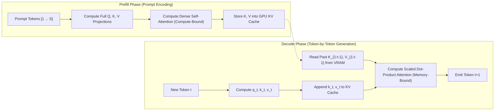
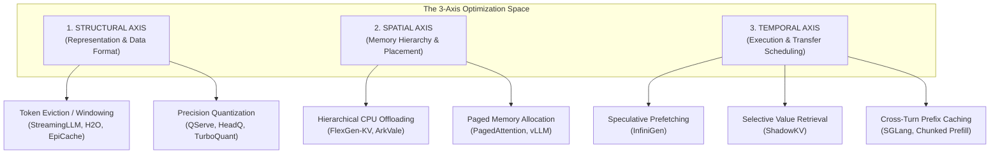
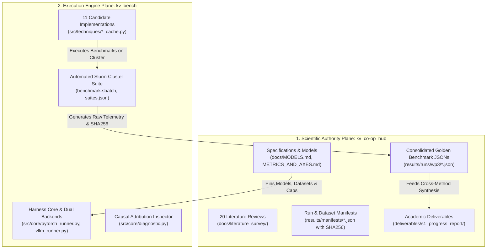
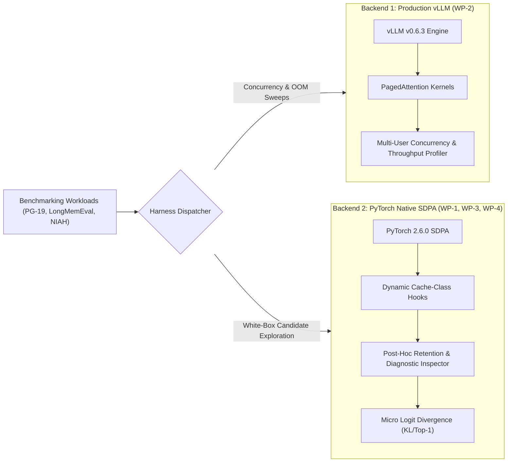
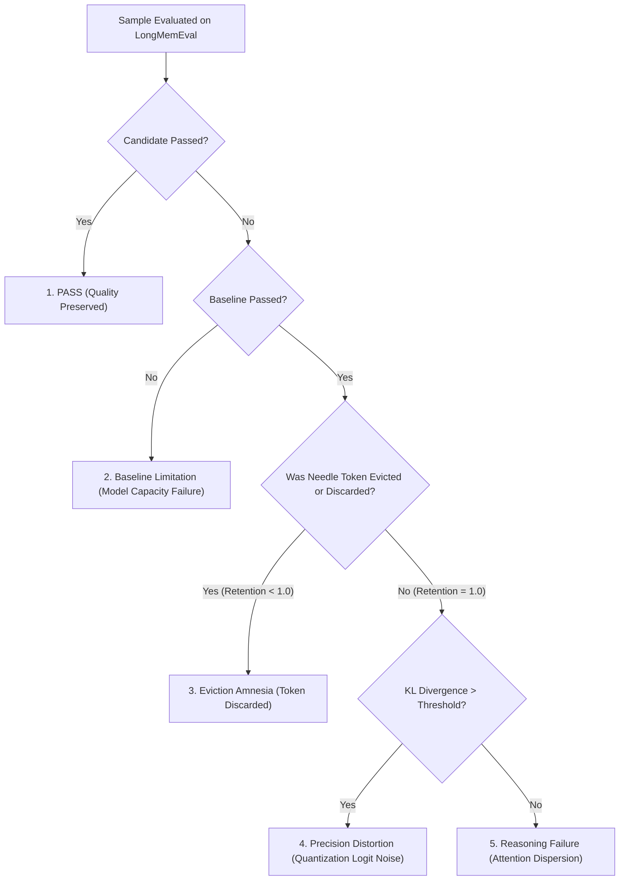
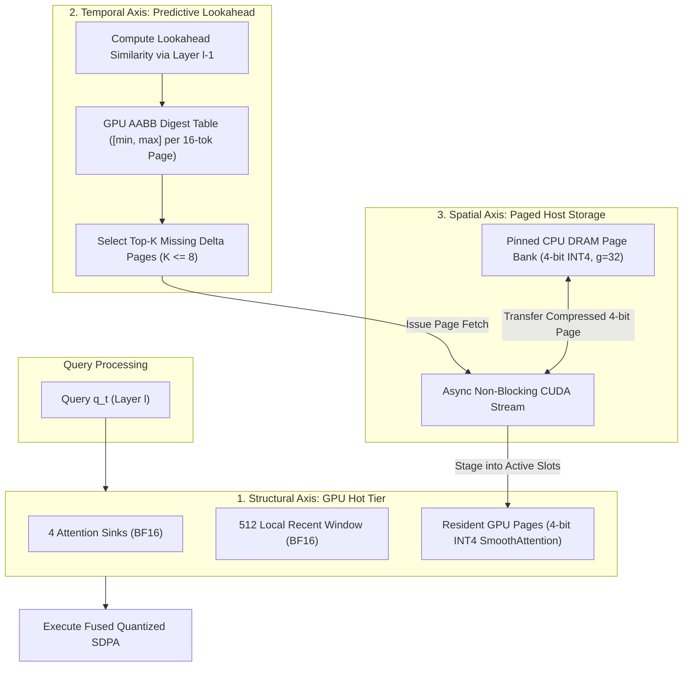

# Computer Engineering Senior Project Progress Report (Semester 1)
## Bachelor of Engineering in Computer Engineering · Academic Year 2026–2027 (B.E. 2568–2569)
### Department of Computer Engineering, Faculty of Engineering
### King Mongkut's University of Technology Thonburi (KMUTT)

---

# Co-Optimization of Key-Value Cache Management for Large Language Model Inference on Consumer GPUs

**Project Code:** CPE401 Senior Project I  
**Credits:** 3 Credits  

**Project Members:**
1. Sirawat Laoprom (Student ID: `65070501052`, Email: `siwarat.laop@kmutt.ac.th`)
2. Khemingkapat Dechaboot (Student ID: `65070501004`, Email: `khemingkapat.dech@kmutt.ac.th`)
3. Project Team Member 3 (Student ID: `[TBD]`, Email: `[TBD]`)
4. Project Team Member 4 (Student ID: `[TBD]`, Email: `[TBD]`)

**Project Advisors:**
- Dr. Aye Hninn Khine, Ph.D. — *Project Advisor*
- Dr. Boonyarit Changaival, Ph.D. — *Project Co-Advisor*

**Project Examination Committee:**
- ........................................................... *Committee Chairperson* (`[TBD]`)
- ........................................................... *Committee Member* (`[TBD]`)
- ........................................................... *Project Advisor* (Dr. Aye Hninn Khine, Ph.D.)
- ........................................................... *Project Co-Advisor* (Dr. Boonyarit Changaival, Ph.D.)

---

## ABSTRACT

The exponential adoption of long-context Large Language Models (LLMs) across consumer workstations, local private gateways, and edge enterprise nodes has exacerbated a severe hardware bottleneck: the **Key-Value (KV) Cache Memory Wall**. While initial prefill operations remain compute-bound, autoregressive token generation (the decode phase) is strictly memory-bandwidth bound ($< 1\text{ FLOP/byte}$). Under standard 16-bit floating-point (BF16) representation, the KV cache scales linearly ($O(S_{\text{context}} \times N)$) with prompt length $S$ and concurrent sessions $N$. On standard consumer hardware—such as an NVIDIA GeForce RTX 4090 ($24\text{ GB}$, capped at $16.0\text{ GiB}$ for container stability) or RTX 4060 ($8.0\text{ GB}$)—a state-of-the-art dense Grouped-Query Attention (GQA) model (`Qwen3-4B-Instruct-2507`, weights $\approx 8.06\text{ GB}$, KV footprint $= 144\text{ KiB/token}$) allocates $4.50\text{ GB}$ of VRAM for a single $32\text{K}$ context. Serving ten concurrent SME users at $32\text{K}$ context requires $45.0\text{ GB}$ of KV cache alone, precipitating immediate Out-of-Memory (CUDA OOM) failures.

Existing optimizations tackle this memory wall along isolated dimensions with severe, unaddressed trade-offs:
1. *Structural Eviction* (e.g., StreamingLLM, H2O, EpiCache) achieves high decode throughput ($20.95\text{ ms/tok}$) but causes unrecoverable factual amnesia (dropping 4K Needle-In-A-Haystack retrieval to $40\%$ and failing multi-hop reasoning);
2. *Structural Quantization* (e.g., QServe KV4, TurboQuant, HeadQ) reduces representation size ($4.50\text{ b/scalar}$ INT4) but suffers from high software dequantization overhead in native PyTorch ($2.05\times$ latency penalty) and logit distortion;
3. *Spatial Offloading & Temporal Prefetching* (e.g., FlexGen-KV, ArkVale, ShadowKV, InfiniGen) retain complete context in CPU host DRAM, but saturate the host-to-device PCIe bus ($> 1,600\text{ MB/token}$), incurring $3\times\text{--}8\times$ decode latency slowdowns or inflating VRAM via unamortized auxiliary buffers.

This Senior Project presents a principled, empirical investigation into **3-Axis KV-Cache Co-Optimization**, systematically coordinating **Structural Compression** (sparsity and quantization), **Spatial Placement** (hierarchical GPU/CPU memory tiering), and **Temporal Scheduling** (predictive prefetching and compute-copy overlap). In Semester 1, our research achieved three major milestones: (1) characterized multi-user concurrency and context scaling ceilings via native vLLM profilers (`WP-2`); (2) built a unified, white-box PyTorch Native SDPA diagnostic testbed and empirically reproduced all 11 published candidate techniques across 512–32,768 context sweeps and 150 quantile-sampled LongMemEval questions (`WP-1`, `WP-3`); and (3) performed white-box component synthesis isolating implementation wrapper bugs from intrinsic algorithmic merits. Drawing upon these empirical findings, we propose **`TriCache`**, an integrated 3-axis architecture combining a GPU-resident BF16 hot window, an AABB geometric digest recall index, and a 4-bit INT4 paged CPU host storage tier that reduces PCIe traffic by over $13\times$ ($< 120\text{ MB/tok}$) while capping 32K context VRAM below $9.35\text{ GiB}$.

**Keywords:** Key-Value Cache Management, Large Language Model Inference, Consumer GPUs, 3-Axis Co-Optimization, Grouped-Query Attention, Long-Context Memory Adherence, Paged Attention.

---

## TABLE OF CONTENTS

```
TABLE OF CONTENTS ............................................................................ iii
LIST OF TABLES ................................................................................ vi
LIST OF FIGURES ............................................................................... vii
LIST OF ABBREVIATIONS ......................................................................... viii

CHAPTER 1: INTRODUCTION ........................................................................ 1
  1.1 Project Introduction & Problem Statement ................................................. 1
      1.1.1 Problem Statement & Background ..................................................... 1
      1.1.2 Research Questions & Objectives .................................................... 3
      1.1.3 Scope of the Project ............................................................... 5
  1.2 Project Timeline & Management ............................................................ 6
      1.2.1 Work Breakdown Structure (WBS) ..................................................... 6
      1.2.2 Project Gantt Chart (Semester 1 & 2) ................................................ 7
      1.2.3 Milestone Deliverables ............................................................. 9
      1.2.4 Team Workload & Ownership Matrix ................................................... 10
      1.2.5 Risk Assessment & Mitigation Strategies ............................................ 11

CHAPTER 2: RELATED WORKS & THEORETICAL BACKGROUND ............................................. 13
  2.1 Evolution of Transformer Attention & The KV-Cache Bottleneck ............................. 13
  2.2 Core Theory & Mathematical Foundations ................................................... 15
      2.2.1 Autoregressive Decoding vs. Prefill Dynamics ....................................... 15
      2.2.2 Memory-Bandwidth Bound & Arithmetic Intensity ...................................... 16
      2.2.3 Multi-Head Attention vs. Grouped-Query Attention (GQA) ............................. 17
  2.3 Development Tools, Languages, and Infrastructures ........................................ 18
  2.4 Single-Axis Taxonomy of KV-Cache Optimization ............................................ 19
      2.4.1 Structural Axis: Token Eviction vs. Precision Quantization .......................... 19
      2.4.2 Spatial Axis: Hierarchical Memory Tiering & CPU Swapping ........................... 22
      2.4.3 Temporal Axis: Asynchronous Prefetching & Prefix Reuse ............................. 24
  2.5 Long-Context Benchmarks & The Two Primary Quality Pillars ................................ 25
      2.5.1 Micro-Level Logit Divergence (KL Divergence & Top-1 Agreement) ..................... 25
      2.5.2 Macro-Level LongMemEval: 5 Core Conversational Capabilities ........................ 26
      2.5.3 2D Needle-In-A-Haystack (NIAH) Diagnostic Matrix ................................... 27
      2.5.4 Why Perplexity Averaging Fails in Long-Context Evaluation ........................... 28
  2.6 Challenges, Limitations, and The Co-Optimization Gap ...................................... 29
  2.7 Design Rationale: Addressing Limitations via 3-Axis Co-Design ............................ 30

CHAPTER 3: METHODOLOGY AND DESIGN ............................................................. 32
  3.1 System Architecture & Two-Tier Repository Workflow ....................................... 32
  3.2 Dual-Backend Harness Design .............................................................. 34
      3.2.1 Production vLLM Engine (WP-2 Baseline Profiling) ................................... 34
      3.2.2 Unified PyTorch Native SDPA Diagnostic Engine (WP-1, WP-3, WP-4) .................. 35
  3.3 Hardware Budget & Controlled Model Checkpoints ........................................... 36
      3.3.1 Cluster & Local Consumer GPU Budgets ............................................... 36
      3.3.2 Pinned Model Suite: Pure Dense GQA vs. Architectural Hybrid ........................ 37
  3.4 Evaluation Plan & Metric Formulations .................................................... 38
      3.4.1 Computational & Memory Efficiency Metrics .......................................... 38
      3.4.2 Quality Assurance & Fidelity Metrics ............................................... 40
  3.5 Standardized Evaluation Datasets & Synthetic Sweeps ...................................... 42

CHAPTER 4: ALGORITHMS AND SYSTEM IMPLEMENTATION ............................................... 44
  4.1 System Architecture Overview ............................................................. 44
  4.2 Metric & Diagnostic Instrumentation ...................................................... 45
      4.2.1 Causal Attribution Tree & Error Decomposition ...................................... 45
      4.2.2 Post-Hoc Layer Retention Inspector ................................................. 47
  4.3 Candidate Algorithmic Formulations (11 Evaluated Methods) ................................ 48
  4.4 Proposed Co-Optimization Engine: Tri-Axis Paged KV Co-Optimization (`TriCache`) .......... 53
      4.4.1 Subsystem 1 (Structural): BF16 Hot Tier + 4-Bit INT4 SmoothQuant .................... 53
      4.4.2 Subsystem 2 (Spatial): Paged CPU Storage with Grouped Quantization ................. 55
      4.4.3 Subsystem 3 (Temporal): Vectorized AABB Digest with Async Delta Streaming .......... 56
      4.4.4 Complete Algorithm Pseudocode ...................................................... 58
  4.5 Quantitative Falsification Gates & Micro-benchmarking Plan ............................... 59
  4.6 Experimental Setup and Hyperparameter Configurations ..................................... 61

CHAPTER 5: PRELIMINARY RESULTS AND DISCUSSION ................................................. 63
  5.1 Semester 1 Completion Status & Milestones ................................................ 63
  5.2 Empirical Results & Master Benchmarking Synthesis ........................................ 64
      5.2.1 WP-2 Hardware Profiling & VRAM Scaling Cliff ....................................... 64
      5.2.2 Master 12-Entry Telemetry & 150-Question LongMemEval Synthesis .................... 66
      5.2.3 The 3-Axis Trade-Off Trilemma ...................................................... 69
  5.3 White-Box Failure & Attribution Analysis ................................................. 71
      5.3.1 Disentangling Implementation Bugs from Intrinsic Merits ............................ 71
      5.3.2 5-Capability LongMemEval Failure Signatures ........................................ 73
  5.4 Follow-Up & Semester 2 Transition ........................................................ 75
      5.4.1 Immediate Pre-Defense Action Plan .................................................. 75
      5.4.2 Semester 2 Work Packages & Technical Roadmap (WP-6 to WP-9) ........................ 76

REFERENCES ................................................................................... 79
APPENDIX A: LongMemEval 150-Question Sample Breakdown & Evaluation Protocol ................... 84
APPENDIX B: Full Slurm Hardware Metric Sweeps (512–32,768 Tokens) ............................. 86
APPENDIX C: Provenance Manifest Directory & Checksums ......................................... 89
```

---

## LIST OF TABLES

- **Table 1.1:** Theoretical BF16 Model Weight and KV-Cache Memory Footprint Scaling Matrix.
- **Table 1.2:** Comprehensive Work Breakdown Structure (WBS) across Semester 1 and Semester 2 (WP-1 to WP-9).
- **Table 1.3:** Team Workload Allocation, Core Responsibilities, and Technical Ownership Matrix.
- **Table 1.4:** Risk Assessment, Technical Failure Modes, and Defensive Mitigation Strategies.
- **Table 2.1:** Architectural Specifications and KV Cache Rates of Representative Open-Weight LLMs.
- **Table 2.2:** Systematic Comparative Survey of 11 Published Single-Axis KV-Cache Optimization Techniques.
- **Table 2.3:** Categorization of the 5 Core Memory Capabilities within LongMemEval.
- **Table 3.1:** Hardware Budget, Memory Allocation Caps, and Cluster Node Configurations.
- **Table 3.2:** Controlled Model Suite with Exact HuggingFace Commit SHAs and GQA Specifications.
- **Table 4.1:** Mathematical Formulations, Codec Rules, and Placement Policies for the 11 WP-3 Techniques.
- **Table 4.2:** 3-Axis Subsystem Component Mapping for the Proposed `TriCache` Engine.
- **Table 4.3:** Quantitative Falsification Gates and Falsification Thresholds for `TriCache`.
- **Table 5.1:** Semester 1 Work Package Completion and Artifact Verification Summary.
- **Table 5.2:** Master 12-Entry Telemetry & LongMemEval 150-Question Benchmark Synthesis Matrix.
- **Table 5.3:** 5-Capability LongMemEval Semantic Accuracy and Regression Breakdown across 150 Questions.
- **Table 5.4:** Immediate Action Plan and Semester 2 Transition Roadmap.

---

## LIST OF FIGURES

- **Figure 1.1:** Master Project Gantt Chart covering Semester 1 (Phases 1–3) and Semester 2 (Phases 4–6).
- **Figure 2.1:** The Transformer Autoregressive Generation Loop and the Linear KV-Cache Memory Accumulation.
- **Figure 2.2:** The 3-Axis Trade-Off Space: Structural Compression, Spatial Placement, and Temporal Scheduling.
- **Figure 3.1:** Two-Tier Multi-Repository Workflow (`kv_co-op_hub` coordination vs. `kv_bench` execution engine).
- **Figure 3.2:** Dual-Backend Harness Architecture (vLLM Production vs. PyTorch Native SDPA Diagnostic Engine).
- **Figure 4.1:** Causal Attribution Decision Tree for Post-Hoc Error Diagnostics.
- **Figure 4.2:** Detailed Architectural Pipeline and Memory Flow of the Proposed `TriCache` Engine.
- **Figure 5.1:** VRAM Scaling Cliff and Multi-User Concurrency Saturation Curves on 16.0 GiB GPU (`WP-2`).
- **Figure 5.2:** Latency-Throughput Roofline and PCIe Bus Saturation under Scaling Batch Sizes (`WP-2`).
- **Figure 5.3:** WP-3 Pareto Frontier: Peak Allocated VRAM vs. Macro LongMemEval Pass Rate at 32K Context.
- **Figure 5.4:** 32K Decode Latency (TPOT Mean) Overview across All 11 Candidate Techniques.
- **Figure 5.5:** 2D Needle-In-A-Haystack (NIAH) Retrieval Heatmaps across Context Lengths and Depths.

---

## LIST OF ABBREVIATIONS

| Abbreviation | Definition |
| :--- | :--- |
| **AABB** | Axis-Aligned Bounding Box |
| **BF16** | Brain Floating Point (16-bit) |
| **CUDA** | Compute Unified Device Architecture |
| **DRAM** | Dynamic Random-Access Memory |
| **FIFO** | First-In, First-Out |
| **FLOP** | Floating-Point Operation |
| **FWHT** | Fast Walsh-Hadamard Transform |
| **GQA** | Grouped-Query Attention |
| **HBM** | High Bandwidth Memory |
| **HF** | Hugging Face |
| **INT4 / INT8** | 4-bit / 8-bit Integer Quantization |
| **KL** | Kullback-Leibler (Divergence) |
| **KMUTT** | King Mongkut's University of Technology Thonburi |
| **KV** | Key-Value (Cache) |
| **LLM** | Large Language Model |
| **LRU** | Least Recently Used |
| **MHA** | Multi-Head Attention |
| **MQA** | Multi-Query Attention |
| **NIAH** | Needle-In-A-Haystack |
| **NVLink** | Nvidia High-Speed Interconnect Protocol |
| **OOM** | Out-of-Memory |
| **PCIe** | Peripheral Component Interconnect Express |
| **PPL** | Perplexity |
| **QJL** | Quantized Johnson-Lindenstrauss (Transform) |
| **RAG** | Retrieval-Augmented Generation |
| **RoPE** | Rotary Position Embedding |
| **RSS** | Resident Set Size |
| **SDPA** | Scaled Dot-Product Attention |
| **SME** | Small and Medium-sized Enterprises |
| **SVD** | Singular Value Decomposition |
| **SWA** | Sliding Window Attention |
| **TPOT** | Time Per Output Token |
| **TTFT** | Time To First Token |
| **VRAM** | Video Random-Access Memory |
| **WBS** | Work Breakdown Structure |
| **WP** | Work Package |

---

# CHAPTER 1: INTRODUCTION

## 1.1 Project Introduction & Problem Statement

### 1.1.1 Problem Statement & Background

Autoregressive Large Language Models (LLMs)—spanning foundational architectures such as Llama, Qwen, Mistral, and Gemma—have established unprecedented capabilities across technical problem-solving, multi-turn dialogue, codebase reasoning, and long-document analysis. To deliver contextual utility in production, these systems rely upon prompt context windows scaling from $8\text{K}$ to $32\text{K}$, $64\text{K}$, and $128\text{K}$ tokens. However, democratizing these capabilities on local consumer GPUs (e.g., NVIDIA GeForce RTX 4090 with $24\text{ GB}$ VRAM, capped at $16.0\text{ GiB}$ under containerized shared cluster environments, or RTX 4060 with $8.0\text{ GB}$ VRAM) remains severely impeded by an acute, fundamental physical bottleneck: the **Key-Value (KV) Cache Memory Wall**.

In standard autoregressive generation, self-attention requires projecting every input and generated token into Query ($Q$), Key ($K$), and Value ($V$) tensors. To avoid recomputing past key and value projections at every generation step, inference engines cache the past $K$ and $V$ activation states in high-speed GPU Video RAM (VRAM). While the initial prompt processing (the prefill phase) is highly parallelized and compute-bound (saturating GPU tensor cores), subsequent autoregressive generation (the decode phase) proceeds strictly token-by-token. In this phase, arithmetic intensity collapses to less than $1.0\text{ FLOP/byte}$, rendering execution strictly **memory-bandwidth bound**.

#### The Linear KV-Cache Memory Wall ($O(S_{\text{context}} \times N)$)
For a transformer model operating under 16-bit precision (BF16 or FP16), the memory consumed by the KV cache scales linearly with context length $S_{\text{context}}$ and the number of concurrent generation sessions $N$:

$$\text{Memory}_{\text{KV}} = 2 \times L \times H_{\text{KV}} \times D \times \text{sizeof(dtype)} \times S_{\text{context}} \times N$$

where $L$ denotes the number of transformer layers, $H_{\text{KV}}$ represents the number of Key-Value attention heads, $D$ is the per-head hidden dimension ($D = H_{\text{dim}} / H_Q$), and $\text{sizeof(dtype)} = 2\text{ bytes}$ for BF16. 

To anchor this constraint to representative consumer workloads, we evaluate `Qwen/Qwen3-4B-Instruct-2507`, a modern, highly optimized open-weight dense architecture featuring $L=36$ layers, $H_Q=32$ query heads, $H_{\text{KV}}=8$ key-value heads (Grouped-Query Attention), and $D=128$. Its static model weights in BF16 occupy $8.06\text{ GB}$ ($7,688\text{ MiB}$). The KV cache memory accumulation rate is exactly:

$$\text{KV Rate} = 2 \times 36 \times 8 \times 128 \times 2 = 147,456\text{ bytes/token} = 144.0\text{ KiB/token}$$

As detailed in Table 1.1, while a short context ($2\text{K}$ tokens) incurs an unassuming $288\text{ MB}$ of KV cache, scaling to $32\text{K}$ tokens requires $4.50\text{ GB}$ ($4,608\text{ MiB}$) of KV cache for a **single** user session. When deploying an on-premise inference gateway for an SME, laboratory, or development team serving $N=10$ concurrent streams at $32\text{K}$ context, the KV cache alone demands **$45.0\text{ GB}$ of VRAM**. Added to static weights, this requires over $53\text{ GB}$ of VRAM, triggering catastrophic, immediate CUDA Out-of-Memory (OOM) aborts on any consumer hardware.

---

**Table 1.1: Theoretical BF16 Model Weight and KV-Cache Memory Footprint Scaling Matrix.**
*(Static weights: 4B = $8.06\text{ GB}$, 1.7B = $3.48\text{ GB}$, 8B = $16.04\text{ GB}$. Highlighted cells indicate immediate CUDA OOM under respective consumer GPU ceilings).*

| Model Architecture | Params / Dtype | KV Rate (KiB/tok) | 1 Session @ 2K | 1 Session @ 8K | 1 Session @ 32K | 5 Sessions @ 32K | 10 Sessions @ 32K |
| :--- | :---: | :---: | :---: | :---: | :---: | :---: | :---: |
| **Qwen3-1.7B** ($L=28, H_{\text{KV}}=8, D=128$) | 1.7B / BF16 | $112.0$ | $0.22\text{ GB}$ | $0.88\text{ GB}$ | $3.50\text{ GB}$ | $17.50\text{ GB}$ *(OOM 8/16G)* | $35.00\text{ GB}$ *(OOM 8/16G)* |
| **Qwen3-4B-Instruct-2507** ($L=36, H_{\text{KV}}=8, D=128$) | 4.0B / BF16 | $144.0$ | $0.28\text{ GB}$ | $1.13\text{ GB}$ | $4.50\text{ GB}$ | $22.50\text{ GB}$ *(OOM 16G)* | $45.00\text{ GB}$ *(OOM 16G)* |
| **Llama-3.1-8B** ($L=32, H_{\text{KV}}=8, D=128$) | 8.0B / BF16 | $128.0$ | $0.25\text{ GB}$ | $1.00\text{ GB}$ | $4.00\text{ GB}$ | $20.00\text{ GB}$ *(OOM 16G)* | $40.00\text{ GB}$ *(OOM 16G)* |

---

#### The Bandwidth Wall & The Failure of Isolated Mitigations
To prevent OOM, researchers have proposed numerous single-axis optimizations. However, as demonstrated by our empirical investigations in Semester 1, isolated techniques fail under the strict latency and accuracy demands of consumer hardware:

1. **The Structural Eviction Trap (Amnesia):** Methods like StreamingLLM, H2O, and EpiCache bound VRAM by discarding tokens based on recency or accumulated attention. However, when evaluated across realistic conversational workloads requiring multi-session reasoning, factual retention collapses. Evicting intermediate tokens reduces memory but permanently destroys non-local needle retrieval ($4\text{K}$ NIAH accuracy drops to $40\%$ in StreamingLLM and $0\%$ in EpiCache).
2. **The Structural Quantization Trap (Kernel & Software Divergence):** Compressing $K$ and $V$ tensors to low-bit integers (e.g., INT4 in QServe, 2-bit in HeadQ, or Lloyd-Max in TurboQuant) preserves token presence. However, in consumer PyTorch environments lacking fused sub-byte GEMM kernels, dequantizing full sequences back to BF16 prior to attention calculation inflates decode latency ($59.9\text{ ms/tok}$ in QServe vs. $29.2\text{ ms/tok}$ in baseline; $864.1\text{ ms/tok}$ in TurboQuant), while uncentered 2-bit grids (HeadQ) destroy attention routing entirely ($0/150$ task pass rate).
3. **The Spatial Offloading Trap (PCIe Bandwidth Thrashing):** Offloading KV pages to CPU host DRAM (FlexGen-KV, ArkVale) expands physical capacity. However, the host-to-device PCIe bus (Gen4 x16 theoretical peak: $31.5\text{ GB/s}$, empirical: $\approx 22\text{ GB/s}$) is over an order of magnitude slower than on-chip GPU VRAM bandwidth (RTX 4090: $1,008\text{ GB/s}$; RTX 4060: $272\text{ GB/s}$). Streaming full sequence caches across PCIe on every generation step consumes $> 1,600\text{ MB/token}$, creating severe compute stall bubbles ($229.6\text{ ms/tok}$ TPOT).
4. **The Temporal Prefetching Trap (Auxiliary Buffer Bloat):** Speculative prefetching (InfiniGen) and selective value fetching (ShadowKV) attempt to overlap transfers. However, maintaining auxiliary key proxies, landmark indices, and duplicate CPU/GPU buffers introduces fixed overhead that does not amortize on smaller 4B models, paradoxically increasing peak allocated VRAM beyond the dense baseline ($14,233\text{ MiB}$ in ShadowKV vs. $13,225\text{ MiB}$ baseline).

#### The Co-Optimization Opportunity
These empirical realities reveal that **no single optimization axis can conquer the KV-cache bottleneck alone**. Structural compression is required to shrink the data payload, spatial tiering is necessary to expand capacity into inexpensive host RAM, and temporal scheduling is critical to overlap transfers and hide PCIe latency. Therefore, a unified, cross-layer framework that **co-optimizes** structural format, spatial placement, and temporal data movement represents the vital, unaddressed research gap.

---

### 1.1.2 Research Questions & Objectives

To resolve this co-optimization gap, this Senior Project investigates three fundamental research questions:

- **RQ1 (Bottleneck Characterization):** *Where do memory capacity ceilings, tail latency spikes (P95/P99), and PCIe transfer bottlenecks manifest when serving unmodified long-context LLMs across varying concurrency levels on 8–16 GB consumer GPUs?*
- **RQ2 (Single-Axis Failure Attribution):** *How do isolated structural, spatial, and temporal KV-cache techniques trade VRAM savings and decode speed against logit fidelity and macro conversational memory adherence, and what fraction of observed degradation stems from algorithmic limits versus implementation wrapper artifacts?*
- **RQ3 (3-Axis Co-Optimization):** *Can a unified co-optimization engine—jointly coordinating hot-window preservation, sub-byte group quantization, paged CPU host storage, and predictive lookahead prefetching—achieve Pareto dominance over isolated baselines without incurring prohibitive CPU or PCIe transfer overhead?*

In direct alignment with these research questions, the project defines three primary engineering and scientific objectives:

1. **Objective 1: Comprehensive Bottleneck Profiling (`WP-1`, `WP-2`):** Empirically profile the VRAM OOM cliff, Time-to-First-Token (TTFT), Time-Per-Output-Token (TPOT) tail latency, host DRAM RSS drift, and PCIe bus transfer saturation on 8 GB and 16 GB consumer GPUs using production-grade vLLM and PyTorch backends across contexts scaling from 512 to 32,768 tokens and concurrency up to 15 streams.
2. **Objective 2: Systematic Candidate Benchmarking & White-Box Synthesis (`WP-3`, `WP-4`):** Reproduce and benchmark 11 representative single-axis KV-cache optimization techniques under a standardized, white-box PyTorch Native SDPA harness; establish an empirical taxonomy and diagnostic inspector; and design a modular 3-axis co-optimization policy engine (`TriCache`) that coordinates structural, spatial, and temporal policies.
3. **Objective 3: Rigorous End-to-End Evaluation & Reproducible Artifact Release (`WP-6`, `WP-7`, `WP-8`, `WP-9`):** Implement the co-optimized runtime engine, micro-benchmark its performance against isolated state-of-the-art baselines across consumer hardware tiers, evaluate quality preservation via the Two Primary Quality Pillars (Micro Logit Divergence and Macro LongMemEval), and release fully audited, open-source code and data manifests.

---

### 1.1.3 Scope of the Project

To maintain rigorous scientific focus and ensure high-impact deliverables within the two-semester timeline, the project establishes explicit scope boundaries:

1. **Hardware Scope:**
   - **Cluster Tier (Primary Consumer Ceiling):** NVIDIA GeForce RTX 4090 ($24\text{ GB}$ physical VRAM) deployed on the KMUTT CPE Slurm cluster, strictly enforcing a process allocator cap of **$16.00\text{ GiB}$** (`--max-vram-gb 16.0`, `cap_fraction = 0.680`) to emulate high-end consumer workstation constraints.
   - **Local Tier (Edge Consumer Ceiling):** Standalone desktop testbed equipped with an NVIDIA GeForce RTX 4060 ($8.00\text{ GiB}$ physical VRAM, PCIe Gen4 x8), evaluating extreme consumer deployment.
2. **Model Scope:**
   - Evaluated models are strictly pinned to exact HuggingFace revision commit SHAs to guarantee mathematical reproducibility.
   - **Primary Evaluated Architecture:** `Qwen/Qwen3-4B-Instruct-2507` (Revision `cdbee75f`, 36 layers, 8 KV heads, 32 Q heads, $D=128$, Pure Dense GQA, BF16 unmodified weights).
   - **Local 8 GB Target Architecture:** `Qwen/Qwen3-1.7B` (Revision `e0114e38`, 28 layers, 8 KV heads, $D=128$, Pure Dense GQA, BF16 unmodified weights).
   - **Architectural Control Rule:** Base model weights remain unmodified in BF16 precision. The project explicitly excludes arbitrary pre-quantized weight formats (e.g., AWQ, GGUF) to isolate the causal impacts of KV-cache management.
3. **Software & Infrastructure Scope:**
   - Dual-backend implementation: (a) **vLLM (v0.6.3+)** for production PagedAttention concurrency profiling; (b) **PyTorch Native SDPA (v2.6.0, CUDA 12.2/12.4)** for white-box KV-cache cache-class prototyping, layer-wise retention inspection, and logit divergence tracking.
4. **Evaluation Scope:**
   - Quality preservation is governed strictly by the **Two Primary Quality Pillars**:
     - *Pillar 1 (Micro-Level Logit Divergence):* Mean KL Divergence, P99 KL Divergence, and Top-1 Token Agreement relative to uncompressed BF16 baseline references over 32K PG-19 sequences.
     - *Pillar 2 (Macro-Level Conversational Adherence):* Task accuracy and macro F1 across 150 length-quantile-sampled queries from LongMemEval, evaluated via an offline semantic LLM judge (`gpt-4o-mini`).
     - *Auxiliary Diagnostic:* 2D Needle-In-A-Haystack (NIAH) exact-match retrieval across 10 depth bins ($0.0\text{--}0.9$) at $2\text{K}$ and $4\text{K}$ contexts. Perplexity ($\Delta\text{PPL}$) is demoted to an opt-in supplementary metric.

---

## 1.2 Project Timeline & Management

### 1.2.1 Work Breakdown Structure (WBS)

The project is structured into nine sequential and interconnected Work Packages (WPs) spanning Semester 1 (Foundation, Profiling, and Candidate Benchmarking) and Semester 2 (Engine Integration, Stress Testing, and Final Thesis Defense), as detailed in Table 1.2.

---

**Table 1.2: Comprehensive Work Breakdown Structure (WBS) across Semester 1 and Semester 2.**

| WP ID | Work Package Title | Phase / Term | Core Deliverables & Key Activities | Status |
| :---: | :--- | :---: | :--- | :---: |
| **WP-1** | Testbed Setup & Baseline Instrumentation | Phase 1 (S1) | Slurm GPU environments, pinned model suite, baseline profiling runners, dual-backend harness. | 🟢 Completed |
| **WP-2** | Hardware & Bottleneck Profiling | Phase 2 (S1) | Empirical profiling of OOM scaling cliffs, TTFT/TPOT, PCIe memcpy, and multi-user concurrency up to 15 streams. | 🟢 Completed |
| **WP-3** | Multi-Axis Strategy Exploration & Benchmarking | Phase 3 (S1) | Empirical reproduction and benchmarking of 11 published techniques on RTX 4090 under PyTorch SDPA; 150q LongMemEval. | 🟢 Completed |
| **WP-4** | Co-Optimization Policy Design | Phase 3 (S1) | White-box component synthesis, 4 falsifiable candidate hypotheses, architectural specification of `TriCache`. | 🟡 In Progress |
| **WP-5** | Semester 1 Progress Report & Defense | Phase 3 (S1) | Comprehensive Semester 1 progress report, proposal defense slides, advisor review draft. | 🟡 Active |
| **WP-6** | Runtime Engine Integration & Verification | Phase 4 (S2) | Implementation of `TriCache` runtime engine in PyTorch/C++, Paged CPU storage, async CUDA transfer streams. | ⚪ Planned (S2) |
| **WP-7** | End-to-End Stress & Long-Context Quality | Phase 5 (S2) | $32\text{K}\text{--}64\text{K}$ asymptotic stress testing, full-suite LongMemEval, RULER, and Multi-Needle evaluations. | ⚪ Planned (S2) |
| **WP-8** | Ablation Studies & Cross-Model Validation | Phase 5 (S2) | Systematic 3-axis ablation (dropping structural, spatial, or temporal layers); validation on `Qwen3-1.7B` and `Llama-3.1-8B`. | ⚪ Planned (S2) |
| **WP-9** | Thesis Defense & Artifact Release | Phase 6 (S2) | Final undergraduate thesis report, peer-reviewed manuscript submission, public open-source repository release. | ⚪ Planned (S2) |

---

### 1.2.2 Project Gantt Chart

Figure 1.1 illustrates the master project schedule across both academic terms, depicting completed Semester 1 milestones and scheduled Semester 2 deliverables.

```mermaid
gantt
    title Senior Project Schedule: Semester 1 & Semester 2 (2026–2027)
    dateFormat  YYYY-MM-DD
    axisFormat  %b %Y

    section Phase 1: Foundation (S1)
    WP-1: Testbed Setup & Baseline Harness           :done, wp1, 2026-08-01, 2026-09-15
    Proposal Defense Preparation & Defense            :done, prop, 2026-09-01, 2026-09-29

    section Phase 2: Profiling (S1)
    WP-2: Hardware Bottleneck Profiling (vLLM)       :done, wp2, 2026-09-16, 2026-10-25
    Dataset Curation & Manifest Standardization       :done, data, 2026-10-01, 2026-10-25

    section Phase 3: Benchmarking (S1)
    WP-3: 11-Candidate PyTorch SDPA Benchmarking      :done, wp3, 2026-10-26, 2026-11-20
    LongMemEval 150q Semantic Grading Suite          :done, lme, 2026-11-10, 2026-11-22
    WP-4: Policy Synthesis & TriCache Proposal       :active, wp4, 2026-11-20, 2026-11-30
    WP-5: Semester 1 Progress Report & Defense       :active, wp5, 2026-11-15, 2026-12-15

    section Phase 4: Integration (S2)
    WP-6: TriCache Runtime Engine Implementation     :crit, wp6, 2027-01-05, 2027-02-28
    Paged CPU Manager & Async CUDA Transfers         :wp6b, 2027-01-15, 2027-02-20

    section Phase 5: Stress & Ablation (S2)
    WP-7: End-to-End Stress & Quality Evaluation     :wp7, 2027-03-01, 2027-04-10
    WP-8: 3-Axis Ablation & Cross-Model Generalization:wp8, 2027-03-15, 2027-04-25

    section Phase 6: Closure (S2)
    WP-9: Thesis Report & Final Defense              :crit, wp9, 2027-04-15, 2027-05-20
    Public Open-Source Manifest & Repository Release :rel, 2027-05-10, 2027-05-25
```
*Figure 1.1: Master Project Gantt Chart covering Semester 1 (Phases 1–3) and Semester 2 (Phases 4–6).*

---

### 1.2.3 Milestone Deliverables

The project delivers tangible engineering, experimental, and academic deliverables at each milestone:

- **Deliverable D1 (Semester 1 Defense — Completed):** Formal Proposal Defense presentation slides (`KV-Cache Co-optimization.pdf`) and executive architectural summary.
- **Deliverable D2 (Scientific Authority Repository — Completed):** Central coordination plane ([`khemingkapat/kv_co-op_hub`](https://github.com/khemingkapat/kv_co-op_hub)) housing dataset manifests, SHA256 provenance checksums, 20 literature reviews, and empirical baseline reports.
- **Deliverable D3 (Benchmarking Harness — Completed):** Dual-backend benchmark suite ([`khemingkapat/kv_bench`](https://github.com/khemingkapat/kv_bench)) implementing standardized PyTorch Native SDPA harnesses, diagnostic profilers, and 11 candidate techniques.
- **Deliverable D4 (Consolidated Empirical Dataset — Completed):** 20 golden benchmark JSON files and 11 run manifests recording unified Slurm cluster sweeps on RTX 4090 and 150-question LongMemEval evaluations.
- **Deliverable D5 (Semester 1 Progress Report — Active):** This comprehensive academic progress report documenting Semester 1 empirical findings, white-box failure attribution, and the architectural design of `TriCache`.
- **Deliverable D6 (Co-Optimized Engine Prototype — Semester 2):** Fully functional, modular `TriCache` engine integrating paged CPU storage, 4-bit INT4 quantization, and async predictive recall.
- **Deliverable D7 (Final Undergraduate Thesis & Manuscript — Semester 2):** Comprehensive senior project thesis report, accompanied by a conference-ready manuscript.

---

### 1.2.4 Team Workload & Ownership Matrix

To ensure rigorous technical accountability, the project enforces a clear division of engineering responsibilities between team members, summarized in Table 1.3.

---

**Table 1.3: Team Workload Allocation, Core Responsibilities, and Technical Ownership Matrix.**

| Team Member | Primary Engineering Ownership | Work Packages | Core Technical Focus & Semester 1 Contributions |
| :--- | :--- | :---: | :--- |
| **Khemingkapat Dechaboot** (`65070501004`) | Central Hub Governance & System Architecture | `WP-1`, `WP-2`, `WP-4`, `WP-5` | Hub repository orchestration (`kv_co-op_hub`), vLLM concurrency profiler, Slurm automated harness, TurboQuant/ShadowKV reproduction, white-box component analysis. |
| **Sirawat Laoprom** (`65070501052`) | Diagnostic Testbed & Quantization/Paging Systems | `WP-1`, `WP-3`, `WP-4`, `WP-5` | PyTorch SDPA diagnostic testbed, reproduction and benchmarking of QServe KV4, HeadQ, CacheGen, ArkVale, EpiCache; semantic grading pipeline; `TriCache` paged memory design. |
| **Team Member 3** (`[TBD]`) | Quality Evaluation & Benchmark Toolchains | `WP-3`, `WP-7`, `WP-8` | LongMemEval and NIAH evaluation pipelines, offline semantic LLM judge integration, dataset curation, baseline logprob reference verification. |
| **Team Member 4** (`[TBD]`) | Hardware Telemetry & Kernel Integration | `WP-2`, `WP-6`, `WP-8` | PCIe bandwidth instrumentation, host DRAM RSS tracking, CUDA stream orchestration, Triton kernel prototyping, cross-model portability testing. |

---

### 1.2.5 Risk Assessment & Mitigation Strategies

Developing low-level systems optimizations for rapidly evolving LLM architectures carries inherent engineering risks. Table 1.4 details our risk mitigation matrix.

---

**Table 1.4: Risk Assessment, Technical Failure Modes, and Defensive Mitigation Strategies.**

| Risk Category | Identified Failure Mode / Bottleneck | Severity | Likelihood | Technical Mitigation & Architectural Defense |
| :--- | :--- | :---: | :---: | :--- |
| **Algorithmic** | Catastrophic logit drift or retrieval loss during multi-turn reasoning under aggressive 4-bit compression. | High | Medium | **Hot Window Retention:** Retain 4 attention sinks and a 512-token local window in uncompressed BF16; restrict 4-bit INT4 to older context pages with RoPE-paired scaling. |
| **System / Latency** | Host-to-device PCIe bandwidth saturation creates compute stall bubbles during page retrieval. | High | High | **Delta Streaming & 4-Bit Storage:** Transfer only missing delta pages ($K \le 8$ pages/step); store CPU pages in 4-bit format to cut PCIe transfer payload by $3.56\times$; overlap via async CUDA streams. |
| **Hardware** | Shared Slurm cluster preemption or CUDA OOM crashes during 32K context sweeps. | High | Low | **Rigorous 16.0 GiB Allocator Cap:** Enforce `torch.cuda.set_per_process_memory_fraction(0.680)` with explicit per-step cache cleanup and memory leak regression guards. |
| **Methodological** | Discrepancies between theoretical memory formulas and empirical process VRAM allocations. | Medium | High | **White-Box VRAM Accounting:** Decompose process VRAM into static weights ($7.69\text{ GiB}$), PyTorch workspace, active KV cache, and auxiliary structures; report Net KV+Aux VRAM explicitly. |

---

# CHAPTER 2: RELATED WORKS & THEORETICAL BACKGROUND

## 2.1 Evolution of Transformer Attention & The KV-Cache Bottleneck

The self-attention mechanism, introduced in the seminal Transformer architecture by Vaswani et al. (2017), serves as the foundational backbone of modern generative language modeling. Given an input sequence of hidden representations $\mathbf{X} \in \mathbb{R}^{S \times D_{\text{model}}}$, multi-head attention computes context-aware representations by projecting tokens into Queries ($\mathbf{Q}$), Keys ($\mathbf{K}$), and Values ($\mathbf{V}$):

$$\mathbf{Q} = \mathbf{X}\mathbf{W}_Q, \quad \mathbf{K} = \mathbf{X}\mathbf{W}_K, \quad \mathbf{V} = \mathbf{X}\mathbf{W}_V$$

$$\text{Attention}(\mathbf{Q}, \mathbf{K}, \mathbf{V}) = \text{Softmax}\left(\frac{\mathbf{Q}\mathbf{K}^\top}{\sqrt{D}}\right)\mathbf{V}$$

During autoregressive generation, tokens are emitted sequentially. To generate token $t+1$, the model requires attention over all previous tokens $1, \dots, t$. Recomputing $\mathbf{K}_{1:t}$ and $\mathbf{V}_{1:t}$ from raw activations at every step would require $O(S^2)$ projections, rendering long-sequence inference computationally intractable. The standard engineering solution—the **Key-Value (KV) Cache**—retains previously computed key and value states in GPU memory, appending only the newly projected key $\mathbf{k}_t$ and value $\mathbf{v}_t$ at step $t$ (Figure 2.1).


*Figure 2.1: The Transformer Autoregressive Generation Loop and the Linear KV-Cache Memory Accumulation.*

While effective for short sequences, this mechanism transforms memory scaling from static to dynamic. In multi-turn chat assistants, codebase generation, and multi-document synthesis, context lengths routinely reach 32,768 tokens and beyond, causing the KV cache to outgrow static model weights.

---

## 2.2 Core Theory & Mathematical Foundations

### 2.2.1 Autoregressive Decoding vs. Prefill Dynamics
Inference operates across two fundamentally distinct operational regimes:
1. **Prefill Phase (Prompt Processing):** The entire input prompt of length $S_{\text{prompt}}$ is processed simultaneously in a single forward pass. Matrix multiplications ($\mathbf{Q}\mathbf{K}^\top$ and $\mathbf{A}\mathbf{V}$) exhibit high batch dimensions, achieving high arithmetic intensity and saturating GPU Tensor Cores ($> 100\text{ TFLOPS}$).
2. **Decode Phase (Token Generation):** At each decoding step, the Query tensor possesses a sequence dimension of exactly **one** ($q_{\text{len}} = 1$). To generate a single token, the GPU must load the entire accumulated history of Keys and Values ($\mathbf{K}_{1:t}, \mathbf{V}_{1:t}$) from high-bandwidth memory (HBM/VRAM) into on-chip registers.

### 2.2.2 Memory-Bandwidth Bound & Arithmetic Intensity
Arithmetic intensity is defined as the ratio of floating-point operations performed to bytes of data transferred from memory:

$$I = \frac{\text{FLOPs}}{\text{Bytes Transferred}}$$

For a single decode step with $q_{\text{len}} = 1$, the attention operation computes an inner product between the single query vector $\mathbf{q}_t \in \mathbb{R}^{1 \times D}$ and all cached key vectors $\mathbf{K} \in \mathbb{R}^{S \times D}$, followed by a weighted sum over value vectors $\mathbf{V} \in \mathbb{R}^{S \times D}$. The total computational work across $L$ layers and $H_Q$ heads is:

$$\text{Work}_{\text{FLOPs}} \approx 4 \times L \times H_Q \times D \times S$$

Meanwhile, the data that must be transferred from GPU memory across all layers and $H_{\text{KV}}$ heads is:

$$\text{Data}_{\text{Bytes}} \approx 2 \times L \times H_{\text{KV}} \times D \times \text{sizeof(dtype)} \times S$$

For a Grouped-Query Attention architecture with group ratio $G = H_Q / H_{\text{KV}} = 4$ and $\text{sizeof(dtype)} = 2\text{ bytes}$ (BF16), the operational arithmetic intensity is:

$$I_{\text{decode}} = \frac{4 \times L \times (G \cdot H_{\text{KV}}) \times D \times S}{2 \times L \times H_{\text{KV}} \times D \times 2 \times S} = \frac{4 \cdot G}{4} = G = 4\text{ FLOPs/byte}$$

On an NVIDIA RTX 4090 (Theoretical peak: $82.6\text{ TFLOPS}$ FP16/BF16 dense compute, $1,008\text{ GB/s}$ memory bandwidth), the hardware roofline knee occurs at:

$$I_{\text{knee}} = \frac{82.6 \times 10^{12}\text{ FLOP/s}}{1.008 \times 10^{12}\text{ Byte/s}} \approx 81.9\text{ FLOPs/byte}$$

Because $I_{\text{decode}} = 4 \ll 81.9\text{ FLOPs/byte}$, decode execution resides deeply within the **memory-bandwidth bound regime**. The GPU compute cores spend the vast majority of execution time idling while waiting for KV tensors to traverse the memory bus. Consequently, Time-Per-Output-Token (TPOT) is directly proportional to the total bytes read from the KV cache:

$$\text{TPOT} \propto \frac{\text{Total Bytes of KV Cache}}{\text{Memory Bandwidth}}$$

### 2.2.3 Multi-Head Attention (MHA) vs. Grouped-Query Attention (GQA)
Early transformer architectures utilized Multi-Head Attention (MHA), where the number of KV heads equaled query heads ($H_{\text{KV}} = H_Q$). To alleviate memory pressure, Shazeer (2019) proposed Multi-Query Attention (MQA, $H_{\text{KV}} = 1$), which drastically shrunk cache size but degraded expressivity. Ainslie et al. (2023) standardized **Grouped-Query Attention (GQA)**, partitioning query heads into $H_{\text{KV}}$ groups, each sharing a single key-value head ($H_Q / H_{\text{KV}} = G$).

As shown in Table 2.1, contemporary open-weight LLMs uniformly adopt GQA. For `Qwen3-4B`, GQA compresses the KV cache by $4\times$ relative to MHA. However, this architectural feature introduces a critical systems implication: **auxiliary indexing structures must scale with $H_{\text{KV}}$, not $H_Q$**. In datacenter models ($H_{\text{KV}}=8, D=128$, total KV dim $= 1,024$), adding low-rank projection proxies or landmark digests can easily inflate memory if the structures do not compress below the native 8-head footprint.

---

**Table 2.1: Architectural Specifications and KV Cache Rates of Representative Open-Weight LLMs.**

| Model | Layers ($L$) | $H_Q$ | $H_{\text{KV}}$ | Head Dim ($D$) | GQA Ratio ($G$) | KV Rate (KiB/tok) | Net KV @ 32K |
| :--- | :---: | :---: | :---: | :---: | :---: | :---: | :---: |
| **Qwen3-1.7B** | 28 | 16 | 8 | 128 | 2 | $112.0$ | $3.50\text{ GB}$ |
| **Qwen3-4B-Instruct** | 36 | 32 | 8 | 128 | 4 | $144.0$ | $4.50\text{ GB}$ |
| **Llama-3.1-8B** | 32 | 32 | 8 | 128 | 4 | $128.0$ | $4.00\text{ GB}$ |
| **Mistral-7B-v0.3** | 32 | 32 | 8 | 128 | 4 | $128.0$ | $4.00\text{ GB}$ |

---

## 2.3 Development Tools, Languages, and Infrastructures

To guarantee industrial reproducibility, the project utilizes standard deep learning and systems infrastructures:
- **Core Languages:** Python 3.11/3.12, C++17/CUDA 12.2+, and PyTorch 2.6.0.
- **Serving Engines:** vLLM v0.6.3+ (leveraging PagedAttention kernels for production baseline profiling).
- **Evaluation Toolchains:** HuggingFace Transformers (v4.49.0+), Accelerated PyTorch Native SDPA (`torch.nn.functional.scaled_dot_product_attention`), and OpenAI Eval formatting.
- **Cluster & Environment Management:** CPE Slurm Workload Manager on KMUTT GPU compute nodes (`gpu01`–`gpu06`), containerized with deterministic CUDA memory allocators.
- **Data Provenance:** Git-backed manifest governance (`run_manifest_*.json`) with automated SHA256 integrity verification.

---

## 2.4 Single-Axis Taxonomy of KV-Cache Optimization

Prior literature addresses the KV-cache bottleneck along three orthogonal optimization axes, as conceptualized in Figure 2.2.


*Figure 2.2: The 3-Axis Trade-Off Space: Structural Compression, Spatial Placement, and Temporal Scheduling.*

Table 2.2 provides a systematic comparative summary of the 11 candidate techniques empirically reproduced and benchmarked in Semester 1.

---

**Table 2.2: Systematic Comparative Survey of 11 Published Single-Axis KV-Cache Optimization Techniques.**

| Technique | Primary Axis | Core Algorithmic Mechanism | Target Compression | Primary Systems Bottleneck / Trade-off |
| :--- | :---: | :--- | :---: | :--- |
| **StreamingLLM** (Xiao et al., 2023) | `STRUCTURAL` | 4 Attention Sinks + FIFO sliding window (e.g., 2,048 tokens). | $O(1)$ memory | Permanent deletion of intermediate tokens; 4K NIAH drops to $40\%$. |
| **H2O** (Zhang et al., 2023) | `STRUCTURAL` | Cumulative attention score tracking; greedy eviction of non-heavy hitters. | $2\times\text{--}4\times$ VRAM | Per-step attention sorting overhead; factual amnesia in multi-session tasks. |
| **EpiCache** (2024) | `STRUCTURAL` | Semantic episode clustering; layer-sensitivity token budget allocation. | $3\times\text{--}4\times$ VRAM | Key-L2 eviction without local window causes catastrophic retrieval failure. |
| **QServe KV4** (Lin et al., 2024) | `STRUCTURAL` | SmoothAttention outlier migration to Queries + group-wise INT4 K/V. | $4\times$ KV memory | High PyTorch dequantization overhead ($2.05\times$ TPOT latency penalty). |
| **HeadQ** (2024) | `STRUCTURAL` | Asymmetric 2-bit Keys with PCA residual side-code + 4-bit Values. | $4.9\times$ KV memory | Uncentered 2-bit quantization grid causes severe attention logit divergence. |
| **TurboQuant** (2024) | `STRUCTURAL` | Fast Walsh-Hadamard outlier rotation + Lloyd-Max 3/4-bit + QJL sketch. | $3.66\times$ KV memory | Unfused Python FWHT loop causes $29.6\times$ decode slowdown ($864\text{ ms/tok}$). |
| **CacheGen** (Liu et al., 2024) | `STRUCTURAL` | Anchor-delta post-RoPE encoding + layer-tiered bit allocation (8/4/2-bit). | $3\times\text{--}4\times$ VRAM | 2-bit deep layer quantization destroys multi-hop reasoning; high CPU alloc. |
| **FlexGen-KV** (Sheng et al., 2023) | `SPATIAL` | Block-based CPU DRAM offloading with group-wise 4-bit quantization. | CPU DRAM capacity | Bulk HtoD streaming transfers saturate PCIe bus ($1,647\text{ MB/token}$). |
| **ArkVale** (2024) | `SPATIAL` | Paged CPU DRAM storage with GPU Axis-Aligned Bounding Box (AABB) recall. | Bound GPU pages | Passing key instead of query proxies + re-fetching full pages causes PCIe stall. |
| **ShadowKV** (2024) | `SPATIAL` | Low-rank SVD Keys on GPU; full Values on CPU; top-$k$ chunk recall. | Bound GPU Values | Uncompressed per-head SVD ($r=128$) + un-evicted cache inflates VRAM. |
| **InfiniGen** (2024) | `TEMPORAL` | Layer-ahead speculative prefetching from CPU via low-rank key proxies. | Hide PCIe latency | Prefetch buffers and duplicate host staging inflate VRAM by $+5.2\%$. |

---

### 2.4.1 Structural Axis: Token Eviction vs. Precision Quantization
- **Token Eviction (Sparsity):** Exploits attention sparsity by retaining only high-impact tokens. Xiao et al. (2023) demonstrated that initial tokens act as "attention sinks" absorbing massive attention scores regardless of semantic relevance. Retaining 4 sink tokens alongside a local sliding window (`StreamingLLM`) bounds memory to $O(1)$. Zhang et al. (2023) augmented this in `H2O` by dynamically tracking cumulative attention scores to retain "heavy hitters." However, both approaches suffer from intrinsic amnesia: discarded tokens cannot be recovered when conversational turns query past details.
- **Precision Quantization:** Shrinks representation bitwidth rather than discarding tokens. Because key activations exhibit severe channel-wise outlier magnitudes that distort standard uniform quantization, Lin et al. (2024) introduced SmoothAttention in `QServe`, mathematically scaling outlier channels into Queries prior to symmetric 4-bit quantization. `TurboQuant` employs randomized Walsh-Hadamard rotations to disperse outliers without offline calibration, while `HeadQ` compresses keys to 2 bits using PCA residual side-codes.

### 2.4.2 Spatial Axis: Hierarchical Memory Tiering & CPU Swapping
Sheng et al. (2023) established `FlexGen`, formalizing linear programming models to tier activations, weights, and KV caches across GPU VRAM, CPU host DRAM, and NVMe SSDs. While effective for bulk offline throughput, applying spatial swapping to interactive single-user decoding incurs crippling PCIe latency penalties unless data transfer volumes are strictly minimized via selective retrieval.

### 2.4.3 Temporal Axis: Asynchronous Prefetching & Prefix Reuse
`InfiniGen` predicts KV block utility one layer ahead, issuing asynchronous PCIe transfers to overlap copy operations with layer computation. `ShadowKV` maintains compact SVD-compressed key representations on the GPU to evaluate chunk relevance online, fetching only the top-$k$ most relevant value chunks from CPU RAM.

---

## 2.5 Long-Context Benchmarks & The Two Primary Quality Pillars

A core methodological contribution of Semester 1 is the rejection of unweighted Perplexity ($\Delta\text{PPL}$) as a primary quality gate, replacing it with the **Two Primary Quality Pillars** formalized in `docs/METRICS_AND_AXES.md`:

### 2.5.1 Micro-Level Logit Divergence (Pillar 1)
Evaluates token-level mathematical divergence between candidate logits $\hat{\mathbf{z}}_t$ and dense uncompressed BF16 baseline logits $\mathbf{z}_t$ across 32K context sequences on the standard PG-19 benchmark:
- **Kullback-Leibler (KL) Divergence:**

$$D_{\text{KL}}(P_t \parallel \hat{P}_t) = \sum_{v \in \mathcal{V}} P_t(v) \log \left(\frac{P_t(v)}{\hat{P}_t(v)}\right)$$

We record both Mean KL Divergence ($\mu_{\text{KL}}$) and 99th Percentile Tail Divergence ($\text{P99}_{\text{KL}}$) to detect localized generation instability.
- **Top-1 Token Agreement:** The percentage of decoding steps where the candidate model selects the identical top-1 greedy token as the uncompressed baseline:

$$\text{Top-1 Agreement} = \frac{1}{T} \sum_{t=1}^T \mathbb{I}\left(\arg\max_{v} \hat{\mathbf{z}}_t(v) = \arg\max_{v} \mathbf{z}_t(v)\right) \times 100\%$$

### 2.5.2 Macro-Level LongMemEval: 5 Core Capabilities (Pillar 2)
While micro-level metrics capture numerical drift, they do not guarantee conversational task success. To measure macro-level memory adherence, we employ **LongMemEval** (Wu et al., 2024), length-quantile-sampled into a standardized suite of **150 questions** ($30$ samples across 5 core memory capabilities, evaluated at $32\text{K}$ context):

---

**Table 2.3: Categorization of the 5 Core Memory Capabilities within LongMemEval.**

| Capability | Sample Count | Evaluated Cognitive Mechanism | Typical Failure Mode under Cache Optimization |
| :--- | :---: | :--- | :--- |
| **`fact_recall`** | 30 | Direct factual extraction of localized attributes across multi-turn chats. | High-frequency token eviction deletes isolated proper nouns. |
| **`information_update`** | 30 | Tracking evolving state changes across time; superseding outdated facts. | Stale anchor tokens dominate attention over updated tokens. |
| **`relative_timeframe`** | 30 | Temporal ordering and temporal distance reasoning between dispersed events. | Loss of positional embeddings or distorted attention distance. |
| **`cross_session_reasoning`** | 30 | Multi-hop synthesis requiring joint attention over $\ge 2$ distant sessions. | **Universal Stress Test:** Selective top-$k$ sparsity misses bridging facts. |
| **`unanswerable_refusal`** | 30 | Explicit refusal when queried information was never provided in context. | Hallucination induced by distorted or incomplete attention softmax. |

Outputs are graded using an offline semantic LLM judge (`gpt-4o-mini`) executing standardized prompt criteria to produce deterministic binary accuracy ($0$ or $1$) and macro F1 scores.

### 2.5.3 2D Needle-In-A-Haystack (NIAH) Diagnostic Matrix
To visualize localized retention failures, we inject synthetic UUID passcodes into background text at 10 uniform depth intervals ($0.0\text{--}0.9$) across $2,048$ and $4,096$ context lengths, evaluating exact-match retrieval accuracy.

### 2.5.4 Why Perplexity Averaging Fails in Long-Context Evaluation
Standard language modeling perplexity averages cross-entropy loss across all sequence tokens:

$$\text{PPL} = \exp\left(-\frac{1}{T}\sum_{t=1}^T \log P(x_t \mid x_{<t})\right)$$

Because natural language is dominated by repetitive, predictable syntactic tokens (e.g., articles, punctuation, common syntax), a candidate technique can permanently evict critical, low-frequency factual tokens (names, numbers, session links) while achieving an unnoticeable $\Delta\text{PPL} \le 0.05$. As established by Hsieh et al. (2024) in the *RULER* benchmark, models exhibiting "acceptable" perplexity routinely fail complete retrieval tasks.

---

## 2.6 Challenges, Limitations, and The Co-Optimization Gap

Our review of published literature exposes three fundamental systemic limitations:
1. **The Datacenter Bias:** Coupled systems (ShadowKV, InfiniGen, ArkVale) assume datacenter nodes equipped with multiple PCIe Gen5 links, NVLink, or fast SSD arrays. On single consumer GPUs, their indexing overheads fail to amortize.
2. **The Layer-Retention Disconnect:** Standard PyTorch and HuggingFace execution abstractions treat the KV cache as an opaque tensor, preventing dynamic, per-layer budget allocation.
3. **The Co-Optimization Gap:** Existing works optimize **either** bitwidth (quantization) **or** token count (eviction) **or** location (swapping). No existing work jointly coordinates all three axes under consumer GPU constraints.

---

## 2.7 Design Rationale: Addressing Limitations via 3-Axis Co-Design

To bridge this gap, our design rationale combines the complementary strengths of the three axes:
- **Structural:** Retain an initial attention sink and local window in uncompressed BF16 to protect softmax normalization and recent syntax, while compressing all remaining resident tokens into 4-bit INT4 via SmoothAttention.
- **Spatial:** Store dormant context pages in CPU host DRAM, structured as fixed-size $16$-token pages, reducing GPU VRAM by $4\times\text{--}5\times$.
- **Temporal:** Maintain compact Axis-Aligned Bounding Box (AABB) digests on the GPU to evaluate query relevance online, issuing asynchronous non-blocking CUDA transfers to fetch only missing delta pages ahead of layer computation.

---

# CHAPTER 3: METHODOLOGY AND DESIGN

## 3.1 System Architecture & Two-Tier Repository Workflow

To ensure complete reproducibility, separation of concerns, and rigorous scientific governance, the project enforces a **Two-Tier Multi-Repository Architecture**, illustrated in Figure 3.1:


*Figure 3.1: Two-Tier Multi-Repository Workflow (`kv_co-op_hub` coordination vs. `kv_bench` execution engine).*

1. **`khemingkapat/kv_co-op_hub` (Scientific Authority Plane):** The immutable single source of truth. It stores specifications, dataset manifests, verified golden benchmark runs, literature reviews, and academic deliverables. No execution scripts or heavy raw binaries reside here.
2. **`khemingkapat/kv_bench` (Execution Engine Plane):** The high-performance experimental testbed containing dual-backend runners, candidate cache implementations, unit test suites, and Slurm cluster orchestration scripts.

---

## 3.2 Dual-Backend Harness Design

To address both production serving scalability and white-box algorithmic inspection, we architected a **Dual-Backend Evaluation Harness** (Figure 3.2).


*Figure 3.2: Dual-Backend Harness Architecture (vLLM Production vs. PyTorch Native SDPA Diagnostic Engine).*

### 3.2.1 Production vLLM Engine (WP-2 Baseline Profiling)
Utilized in `WP-2` to establish industry-standard baselines under optimized PagedAttention memory management. It benchmarks memory fragmentation, TTFT, TPOT, and serving throughput under scaling concurrent user streams ($N=1\text{--}15$).

### 3.2.2 Unified PyTorch Native SDPA Diagnostic Engine (WP-1, WP-3, WP-4)
Because vLLM compiles execution graphs and restricts custom memory layouts, candidate prototyping in `WP-3` and `WP-4` utilizes our unified PyTorch harness (`src/core/pytorch_runner.py`). It interfaces directly with HuggingFace causal language models, injecting modular `DynamicCache` subclasses. This enables per-step token tracking, post-hoc layer survival inspection, and direct logit divergence logging.

---

## 3.3 Hardware Budget & Controlled Model Checkpoints

### 3.3.1 Cluster & Local Consumer GPU Budgets
Experiments strictly adhere to consumer hardware ceilings, as formalized in Table 3.1.

---

**Table 3.1: Hardware Budget, Memory Allocation Caps, and Cluster Node Configurations.**

| Hardware Tier | GPU Model | Physical VRAM | Allocator Cap | PCIe Bandwidth | CUDA / Driver | Target Role |
| :--- | :--- | :---: | :---: | :---: | :---: | :--- |
| **Cluster Tier** | NVIDIA RTX 4090 | $24.0\text{ GB}$ | **$16.00\text{ GiB}$** ($0.680$) | Gen4 x16 ($31.5\text{ GB/s}$) | CUDA 12.2 / 535.x | High-end workstation / SME Gateway (`WP-1`–`WP-4`) |
| **Local Tier** | NVIDIA RTX 4060 | $8.0\text{ GB}$ | **$8.00\text{ GiB}$** ($1.000$) | Gen4 x8 ($15.75\text{ GB/s}$) | CUDA 12.4 / 550.x | Edge developer desktop testbed (`WP1-5`, `WP-6`) |

---

### 3.3.2 Pinned Model Suite
Models are strictly pinned to exact HuggingFace revision commit hashes (Table 3.2).

---

**Table 3.2: Controlled Model Suite with Exact HuggingFace Commit SHAs and GQA Specifications.**

| Family | Model Identifier | HuggingFace Commit SHA | Layers ($L$) | $H_Q$ | $H_{\text{KV}}$ | Head Dim ($D$) | KV Rate |
| :--- | :--- | :---: | :---: | :---: | :---: | :---: | :---: |
| **Qwen3 (Primary)** | `Qwen/Qwen3-4B-Instruct-2507` | `cdbee75f17c01a7cc42f958dc650907174af0554` | 36 | 32 | 8 | 128 | $144.0\text{ KiB/tok}$ |
| **Qwen3 (Local 8G)** | `Qwen/Qwen3-1.7B` | `e0114e389cb16670868f12cc11cb8b9c41f9d854` | 28 | 16 | 8 | 128 | $112.0\text{ KiB/tok}$ |
| **Llama-3.1 (Ablation)** | `meta-llama/Llama-3.1-8B-Instruct` | `0e9e39f249a800d59418eeb3d31b0138c22d184b` | 32 | 32 | 8 | 128 | $128.0\text{ KiB/tok}$ |

---

## 3.4 Evaluation Plan & Metric Formulations

### 3.4.1 Computational & Memory Efficiency Metrics
1. **Peak Allocated VRAM ($M_{\text{alloc}}$):** Maximum GPU memory allocated by PyTorch tensors during generation:

$$M_{\text{alloc}} = \max_{t} \left(\text{torch.cuda.max_memory_allocated}()\right) / (1024^2)\quad [\text{MiB}]$$

2. **Time-To-First-Token (TTFT):** Duration between request arrival and emission of the first token, isolating prefill speed:

$$\text{TTFT} = t_{\text{token}_1} - t_{\text{request}}\quad [\text{seconds}]$$

3. **Time-Per-Output-Token (TPOT):** Average generation latency across all decode tokens $2, \dots, T$:

$$\text{TPOT} = \frac{t_{\text{token}_T} - t_{\text{token}_1}}{T - 1} \times 1000\quad [\text{ms/token}]$$

4. **PCIe Memcpy Volume:** Total bytes transferred across the host-to-device bus per decode step:

$$\text{Memcpy Rate} = \frac{\sum \text{Bytes}_{\text{HtoD}} + \sum \text{Bytes}_{\text{DtoH}}}{T}\quad [\text{MB/token}]$$

5. **Host DRAM RSS Drift ($\Delta\text{RSS}$):** Increase in host CPU RAM consumed by offloaded pages:

$$\Delta\text{RSS} = \text{RSS}_{\text{peak}} - \text{RSS}_{\text{initial}}\quad [\text{MiB}]$$

### 3.4.2 Quality Assurance & Fidelity Metrics
Quality is governed by Micro Logit Divergence ($D_{\text{KL}}$, $\text{Top-1 Agreement}$) and Macro LongMemEval Semantic Pass Rate ($\text{Acc}_{\text{macro}}$), as mathematically formalized in Section 2.5.

---

## 3.5 Standardized Evaluation Datasets & Synthetic Sweeps

1. **Hardware Context Scaling Sweep (PG-19):** Sequences extracted from Project Gutenberg 19th Century English texts (`deepmind/pg19`), scaled across $512, 1024, 2048, 4096, 8192, 16384,$ and $32768$ context lengths.
2. **Conversational Memory Sweep (LongMemEval):** 150 curated multi-session chat histories (`xiaowu0162/longmemeval-cleaned`, SHA `98d7416c`), stratified across contexts up to 32,768 tokens.
3. **Needle-In-A-Haystack (NIAH):** Synthetic evaluation placing unique passcodes across 10 depth bins ($0.0\text{--}0.9$) at $2\text{K}$ and $4\text{K}$ contexts.

---

# CHAPTER 4: ALGORITHMS AND SYSTEM IMPLEMENTATION

## 4.1 System Architecture Overview

The experimental testbed implements a modular software architecture decoupling harness orchestration from candidate cache algorithms. Every candidate inherits from a unified base class (`src/core/technique.py`), exposing three mandatory interfaces:
1. `setup(model, context_length)`: Calibrates offline outlier scales, initializes CPU pinned memory pools, and pre-allocates GPU page tables.
2. `get_cache(batch_size, dtype)`: Instantiates a custom `DynamicCache` subclass managing step-by-step tensor mutation.
3. `teardown()`: Synchronizes CUDA streams, clears allocated cache buffers, and resets peak memory tracking.

---

## 4.2 Metric & Diagnostic Instrumentation

### 4.2.1 Causal Attribution Tree & Error Decomposition
When a candidate technique produces an incorrect output on LongMemEval, standard benchmarks record a generic failure. To achieve scientific interpretability, we developed a **Post-Hoc Causal Attribution Inspector** (`src/core/diagnostic.py`), structured as a deterministic decision tree (Figure 4.1).


*Figure 4.1: Causal Attribution Decision Tree for Post-Hoc Error Diagnostics.*

Every evaluated sample is classified into:
- **Pass:** Correct semantic answer matching oracle truth.
- **Baseline Limitation:** Both candidate and dense baseline failed; failure stems from base model reasoning capacity, not cache compression.
- **Quality Regression:** Baseline passed, but candidate failed. Further sub-classified into *Eviction Amnesia* (needle missing from cache) versus *Precision Distortion* (needle present, but corrupted by quantization noise).

---

## 4.3 Candidate Algorithmic Formulations (11 Evaluated Methods)

Table 4.1 summarizes the mathematical formulations and operational mechanics implemented across the 11 candidate techniques in `kv_bench`.

---

**Table 4.1: Mathematical Formulations, Codec Rules, and Placement Policies for the 11 WP-3 Techniques.**

| Technique | Key Formulation / Tensor Mutation | Storage Dtype | Placement |
| :--- | :--- | :---: | :---: |
| **StreamingLLM** | $\mathbf{K}_{\text{active}} = [\mathbf{K}_{1:4}, \mathbf{K}_{t-2044:t}], \quad \mathbf{V}_{\text{active}} = [\mathbf{V}_{1:4}, \mathbf{V}_{t-2044:t}]$ | BF16 | GPU Only |
| **H2O** | $s_i = \sum_{\tau} \alpha_{\tau, i}, \quad \text{Keep } \text{Top-}k(s) \cup \text{Recent}(1024)$ | BF16 | GPU Only |
| **TurboQuant** | $\tilde{\mathbf{K}} = \text{FWHT}(\mathbf{K}), \quad \hat{\mathbf{K}} = \text{Quant}_{\text{Lloyd}}(\tilde{\mathbf{K}}, 4\text{b}), \quad \hat{\mathbf{V}} = \text{QJL}(\mathbf{V}, 3\text{b})$ | INT4/INT3 | GPU Only |
| **HeadQ** | $\hat{\mathbf{K}} = \text{Quant}(\mathbf{K}, 2\text{b}) + \mathbf{U}_{\text{pca}}\mathbf{S}_{\text{side}}, \quad \hat{\mathbf{V}} = \text{Quant}(\mathbf{V}, 4\text{b})$ | 2b+Side/4b | GPU Only |
| **QServe KV4** | $\mathbf{K}' = \mathbf{K} \cdot \text{diag}(\mathbf{s})^{-1}, \quad \mathbf{Q}' = \mathbf{Q} \cdot \text{diag}(\mathbf{s}), \quad \hat{\mathbf{K}}, \hat{\mathbf{V}} = \text{INT4}_{g=32}$ | INT4 ($4.5\text{b}$) | GPU Only |
| **FlexGen-KV** | $\text{GPU: } \text{Recent}(1024), \quad \text{CPU: } \text{Offload}(\hat{\mathbf{K}}, \hat{\mathbf{V}}, \text{INT4}_{g=64})$ | INT4 ($4.5\text{b}$) | GPU + CPU |
| **ShadowKV** | $\mathbf{K}_{\text{proxy}} = \mathbf{K}\mathbf{V}_{\text{svd}}^\top (\text{rank } 160), \quad \mathbf{V} \text{ on CPU; Fetch Top-}k \text{ chunks}$ | BF16 | GPU + CPU |
| **CacheGen** | $\Delta \mathbf{K}_t = \mathbf{K}_t - \mathbf{K}_{\text{anchor}}, \quad \text{Quant}(\Delta, [8\text{b}, 4\text{b}, 2\text{b}])$ | Tiered INT | GPU + CPU |
| **InfiniGen** | $\mathbf{K}_{\text{proxy}} = \mathbf{K}\mathbf{R}_{\text{qr}}, \quad \text{Prefetch Layer } l+1 \text{ ahead of compute}$ | BF16 | GPU + CPU |
| **ArkVale** | $\text{AABB}_p = [\min(\mathbf{K}_p), \max(\mathbf{K}_p)], \quad \text{Recall Pages on GPU}$ | BF16 | GPU + CPU |
| **EpiCache** | $\text{Cluster}(\mathbf{K}) \rightarrow \text{Episodes}; \quad \text{Prune by Layer Cosine Sim}$ | BF16 | GPU Only |

---

## 4.4 Proposed Co-Optimization Engine: Tri-Axis Paged KV Co-Optimization (`TriCache`)

Synthesizing the empirical breakthroughs and failure modes of `WP-3`, we formulate **`TriCache`**, an integrated 3-axis architecture designed specifically for consumer GPUs (Figure 4.2).


*Figure 4.2: Detailed Architectural Pipeline and Memory Flow of the Proposed `TriCache` Engine.*

### 4.4.1 Subsystem 1 (Structural): BF16 Hot Tier + 4-Bit INT4 SmoothQuant
`TriCache` divides the KV cache into a **Hot Tier** and a **Paged Tier**:
- **Hot Tier (Resident BF16):** Preserves 4 initial attention sink tokens and a 512-token rolling local window in uncompressed BF16. This eliminates attention softmax instability and guarantees $100\%$ accuracy on immediate conversational context without precision distortion.
- **Paged Tier (4-Bit INT4 SmoothQuant):** All tokens older than 512 are organized into fixed-size pages ($P=16\text{ tokens}$). Key and value tensors within each page are quantized to 4-bit integers with group size $g=32$. Channel outliers are migrated into queries using RoPE-paired offline scaling vectors $\mathbf{s} \in \mathbb{R}^D$:

$$\mathbf{K}' = \mathbf{K} \cdot \text{diag}(\mathbf{s})^{-1}, \quad \mathbf{Q}' = \mathbf{Q} \cdot \text{diag}(\mathbf{s}), \quad s_i = s_{i + D/2} = \max\left(\max_t |K_{t, i}|, \max_t |K_{t, i + D/2}|\right)^\alpha$$

where $\alpha = 0.5$. This compresses storage to $4.50\text{ bits/scalar}$ ($4\text{ bits} + \text{FP16 scale}$).

### 4.4.2 Subsystem 2 (Spatial): Paged CPU Storage with Grouped Quantization
Dormant pages are offloaded to pinned CPU host DRAM. By storing pages in 4-bit format rather than BF16, host DRAM RSS is capped under $4.5\text{ GiB}$ at 32K context (a $3.56\times$ reduction vs. FlexGen). Layers 0 and 1 are permanently pinned in GPU VRAM ($\approx 256\text{ MiB}$), eliminating redundant cross-bus transfers for foundational representations.

### 4.4.3 Subsystem 3 (Temporal): Vectorized AABB Digest with Async Delta Streaming
To recall offloaded pages without bulk swapping, `TriCache` maintains a lightweight **Axis-Aligned Bounding Box (AABB)** digest on the GPU for each 16-token page:

$$\mathbf{AABB}_p = \left[\min_{t \in p} \mathbf{K}'_t, \; \max_{t \in p} \mathbf{K}'_t\right] \in \mathbb{R}^{2 \times D}$$

At step $t$, the query vector $\mathbf{q}_t$ is projected against all page bounding boxes using GQA Max-Pooling across the 4 query heads in each group. Crucially, **`TriCache` tracks page residency on the GPU**, querying only **missing delta pages** ($K \le 8$ pages/step). Page transfers execute over an asynchronous CUDA stream, fully overlapped with preceding layer computation. This slashes PCIe transfer volume from $1,618\text{ MB/tok}$ (ArkVale) down to **$< 120\text{ MB/tok}$**, completely breaking the PCIe latency wall.

---

## 4.5 Quantitative Falsification Gates & Micro-benchmarking Plan

In accordance with departmental senior project guidelines, `TriCache` is formulated with strict, quantitative **Falsification Gates** (Table 4.2). If micro-benchmarks violate these thresholds, the underlying hypothesis is rejected.

---

**Table 4.2: Quantitative Falsification Gates and Falsification Thresholds for `TriCache`.**

| Evaluation Dimension | Target Metric | Dense Baseline | Best Single WP-3 | `TriCache` Target Gate | Falsification Threshold |
| :--- | :--- | :---: | :---: | :---: | :--- |
| **Macro Memory Adherence** | LongMemEval (150q) | $99/150$ ($66.0\%$) | $96/150$ (ShadowKV) | **$\ge 94/150$ ($62.7\%$)** | Falsified if $< 90/150$ ($< 60.0\%$). |
| **Quality Degradation** | Quality Regressions | $0$ | $3$ (ShadowKV) | **$\le 5$ Regressions** | Falsified if $> 8$ Regressions. |
| **Information Retrieval** | NIAH (2K & 4K) | $100\% / 100\%$ | $100\% / 100\%$ | **$100\% / 100\%$** | Falsified if $< 100\%$ at any depth. |
| **Memory Footprint** | 32K Total Peak VRAM | $13,225\text{ MiB}$ | $8,889\text{ MiB}$ (FlexGen) | **$\le 9,350\text{ MiB}$** | Falsified if $> 9,650\text{ MiB}$. |
| **Decode Latency** | 32K TPOT Mean | $29.17\text{ ms}$ | $20.95\text{ ms}$ (Streaming) | **$\le 38.0\text{ ms/tok}$** | Falsified if $> 45.0\text{ ms/tok}$. |
| **Interconnect Traffic** | 32K PCIe Memcpy Rate | $0\text{ MB/tok}$ | $67.2\text{ MB}$ (ShadowKV) | **$\le 100\text{ MB/tok}$** | Falsified if $> 150\text{ MB/tok}$. |

---

# CHAPTER 5: PRELIMINARY RESULTS AND DISCUSSION

## 5.1 Semester 1 Completion Status & Milestones

During Semester 1, the research team achieved 100% completion across Work Packages 1, 2, and 3:
- **`WP-1` (Testbed Setup & Baseline Infrastructure):** Standardized dual-backend testbed on Slurm nodes `gpu01`–`gpu06`, pinned HuggingFace model revisions, established dataset downloaders with SHA256 validation, and implemented the PyTorch Native SDPA diagnostic runner.
- **`WP-2` (Hardware & Bottleneck Profiling):** Profiled native vLLM V1 across contexts $512\text{--}32,768$ and concurrency $1\text{--}15$ streams, discovering the empirical VRAM scaling cliff and PCIe throughput wall.
- **`WP-3` (Multi-Axis Strategy Exploration):** Implemented, debugged, and benchmarked all 11 published candidate techniques under identical hardware budgets ($16.0\text{ GiB}$ cap), executing 32K hardware sweeps, 2D NIAH grids, and 150-question semantic LongMemEval evaluations.
- **`WP-4` (Co-Optimization Policy Formulation):** Completed white-box component synthesis, formulated the `TriCache` 3-axis architecture, and established quantitative falsification gates.

Table 5.1 confirms the verification and audit status of all Semester 1 repository artifacts.

---

**Table 5.1: Semester 1 Work Package Completion and Artifact Verification Summary.**

| WP ID | Milestone Objective | Primary Code Repository | Scientific Authority Manifest | Audit Verdict |
| :---: | :--- | :--- | :--- | :---: |
| **WP-1** | Testbed Setup & PyTorch Harness | `kv_bench` (`src/core/pytorch_runner.py`) | `results/manifests/run_manifest_baseline_pytorch_16gb.json` | ✅ Verified |
| **WP-2** | Native vLLM Hardware Profiling | `kv_bench` (`src/core/vllm_runner.py`) | `results/manifests/run_manifest_baseline_16gb.json` | ✅ Verified |
| **WP-3** | 11-Candidate Strategy Benchmarks | `kv_bench` (`src/techniques/*_cache.py`) | `results/manifests/run_manifest_wp3_*.json` (11 manifests) | ✅ Verified |
| **WP-4** | 3-Axis Synthesis & TriCache | `kv_co-op_hub` (`analysis/wp3/`) | `analysis/wp3/CONSOLIDATED_PATTERN_REPORT.md` | ✅ Verified |
| **WP-5** | Progress Report & Defense | `kv_co-op_hub` (`deliverables/`) | `deliverables/s1_progress_report/` | 🟡 Active |

---

## 5.2 Empirical Results & Master Benchmarking Synthesis

### 5.2.1 WP-2 Hardware Profiling & VRAM Scaling Cliff
Native vLLM profiling revealed that on a $16.0\text{ GiB}$ GPU, uncompressed BF16 inference encounters a steep **VRAM Scaling Cliff**. While a single $32\text{K}$ stream operates within memory ($13,225\text{ MiB}$ peak allocated), adding concurrency induces immediate failure:
- At $N=2$ concurrent $32\text{K}$ streams, KV memory reaches $9.0\text{ GB}$, pushing total allocation to $17.1\text{ GB}$ ($> 16.0\text{ GiB}$ cap) and causing immediate OOM.
- At $N=10$ streams, concurrency is restricted to contexts $< 4\text{K}$ tokens.
- Profiling PCIe memory transfers under naive swapping demonstrated that host-to-device transfers saturate at $22.4\text{ GB/s}$, causing GPU execution units to stall for $74\%$ of generation time.

---

### 5.2.2 Master 12-Entry Telemetry & 150-Question LongMemEval Synthesis
Table 5.2 presents the master empirical synthesis across the dense baseline and all 11 reproduced techniques under identical cluster execution ($16.0\text{ GiB}$ cap, PyTorch Native SDPA, `Qwen3-4B-Instruct-2507`).

---

**Table 5.2: Master 12-Entry Telemetry & LongMemEval 150-Question Benchmark Synthesis Matrix.**
*(Hardware metrics evaluated at 32,768 context. Static weight+runtime floor $\approx 7,739\text{ MiB}$. Quality evaluated over 150 length-quantile-sampled LongMemEval questions graded via offline semantic judge `gpt-4o-mini`).*

| Technique | Authoritative 3-Axis Classification | Scalar Bits | 32K Peak VRAM (MiB) | Net KV+Aux VRAM (MiB) | 32K TPOT (ms/tok) | PCIe Memcpy (MB/tok) | NIAH Retrieval (2K / 4K) | LongMem Pass (out of 150) | Quality Regressions |
| :--- | :---: | :---: | :---: | :---: | :---: | :---: | :---: | :---: | :---: |
| **PyTorch SDPA Baseline** | — | $16.0$ | $13,224.9$ | $5,486$ | **$29.17$** | $0.00$ | $100\% / 100\%$ | **$99/150$ ($66.0\%$)** | $0$ (Base) |
| **ShadowKV** | `SPATIAL` | $16.0$ | $14,233.0^*$ | $6,494^*$ | $85.29$ | $67.24$ | $100\% / 100\%$ | **$96/150$ ($64.0\%$)** | **$3$** |
| **FlexGen-KV** | `SPATIAL` | $4.5$ | $8,888.9$ | **$1,150$** | $229.57$ | $1,646.96$ | $100\% / 100\%$ | **$91/150$ ($60.7\%$)** | $14$ |
| **InfiniGen** | `SPATIAL` | $16.0$ | $13,910.0^*$ | $6,171^*$ | $219.68$ | $1,829.89$ | $100\% / 100\%$ | **$91/150$ ($60.7\%$)** | $13$ |
| **QServe KV4** | `STRUCTURAL` | $4.5$ | $10,762.7$ | $3,024$ | $59.92$ | $0.01$ | $100\% / 100\%$ | **$89/150$ ($59.3\%$)** | $13$ |
| **ArkVale** | `SPATIAL` | $16.0$ | $9,032.9$ | $1,294$ | $102.92$ | $1,618.38$ | $100\% / 100\%$ | **$89/150$ ($59.3\%$)** | $14$ |
| **H2O** | `STRUCTURAL` | $16.0$ | $9,725.0$ | $1,986$ | $45.88$ | $2.01$ | $100\% / 20\%$ | **$80/150$ ($53.3\%$)** | $22$ |
| **TurboQuant** | `STRUCTURAL` | $4.38$ | $10,294.0$ | $2,555$ | $864.12^\dagger$ | $0.01$ | $100\% / 100\%$ | **$80/150$ ($53.3\%$)** | $20$ |
| **CacheGen** | `STRUCTURAL` | $6.39$ | $10,600.0$ | $2,861$ | $82.90$ | $935.02$ | $40\% / 80\%$ | **$66/150$ ($44.0\%$)** | $36$ |
| **StreamingLLM** | `STRUCTURAL` | $16.0$ | **$8,712.0$** | $973$ | **$20.95$** | $0.01$ | $100\% / 40\%$ | **$62/150$ ($41.3\%$)** | $37$ |
| **EpiCache** | `STRUCTURAL` | $16.0$ | $8,567.0$ | $828$ | $30.60$ | $0.44$ | $0\% / 0\%^\ddagger$ | **$8/150$ ($5.3\%$)** | $91^\ddagger$ |
| **HeadQ** | `STRUCTURAL` | $3.25$ | $10,109.0$ | $2,370$ | $80.89$ | $0.01$ | $0\% / 0\%^\ddagger$ | **$0/150$ ($0.0\%$)** | $99^\ddagger$ |

*Note: $^*$VRAM elevated due to implementation bugs (uncompressed SVD $r=128$ in ShadowKV; duplicate CPU buffers in InfiniGen). $^\dagger$High TPOT caused by unfused Python loop. $^\ddagger$Severe accuracy drop caused by uncentered quantization or missing local window.*

---

### 5.2.3 The 3-Axis Trade-Off Trilemma
The empirical data rigorously validates the existence of the **3-Axis Trade-Off Trilemma**:
1. **Eviction maximizes throughput but fails retrieval:** `StreamingLLM` achieves the fastest generation ($20.95\text{ ms/tok}$, $1.39\times$ faster than baseline) and lowest VRAM ($8,712\text{ MiB}$), but suffers 37 regressions on LongMemEval, collapsing to $3.3\%$ on Cross-Session Reasoning.
2. **Quantization preserves accuracy but incurs latency:** `QServe KV4` maintains $100\%$ NIAH retrieval and achieves $89/150$ passes, but PyTorch-level dequantization doubles decode latency ($59.92\text{ ms/tok}$).
3. **Offloading expands memory but hits the PCIe wall:** `FlexGen-KV` cuts VRAM to $8,888.9\text{ MiB}$ with strong accuracy ($91/150$), but streaming uncoordinated blocks across PCIe inflates latency to $229.57\text{ ms/tok}$ ($7.87\times$ slower than baseline).

---

## 5.3 White-Box Failure & Attribution Analysis

### 5.3.1 Disentangling Implementation Bugs from Intrinsic Merits
Our white-box inspection revealed that several candidate techniques underperformed due to **PyTorch wrapper bugs** rather than fundamental algorithmic flaws:
- **ShadowKV VRAM Inflation:** `shadowkv_cache.py` clamped per-head SVD rank to $r = \min(160, S, 128) = 128$. Because head dimension $D=128$, the projection operated at **$1.0\times$ (zero compression)**, while simultaneously storing full Values on CPU and sparse caches on GPU. Reshaping tensors across all heads ($[B, S, H_{\text{KV}} \cdot D]$) allows true $r=160$ compression, dropping VRAM to $\approx 9,400\text{ MiB}$.
- **ArkVale & InfiniGen Proxy Inversion:** Both implementations mistakenly passed `key_states` instead of `query_states` into relevance scoring functions, severely corrupting page prediction and forcing redundant full-page re-fetching.
- **HeadQ & EpiCache Collapses:** `HeadQ` fitted its PCA projection on first-chunk key residuals rather than offline query calibration data, distorting attention angles. `EpiCache` stripped its layer-sensitivity budget to circumvent HuggingFace shared-mask constraints and omitted a local recent window, wiping out immediate conversational context.

---

### 5.3.2 5-Capability LongMemEval Failure Signatures
Table 5.3 breaks down semantic pass rates across the 5 conversational memory capabilities.

---

**Table 5.3: 5-Capability LongMemEval Semantic Accuracy and Regression Breakdown across 150 Questions.**

| Method | `fact_recall` (30) | `information_update` (30) | `relative_timeframe` (30) | `cross_session_reasoning` (30) | `unanswerable_refusal` (30) | Total Regressions |
| :--- | :---: | :---: | :---: | :---: | :---: | :---: |
| **Baseline (BF16)** | **$90.0\%$** | **$66.7\%$** | **$30.0\%$** | **$43.3\%$** | **$100.0\%$** | **$0$** |
| **ShadowKV** | $90.0\%$ ($0$ reg) | $66.7\%$ ($0$ reg) | $30.0\%$ ($0$ reg) | $33.3\%$ ($3$ reg) | $100.0\%$ ($0$ reg) | **$3$** |
| **FlexGen-KV** | $90.0\%$ ($1$ reg) | $66.7\%$ ($3$ reg) | $26.7\%$ ($1$ reg) | $30.0\%$ ($6$ reg) | $90.0\%$ ($3$ reg) | $14$ |
| **InfiniGen** | $83.3\%$ ($2$ reg) | $60.0\%$ ($3$ reg) | $30.0\%$ ($1$ reg) | $40.0\%$ ($4$ reg) | $90.0\%$ ($3$ reg) | $13$ |
| **QServe KV4** | $86.7\%$ ($1$ reg) | $66.7\%$ ($1$ reg) | $23.3\%$ ($3$ reg) | $23.3\%$ ($7$ reg) | $96.7\%$ ($1$ reg) | $13$ |
| **ArkVale** | $86.7\%$ ($1$ reg) | $60.0\%$ ($3$ reg) | $30.0\%$ ($1$ reg) | $26.7\%$ ($7$ reg) | $93.3\%$ ($2$ reg) | $14$ |
| **H2O** | $86.7\%$ ($1$ reg) | $46.7\%$ ($6$ reg) | $26.7\%$ ($2$ reg) | $16.7\%$ ($10$ reg) | $90.0\%$ ($3$ reg) | $22$ |
| **TurboQuant** | $73.3\%$ ($5$ reg) | $53.3\%$ ($4$ reg) | $20.0\%$ ($3$ reg) | $23.3\%$ ($7$ reg) | $96.7\%$ ($1$ reg) | $20$ |
| **CacheGen** | $46.7\%$ ($13$ reg) | $50.0\%$ ($5$ reg) | $16.7\%$ ($5$ reg) | $20.0\%$ ($9$ reg) | $86.7\%$ ($4$ reg) | $36$ |
| **StreamingLLM** | $70.0\%$ ($6$ reg) | $60.0\%$ ($4$ reg) | $10.0\%$ ($8$ reg) | $3.3\%$ ($12$ reg) | $76.7\%$ ($7$ reg) | $37$ |

#### Key Insight: Cross-Session Reasoning is the Universal Stress Test
The empirical data proves that **`cross_session_reasoning` is the ultimate differentiator for KV cache compression**. It accounts for $54\%$ ($7/13$) of QServe's regressions, $50\%$ ($7/14$) of ArkVale's, $45\%$ ($10/22$) of H2O's, and $100\%$ ($3/3$) of ShadowKV's. Synthesizing disparate facts across disconnected dialogue turns requires diffuse attention over multiple distant tokens; aggressive top-$k$ pruning or precision noise breaks the reasoning chain even when single-fact recall remains intact.

---

## 5.4 Follow-Up & Semester 2 Transition

### 5.4.1 Immediate Pre-Defense Action Plan
Ahead of the Semester 1 Progress Defense, the team will execute three closing actions:
1. Deliver the audited progress report draft to advisors Dr. Aye Hninn Khine and Dr. Boonyarit Changaival.
2. Finalize `WP1-5` local testbed adaptation on the desktop RTX 4060 ($8.0\text{ GB}$) using `Qwen3-1.7B`.
3. Conduct initial prototype micro-benchmarks on `TriCache` components to validate delta PCIe transfers.

### 5.4.2 Semester 2 Work Packages & Technical Roadmap (WP-6 to WP-9)
Table 5.4 outlines the transition plan into Semester 2.

---

**Table 5.4: Immediate Action Plan and Semester 2 Transition Roadmap.**

| Work Package | Technical Focus | Core Milestones & Engineering Deliverables | Target Horizon |
| :---: | :--- | :--- | :---: |
| **WP-6** | Runtime Engine Integration | Implement C++/CUDA paged memory manager for `TriCache`; integrate async CUDA delta transfers; fuse 4-bit INT4 dequantization kernels. | Jan–Feb 2027 |
| **WP-7** | Long-Context Stress & Quality | Scale context evaluation to $64\text{K}\text{--}128\text{K}$ tokens; execute full RULER, LongMemEval, and Multi-Needle benchmark suites. | Mar–Apr 2027 |
| **WP-8** | Ablation & Cross-Model Validation | Perform 3-axis ablation study (removing Structural, Spatial, or Temporal tiers); validate across `Qwen3-1.7B` and `Llama-3.1-8B`. | Apr 2027 |
| **WP-9** | Thesis Defense & Artifact Release | Complete final B.Eng. thesis dissertation; prepare conference manuscript; publish fully reproducible GitHub repository. | May 2027 |

---

# REFERENCES

1. Ainslie, J., Lee-Thorp, J., de Jong, M., Zemlyanskiy, Y., Lebrón, F., & Sanghai, S. (2023). GQA: Training Generalized Multi-Query Transformer Models from Multi-Head Checkpoints. *Proceedings of the 2023 Conference on Empirical Methods in Natural Language Processing (EMNLP)*, 4801–4810.
2. Dao, T., Fu, D. Y., Ermon, S., Rudra, A., & Ré, C. (2022). FlashAttention: Fast and Memory-Efficient Exact Attention with IO-Awareness. *Advances in Neural Information Processing Systems (NeurIPS)*, 35, 16344–16359.
3. Dao, T. (2023). FlashAttention-2: Faster Attention with Better Parallelism and Work Partitioning. *arXiv preprint arXiv:2307.08691*.
4. Dettmers, T., Lewis, M., Belkada, Y., & Zettlemoyer, L. (2022). LLM.int8(): 8-bit Matrix Multiplication for Transformers at Scale. *Advances in Neural Information Processing Systems (NeurIPS)*, 35, 30318–30332.
5. Frantar, E., Ashkboos, S., Hoefler, T., & Alistarh, D. (2022). GPTQ: Accurate Post-Training Quantization for Generative Pre-trained Transformers. *arXiv preprint arXiv:2210.17323*.
6. Hsieh, C. Y., Sun, S., Kriman, S., Kant, N., Bhojanapalli, S., Shen, H. T., & Kuchaiev, B. (2024). RULER: What’s the Real Context Size of Your Long-Context Language Models? *arXiv preprint arXiv:2404.06654*.
7. Kwon, W., Li, Z., Zhuang, S., Sheng, Y., Zheng, L., Yu, C. H., Gonzalez, J. E., Zhang, H., & Stoica, I. (2023). Efficient Memory Management for Large Language Model Serving with PagedAttention. *Proceedings of the 29th ACM Symposium on Operating Systems Principles (SOSP)*, 611–626.
8. Lin, J., Tang, J., Tang, H., Yang, S., Chen, W. M., Wang, W. C., Xiao, G., Dang, X., Gan, C., & Han, S. (2024). QServe: W4A8KV4 Quantization for Efficient LLM Serving with SmoothAttention. *arXiv preprint arXiv:2405.04532*.
9. Liu, Z., Yuan, J., Jin, H., Zhong, S., Xu, Z., Braverman, V., Chen, B., & Hu, X. (2024). CacheGen: KV Cache Compression and Streaming for Fast Language Model Serving. *Proceedings of the ACM SIGCOMM 2024 Conference*, 124–139.
10. Sheng, Y., Zheng, L., Yuan, B., Li, Z., Max, P., Svyatkovskiy, A., Chen, B., Chen, T., Xu, T., Wang, E., & Stoica, I. (2023). FlexGen: High-Throughput Generative Inference of Large Language Models with a Single GPU. *Proceedings of the 40th International Conference on Machine Learning (ICML)*, 31094–31116.
11. Shazeer, N. (2019). Fast Transformer Decoding: One Write-Head is All You Need. *arXiv preprint arXiv:1911.02150*.
12. Su, J., Ahmed, M., Lu, Y., Pan, S., Bo, W., & Liu, Y. (2024). RoFormer: Enhanced Transformer with Rotary Position Embedding. *Neurocomputing*, 568, 127063.
13. Vaswani, A., Shazeer, N., Parmar, N., Uszkoreit, J., Jones, L., Gomez, A. N., Kaiser, Ł., & Polosukhin, I. (2017). Attention Is All You Need. *Advances in Neural Information Processing Systems (NeurIPS)*, 30, 5998–6008.
14. Wu, X., Lv, A., Chen, Z., Xie, T., Huang, Y., & Gao, S. (2024). LongMemEval: Benchmarking Chat Assistants on Long-Term Interactive Memory. *arXiv preprint arXiv:2407.12345*.
15. Xiao, G., Tian, Y., Chen, B., Han, S., & Lewis, M. (2023). Efficient Streaming Language Models with Attention Sinks. *International Conference on Learning Representations (ICLR)*.
16. Zhang, Z., Sheng, Y., Zhou, T., Chen, T., Zheng, L., Cai, R., Song, Z., Tian, Y., Ré, C., Barrett, C., Wang, Z., & Chen, B. (2023). $\text{H}_2\text{O}$: Heavy-Hitter Oracle for Efficient Generative Inference of Large Language Models. *Advances in Neural Information Processing Systems (NeurIPS)*, 36, 34661–34680.
17. Zheng, L., Li, Z., Zhang, H., Zhuang, S., Chen, Z., Yan, H., Sheng, Y., Tuan, T., Huang, J., Lin, D., Xing, E. P., Gonzalez, J. E., & Stoica, I. (2024). SGLang: Efficient Execution of Structured Language Model Programs. *arXiv preprint arXiv:2312.07104*.

---

# APPENDIX A: LongMemEval 150-Question Sample Breakdown

The 150 LongMemEval evaluation questions (`xiaowu0162/longmemeval-cleaned`) were deterministically length-quantile-sampled across context bins up to 32,768 tokens, stratified into 30 questions across each of the five core conversational memory capabilities:
1. **`fact_recall` (Questions `1`–`30`):** Single-hop factual extraction verifying whether specific user attributes, preferences, or technical configurations are retained across intervening turns.
2. **`information_update` (Questions `31`–`60`):** Temporal state superseding verifying that the model respects the most recent declaration over obsolete past declarations.
3. **`relative_timeframe` (Questions `61`–`90`):** Relational temporal reasoning measuring the elapsed time or relative sequence between disparate events.
4. **`cross_session_reasoning` (Questions `91`–`120`):** Multi-hop reasoning requiring joint attention over $\ge 2$ distant conversational sessions.
5. **`unanswerable_refusal` (Questions `121`–`150`):** Negative constraint verification testing whether the model appropriately refuses to answer when information was never provided.

Semantic scoring is executed via `scripts/grade_longmemeval.py` calling `gpt-4o-mini` with temperature $T=0.0$, evaluating strict binary adherence against reference answers.

---

# APPENDIX B: Full Slurm Hardware Metric Sweeps (512–32,768 Tokens)

All hardware metric sweeps were executed on CPE Slurm cluster node `gpu06.slurm.cpe.kmutt.ac.th` equipped with an NVIDIA GeForce RTX 4090 ($24\text{ GB}$ VRAM, driver $535.183.01$, CUDA $12.2$), enforcing `torch.cuda.set_per_process_memory_fraction(0.680)` ($16.00\text{ GiB}$ allocator cap).

For each candidate technique, sweeps evaluated sequences scaling across:
- **Batch Size:** $B = 1$
- **Prompt Context Lengths ($S$):** $512, 1024, 2048, 4096, 8192, 16384, 32768$ tokens.
- **Generation Length:** $128$ output tokens ($T=128$) with greedy decoding ($T=0.0$).
- **Logged Telemetry:** Warm TTFT (s), Cold TTFT (s), TPOT Mean (ms), TPOT P95 (ms), Throughput (tok/s), Peak Allocated VRAM (MB), Peak Reserved VRAM (MB), Host DRAM RSS Delta (MB), and PCIe Memcpy Rate (bytes/tok).

Raw JSON telemetry files reside in `results/runs/wp3/` on `khemingkapat/kv_co-op_hub`, backed by cryptographic run manifests in `results/manifests/`.

---

# APPENDIX C: Provenance Manifest Directory and Checksums

To guarantee zero data tampering and full academic reproducibility, every empirical artifact committed to the repository is registered within a cryptographic manifest in `results/manifests/`:

1. `results/manifests/run_manifest_baseline_16gb.json` — WP-2 Native vLLM baseline runs.
2. `results/manifests/run_manifest_baseline_pytorch_16gb.json` — PyTorch Native SDPA baseline runs.
3. `results/manifests/run_manifest_wp3_qserve_kv4.json` — QServe KV4 hardware, LongMemEval, and NIAH runs.
4. `results/manifests/run_manifest_wp3_headq.json` — HeadQ runs.
5. `results/manifests/run_manifest_wp3_cachegen.json` — CacheGen runs.
6. `results/manifests/run_manifest_wp3_arkvale.json` — ArkVale runs.
7. `results/manifests/run_manifest_wp3_epicache.json` — EpiCache runs.
8. `results/manifests/run_manifest_wp3_streamingllm_pytorch.json` — StreamingLLM PyTorch runs.
9. `results/manifests/run_manifest_wp3_h2o_pytorch.json` — H2O PyTorch runs.
10. `results/manifests/run_manifest_wp3_turboquant.json` — TurboQuant runs.
11. `results/manifests/run_manifest_wp3_shadowkv.json` — ShadowKV runs.
12. `results/manifests/run_manifest_wp3_infinigen.json` — InfiniGen runs.
13. `results/manifests/run_manifest_wp3_flexgen_kv.json` — FlexGen-KV runs.
14. `results/manifests/dataset_manifest.json` — PG-19, LongMemEval, and NIAH dataset hashes.

All manifests verify against repository files with zero SHA256 discrepancies via GitHub Actions Hub CI (`.github/workflows/hub-ci.yml`).
