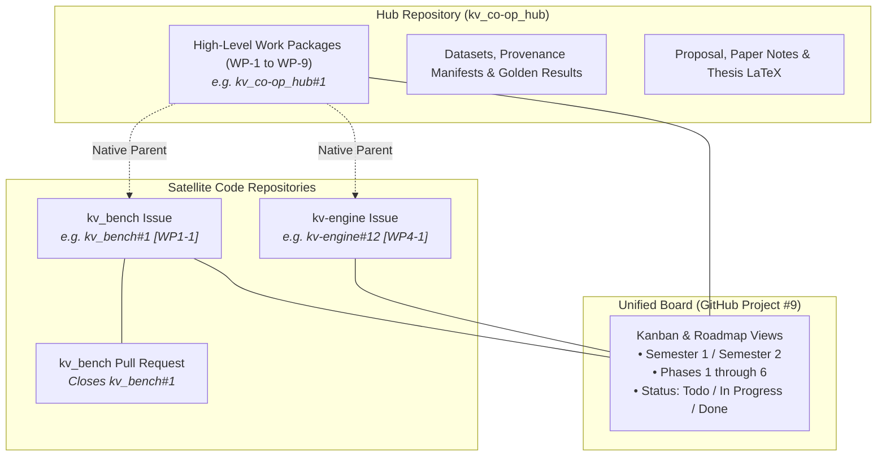

# Multi-Repository Engineering Workflow Specification

> **Project**: Co-optimization of KV-Cache Management for LLM Inference on Consumer GPUs  
> **Master Project Board**: [GitHub Project #9: KV-Cache Co-Optimization](https://github.com/users/khemingkapat/projects/9)  
> **Primary Tracking Hub**: [khemingkapat/kv_co-op_hub](https://github.com/khemingkapat/kv_co-op_hub)

---

## 1. Overview & Core Philosophy

This project spans a full academic year across multiple codebases (benchmarking harness, policy runtime, kernel modules) and research artifacts (proposals, baseline results, thesis drafts). 

To prevent documentation drift, fragmented experiment logs, and code clutter, we follow a **Two-Tier Architecture**:
1. **Purpose / Coordination Plane (`kv_co-op_hub`)**: Holds the scientific foundations, high-level Work Packages (`WP-1` to `WP-9`), standardized datasets, golden evaluation results, and academic deliverables.
2. **Execution Plane (`kv_bench`, future `kv-engine`)**: Specialized code repositories for benchmark execution, runtime integration, and CUDA/C++ kernels.
3. **Single Tracking Plane (GitHub Project #9)**: A unified GitHub Projects v2 board that tracks both high-level roadmap epics and day-to-day code tasks across all repositories.



---

## 2. Issue Hierarchy & Cross-Repository Linking

### 2.1 Two Levels of Issues

| Level | Where it lives | Purpose | Example Title |
|---|---|---|---|
| **Parent (Epic)** | `kv_co-op_hub` | Broad research milestone or phase deliverable | `[WP-1] Testbed Setup & Baseline Reproduction` |
| **Child (Sub-Issue)** | Satellite code repo (`kv_bench`, etc.) | Concrete, actionable engineering task | `[WP1-1] Setup vLLM versioning and baseline environment` |

### 2.2 Native Cross-Repository Sub-Issues

GitHub natively supports parent-child issue relationships across different repositories. 

* **On the parent issue (`kv_co-op_hub`)**: GitHub displays a **Sub-issues** section with a progress bar (`X of Y completed`) and direct chips to the satellite issues.
* **On the child issue (`kv_bench`)**: GitHub renders a breadcrumb header linking directly back to the parent epic: `khemingkapat/kv_co-op_hub#1 > [WP1-1] ...`.

---

## 3. Step-by-Step Task Execution Workflow

When starting work on any feature or experiment, follow these 4 steps:

### Step 1: Create the Sub-Issue in the Code Repo

Always associate code tasks with the relevant parent Work Package in `kv_co-op_hub`.

#### Option A: Using the GitHub CLI (`gh`)
Run directly from the code repository directory (e.g. `kv_bench`):
```bash
gh issue create \
  --parent "https://github.com/khemingkapat/kv_co-op_hub/issues/<PARENT_WP_NUMBER>" \
  --title "[WPX-Y] Task title" \
  --body "Description of the task and acceptance criteria." \
  --project "KV-Cache Co-Optimization"
```

#### Option B: Using the GitHub Web UI
1. Go to the parent issue in [`kv_co-op_hub`](https://github.com/khemingkapat/kv_co-op_hub/issues).
2. In the right-hand sidebar under **Sub-issues**, click **Add sub-issue**.
3. Choose **Create new issue**, select the target repository (e.g. `kv_bench`), and enter the title.

---

### Step 2: Work on a Feature Branch

In the code repository, create a branch following the naming convention:
```bash
git checkout -b feat/wp<X>-<Y>-<short-description>
# Example:
git checkout -b feat/wp1-2-flexgen-baseline
```

Make your code changes, write tests, and commit with meaningful messages:
```bash
git commit -m "feat(flexgen): add uniform offload wrapper and sweep config"
```

---

### Step 3: Open a Pull Request & Link the Issue

When opening a Pull Request in the code repository (`kv_bench`):

1. **Title**: `[WPX-Y] Short PR description`
2. **Body**: Include the closing keyword pointing to the local sub-issue, plus a reference to the parent hub issue:
   ```markdown
   ## Summary
   Implemented the FlexGen offload wrapper and verified 4-bit weight + KV offload on consumer GPU.

   ## Related Issues
   - Closes #<LOCAL_SUB_ISSUE_NUMBER>
   - Part of khemingkapat/kv_co-op_hub#<PARENT_WP_NUMBER>
   ```

3. **Project Board**: Add the PR to the **KV-Cache Co-Optimization** project board.

---

### Step 4: Review, Merge & Automatic Rollup

When the Pull Request is merged:
1. The local sub-issue in `kv_bench` is **automatically closed**.
2. The progress bar in the parent Work Package on `kv_co-op_hub` **automatically increments**.
3. The Project #9 board moves the sub-issue card to `Done`.

---

## 4. Experiment Results & Provenance Workflow

Because experiments will run on different machines (local RTX 4060 vs. CPE Slurm cluster RTX 4090 capped at 16GB), **results must never be left uncommitted on temporary scratch drives**.

### 4.1 Provenance Manifest Structure
Every benchmark sweep output saved to `kv_co-op_hub/results/` must record its exact provenance:
```json
{
  "run_id": "20261015_rtx4060_baseline_vllm",
  "timestamp": "2026-10-15T10:30:00Z",
  "hardware": {
    "gpu": "NVIDIA GeForce RTX 4060 8GB",
    "host_ram_gb": 16,
    "pcie": "PCIe 4.0 x8",
    "driver_version": "535.183.01",
    "cuda_version": "12.2"
  },
  "repositories": {
    "kv_bench_commit": "a1b2c3d...",
    "engine_commit": "e4f5g6h..."
  },
  "command": "uv run main.py --technique baseline --contexts 512 1024 2048 4096 --max-vram-gb 8.0",
  "metrics_summary": {
    "peak_vram_mb": 7650,
    "oom_threshold_ctx": 4096,
    "ttft_p95_sec": 1.42,
    "tpot_mean_ms": 19.8
  }
}
```

### 4.2 Storage Locations in `kv_co-op_hub`
* `results/baselines/`: Golden reference numbers for standard vLLM, FlexGen, StreamingLLM.
* `results/runs/<milestone>/`: Batch experiment outputs from sweeps.
* `analysis/figures/`: Publication-ready SVG/PDF charts produced by Jupyter notebooks in `analysis/notebooks/`.

---

## 5. Quick Command Cheatsheet

| Task | Command |
|---|---|
| View project items | `gh project item-list 9 --owner khemingkapat` |
| View parent issue status | `gh issue view 1 -R khemingkapat/kv_co-op_hub --json subIssues,subIssuesSummary` |
| Create sub-issue from terminal | `gh issue create --parent "https://github.com/khemingkapat/kv_co-op_hub/issues/1" --title "[WP1-2] ..." --project "KV-Cache Co-Optimization"` |
| Link PR to sub-issue | Put `Closes #<sub_issue_id>` in the PR description |
| Link PR across repos to epic | Put `Part of khemingkapat/kv_co-op_hub#<parent_wp_id>` in the PR description |
